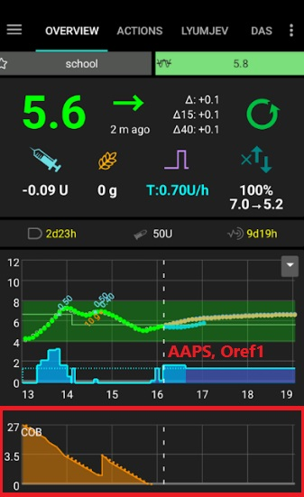

# COB-beregning

## Hvordan beregner AAPS COB-værdien?

Når brugeren indtaster kulhydrater som en del af et måltid eller en kulhydratkorrektion, lægger **AAPS** dem til de aktuelle kulhydrater om bord (**COB**). **AAPS** beregner derefter, hvordan brugerens kulhydrater bliver absorberet, ud fra de afvigelser, der ses i brugerens **BS**-værdier. Absorptionshastigheden afhænger af kulhydratfølsomhedsfaktoren (**CSF**). Dette er ikke en indstilling i brugerens **profil**. **AAPS** beregner den ud fra opsætningen af **ISF/I:C**, og den bestemmes af, hvor mange mg/dl 1 g kulhydrat hæver brugerens **BS**.

## Kulhydratfølsomhedsfaktor

Den formel, som **AAPS** bruger, er:

- absorbed_carbs = deviation * ic / isf.

Virkningen på brugerens **profil** er:

- _øg_ **IC** – flere kulhydrater bliver absorberet hvert 5. minut, så den samlede absorptionstid bliver kortere;

- _øg_ **ISF** – færre kulhydrater bliver absorberet hvert 5. minut, så den samlede absorptionstid bliver længere; og

- _ændr_ **Profilprocent** – begge værdier øges/mindskes, så det har ingen virkning på kulhydraternes absorptionstid.

Hvis brugerens **profil**-**ISF** f.eks. er 100 og **I:C** er 5, vil brugerens kulhydratfølsomhedsfaktor være 20. For hver 20 mg/dl brugerens **BS** stiger, beregner **AAPS**, at 1 g kulhydrat er absorberet. Positiv **IOB** påvirker også beregningen af **COB**. Så hvis **AAPS** forudsiger, at brugerens **BS** vil falde 20 mg/dl på grund af **IOB**, men BS i stedet bliver liggende, vil **AAPS** også beregne, at 1 g kulhydrat er absorberet.

Kulhydrater bliver også absorberet efter de metoder, der er beskrevet nedenfor. Det afhænger af, hvilken følsomhedsalgoritme brugeren har valgt i **AAPS**.

## Kulhydratfølsomhed – Oref1

Kulhydrater, der ikke er absorberet, bliver skåret af efter en bestemt tid:




```{admonition} Older screenshot
:class: note
Skærmbilledet ovenfor er fra en tidligere version af **AAPS** – i **AAPS** 4 ser graferne lidt anderledes ud, men **COB**-grafen viser de samme oplysninger.
```


## Kulhydratfølsomhed – WeightedAverage

Absorptionen bliver beregnet, så COB = 0 efter en bestemt tid:


Hvis den minimale kulhydratabsorption (min_5m_carbimpact) bliver brugt i stedet for en værdi, der er beregnet ud fra **BS**-afvigelser, vises en orange prik på **COB**-grafen.

(CobCalculation-detection-of-wrong-cob-values)=
## Registrering af forkerte COB-værdier

**AAPS** advarer brugeren, hvis brugeren er ved at give bolus med **COB** fra et tidligere måltid, og algoritmen vurderer, at den aktuelle **COB**-beregning er forkert. I dette tilfælde giver AAPS brugeren et ekstra tip på bekræftelsesskærmen, efter at bolusberegneren er brugt.

### Hvordan registrerer AAPS forkerte COB-værdier?

Normalt registrerer __AAPS__ kulhydratabsorption ud fra **BS**-afvigelser. Hvis brugeren har indtastet kulhydrater, men **AAPS** ikke kan registrere den forventede absorption ud fra **BS**-afvigelser, bruger AAPS i stedet metoden [min_5m_carbimpact](#Preferences-min_5m_carbimpact) til at beregne absorptionen (såkaldt »fallback«). Da denne metode kun beregner den minimale kulhydratabsorption uden at tage hensyn til **BS**-afvigelser, kan den give forkerte COB-værdier.


På skærmbilledet ovenfor blev kulhydratabsorptionen 66% af tiden beregnet med min_5m_carbimpact i stedet for den værdi, der blev registreret ud fra afvigelser. Det betyder, at brugeren måske har haft mindre **COB** end beregnet af algoritmen.

### Hvad gør du ved denne advarsel?

- Overvej at annullere behandlingen – tryk på »Annuller« i stedet for OK.
- Beregn dit næste måltid igen med bolusberegneren, og lad **COB** være uden flueben.
- Hvis du har brug for en korrektionsbolus, så indtast den manuelt.
- Pas på, at du ikke overdoserer eller stabler insulin!


### Hvorfor registrerer algoritmen ikke COB korrekt?

Det kan skyldes:
- Måske har brugeren overvurderet kulhydraterne, da de blev indtastet.
- Aktivitet / motion efter dit forrige måltid.
- I:C skal justeres.
- Værdien for min_5m_carbimpact er forkert (anbefalet er 8 med SMB, 3 med AMA).


## Manuel rettelse af indtastede kulhydrater

Hvis kulhydrater er over- eller undervurderet, kan det rettes på skærmen **Behandlingshistorik** som beskrevet [her](#screens-bolus-carbs).


## Kulhydratkorrektion – sådan sletter du en kulhydratindtastning i Behandlinger


Skærmen **Behandlingshistorik** kan bruges til at rette en forkert kulhydratindtastning ved at slette den. Det kan skyldes, at brugeren har over- eller undervurderet kulhydratindtastningen:


1. Se efter, og husk de aktuelle værdier for **COB** og **IOB** på hovedskærmen i **AAPS**.
2. Åbn **Behandlingshistorik** (sidemenuen → *Behandlingshistorik*), fanen **Kulhydrater og bolus**. Afhængigt af pumpen kan kulhydraterne vises sammen med insulin på én linje eller som en separat indtastning (f.eks. med Dana RS).
3. **Tryk længe** på den forkerte kulhydratindtastning – listen skifter til **valgtilstand** med et afkrydsningsfelt på hver linje, og indtastningen er markeret (mærket **1** ovenfor). Sæt flueben ved andre indtastninger, som du også vil fjerne.
4. Tryk på ikonet **🗑 Slet** i den øverste bjælke (mærket **2**), og bekræft – bekræftelsesdialogen viser præcis, hvad der bliver fjernet.
5. Kontroller, at kulhydraterne er fjernet, ved at se på **COB** på hovedskærmen i **AAPS** igen.
6. Gør det samme for **IOB**, hvis der kun er én linje med både kulhydrater og insulin.
7. Hvis kulhydrater ikke bliver fjernet som tænkt, og der bliver tilføjet ekstra kulhydrater som forklaret i dette afsnit, bliver **COB** for høj. Det kan føre til, at **AAPS** giver for meget insulin.
8. Indtast den rigtige mængde kulhydrater i dialogen **Kulhydrater** (**Behandlinger** → **Kulhydrater**), og indstil det rigtige tidspunkt for hændelsen.
9. Hvis der kun var én linje med både kulhydrater og insulin, skal brugeren også tilføje insulinmængden igen. Sørg for at indstille det rigtige tidspunkt for hændelsen, og kontroller **IOB** på hovedskærmen, når du har bekræftet den nye indtastning.

