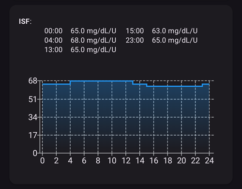
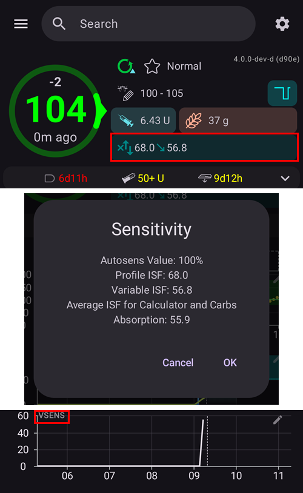
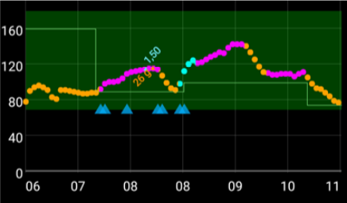
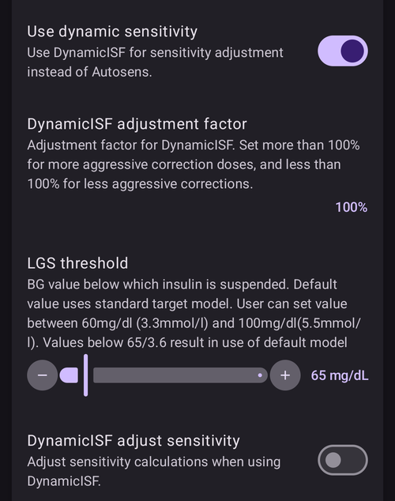

(Open-APS-features-DynamicISF)=
# Dynamisk ISF (DynISF)

Indtil nu, med **AMA** og **SMB**, blev **ISF** angivet i **profilen** og var fast for hver periode, der var angivet i løbet af dagen. Men i virkeligheden er en persons **ISF** ikke så fast. Den skifter med **BS**-niveauet: ved et højt BS skal brugeren have mere insulin for at sænke sit **BS** 50 mg/dl / 3 mmol/l, end ved et lavere **BS**. [Autosens](#Open-APS-features-autosens) var den første algoritme, der forsøgte at løse dette problem ved at justere **ISF** uden for måltiderne.

**Dynamisk ISF** (også kaldet **DynISF**) har samme formål, men er mere avanceret, fordi den kan bruges hele tiden. Den anbefales kun til erfarne brugere, der har godt styr på betjening og overvågning af **AAPS**. Læs [Det skal du overveje, før du aktiverer dynamisk ISF](#dyn-isf-things-to-consider-when-activating-dynamicisf) nedenfor, før du prøver den.

```{admonition} CAUTION - Automations or Profile Percentage change
:class: warning

**Automatiseringer** skal altid bruges med forsigtighed. Det gælder især med **dynamisk ISF**.

Når du bruger **dynamisk ISF**, skal du slå alle midlertidige **profil**-ændringer i **automatiseringsregler** fra, fordi de ville gøre **dynamisk ISF** alt for aggressiv med korrektionsboluser, og det ville give hypoglykæmi. Det er netop formålet med **dynamisk ISF**, så der er ingen grund til at bede **AAPS** om at give ekstra insulin via automatisering ved høje **BS**-værdier.

```

For at bruge **dynamisk ISF** skal databasen i **AAPS** have data fra mindst 7 dage fra brugerens **AAPS**.

## Hvad gør dynamisk ISF?

**Dynamisk ISF** tilpasser insulinfølsomhedsfaktoren (**ISF**) dynamisk ud fra brugerens:

- samlet daglig dosis insulin (**TDD**); og
- aktuelle og forudsagte blodsukkerværdier.

Når du bruger **dynamisk ISF**, bruges de **ISF**-værdier, der er indtastet i **profilen**, slet ikke længere, undtagen som reserve, hvis der ikke er nok TDD-data i databasen i **AAPS** (*f.eks.* efter en ny geninstallation af appen).

**SMB/AMA** – et eksempel på en brugers **profil** med fast **ISF**, som brugeren har indstillet, og som **SMB** og **AMA** bruger.



**Dynamisk ISF** – et eksempel på en brugers **ISF**, der ændrer sig, som **dynamisk ISF** bestemmer.



Afsnittet med den røde cirkel viser: `profile ISF` -> `ISF as calculated by DynISF`. <br/> Hvis du trykker på dette afsnit, vises en dialog med flere oplysninger, f.eks. den **ISF**, der bruges til beregneren og til optagelse af kulhydrater (se [Anden brug af ISF](#dynisf-other-usages-of-isf) nedenfor).

**DynISF**-værdien kan også vises i en graf: tryk på **Tilføj graf** under graferne på hovedskærmen, og vælg **VSENS** (variabel følsomhed). Den vises som en hvid linje (nederst på billedet ovenfor).

## Hvordan beregnes dynamisk ISF?

**Dynamisk ISF** bruger Chris Wilsons model til at bestemme **ISF** i stedet for brugerens faste **ISF**-værdi, som er indstillet i **profilen**. En detaljeret forklaring findes her: [Chris Wilson on Insulin Sensitivity (Correction Factor) with Loop and Learn, 2/6/2022](https://www.youtube.com/watch?v=oL49FhOts3c).

Den ligning, der bruges til **dynamisk ISF**, er: `ISF = 1800 / ((TDD * DynISF Adjust Factor) * Ln (( current BG / insulin divisor) + 1 ))`

Variablerne i ligningen er forklaret nedenfor.<br/> Bemærk: `Ln` står for den naturlige logaritme, en matematisk funktion.

Ligningen ovenfor bruges til at beregne den aktuelle **ISF** og i oref1-[forudsigelserne for **IOB**, **ZT** (nul-basal) og **UAM**](#aaps-screens-prediction-lines). Den bruges også til **COB** og i bolusberegneren (se [Anden brug af ISF](#dynisf-other-usages-of-isf) nedenfor).

### TDD (samlet daglig dosis)
TDD bruger en kombination af følgende værdier:
1.  gennemsnitlig **TDD** for 7 dage;
2.  **TDD** fra dagen før; og
3.  et vægtet gennemsnit af insulinforbruget i de sidste otte (8) timer, omregnet til 24 timer.

Den **TDD**, der bruges i ligningen ovenfor, vægtes med en tredjedel af hver af værdierne ovenfor.

### Justeringsfaktor for dynamisk ISF

Den indstilles i brugerens **Indstillinger** og bruges til at gøre **dynamisk ISF** mere eller mindre aggressiv. Se afsnittet [Indstillinger](#dyn-isf-preferences) nedenfor.

### Insulindivisor
Insulindivisoren afhænger af spidsen for den insulin, du bruger, og er omvendt proportional med spidstidspunktet. For Lyumjev er værdien 75, for Fiasp 65 og for almindelig hurtigvirkende insulin 55.

### ISF ud fra forudsagt BS til dosisbeslutninger

Den dynamiske følsomhed beregnes ud fra den **aktuelle BS**-værdi og vises som din aktuelle ISF i **AAPS**. Men når der beregnes doser, beregner og bruger oref1-algoritmen i stedet en **fremtidig ISF**.

Det sker for at undgå at give for meget insulin, når **BS** er lavt eller forventes at blive lavt.

**Fremtidig ISF** bruger samme formel som beskrevet ovenfor, men kan bruge **mindste forudsagte BS** i stedet for **aktuelt BS**. **Mindste forudsagte BS**, [som beregnet i oref1](#aaps-screens-how-predictions-become-a-dosing-decision), er den laveste værdi, dit BS forventes at nå i hele forudsigelsens forløb.

* Hvis det aktuelle **BS** er over målværdien<br/> **og** **BS** er fladt, inden for +/- 3 mg/dl:<br/>BS bruges sådan i formlen: `average(minimum predicted BG, current BG)`.
* Hvis det endelige **BS** er over målværdien, og glukosen stiger,<br/> **eller** det endelige **BS** er over det aktuelle **BS**:<br/>BS bruges sådan i formlen: `current BG`.
* Ellers:<br/>BS bruges sådan i formlen: `minimum predicted BG`.

Se skærmbilledet nedenfor for en forenklet forklaring. Det viser situationen ovenfor. Orange prikker bruger **forudsagt BS**, lilla prikker bruger **gennemsnit(forudsagt BS, aktuelt BS)**, og blå prikker bruger **aktuelt BS**.



(dynisf-other-usages-of-isf)=
## Anden brug af ISF

### ISF og optagelse af COB

Som beskrevet på siden [COB-beregning](../DailyLifeWithAaps/CobCalculation.md) beregnes optagelsen af COB normalt med denne formel:   
`absorbed_carbs = deviation * ic / isf`  
Når du bruger **dynamisk ISF**, er den **ISF**, der bruges her, gennemsnittet af værdierne for dynamisk ISF i de sidste 24 timer.

### ISF i bolusberegneren

Når du bruger [bolusberegneren](#aaps-screens-bolus-wizard), bruges **ISF** til at lægge en korrektion til, hvis **BS** er over målværdien.

Når du bruger **dynamisk ISF**, er den **ISF**, der bruges her, gennemsnittet af værdierne for dynamisk ISF i de sidste 24 timer.

(dyn-isf-preferences)=
## Indstillinger

Sæt flueben i **Brug dynamisk følsomhed** i [Indstillinger > OpenAPS SMB](#Preferences-openaps-smb-settings) for at aktivere den. Nye indstillinger bliver tilgængelige, når den er valgt.



(dyn-isf-adjustment-factor)=
### DynamicISF-justeringsfaktor
**Dynamisk ISF** bygger på én regel, som skal gælde for alle. Det betyder, at personer med samme **TDD** ville have samme følsomhed. Da hver bruger har sin egen følsomhed, kan brugeren med **justeringsfaktoren** angive, om man er mere eller mindre følsom over for insulin end den »almindelige« person.

**Justeringsfaktoren** er en værdi mellem 1% og 300%. Den virker som en multiplikator på **TDD**-værdien.

* Hvis du hæver værdien over 100%, bliver **DynISF** mere aggressiv: **ISF**-værdierne bliver *mindre* (_dvs._ der skal mere insulin til for at sænke **BS** en smule)
* Hvis du sænker værdien under 100%, bliver **DynISF** mindre aggressiv: **ISF**-værdierne bliver større (_dvs._ der skal mindre insulin til for at sænke **BS** en smule).

**Justeringsfaktoren** ændres også, når du aktiverer et [**profilskift** med procent](../DailyLifeWithAaps/ProfileSwitch-ProfilePercentage.md). En lavere **profilprocent** sænker **justeringsfaktoren**, og en højere **profilprocent** hæver den.

Hvis din **justeringsfaktor** f.eks. er 80%, og du laver et **profilskift** til 80%, bliver den resulterende **justeringsfaktor** `0.8*0.8=0.64`.

Det betyder, at når du bruger **DynISF**, kan du bruge **profilprocent** til midlertidigt at finjustere din følsomhed manuelt. Det kan være nyttigt ved fysisk aktivitet (lavere procent), sygdom (højere procent) osv.

### LGS-grænse

**BS**-værdi, under hvilken insulin stoppes (Stop ved lavt BS). Standardværdien bruger den almindelige målmodel. Brugeren kan sætte værdien mellem 60 mg/dl (3,3 mmol/l) og 100 mg/dl (5,5 mmol/l). Værdier under 65/3,6 betyder, at standardmodellen bruges.

### DynamicISF justerer følsomhed

Denne indstilling (*»Juster følsomhedsberegninger, når DynamicISF bruges«*) erstatter Autosens og bruger forholdet mellem **TDD** for de sidste 24 timer og **TDD** for 7 dage som grundlag for at hæve og sænke basalraten, på samme måde som almindelig Autosens gør. Den beregnede værdi bruges også til at justere målværdien, hvis indstillingerne for at justere målværdien efter følsomhed er aktiveret. I modsætning til Autosens justerer denne indstilling ikke **ISF**-værdier.

(dyn-isf-things-to-consider-when-activating-dynamicisf)=
## Det skal du overveje, før du aktiverer dynamisk ISF

* **Dynamisk ISF** anbefales kun til erfarne brugere, der har godt styr på betjening og overvågning af **AAPS**. Brugere bør helst have opnået god kontrol med **SMB**, før de går videre til **dynamisk ISF**.
* Som nævnt ovenfor skal du slå alle [**automatiseringer**](../DailyLifeWithAaps/Automations.md) fra, der aktiverer en **profilprocent** ud fra **BS**, fordi det bliver for aggressivt og kan give for meget insulin! Det er allerede en del af algoritmen for **dynamisk ISF**.
* [Profilprocent](../DailyLifeWithAaps/ProfileSwitch-ProfilePercentage.md) tages med i beregningen af dynamisk ISF (se [Justeringsfaktor for dynamisk ISF](#dyn-isf-adjustment-factor) ovenfor). Det er dårlig praksis at bruge en anden **profilprocent** end 100% i lang tid. Hvis du finder ud af, at din **profil** har ændret sig, så opret en ny **profil** med dine nye værdier i stedet for at bruge **profilen** med en bestemt procent.
* **Dynamisk ISF** virker måske ikke for alle. Du kan især få uventede resultater, hvis en af disse situationer gælder for dig:
  * Skiftende livsstil (uregelmæssige mønstre for måltider eller fysisk aktivitet)
  * TDD eller følsomhed, der skifter fra dag til dag.
* Der findes ingen præcis vejledning til at sætte startværdien for **justeringsfaktoren**. Men som udgangspunkt: hvis værdierne i din **profil** er korrekte, og du er i målområdet med et fladt **BS**, bør **DynISF**-værdien være omtrent den samme som den, du før havde i din **profil**.<br/>Hvis du ser, at **dynamisk ISF** er for aggressiv, så sænk **justeringsfaktoren**, og omvendt.
* Selvom **DynISF** slet ikke bruger **profil-ISF**, bør du overveje at holde den opdateret, hvis du ser, at din følsomhed er meget anderledes end det, der før var gemt i din **profil**. Det kan være nyttigt, hvis du mister dine data i **AAPS** (_f.eks._ ny telefon, ny version af **AAPS** …), fordi din **profil-ISF** så bruges som reserve de næste 7 dage.