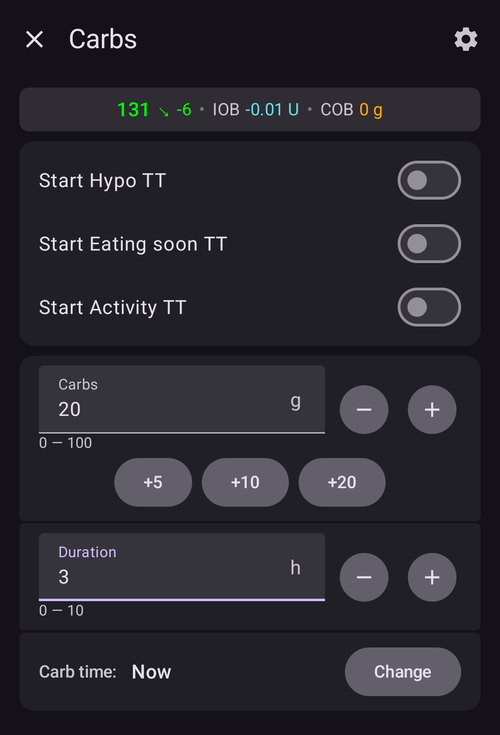
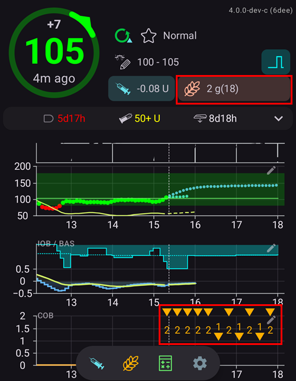
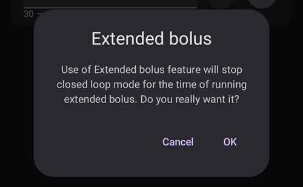
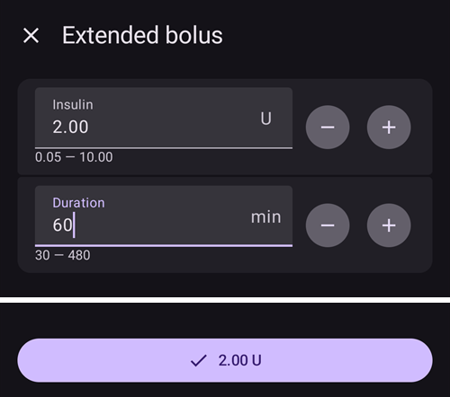
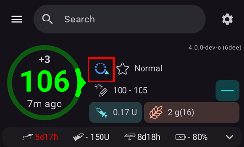
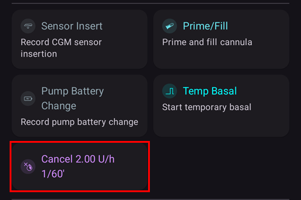

(Extended-Carbs-extended-carbs-ecarbs)=
# Forlængede kulhydrater / »e-kulhydrater«

## Hvad er e-kulhydrater, og hvornår er de nyttige?

Ved almindelig pumpebehandling er forlængede boluser en god måde at håndtere fede måltider eller andre måltider, der optages langsomt. Sådanne måltider hæver blodsukkeret i længere tid, end insulinen virker. I et loop giver forlængede boluser dog ikke så meget mening (og de giver tekniske problemer). De er nemlig i bund og grund en fast, høj midlertidig basalrate, og det går imod den måde, loopet virker på: loopet justerer basalraten dynamisk. Se flere detaljer under [forlænget bolus](#extended-bolus-and-why-they-wont-work-in-closed-loop-environment) nedenfor.

Men behovet for at håndtere sådanne måltider findes stadig. Derfor understøtter AAPS såkaldte forlængede kulhydrater eller e-kulhydrater.

E-kulhydrater er kulhydrater, der er fordelt over flere timer. Ved almindelige måltider med flere kulhydrater end fedt/protein er det som regel nok at indtaste kulhydraterne fra starten (og om nødvendigt gøre den første bolus mindre). Så undgår du, at insulinen bliver givet for tidligt.  Men ved måltider, der optages langsommere, kan fuld indtastning af kulhydraterne fra starten give for meget IOB fra SMB. Her kan e-kulhydrater bruges til mere præcist at efterligne, hvordan kulhydraterne (og eventuelle kulhydratækvivalenter, som du indtaster for andre makronæringsstoffer) bliver optaget og påvirker blodsukkeret. Med denne information kan loopet give SMB'er mere gradvist for at håndtere disse kulhydrater. Det kan ses som en dynamisk forlænget bolus (det burde også virke uden SMB'er, men er sandsynligvis mindre effektivt).

**Bemærk:** E-kulhydrater er ikke kun til måltider med meget fedt / protein: de kan også hjælpe i alle situationer, hvor noget hæver blodsukkeret, f.eks. anden medicin som kortikosteroider.

## Sådan bruger du e-kulhydrater

For at indtaste e-kulhydrater skal du åbne dialogen **Kulhydrater** (**Behandlinger** → **Kulhydrater**), indtaste de samlede kulhydrater, angive en **Varighed** og eventuelt flytte starten med **Kulhydrattid** (*tallene nedenfor er kun eksempler. Du skal prøve dine egne værdier for at få en god glukoserespons i dine situationer*):

E-kulhydrater på hovedskærmen: tallet i parentes i feltet **COB** viser de kulhydrater, der stadig kommer, og grafen **COB** viser hver fremtidig e-kulhydrat-indtastning som en orange markør. Hvis du ikke kan se en **COB**-graf, så tilføj en med **Tilføj graf** under graferne (se [AAPS-skærme](../DailyLifeWithAaps/AapsScreens.md)).

(AapsScreens-carbs-type)=
## Kulhydrattype i bolusberegneren: brød, kage eller pizza

I [bolusberegneren](#aaps-screens-bolus-wizard) kan du med tre knapper under feltet **Kulhydrater** vælge, hvor hurtigt dit måltid bliver optaget. Vælg en, før du bekræfter. Afhængigt af typen tager **AAPS** en del af de kulhydrater, du har indtastet, som normale kulhydrater, og tilføjer senere [forlængede kulhydrater (»e-kulhydrater«)](#Extended-Carbs-extended-carbs-ecarbs) til langsomme, fede måltider. Tryk på ikonet **(i)** ved siden af knapperne for at se typiske madvarer for den valgte type, og hvad den gør med dine kulhydrater.

| Type                | Typiske madvarer (eksempler fra appen)                                                                                                     | Kulhydrater nu, bruges til bolussen | Tilføjede e-kulhydrater                               |
| ------------------- | ------------------------------------------------------------------------------------------------------------------------------------------ | ----------------------------------- | ----------------------------------------------------- |
| **Brød** (standard) | Brød, salt bagværk, yoghurt, frugt, kartofler, ris, havregryn, grøntsager                                                                  | 100%                                | Ingen                                                 |
| **Kage**            | Dumplings, pasta, asiatiske retter med mange kulhydrater og meget fedt, sødt bagværk og gærbagværk, morgenmadsprodukter, honning, syltetøj | 90%                                 | 20%, starter 60 minutter senere, fordelt over 2 timer |
| **Pizza**           | Lasagne, pizza, hamburgere, pommes frites, bagte kartofler, chips                                                                          | 80%                                 | 35%, starter 60 minutter senere, fordelt over 3 timer |

**Eksempel**: du indtaster 100 g og vælger **Pizza**. Bolussen beregnes for 80 g, som registreres nu. 35 g e-kulhydrater starter 1 time senere og fordeles over 3 timer.

Godt at vide:
* Det er ikke en simpel opdeling: med **Kage** og **Pizza** bliver de registrerede kulhydrater til sammen **mere, end du indtastede** (110% og 115%). Det ekstra findes kun i e-kulhydraterne.
* Bolussen dækker kun de kulhydrater, der registreres nu. **AAPS** giver ikke bolus på forhånd for e-kulhydraterne: loopet tager dem med i beregningen, når de starter, ligesom alle andre [e-kulhydrater](#Extended-Carbs-extended-carbs-ecarbs).
* Hvis du angiver en **Kulhydrattid**, starter e-kulhydraterne 60 minutter efter dette tidspunkt.
* Bekræftelsesdialogen viser e-kulhydraterne på deres egen linje, _f.eks._ »e-kulhydrater 35 g / 3 t (+60 min)«.
* Gram rundes ned til hele tal.
* Procenterne, forsinkelserne og varighederne er faste; de kan ikke ændres i indstillingerne.
* Valget bliver ikke husket: beregneren åbner med **Brød** hver gang.

______________________________________________________________________

En måde at håndtere fedt og protein med denne funktion er beskrevet her: [https://adriansloop.blogspot.com/2018/04/page-margin-0.html](https://adriansloop.blogspot.com/2018/04/page-margin-0.html)

______________________________________________________________________

## Anbefalet opsætning, eksempel og vigtige bemærkninger

Den anbefalede opsætning er at bruge APS-pluginet OpenAPS SMB med SMB'er aktiveret og med indstillingen *Aktiver SMB med COB* aktiveret.

Et eksempel for f.eks. en pizza kan være at give en (delvis) bolus fra starten via *bolusberegneren* og derefter bruge dialogen *Kulhydrater* til at indtaste resten af kulhydraterne med en varighed på 4-6 timer, som starter efter 1 eller 2 timer.

For en hurtigere start kan *bolusberegneren* tilføje e-kulhydrater for dig: vælg [kulhydrattypen](#AapsScreens-carbs-type) **Kage** eller **Pizza** under feltet **Kulhydrater** (se ovenfor). Mængderne og tidspunkterne er faste. Brug derfor dialogen *Kulhydrater* i stedet, hvis du vil have andre værdier.

**Vigtige bemærkninger:** Du skal selvfølgelig prøve dig frem og se, hvilke konkrete værdier der virker for dig. Du kan også forsigtigt justere indstillingen *Maks. minutter basal til begrænsning af SMB* for at gøre algoritmen mere eller mindre aggressiv. Ved måltider med få kulhydrater og meget fedt/protein kan det være nok kun at bruge e-kulhydrater uden manuelle boluser (se blogindlægget ovenfor). Når der oprettes e-kulhydrater, bliver der også oprettet et Careportal-notat, som dokumenterer alle indtastninger. Det gør det lettere at prøve igen og forbedre indtastningerne.

(extended-bolus-and-why-they-wont-work-in-closed-loop-environment)=
## Forlængede boluser, og hvorfor de ikke virker i et lukket loop

Som nævnt ovenfor virker forlængede boluser eller multiwave-boluser ikke rigtigt i et lukket loop. [Se nedenfor](#why-extended-boluses-won-t-work-in-a-closed-loop-environment) for detaljer

(Extended-Carbs-extended-bolus-and-switch-to-open-loop-dana-and-insight-pump-only)=
### Forlænget bolus og skift til åbent loop - kun Dana- og Insight-pumper

Nogle personer spurgte alligevel efter en mulighed for at bruge forlænget bolus i AAPS, fordi de ville behandle særlige madvarer, som de er vant til.

Derfor tilbyder **AAPS** en forlænget bolus til brugere af Dana- og Insight-pumper: åbn **Administrer**, og vælg **Forlænget bolus**.

**AAPS** advarer dig først om, at det lukkede loop bliver stoppet, mens den forlængede bolus kører. Tryk på **OK** for at fortsætte:

Indtast mængden af **Insulin** og **Varighed**, tryk derefter på knappen til bekræftelse nederst og på **OK**:

På Insight-pumpen er forlænget bolus *ikke tilgængelig*, hvis [TBR-emulering](#Accu-Chek-Insight-Pump-settings-in-aaps) bruges.

Mens den forlængede bolus kører, kører loopet i tilstanden **Åbent loop** (loop-ikonet på hovedskærmen ændrer sig), og lukket loop bliver automatisk slået til igen, når den forlængede bolus slutter:

Menuen **Administrer** viser en knap **Annuller** med raten og den forløbne / samlede tid (for eksempel **Annuller 2,00 E/t 1/60'**). Tryk på den for at stoppe den forlængede bolus før tid:

(why-extended-boluses-won-t-work-in-a-closed-loop-environment)=
### Hvorfor forlængede boluser ikke virker i et lukket loop

1. Loopet beslutter, at der nu skal leveres 1,55 E/t. For algoritmen er det ligegyldigt, om dette leveres som en forlænget bolus eller som TBR. Faktisk bruger nogle af pumperne den forlængede bolus. Hvad skal der så ske? De fleste pumpedrivere stopper så den forlængede bolus -> Du behøvede slet ikke at starte den.

2. Hvis du havde den forlængede bolus som input, hvad skulle der så ske i modellen?

   1. Skulle den ses som neutral sammen med basalraten, og skulle loopet arbejde ud fra den? Så skulle loopet også kunne gøre bolussen mindre, hvis du f.eks. bliver for lav, og al den »neutrale« insulin bliver taget væk?
   2. Skulle den forlængede bolus bare lægges til? Skulle loopet så bare have lov til at fortsætte? Selv ved den værste hypo? Det synes jeg ikke er så godt: En hypo er forudset, men den må ikke forhindres?

3. Den IOB, som den forlængede bolus opbygger, viser sig efter 5 minutter ved næste kørsel. Derfor ville loopet give mindre basal. Så der ændrer sig ikke meget... bortset fra at muligheden for at undgå hypo bliver taget væk.
