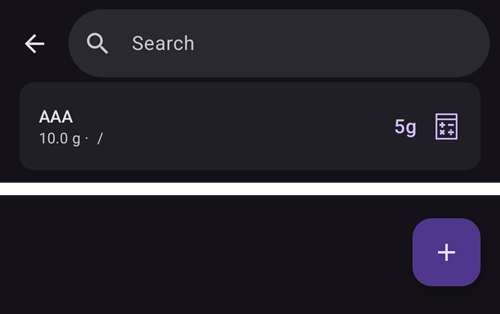
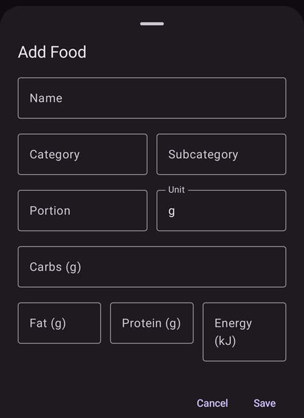

(food)=
# Mad (din maddatabase)

Databasen **Mad** er din personlige liste over gemte madvarer. Hver post gemmer en madvares **kulhydrater** (og, hvis du vil, dens fedt, protein, energi og en kategori). Så kan du have det, du ofte spiser, samlet ét sted og starte en bolus fra en gemt madvare, hvor kulhydraterne allerede er udfyldt.

```{contents} Table of contents
:depth: 2
:local: true
```

---

## Åbn maddatabasen

Åbn skærmen **Administrer** (navigationen nederst), og vælg **Mad** (*»Administrer poster i maddatabasen«*). I **AAPS** v4 er Mad **ikke længere et plugin** — der er intet at aktivere; det er en selvstændig skærm, som du åbner fra [arket Administrer](#v4changes-manage).

---

## Madlisten

Dine madvarer vises som en liste, du kan rulle i. Hver række viser madvarens **navn**, dens **portion / enhed / kategori** og dens **kulhydrater**:



- **🔍 Søg** (øverst) — filtrer listen efter **navn** (store og små bogstaver er lige meget).
- **Kategorifilter** — med chips kan du begrænse listen til en **kategori**; når en kategori er valgt, vises chips for dens **underkategorier**. (Tryk på en valgt chip igen for at fjerne den.)
- **➕** (nederst til højre) — tilføj en ny madvare (se nedenfor).
- Tryk på en række for at **redigere** den madvare.

Hvis listen (eller det aktuelle filter) ikke har nogen poster, viser skærmen **Ingen data**.

---

## Tilføj og rediger en madvare

Tryk på **➕** for at tilføje, eller tryk på en eksisterende række for at redigere. En editor åbner som et ark nederst (**Tilføj mad** / **Rediger mad**):



Felterne er:

- **Navn** — skal udfyldes (du kan ikke gemme uden).
- **Kategori** og **Underkategori** — valgfrie, bruges til at gruppere/filtrere madvarer.
- **Portion** og **Enhed** — den normale portionsstørrelse; **Enhed** er som standard **g**.
- **Kulhydrater (g)** — mængden af kulhydrater i madvaren.
- **Fedt (g)**, **Protein (g)**, **Energi (kJ)** — valgfrie næringsværdier.

Tryk på **Gem** for at gemme, eller på **Annuller** for at kassere. Når du redigerer en eksisterende madvare, har editoren også en knap **Slet**.

```{admonition} Deleting is undoable
:class: note
Når du sletter en madvare, vises beskeden **»Mad slettet«** med handlingen **Fortryd**, så det er nemt at fortryde en sletning ved en fejl.
```

---

## Brug en madvare til en bolus

Hver række i madlisten har en knap til **beregneren**. Et tryk på den åbner **bolusberegneren** med madvarens **kulhydrater** allerede udfyldt og madvarens **navn** tilføjet som notat til behandlingen — så du bare bekræfter og giver bolus uden at skrive kulhydraterne igen.

```{admonition} The carbs value is used as-is
:class: note
Madvarens gemte tal for **kulhydrater** sendes direkte til beregneren — **AAPS** ganger det ikke med portionen eller med, hvor meget du spiste. Hvis du har en anden mængde, så juster kulhydraterne i beregneren, før du bekræfter. (Der er ingen madvælger *inde i* bolusberegneren eller dialogen for kulhydrater; du starter fra madvarens række her.)
```

---

## Hvor madvarerne kommer fra (synkronisering med Nightscout)

Maddatabasen deles via **Nightscout**, men **kun i én retning**:

- **Download:** **AAPS** **læser** madvarer fra din Nightscout-sides **maddatabase** og holder den lokale liste synkroniseret med den. Det sker som en del af NSClient-synkroniseringen, så en parret **klient/følger** får også de samme madvarer.
- **Upload:** **AAPS** sender **ikke** madvarer **til** Nightscout — NSClient understøtter ikke upload af madposter. Madvarer, som du opretter eller redigerer **i AAPS**, bliver derfor **på den enhed** og bliver ikke overført til Nightscout eller til dine andre enheder.

```{admonition} Maintain your shared list in Nightscout
:class: important
Fordi mad **kun downloades**, er måden at dele én madliste mellem din telefon, din følger/[klient](../RemoteFeatures/ClientMasterControl.md) og resten af din opsætning at vedligeholde den i **Nightscout** (dens indbyggede madeditor). **AAPS** henter så disse poster ned. En madvare, der kun er tilføjet i **AAPS**, er lokal på den enhed — og bliver der: en download matcher Nightscout-poster efter deres Nightscout-ID, så den tilføjer og opdaterer dem, men overskriver eller fjerner aldrig en madvare, du har oprettet lokalt (en madvare bliver kun fjernet, når dens kopi i Nightscout bliver slettet i Nightscout).

Bemærk, at maddatabasen heller **ikke** er en del af den signerede styringskanal mellem hovedenhed ↔ klient — den sendes kun som Nightscout-data.
```

---

## Ikke på uret

Maddatabasen er en funktion på **telefonen** — der er ingen madbrowser, intet felt og ingen menu på et **Wear OS-ur**.

---


<!-- =====================================================================
     Screenshots captured from a real master device:
       - food_list.png    (Manage → Food: list row, search, add button)
       - food_editor.png  ("Add Food" editor: name/category/subcategory/portion/unit/carbs/fat/protein/energy)
     No food was created or deleted (the editor was cancelled).
     Sync facts code-verified: download via LoadFoodsWorker.getFoods(); upload disabled
     (DataSyncSelectorV3 processChangedFoods() commented out — "NSCv3 doesn't support food update").
     Maintainers: relocate page + images and fix cross-links as needed.
     ===================================================================== -->
