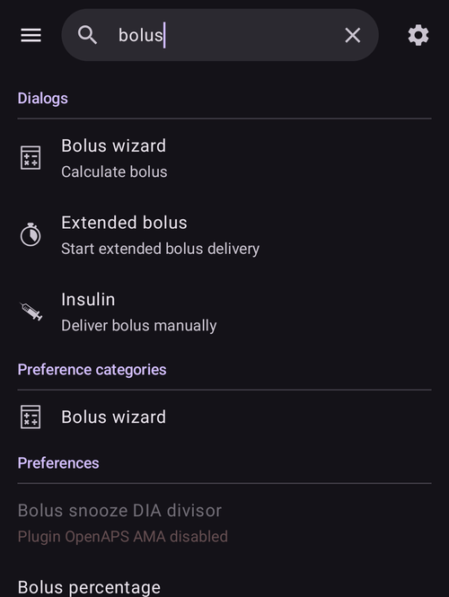
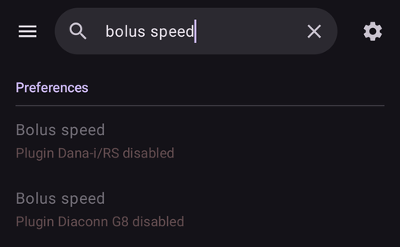
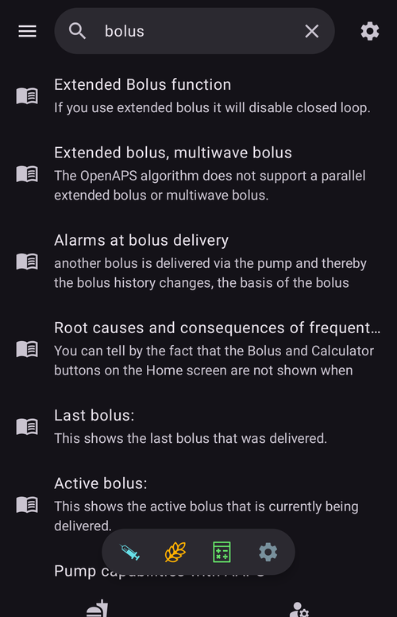

(global-search)=
# Global søgning

**AAPS** v4 har et felt til **global søgning** øverst på hovedskærmen. Skriv et ord, og appen søger i hele appen på én gang – plugins, dialoger, skærme med indstillinger og de enkelte indstillinger – og, hvis du er online, også i **AndroidAPS-dokumentationen**. Det er den hurtigste måde at komme til en indstilling eller en skærm på, uden at du skal huske, hvor den ligger.

```{contents} Table of contents
:depth: 2
:local: true
```

---

## Åbn søgning

Tryk på feltet **🔍 Søg** øverst i **Oversigt** (ved siden af menuen ☰). Begynd at skrive. Resultaterne vises, mens du skriver (efter en kort pause), og de er grupperet efter kategori:



While the box is empty, **AAPS** shows your **Recent searches**, newest first (up to ten). Tap one to run that search again, or tap the **✕** at the end of a row to remove only that search from the list. A search is added to the list when you open one of its results, so half-typed words are not kept. The list is stored on this phone only: it is not included in a settings export and is not sent to **AAPSClient**.

Ryd feltet med **✕**, eller luk søgningen med enhedens knap **Tilbage**.

---

## Søg på engelsk *eller* på dit eget sprog

Det er godt at vide: Søgningen finder match i **både** teksten på dit **valgte sprog** **og** den originale **engelske** tekst.

- Hvis din app f.eks. er på tysk eller tjekkisk, kan du skrive det **oversatte** ord **eller** det **engelske** ord – begge finder indstillingen.
- Et match i den **oversatte** titel kommer øverst, derefter den **engelske** titel og derefter de oversatte og engelske **beskrivelser**.
- Søgningen ser bort fra **accenter og diakritiske tegn** (så *ů* matcher *u*, og *é* matcher *e*), og den skelner **ikke mellem store og små bogstaver**.

Det betyder, at en vejledning eller et forumindlæg på engelsk stadig fører dig til den rigtige indstilling, selv om din telefon viser alt oversat.

---

## Hvad søgningen dækker

Resultaterne er grupperet i disse kategorier:

- **Plugins** – alle plugins, der er synlige i dit build (de samme, som står under [Konfiguration](../SettingUpAaps/ConfigBuilder.md)). Hver plugin-række har sin **kontakt til at aktivere**, så du kan aktivere eller deaktivere et plugin direkte fra resultaterne. Hvis du trykker på rækken for et deaktiveret plugin (som kan slås til), bliver det aktiveret.
- **Dialoger** – skærmene til behandlinger, handlinger og administration (Beregner, Insulin, Forlænget bolus, Kalibrering, Midlertidigt mål, Profil, …). Skærme, der ikke passer til dit build, er udeladt (f.eks. *Par med hovedenhed* på en hovedenhed og *Godkendte klienter* på en klient).
- **Indstillingskategorier** – **skærmene** med indstillinger og deres underskærme, både de indbyggede (Generelt, Udseende, Beskyttelse, Alarmer, Vedligeholdelse, …) og dem fra plugins, plus de små grupper af indstillinger, som du når fra dialoger (Fyld-knapper, trin for Insulin-/Kulhydrat-knapper, grænser for statuslys, indstillinger for beregneren, …).
- **Indstillinger** – hver **enkelt indstilling**, der har en titel. De er filtreret efter dit build og din tilstand, så du kun ser de indstillinger, der faktisk gælder (APS / NSClient / pumpestyring).
- **Dokumentation** – sider fra den online **AndroidAPS-dokumentation** (se nedenfor).

```{admonition} Settings that belong to a disabled plugin
:class: note
En indstilling, hvis plugin lige nu er **deaktiveret**, vises stadig – **grå** og uden mulighed for at trykke – med en note *»Pluginet … er deaktiveret«*, så du kan se, at indstillingen findes, og hvilket plugin du skal aktivere for at nå den.


```

---

## Resultater fra dokumentationen (online)

Mens den lokale søgning kører, søger **AAPS** samtidig i den officielle **AndroidAPS-dokumentation** (som ligger på ReadTheDocs). Sider, der matcher, vises i gruppen **Dokumentation** nederst, hver med et 📖-ikon, titlen på afsnittet og et kort uddrag:



- Hvis dokumentationen er oversat til sproget i din app, søger **AAPS** i de oversatte sider og de engelske sider på samme tid. Sider på dit sprog kommer først, derefter de engelske sider, som ikke allerede er fundet.
- Når du trykker på et resultat fra dokumentationen, åbnes siden i din **browser**.
- Søgning i dokumentationen kræver **internet**. Når du er offline, får du i stedet noten *»Søgning i dokumentationen kræver internetforbindelse«*, og de lokale resultater (i appen) virker stadig som normalt.

---

## Åbn et resultat

Tryk på et resultat for at gå direkte til det:

- **Plugin** → åbner pluginet.
- **Dialog** → åbner skærmen eller dialogen.
- **Indstillingskategori** → åbner skærmen med indstillinger.
- **Indstilling** → åbner indstillingen **på stedet** (springer til den på dens skærm).
- **Dokumentation** → åbner siden i din browser.

At åbne indstillinger og beskyttede handlinger kræver stadig din **[beskyttelse](#Preferences-protection)** (PIN/adgangskode), præcis som hvis du var gået derhen selv. Når du har brugt et resultat, kan du trykke på **Tilbage** for at komme tilbage til dine søgeresultater.

---

## Genveje for erfarne brugere

To særlige søgninger viser en hel kategori på én gang:

- `%PLUGINS%` – viser **alle** plugins.
- `%DIALOGS%` – viser **alle** dialoger og handlingsskærme.

---

```{admonition} The index stays current
:class: note
Søgeindekset bygges, første gang du søger, og holdes klar derefter. Det bygges automatisk igen, når du **aktiverer eller deaktiverer et plugin** eller **skifter sproget i appen**, så resultaterne altid passer til din nuværende opsætning.
```

---


<!-- =====================================================================
     Screenshots captured from a real master device (query "bolus"):
       - search_results.png        (categorized local results: Dialogs / Preference categories / Preferences)
       - search_disabled_plugin.png (greyed-out preference from a disabled plugin)
       - search_documentation.png   (online ReadTheDocs results with 📖 icon + snippets)
     Maintainers: relocate page + images and fix cross-links as needed.
     ===================================================================== -->
