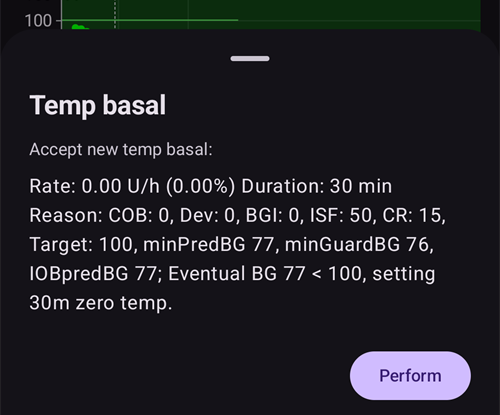
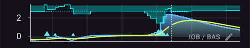

# Vigtige AAPS-funktioner

## Loop-tilstand

Loopets status vises på hovedskærmen med et af ikonerne nedenfor.

**AAPS** har flere loop-tilstande, f.eks. lukket loop (1), stop ved lavt BS (LGS - 2) og åbent loop (3).

Se [AAPS-skærme > Hovedskærmen > Loop-status](#AapsScreens-loop-status) for at læse, hvordan du vælger loop-tilstand, og om de andre ikoner på billedet (4 til 6).

(KeyAapsFeatures-OpenLoop)=

### Åbent loop

**AAPS** vurderer hele tiden alle tilgængelige data (IOB, COB, BS ...) og kommer med forslag til behandling (midlertidige basalrater) om, hvordan din behandling kan justeres, hvis det er nødvendigt.

Forslagene udføres ikke automatisk (som i lukket loop). Forslagene skal udføres manuelt af brugeren på pumpen (hvis du bruger en virtuel pumpe) eller med en knap, hvis **AAPS** er forbundet til en rigtig pumpe.

When **AAPS** has a suggestion, a **Loop** entry with a green dot appears in the bottom navigation of the main screen. Tryk på det for at læse forslaget (»Accepter ny midlertidig basal«) med rate, varighed og årsag, og tryk derefter på **Udfør** for at udføre det:

Et forslag gælder kun i nogle få minutter. Hvis det er ældre end ca. 9 minutter, eller hvis loopet er blevet suspenderet eller forbindelsen til pumpen er blevet afbrudt i mellemtiden, afviser **AAPS** det, og der sendes intet til pumpen (*»Dette forslag er for gammelt. Intet blev sendt til pumpen. Vent på det næste.«*). Vent på det næste forslag.

Denne indstilling er til at lære, hvordan **AAPS** virker, eller hvis du bruger en pumpe, der ikke understøttes. Du er i åbent loop, uanset hvad du vælger her, indtil slutningen af **[læringsmål 5](#objectives-objective5)**.

(KeyAapsFeatures-LGS)=

### Stop ved lavt BS (LGS)

I denne tilstand er [maxIOB](#Open-APS-features-maximum-total-iob-openaps-cant-go-over) sat til nul.

Det betyder, at hvis blodsukkeret falder, kan **AAPS** sænke basalen for dig. Men hvis blodsukkeret stiger, foretages der ingen automatisk korrektion. Dine basalrater forbliver de samme som angivet i din aktuelle **profil**. Kun hvis IOB er negativ (fra et tidligere stop ved lavt BS), gives der ekstra insulin for at sænke **BS**.

Denne tilstand er tilgængelig fra **[læringsmål 6](#objectives-objective6)**.

Ud over at du selv kan vælge den, kan **AAPS** også selv skifte til denne tilstand: mens du arbejder på **[læringsmål 6](#objectives-objective6)**, og hver gang den registrerer dobbelte BS-værdier (se [advarselstegn for BS](#aaps-screens-bg-warning-sign)).

(KeyAapsFeatures-ClosedLoop)=

### Lukket loop

**AAPS** vurderer hele tiden alle tilgængelige data (IOB, COB, BS ...) og justerer automatisk behandlingen, hvis det er nødvendigt (*dvs.* uden at du skal gøre mere), for at nå det indstillede [målområde eller den indstillede målværdi](#profile-glucose-targets) (levering af bolus, midlertidig basalrate, stop af insulin for at undgå hypo osv.).

Lukket loop arbejder inden for mange sikkerhedsgrænser, som kan indstilles individuelt.

Lukket loop er kun muligt, hvis du er i **[læringsmål 7](#objectives-objective7)** eller højere og bruger en understøttet pumpe.

(autosens)= (Open-APS-features-autosens)=

## Autosens

- Autosens er en algoritme, der ser på afvigelser i blodsukkeret (positive/negative/neutrale).
- Den prøver at finde ud af, hvor følsom/resistent du er, ud fra disse afvigelser.
- Oref-implementeringen i **OpenAPS** bruger en kombination af data fra 24 og 8 timer. Den bruger den af dem, der er mest følsom.
- Brugere, der kommer fra oref1, vil sandsynligvis opleve, at systemet reagerer mindre dynamisk på ændringer, fordi følsomheden varierer mellem 24 og 8 timer.
- Et kanyleskift eller et profilskift nulstiller Autosens-forholdet til 100% (et procentvis profilskift med varighed nulstiller ikke Autosens).
- Autosens justerer din basal og ISF (dvs. det efterligner, hvad et profilskift gør).
- Hvis du spiser kulhydrater uafbrudt over en længere periode, er Autosens mindre effektiv i den periode, fordi kulhydrater udelukkes fra beregningerne af **BS**-delta.
- Afvigelserne omregnes til et **følsomhedsforhold** (en procentdel): et forhold under 100% betyder, at AAPS mener, at du er mere følsom over for insulin, end din **profil** antager (så den sænker den effektive basal og hæver ISF-værdien), mens et forhold over 100% betyder, at du er mere resistent (så den hæver basal og sænker ISF-værdien).
- Som standard holdes dette forhold mellem 0,7 (70%, mere følsom) og 1,2 (120%, mere resistent), så en periode med usædvanlige data ikke kan flytte din dosering for langt væk fra din **profil**. Disse grænser kan ændres i de avancerede indstillinger for detektering af følsomhed.
- Autosens og [Autotune](../AdvancedOptions/Autotune.md) løser det samme grundlæggende problem på forskellige tidsskalaer: Autosens justerer din *aktuelle* dosering lidt fra minut til minut ud fra de sidste 8-24 timer, mens Autotune langsomt omskriver selve din *profil* ud fra flere ugers historik. Det er normalt og forventet at bruge begge — de supplerer hinanden og gør ikke det samme to gange.

*Den fulde tekniske beskrivelse af Autosens-algoritmen finder du i [OpenAPS' dokumentation om Autosens](https://openaps.readthedocs.io/en/latest/docs/Customize-Iterate/autosens.html).*

(Open-APS-features-super-micro-bolus-smb)=

## Super Micro Bolus (SMB)

**SMB**, forkortelsen for **Super micro bolus**, er en OpenAPS-funktion, der blev indført fra 2018 i Oref1-algoritmen. I modsætning til **AMA** bruger **SMB** ikke midlertidige basalrater til at styre glukoseniveauet, men primært **små super micro boluser**. I situationer, hvor **AMA** ville tilføre 1,0 IE insulin med en midlertidig basalrate, giver **SMB** flere super micro boluser i små trin med **5 minutters mellemrum**, f.eks. 0,4 IE, 0,3 IE, 0,2 IE og 0,1 IE. Samtidig (af sikkerhedsgrunde) sættes den faktiske basalrate til 0 IE/t i en vis periode for at forhindre overdosering (**»nul-basal«**). Det gør det muligt for systemet at justere blodsukkeret hurtigere end med den øgede midlertidige basalrate i **AMA**.

Takket være SMB kan det ved måltider med kun »langsomme« kulhydrater være nok at fortælle systemet den planlagte mængde kulhydrat og lade resten være op til **AAPS**. Det kan dog give højere toppe efter måltidet, fordi en bolus før måltidet ikke er mulig. Eller du kan, om nødvendigt som bolus før måltidet, give en **startbolus**, som **kun delvist** dækker kulhydraterne (f.eks. 2/3 af den anslåede mængde), og lade **SMB** levere resten af insulinen.

SMB'er vises på [IOB-grafen](#aaps-screens-iob) med blå trekanter. [Tryk og hold](#aaps-screens-graph-press-and-hold) på grafen ved en trekant for at se, hvor meget insulin der blev leveret, eller brug [Behandlingshistorik](#aaps-screens-treatments).

**SMB**-funktionerne har nogle sikkerhedsmekanismer:

1. **Største enkelte SMB-dosis**  
  Den største enkelte SMB-dosis kan højst være den mindste af disse værdier:
  
        * værdien, der svarer til den aktuelle basalrate (som justeret af Autosens) i den varighed, der er sat i »Maks. minutter basal til begrænsning af SMB«, f.eks. basalmængden for de næste 30 minutter, eller
        * halvdelen af den mængde insulin, der lige nu er brug for, eller
        * den resterende del af din maxIOB-værdi i indstillingerne.
      

2. **Lave midlertidige basalrater**  
  Lave midlertidige basalrater (på engelsk »low temps«) eller midlertidige basalrater på 0 E/t (kaldet »nul-basaler«, på engelsk »zero-temps«) bruges oftere med **SMB**. Det er bevidst af sikkerhedsgrunde og har ingen negative virkninger, hvis **profilen** er indstillet korrekt. På hovedgrafen er IOB-kurven (tynd gul linje) mere sigende end forløbet af de midlertidige basalrater.

3. **Uanmeldte måltider**  
  Ekstra beregninger til at forudsige glukoseforløbet, f.eks. med **UAM** (uanmeldte måltider). Selv uden at brugeren indtaster kulhydrater, kan **UAM** automatisk opdage en betydelig stigning i glukoseniveauet på grund af måltider, adrenalin eller andre påvirkninger og forsøge at justere den med **SMB**. For en sikkerheds skyld virker det også den anden vej og kan stoppe SMB tidligere, hvis glukosen uventet falder hurtigt. Derfor bør UAM altid være aktiv med SMB.

SMB beslutter ikke selv, at der er brug for insulin — den bygger på de samme samlede BS-forudsigelser (eventual BG, nul-basal, COB, UAM), som er beskrevet i [hvordan AAPS gør forudsigelser til en doseringsbeslutning](#aaps-screens-how-predictions-become-a-dosing-decision). SMB og nul-basal er ganske enkelt de to værktøjer, som AAPS bruger til at handle på den beslutning.

**Du skal have startet [læringsmål 9](#objectives-objective9) for at bruge SMB.**

Se også [OpenAPS' dokumentation om oref1/SMB](https://openaps.readthedocs.io/en/latest/docs/Customize-Iterate/oref1.html#understanding-super-micro-bolus-smb) for den fulde tekniske beskrivelse, eller [Tims information om SMB](https://www.diabettech.com/artificial-pancreas/understanding-smb-and-oref1/) for en beskrivelse fra fællesskabet.

Indstillingerne for OpenAPS SMB er beskrevet nedenfor.

(Open-APS-features-max-u-h-a-temp-basal-can-be-set-to)=

### Maks. basalrate

Denne sikkerhedsindstilling bestemmer den maksimale midlertidige basalrate, som insulinpumpen må levere. Den er også kendt som **max-basal**.

Værdien måles i enheder pr. time (E/t). Det anbefales at sætte denne til en fornuftig værdi. En god anbefaling for denne parameter er:

**MAX-BASAL = HØJESTE BASALRATE x 4**

Hvis den højeste basalrate i din profil f.eks. var 0,5 E/t, kan du gange den med 4 og få en værdi på 2 E/t.

**AAPS** begrænser denne værdi med en »fast grænse« ud fra [Indstillinger > Sikkerhed > Patientens alder](#preferences-patient-type). De faste grænser er:

- Barn: 2
- Teenager: 5
- Voksen: 10
- Insulinresistent voksen: 12
- Graviditet: 25

*Se også [oversigt over faste grænser](#Open-APS-features-overview-of-hard-coded-limits).*

(Open-APS-features-maximum-total-iob-openaps-cant-go-over)=

### Maks. IOB for SMB

Denne værdi bestemmer den maksimale **insulin om bord** (basal- og bolus-IOB), som **AAPS** holder sig under, når den kører i lukket loop. Den er også kendt som **maxIOB**.

Hvis den aktuelle IOB (f.eks. efter en måltidsbolus) er over den fastsatte værdi, stopper loopet med at dosere insulin, indtil IOB igen er under grænsen.

En god start for denne parameter er:

      maxIOB = gennemsnitlig måltidsbolus + 3x maks. daglig basal
    

Vær forsigtig og tålmodig, når du justerer din **max-IOB**. Den er forskellig for alle og kan også afhænge af den gennemsnitlige samlede daglige dosis (TDD).

**AAPS** begrænser denne værdi med en »fast grænse« ud fra [Indstillinger > Sikkerhed > Patientens alder](#preferences-patient-type). De faste grænser er:

- Barn: 7
- Teenager: 13
- Voksen: 22
- Insulinresistent voksen: 30
- Graviditet: 70

*Se også [oversigt over faste grænser](#Open-APS-features-overview-of-hard-coded-limits).*

Bemærk: Når du bruger **SMB**, beregnes **max-IOB** anderledes end i AMA. I **AMA** er maxIOB en sikkerhedsparameter for basal-**IOB**, mens den i SMB-tilstand også omfatter bolus-IOB.

### Brug dynamisk følsomhed

Dette er funktionen [DynamicISF](../DailyLifeWithAaps/DynamicISF.md). Når den er aktiveret, bliver nye indstillinger tilgængelige. Indstillingerne er forklaret på siden [DynamicISF](#dyn-isf-preferences).

### Brug Autosens

Dette er funktionen [Autosens](#Open-APS-features-autosens). Når du bruger DynamicISF, kan Autosens ikke bruges, fordi de er to forskellige algoritmer, der ændrer den samme variabel (følsomhed).

Autosens ser på afvigelser i blodsukkeret (positive/negative/neutrale). Den prøver at finde ud af, hvor følsom/resistent du er, ud fra disse afvigelser og justerer basalrate og ISF ud fra dem.

Når den er aktiveret, bliver nye indstillinger tilgængelige.

#### Følsomhed hæver målværdi

Hvis denne indstilling er aktiveret, kan detektering af følsomhed (Autosens) hæve målværdien, når der registreres følsomhed (under 100%). I så fald hæves din målværdi med den registrerede følsomheds procentdel.

Hvis målværdien er ændret på grund af detektering af følsomhed, vises den med grøn baggrund på hovedskærmen.

Denne indstilling er tilgængelig, når enten »Brug dynamisk følsomhed« eller »Brug Autosens« er aktiveret.

#### Resistens sænker målværdi

Hvis denne indstilling er aktiveret, kan detektering af følsomhed (Autosens) sænke målværdien, når der registreres resistens (over 100%). I så fald sænkes din målværdi med den registrerede resistens' procentdel.

Denne indstilling er tilgængelig, når enten »Brug dynamisk følsomhed« eller »Brug Autosens« er aktiveret.

### Aktiver SMB

Aktiver denne for at bruge SMB-funktionen. Hvis den er deaktiveret, gives der ingen **SMB'er**.

Når den er aktiveret, bliver nye indstillinger tilgængelige.

(Open-APS-features-enable-smb-with-high-temp-targets)=

#### Aktiver SMB ved højt midlertidigt mål

Hvis denne indstilling er aktiveret, gives der stadig **SMB'er**, selvom brugeren har valgt et højt **midlertidigt mål** (defineret som 100 mg/dl eller 5,6 mmol/l og derover, uanset målværdien i **profilen**). Vær forsigtig, når du aktiverer den: **SMB'er** kan blive for aggressive, hvis dine indstillinger ikke er godt justeret, eller hvis din **profil** ofte ændrer sig (f.eks. hos børn).

Når denne indstilling er deaktiveret, slår et højt **midlertidigt mål** **SMB'er** fra. Hvis denne indstilling f.eks. er deaktiveret, kan **SMB'er** slås fra ved at sætte et **midlertidigt mål** på 100 mg/dl eller 5,6 mmol/l og derover. Denne indstilling slår også **SMB'er** fra, uanset hvilken anden betingelse der prøver at aktivere SMB — undtagen et lavt **midlertidigt mål** som **Spiser snart** (eller ethvert **midlertidigt mål** på 98 mg/dl eller 5,4 mmol/l og derunder), som stadig kan give **SMB'er** for at bringe **BS** mod målværdien.

Denne indstilling slår ikke selv **SMB** til. Med et højt midlertidigt mål gives **SMB** kun, hvis en af de andre indstillinger nedenfor (f.eks. **Aktiver SMB altid** eller **Aktiver SMB med COB**) også tillader det.

(Open-APS-features-enable-smb-always)=

#### Aktiver SMB altid

Hvis denne indstilling er aktiveret, er SMB altid aktiveret (uafhængigt af COB, midlertidige mål eller boluser). Hvis denne indstilling er aktiveret, har de øvrige aktiveringsindstillinger nedenfor ingen virkning. Men hvis **Aktiver SMB ved højt midlertidigt mål** er deaktiveret, og der er sat et højt midlertidigt mål, deaktiveres SMB'er.

Denne indstilling er kun tilgængelig, hvis **AAPS** registrerer, at du bruger en [pålidelig BS-kilde](#GettingStarted-TrustedBGSource) med avanceret filtrering. FreeStyle Libre 1 regnes ikke for en pålidelig kilde, fordi der er risiko for, at gamle BS-data gentages i det uendelige, hvis sensoren svigter.

Data med meget støj kan få **AAPS** til at tro, at BS stiger meget hurtigt, så der gives unødvendige SMB'er. Du kan læse mere om støj og udjævning af data [her](../CompatibleCgms/SmoothingBloodGlucoseData.md).

#### Aktiver SMB med COB

Hvis denne indstilling er aktiveret, er SMB aktiveret, når COB er større end 0.

Denne indstilling er ikke synlig, hvis »Aktiver SMB altid« er slået til.

#### Aktiver SMB ved lavt midlertidigt mål

Hvis denne indstilling er aktiveret, er SMB aktiveret, når der er sat et midlertidigt mål (spiser snart, aktivitet, hypo, brugerdefineret). Hvis denne indstilling er aktiveret, men **Aktiver SMB ved højt midlertidigt mål** er deaktiveret, er SMB aktiveret, når der er sat et lavt midlertidigt mål (98 mg/dl eller 5,4 mmol/l og derunder), men deaktiveret, når der er sat et højt midlertidigt mål.

Denne indstilling er ikke synlig, hvis »Aktiver SMB altid« er slået til.

#### Aktiver SMB efter kulhydrater

Hvis den er aktiveret, er SMB aktiveret i 6 timer, efter at der er indtastet kulhydrater, også selvom COB er nået 0.

Af sikkerhedsgrunde er denne indstilling kun tilgængelig, hvis **AAPS** registrerer, at du bruger en pålidelig BS-kilde. Den er ikke synlig, hvis »Aktiver SMB altid« er slået til.

Denne indstilling er kun tilgængelig, hvis **AAPS** registrerer, at du bruger en [pålidelig BS-kilde,](#GettingStarted-TrustedBGSource) med avanceret filtrering. FreeStyle Libre 1 regnes ikke for en pålidelig kilde, fordi der er risiko for, at gamle BS-data gentages i det uendelige, hvis sensoren svigter.

Data med meget støj kan få **AAPS** til at tro, at BS stiger meget hurtigt, så der gives unødvendige SMB'er. Du kan læse mere om støj og udjævning af data [her](../CompatibleCgms/SmoothingBloodGlucoseData.md).  
Denne indstilling er ikke synlig, hvis »Aktiver SMB altid« er slået til.

#### SMB-interval

Denne funktion begrænser, hvor ofte der gives SMB'er. Denne værdi bestemmer den mindste tid mellem SMB'er. Bemærk, at loopet kører, hver gang der kommer en glukoseværdi (normalt hvert 5. minut). Træk 2 minutter fra for at give loopet ekstra tid til at blive færdigt. Hvis du f.eks. vil have SMB ved hver kørsel af loopet, så sæt denne til 3 minutter.

Standardværdi: 3 min.

(Open-APS-features-max-minutes-of-basal-to-limit-smb-to)=

#### Maks. minutter basal til begrænsning af SMB

Dette er en vigtig sikkerhedsindstilling. Denne værdi bestemmer, hvor meget SMB der kan gives ud fra mængden af basalinsulin i et givet tidsrum, når den er dækket af COB.

Jo større værdi, desto mere aggressiv kan SMB være. Du bør starte med standardværdien på 30 minutter. Når du har fået lidt erfaring, kan du øge værdien i trin på 15 minutter og se på virkningen over flere måltider.

Det anbefales ikke at sætte værdien højere end 90 minutter, da algoritmen så måske ikke kan modvirke et faldende BS med en basal på 0 E/t (»nul-basal«). Du bør også sætte alarmer, især mens du stadig tester nye indstillinger, så du bliver advaret i god tid før en hypo.

Standardværdi: 30 min.

#### UAM maks. minutter basal til begrænsning af SMB

Med denne indstilling kan du justere styrken af SMB under UAM, når der ikke er flere kulhydrater.

Standardværdi: den samme som **Maks. minutter basal til begrænsning af SMB**.

Denne indstilling er kun synlig, hvis »Aktiver SMB« og »Aktiver UAM« er slået til.

(enable-uam)=

### Aktiver UAM

Når denne indstilling er aktiveret, kan SMB-algoritmen genkende uanmeldte måltider. Det er nyttigt, hvis du glemmer at fortælle **AAPS** om dine kulhydrater, eller hvis du anslår dem forkert, så den indtastede mængde kulhydrater er forkert, eller hvis et måltid med meget fedt og protein varer længere end forventet. Uden nogen indtastning af kulhydrater kan UAM genkende en hurtig glukosestigning forårsaget af kulhydrater, adrenalin osv. og forsøger at justere den med SMB'er. Det virker også den anden vej: hvis glukosen falder hurtigt, kan den stoppe SMB'er tidligere.

**Derfor bør UAM altid være aktiveret, når du bruger SMB.**

(key-aaps-features-minimal-carbs-required-for-suggestion)=

### Grænse for kulhydratbehov

Mindste antal gram kulhydrater, før der vises en advarsel med forslag om kulhydrater. Der foreslås ekstra kulhydrater, når referencedesignet registrerer, at der er brug for kulhydrater. I så fald får du en notifikation, som kan udsættes i 5, 15 eller 30 minutter.

Notifikationer om påkrævede kulhydrater kan sendes til Nightscout, hvis du ønsker det. I så fald vises og udsendes en meddelelse.

Under alle omstændigheder vises de nødvendige kulhydrater i COB-feltet på hovedskærmen.

### Avancerede indstillinger

Den fulde reference for parametrene (også indstillinger, der ikke er beskrevet her) finder du i [OpenAPS' dokumentation om indstillinger og sikkerhedsindstillinger](https://openaps.readthedocs.io/en/latest/docs/While%20You%20Wait%20For%20Gear/preferences-and-safety-settings.html).

**Brug altid kort gns. delta** Hvis du aktiverer denne funktion, bruger **AAPS** den korte gennemsnitlige delta/blodsukker fra de sidste 15 minutter, som normalt er gennemsnittet af de sidste tre værdier. Det hjælper **AAPS** til at være mere stabil med datakilder med meget støj som xDrip og Libre.

**Maks. daglig sikkerhedsmultiplikator** Dette er en vigtig sikkerhedsgrænse. Standardindstillingen (som næppe skal ændres) er 3. Det betyder, at **AAPS** aldrig får lov til at sætte en midlertidig basalrate, der er mere end 3 gange den højeste basalrate pr. time, der er programmeret i brugerens pumpe og/eller profil. Eksempel: Hvis din højeste basalrate er 1,0 E/t, og den maks. daglige sikkerhedsmultiplikator er 3, kan **AAPS** højst sætte en midlertidig basalrate på 3,0 E/t (= 3 x 1,0 E/t).

Standardværdi: 3 (bør ikke ændres, medmindre du virkelig har brug for det og ved, hvad du gør)

**Sikkerhedsmultiplikator for aktuel basal** Dette er en anden vigtig sikkerhedsgrænse. Standardindstillingen (som heller ikke skal ændres ret ofte) er 4. Det betyder, at **AAPS** aldrig får lov til at sætte en midlertidig basalrate, der er mere end 4 gange den aktuelle basalrate pr. time, der er programmeret i brugerens pumpe og/eller profil.

Standardværdi: 4 (bør ikke ændres, medmindre du virkelig har brug for det og ved, hvad du gør)

* * *

(Open-APS-features-auto-isf)=

## Auto ISF

**Auto ISF** er en **eksperimentel** algoritme til avancerede brugere. Den bygger på OpenAPS SMB og tilføjer regler, der gør insulinfølsomhedsfaktoren (ISF) stærkere eller svagere, afhængigt af hvordan din glukose opfører sig.

Det er en udviklingsfunktion: den kan kun slås til i en [dev-build](../AdvancedOptions/DevBranch.md) med **Engineering Mode** aktiveret. I en almindelig udgivet build er den altid slået fra og vises derfor ikke under **Konfiguration → APS**. At gennemføre [læringsmålene](../SettingUpAaps/CompletingTheObjectives.md) låser den ikke op.

Når du har valgt den, indeholder dens **Indstillinger** indstillingerne for OpenAPS SMB plus gruppen **AutoISF-indstillinger**:

- **Aktiver AutoISF**: slår ISF-justeringerne til. Uden den virker algoritmen som OpenAPS SMB.
- **AutoISF min.** og **AutoISF maks.**: hvor svag og hvor stærk ISF må blive, på samme måde som Autosens-grænserne. Med standardværdien 1,0 er virkningen slået fra.
- **Vægte**: hver af dem styrer én regel, og standardværdien 0,0 slår reglen fra. 
  - mens glukosen **stiger hurtigere og hurtigere**, gøres ISF stærkere (mere insulin);
  - mens glukosen **bremses**, gøres ISF svagere (mindre insulin);
  - mens glukosen er **under målværdien**, gøres ISF svagere;
  - mens glukosen er **over målværdien**, gøres ISF stærkere;
  - en vægt for **efter måltid** og en vægt for **varighed** virker efter måltider, og når glukosen er høj i lang tid.
- **SMB-leveringsforhold** (med et minimum, et maksimum og et BS-område): hvor stor en del af den nødvendige insulin der kan gives som SMB.
- **SMB maks. udvidelse af område**: med hvilken faktor den normale grænse for SMB-størrelse ([maks. minutter basal](#Open-APS-features-max-minutes-of-basal-to-limit-smb-to), 30 minutter som standard) må overskrides. Standardværdien 1 ændrer intet; op til 5 er muligt. Øg denne eksperimentelle værdi langsomt og forsigtigt.
- **IOB-grænse i procent**: den procentdel af maks. IOB, over hvilken SMB'er deaktiveres.

    {admonition} Kun for erfarne brugere
    :class: danger
    Med standardværdierne ændrer Auto ISF intet. Hver værdi, du hæver, gør **AAPS** mere aggressiv. Ændr én værdi ad gangen, i små trin, og se på resultatet i flere dage. Vær meget forsigtig med en **AutoISF maks.** over 2,5.

(Open-APS-features-advanced-meal-assist-ama)=

## Advanced Meal Assist (AMA)

AMA, forkortelsen for »advanced meal assist«, er en OpenAPS-funktion fra 2017 (oref0). OpenAPS Advanced Meal Assist (AMA) gør det muligt for systemet at sætte en høj midlertidig basal hurtigere efter en måltidsbolus, hvis du indtaster kulhydrater pålideligt.

Du kan finde mere information i [OpenAPS-dokumentationen](https://newer-docs.readthedocs.io/en/latest/docs/walkthrough/phase-4/advanced-features.html#advanced-meal-assist-or-ama).

### Maks. basalrate (OpenAPS »max-basal«)

Denne sikkerhedsindstilling forhindrer, at **AAPS** nogensinde kan give en farligt høj basalrate, og begrænser den midlertidige basalrate til x E/t. Det anbefales at sætte denne til en fornuftig værdi. En god anbefaling er at tage den højeste basalrate i din profil og gange den med 4, og mindst med 3. Hvis den højeste basalrate i din profil f.eks. er 1,0 E/t, kan du gange den med 4 og få en værdi på 4 E/t og sætte 4 som din sikkerhedsparameter.

Du kan ikke vælge en hvilken som helst værdi: Af sikkerhedsgrunde er der en »fast grænse«, som afhænger af patientens alder. Den »faste grænse« for maxIOB er lavere i AMA end i SMB. For børn er værdien lavest, og for insulinresistente voksne er den højest.

De faste parametre i **AAPS** er:

- Barn: 2
- Teenager: 5
- Voksen: 10
- Insulinresistent voksen: 12
- Graviditet: 25

*Se også [oversigt over faste grænser](#Open-APS-features-overview-of-hard-coded-limits).*

### Maks. IOB for AMA

Denne parameter begrænser den maksimale basal-IOB, hvor **AAPS** stadig virker. Hvis IOB er højere, stopper den med at give ekstra basalinsulin, indtil basal-IOB er under grænsen.

Standardværdien er 2, men du bør hæve denne parameter langsomt for at se, hvor meget den påvirker dig, og hvilken værdi der passer bedst. Den er forskellig for alle og afhænger også af den gennemsnitlige samlede daglige dosis (TDD). Af sikkerhedsgrunde er der en grænse, som afhænger af patientens alder. Den »faste grænse« for maxIOB er lavere i AMA end i SMB.

- Barn: 3
- Teenager: 5
- Voksen: 7
- Insulinresistent voksen: 12
- Graviditet: 25

*Se også [oversigt over faste grænser](#Open-APS-features-overview-of-hard-coded-limits).*

### Brug Autosens (AMA)

Her kan du vælge, om du vil bruge [detektering af følsomhed](../DailyLifeWithAaps/SensitivityDetectionAndCob.md) (Autosens) eller ej.

### Autosens justerer målværdier

Hvis denne indstilling er aktiveret, kan Autosens også justere målværdier (ud over basal og ISF). Det lader **AAPS** arbejde mere eller mindre »aggressivt«. Den faktiske målværdi kan nås hurtigere på denne måde.

### Avancerede indstillinger

- Normalt behøver du ikke ændre indstillingerne i denne dialog!
- Hvis du alligevel vil ændre dem, så sørg for, at du forstår, hvad du gør — se den fulde reference for parametrene i [OpenAPS' dokumentation om indstillinger og sikkerhedsindstillinger](https://openaps.readthedocs.io/en/latest/docs/While%20You%20Wait%20For%20Gear/preferences-and-safety-settings.html).

**Brug altid kort gns. delta** Hvis du aktiverer denne funktion, bruger **AAPS** den korte gennemsnitlige delta/blodsukker fra de sidste 15 minutter, som normalt er gennemsnittet af de sidste tre værdier. Det hjælper **AAPS** til at arbejde mere stabilt med datakilder med meget støj som xDrip og Libre.

**Maks. daglig sikkerhedsmultiplikator** Dette er en vigtig sikkerhedsgrænse. Standardindstillingen (som næppe skal ændres) er 3. Det betyder, at **AAPS** aldrig får lov til at sætte en midlertidig basalrate, der er mere end 3 gange den højeste basalrate pr. time, der er programmeret i brugerens pumpe. Eksempel: Hvis din højeste basalrate er 1,0 E/t, og den maks. daglige sikkerhedsmultiplikator er 3, kan **AAPS** højst sætte en midlertidig basalrate på 3,0 E/t (= 3 x 1,0 E/t).

Standardværdi: 3 (bør ikke ændres, medmindre du virkelig har brug for det og ved, hvad du gør)

**Sikkerhedsmultiplikator for aktuel basal** Dette er en anden vigtig sikkerhedsgrænse. Standardindstillingen (som heller ikke skal ændres ret ofte) er 4. Det betyder, at **AAPS** aldrig får lov til at sætte en midlertidig basalrate, der er mere end 4 gange den aktuelle basalrate pr. time, der er programmeret i brugerens pumpe.

Standardværdi: 4 (bør ikke ændres, medmindre du virkelig har brug for det og ved, hvad du gør)

**Bolus snooze DIA-divisor** Funktionen »bolus snooze« virker efter en måltidsbolus. **AAPS** sætter ikke lave midlertidige basalrater efter et måltid i en periode, der svarer til DIA divideret med parameteren »bolus snooze«. Standardværdien er 2. Det betyder, at med en DIA på 5 t vil »bolus snooze« vare 5 t : 2 = 2,5 t.

Standardværdi: 2

* * *

(Open-APS-features-overview-of-hard-coded-limits)=

## Oversigt over faste grænser

|            | Barn | Teenager | Voksen | Insulinresistent voksen | Graviditet |
| ---------- | ---- | -------- | ------ | ----------------------- | ---------- |
| MAXBOLUS   | 5    | 10       | 17     | 25                      | 60         |
| MINDIA     | 5    | 5        | 5      | 5                       | 5          |
| MAXDIA     | 9    | 9        | 9      | 9                       | 10         |
| MINIC      | 2    | 2        | 2      | 2                       | 0,3        |
| MAXIC      | 100  | 100      | 100    | 100                     | 100        |
| MAXIOB_AMA | 3    | 5        | 7      | 12                      | 25         |
| MAXIOB_SMB | 7    | 13       | 22     | 30                      | 70         |
| MAXBASAL   | 2    | 5        | 10     | 12                      | 25         |