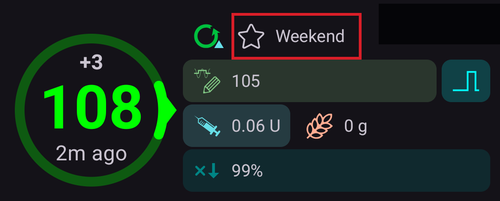
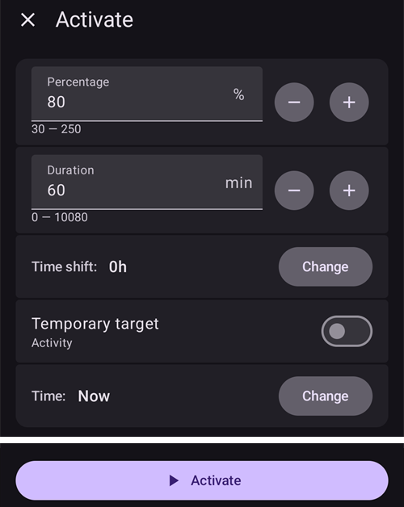
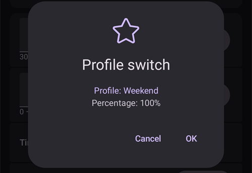
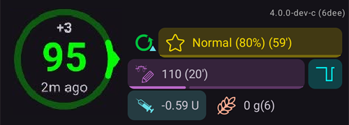
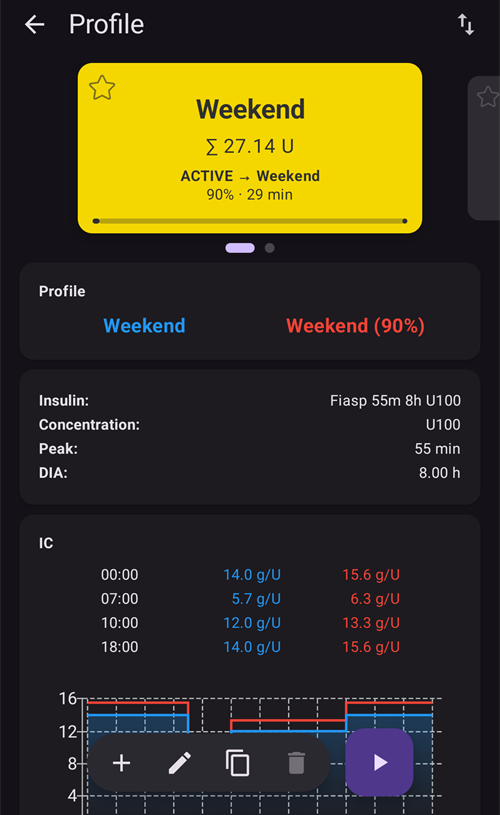
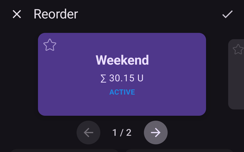
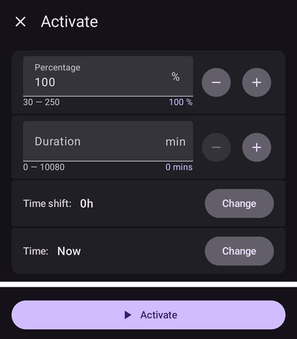
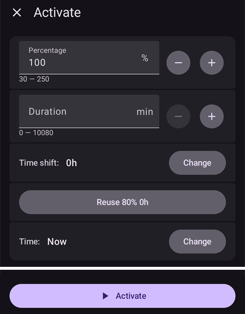
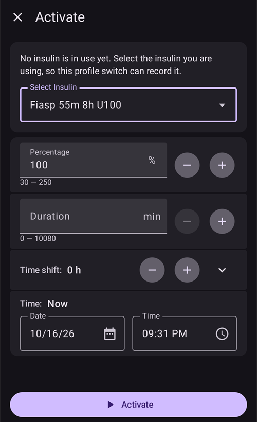
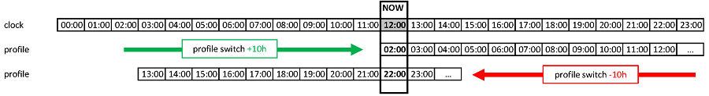

# Profilskift og profilprocent

Dette afsnit forklarer, hvad et **profilskift** og en **profilprocent** er. Du kan lære at oprette en **profil** i [Din AAPS-profil](#your-aaps-profile-create-and-edit-profiles).

Når du starter med **AAPS**, skal du oprette en **profil**, forstå hvordan du laver et **profilskift**, og lære hvilken virkning en **profilprocent** har i **AAPS**. Funktionerne **profilskift** og **profilprocent** kan især være nyttige ved:

- Menstruationscyklus – en procentjustering af en **profil** kan sættes op i **Automatisering**, så **AAPS** kan tilpasse sig hormoncyklussens forskellige faser og den forventede insulinresistens.

- Motion – en procentjustering af en **profil** kan sættes op i **Automatisering** til motion for at nedsætte basalen.

- Natarbejde eller skifteholdsarbejde – en tidsforskydning af **profilen** kan sættes op for skifteholdsarbejdere. Antallet af timer i **profilen** ændres til, hvor meget senere/tidligere brugeren går i seng eller står op.

Hvorfor bruge en **profilprocent** i stedet for en midlertidig justering af basalen? For at virke bedre ændrer en **profilprocent** basal, ISF og IC i samme forhold, op eller ned. Det sikrer, at **AAPS** beregner en afbalanceret dosering, når brugerens insulin gives. Det hjælper ikke meget at sænke basalen i brugerens **profil** i **AAPS**, hvis algoritmen fortsat bruger de samme værdier for ISF og IC.

(ProfileSwitch-change-percentage)=

## Skift profilprocent fra hovedskærmen

Du skal have mindst én gemt **profil**. En **profilprocent** bruges altid gennem et **profilskift**: Du aktiverer en **profil** igen, denne gang med en procent.

```{admonition} Kommer du fra AAPS 3? :class: note Et langt tryk på profilnavnet åbner ikke længere dialogen til profilskift. **Tryk** på profilnavnet, og tryk derefter på den runde knap **▶** nederst til højre: Den åbner de samme indstillinger (procent, varighed, midlertidigt mål Aktivitet).

    <br />1. På hovedskærmen skal du **trykke på profilnavnet** (ved siden af stjerneikonet). [Profilskærmen](#ProfileSwitch-manage-v4) åbner på kortet for den **profil**, der kører nu, markeret med **AKTIV**.
    
       
    
    2. Hvis du vil beholde den samme **profil**, så lad kortet **AKTIV** være valgt. Hvis du samtidig vil skifte **profil**, så stryg til et andet kort.
    3. Tryk på den runde knap **▶** (**Aktiver**) nederst til højre. Skærmen **Aktiver** åbner.
    4. Indstil **Procentdel** med **−** / **+** (i trin på 5%), eller skriv den ind (30 til 250%). Feltet starter altid på **100%**: Det viser ikke den procent, der kører nu. Indtast f.eks. **80** for 20% mindre insulin eller **120** for 20% mere.
    5. Indstil **Varighed** i minutter:
       * **0** beholder den nye procent, indtil du laver et nyt **profilskift**;
       * enhver anden værdi afslutter skiftet efter den tid, og **AAPS** går tilbage til den **profil**, der kørte før.
    
       
    
    6. Tryk på **▶ Aktiver** nederst på skærmen. Kontroller oversigten i dialogen **Profilskift**, og tryk på **OK**.
    
       
    
    Tilbage på hovedskærmen viser profilnavnet procenten og den resterende tid, f.eks. *Normal (80%) (59')*, og bliver gult, mens et skift med varighed kører. En stjerne markerer skiftet på glukosegrafen. Se [hovedskærmen](#aaps-screens-profile--target).
    
    
    
    For at **gå tilbage til 100%** før tiden er gået, skal du gentage trinene og beholde **Procentdel** på 100 og **Varighed** på 0.
    
    ```{admonition} Procenter med ét tryk
    :class: tip
    Hvis du ofte bruger den samme procent (sport, sygdom), så tilføj en [profilgenvej](#profile-shortcuts) til Hurtigstart-linjen, eller opret en [scene](Scenes.md). Begge dele aktiverer en profil med en forudindstillet procent og varighed med ét tryk.
    

(ProfileSwitch-manage-v4)=

## Administrer og aktiver profiler (Administrer → Profil)

I **AAPS** v4 administreres og aktiveres profiler fra skærmen **Administrer** (navigation nederst) → **Profil** (*»Administrer og aktiver profiler«*).

Profilskærmen viser dine profiler som en **karrusel af kort, som du kan stryge mellem**. Kortet for den profil, der kører nu, er markeret med **AKTIV** og viser profilens samlede daglige basal (f.eks. *∑ 30,15 IE*). Under det valgte kort ser du profilens detaljer — **Insulin**-typen og skemaerne for **IC**, **ISF**, **basal** og **mål** med grafer.

Når et midlertidigt skift kører, viser kortet **AKTIV** dets procent og tidsforskydning med den resterende tid, f.eks. *110% +2 t · 2 t 40 min*, over en statuslinje. Begge opdateres hvert 30. sekund. Detaljerne nedenfor har så to kolonner: profilens værdier i blåt og de værdier, der bruges med procenten, i rødt.



Knapperne nederst virker på den **valgte** profil: **➕ Tilføj**, **✏️ Rediger**, **⧉ Klon** og **‘️ Slet**, og den runde knap **▶ Aktiver** til højre. Se [Opret og rediger profiler](#your-aaps-profile-create-and-edit-profiles) for, hvordan du udfylder de fire skemaer i editoren (IC / ISF / BAS / TARG).

**⧉ Klon** bruger ikonet med to firkanter, som ofte bruges til *kopier*, men der er intet at indsætte: Den laver kopien i ét trin. Bekræft *Klon profilen "Normal"?*, og en ny profil med navnet *Normal kopi* tilføjes sidst i karrusellen og vælges, klar til **✏️ Rediger** (hvor du også kan omdøbe den). Det er ikke det samme som at klone et tidligere **profilskift** fra behandlingshistorikken, hvilket opretter en ny profil *med procent og tidsforskydning lagt ind*. Se [Gem et profilskift til senere brug](#ProfileSwitch-keep-for-later).

(ProfileSwitch-read-only-mode)= **Kun knappen ▶ Aktiver?** Dine indstillinger er beskyttet, så skærmen åbner skrivebeskyttet. Tryk på **✏️ blyanten** i den øverste linje, og indtast din adgangskode til indstillingerne. Se [Beskyttelse af indstillinger låser nu også administrationsskærmene](#v4changes-read-only-management).

### Skift rækkefølge på profiler

Hvis du har mere end én profil, kan du vælge deres rækkefølge i karrusellen: Tryk på ikonet **Skift rækkefølge** (⇅, to pile, der peger op og ned) i den øverste linje. Sideindikatoren erstattes af **◀ / ▶ flytteknapper** med en visning af *position / i alt* — flyt kortet i midten tidligere eller senere, og bekræft derefter med **✓** (eller forkast med **✕**). Den nye rækkefølge gemmes én gang, når du bekræfter.



### Aktivering af en profil

Vælg en profil, og tryk på **▶ Aktiver**. På skærmen **Aktiver** kan du tilpasse, hvordan **profilskiftet** bruges:



- **Procentdel** (30–250%, starter på 100% hver gang) — skalerer hele profilen. 100% bruger den uændret; f.eks. sænker 70% basalen og den beregnede insulindosis (både måltidsboluser og korrektioner) med 30%. Det ændrer ikke dine glukosemål eller kulhydratabsorptionen. Se [Profilprocent](#ProfileSwitch-profile-percentage) for hele virkningen.
- **Varighed** (0–10080 minutter, det vil sige op til 7 dage) — hvor længe skiftet varer. **0 = uendeligt** (indtil du skifter igen); en værdi over 0 går tilbage til den tidligere profil, når tiden er gået.
- **Midlertidigt mål / Aktivitet** — vises kun, når du indstiller en **Varighed** og en **Procentdel** under 100%. Slå det til for også at starte et [midlertidigt mål Aktivitet](#TempTargets-activity-temp-target) i samme tid, som du ville gøre før motion.
- **Tidsforskydning** — viser *0t*; tryk på **Ændr** for at flytte skemaet frem eller tilbage med op til 23 timer (nyttigt ved skifteholdsarbejde eller rejser). Se [Tidsforskydning](#ProfileSwitch-ProfilePercentage-time-shift-of-the-circadian-percentage-profile).
- **Genbrug** — vises, når det kørende skift har en anden procent end 100% eller en tidsforskydning, f.eks. **Genbrug 80% 0t**. Tryk på den for at udfylde den samme procent og tidsforskydning, f.eks. for at forlænge et skift, der snart slutter.
    
    

- **Tid** — *Nu* som standard. Du kan vælge et andet tidspunkt, op til 24 timer før eller efter nu. Et skift, der er sat til et senere tidspunkt, starter på det tidspunkt; et midlertidigt mål Aktivitet, der er sat sammen med det, starter så også på det tidspunkt.
    
    

- **Bemærkninger** — vises kun, hvis [Vis notater i dialoger](#Preferences-show-notes-field-in-treatments-dialogs) er slået til.

Hvis basalraterne med den valgte procent ikke er kompatible med din pumpe, vises en advarsel øverst, og **▶ Aktiver** forbliver deaktiveret: Vælg en anden procent.

Tryk på **▶ Aktiver**, og derefter på **OK** i bekræftelsesdialogen. Den profil, der kører, har derefter mærket **AKTIV** på sit kort.

```{admonition} Din pumpe kan afrunde basalraterne :class: note Hver pumpe kan kun give basalrater i sine egne trin (f.eks. 0,05 E/t), så den afrunder raterne i din **profil**. **AAPS** bruger derefter den basal, som pumpen faktisk giver, så IOB og TDD forbliver korrekte. Hvis pumpen giver lidt mere eller mindre insulin pr. dag end din **profil**, fortæller meddelelsen *»Basalprofilen i pumpen er opdateret«* hvor meget, f.eks. *»den giver 10,00 IE pr. dag i stedet for 10,12 IE«*.

Hvis pumpen rapporterer en basal, der ligger langt fra din **profil**, beholder **AAPS** **profilens** basal og beder dig kontrollere basalraterne i pumpen.

    <br />```{admonition} Med procent og tidsforskydning rækker én profil langt
    :class: note
    I stedet for at lave mange ens profiler kan du beholde én grundprofil og bruge den med en anden **procent** eller **tidsforskydning** i situationer, der kommer igen (sygdom, motion, rejser). Det er præcis det, [scener](Scenes.md) automatiserer.
    

Et profilskift er ikke begrænset til denne skærm. Det samme skift kan også startes fra et **Wear OS-ur**, en parret **klient** (se [Styring mellem hovedenhed ↔ klient](../RemoteFeatures/ClientMasterControl.md)), en **[scene](Scenes.md)** eller en **automatiseringsregel**.

(ProfileSwitch-profile-percentage)=

## Profilprocent

Det er vigtigt, at brugeren forstår de vigtigste egenskaber ved en **profilprocent**. Når du øger eller sænker et **profilskift** med en procent, hæves eller sænkes brugerens indstillinger i **profilen** med den samme procent.

For eksempel: Et **profilskift** til 130% (betyder, at brugeren er 30% mere insulinresistent) får **AAPS** til at

- **øge** basalraten med 30%; 
- **sænke** **ISF**: ved at dividere med 1,3;
- **sænke** **IC** ved at dividere med 1,3.

Husk: En lavere **ISF** eller **IC** betyder et stærkere forhold, og at der gives mere insulin. Det overser nye **AAPS**-brugere let.

Når procenten er valgt, justerer **AAPS** standardbasalraten, og **AAPS** (åbent eller lukket loop) arbejder videre ud fra den valgte procent af **profilen**.

Virkningen af en **profil**procent er vist i tabellen nedenfor:

| Profilskift  
procent |   Virkning   |     IC  
g/IE     | Eksempel  
15 g |         ISF  
mmol/l/IE  
mg/dl/IE         | IE til at sænke  
2 mmol/l  
40 mg/dl |
|:---------------------:|:------------:|:-----------------:|:---------------:|:------------------------------------------:|:-------------------------------------:|
|          90%          |   Svagere    | 5/0,9  
=**5,55** |     2,7 IE      | 2,2/0,9  
=**2,4**  
  
40/0,9  
=**44,4** |                0,8 IE                 |
|       **100%**        | **Standard** |       **5**       |    **3 IE**     |                **2,2  
40**                |              **0,9** IE               |
|         130%          |   Stærkere   | 5/1,3  
=**3,85** |     3,9 IE      | 2,2/1,3  
=**1,7**  
  
40/1,3  
=**30,8** |                1,2 IE                 |

(ProfileSwitch-ProfilePercentage-time-shift-of-the-circadian-percentage-profile)=

## Tidsforskydning af den døgnrytmiske procentprofil

En »tidsforskydning« i brugerens **profil** flytter **profilens** indstillinger rundt på døgnets ur (»døgnrytme«) med det ønskede antal timer. Det kan være nyttigt for:

- **natarbejdere eller skifteholdsarbejdere**: arbejde om natten, ved at ændre antallet af timer i **profilen** til, hvor meget senere/tidligere brugeren går i seng eller står op; 
- **brugere, der skifter tidszone på rejser**; eller
- **børn med type 1-diabetes**: som har en fast sengetidsrutine, og hvor insulinresistensen er indbygget i **profilen**. Hvis barnet af en eller anden grund forventes at gå senere i seng, kan omsorgspersonen lægge en »tidsforskydning« på barnets **profil**, så **AAPS** reagerer på insulinresistensen i det tidsrum, brugeren har valgt.

Spørgsmålet er altid, hvilken times **profil**-indstillinger der skal erstatte indstillingerne for det aktuelle tidspunkt. Dette tidspunkt skal forskydes med x timer. Vær derfor opmærksom på retningen, som beskrevet i dette eksempel:

- Aktuelt tidspunkt: 12:00
- **Positiv** tidsforskydning 
    - 2:00 **+10 t** -> 12:00
    - Indstillingerne fra kl. 2:00 bruges i stedet for de indstillinger, der normalt bruges kl. 12:00, fordi tidsforskydningen er positiv.
- **Negativ** tidsforskydning 
    - 22:00 **-10 t** -> 12:00
    - Indstillingerne fra kl. 22:00 bruges i stedet for de indstillinger, der normalt bruges kl. 12:00, fordi tidsforskydningen er negativ.



Denne måde at tage øjebliksbilleder af **profilen** på giver en meget mere præcis beregning af fortiden og gør det muligt at følge ændringer i **profilen**.

(ProfileSwitch-keep-for-later)=

## Gem et profilskift til senere brug

Når du har lavet et profilskift med procent og/eller tidsforskydning, kan du kopiere denne midlertidige profil til en ny profil.

Det gør du ved at åbne menuen (☰) → **Behandlinger** og gå til fanen **Profilskift**, se [Klon et profilskift til en ny profil](#your-aaps-profile-clone-profile-switch).