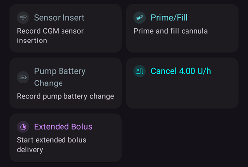
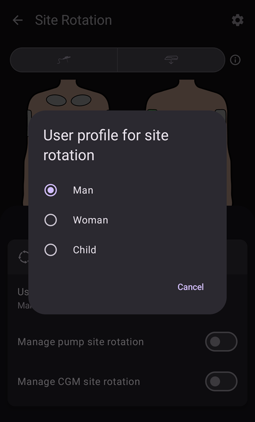

# Pumper og kanyler

## Skift af infusionssæt: insulinreservoirer og kanyler

Fremgangsmåden nedenfor gælder kun for pumper med slange. Den gælder ikke for patchpumper som Omnipod, Medtrum Nano, Accu-Chek Solo osv. Denne fremgangsmåde kaldes nogle gange et »sætskift«. Et »fuldt« sætskift omfatter både insulinreservoir og kanyle, og et »delvist« sætskift betyder, at kun kanylen skiftes.

Patchpumper fylder og klargør sig selv i deres egen aktiveringsguide, og deres kanyle sidder allerede i kroppen. **AAPS** har ingen klargøring for dem: **Klargør/Fyld** vises ikke i **Administrer**-arket eller i Hurtigstart. Se siden for din pumpe under [Kompatible pumper](../Getting-Started/CompatiblePumps.md).

Fysisk skift af ampul/reservoir kan ikke gøres via **AAPS**. Det skal gøres direkte på pumpen. Skiftet skal registreres manuelt i **AAPS**, når det er gjort.

(pumps-cannulas-changing-reservoir-and-cannula)=
### Vejledning i at skifte både pumpens reservoir og kanyle

1. Afbryd pumpen i **AAPS**: tryk på [loop-ikonet](#AapsScreens-loop-status) på hovedskærmen, og vælg **Afbryd pumpe** i 1 time. Ikonet skifter til et gråt stik-ikon, som viser, at pumpen er afbrudt.

2. Skift insulinreservoiret fysisk: tag pumpen af kroppen, og skift reservoir/ampul og kanyle efter producentens vejledning.

3. Klargør/fyld slangen og kanylen: det kan gøres direkte på pumpen. Sørg for at fjerne alle luftbobler i slangen.

4. Sæt den nye kanyle på kroppen. Når kanylen er sat i og nålen er fjernet, har den tilsluttede kanyle nu et lille luftrum, som også skal klargøres (primes). Sådan registrerer du det i **AAPS** og klargør stedet: åbn **Klargør/Fyld** (i det udvidede statuspanel på hovedskærmen, i **Administrer**-arket eller som en [Hurtigstart](QuickLaunch.md)-knap), og sæt flueben ved **Registrer skift af infusionssæt** og/eller **Registrer skift af insulinampul** efter behov for at registrere skiftet. Tryk nu på standardmængden til klargøring af insulinkanylen (den er normalt omkring 0,3 IE, men tjek, at værdien passer til din kanyle), og vælg **OK**. Læs oversigten, og bekræft klargøringen ved at trykke på **OK**.

   


5. Genforbind pumpen i **AAPS**: tryk på det grå stik-ikon, og vælg **Genforbind pumpe** for at fortsætte loopet.

### Nyttig information om skift af insulin/kanyle

* Når du registrerer et skift af infusionssæt, nulstilles Autosens til 100%. Det nulstiller også de tilhørende statuslys og aldre for kanyle/insulin på **AAPS**-hovedskærmen.

* Du kan indstille/justere standardmængderne til klargøring i indstillingerne for **Klargør/Fyld** — skriv »prime« i søgefeltet på hovedskærmen for at åbne dem (se [Indstillinger](../SettingUpAaps/Preferences.md)). Se brugsanvisningen i din kanyleæske for, hvor mange enheder (afhængigt af nålens og slangens længde) der skal klargøres for din kanyle.

* Insulin, der leveres med klargøringsfunktionen, medregnes ikke af **AAPS**, når insulin om bord (IOB) beregnes. Den er markeret som »Klargør« i [Behandlingshistorik](#aaps-screens-treatments).

* Insulin, der gives som bolus fra pumpen, mens pumpen er afbrudt, medregnes heller ikke af **AAPS**. Hvis du giver en bolus direkte fra pumpen, mens **AAPS** er afbrudt, kan du, når du har genforbundet pumpen, registrere denne insulin (uden at give den som bolus) i dialogen **Insulin** (se [Sådan registrerer du leveret insulin uden at give en bolus](#pumps-cannulas-announce-insulin) nedenfor).

### Problemer med kanyle, indstikssted, slange og/eller pumpe

Hvis du er sikker på, at du ikke har fået insulin i en periode, selv om **AAPS** har registreret det, og du ved præcis, hvornår problemet startede (_f.eks._ du fjerner kanylen og ser, at den blev bøjet, da den blev sat i), kan du rette det i **AAPS**. Vær dog klar over, at insulinen måske faktisk er blevet leveret, men af en eller anden grund virker langsomt.

```{admonition} Caution - Risk of Hypoglycemia
:class: danger
Slet kun insulintilførsel fra **AAPS** med EKSTREM forsigtighed, hvis insulinen _faktisk_ er blevet leveret, og hold nøje øje med dit BS de næste 24 timer.
```

For at fjerne boluser og SMB'er, som du ved ikke er blevet leveret, skal du åbne **menuen** (☰), vælge [Behandlingshistorik](#aaps-screens-treatments) og på fanen **Kulhydrater og bolus** forsigtigt slette de registrerede boluser fra det tidspunkt, hvor problemet opstod. Det retter værdien for »insulin om bord« (IOB), som er afgørende for **AAPS**' beregninger. Hvis du nu går tilbage til hovedskærmen, vil du se, at IOB er blevet mindre. Vær opmærksom på, at du ikke kan slette basalinsulin, som **AAPS** har beregnet er blevet leveret. Den bliver derfor stadig medregnet af **AAPS**.

I mindre tydelige tilfælde af problemer med insulintilførslen, _f.eks._ lækager, tilstopninger eller tunneldannelse, hvor du enten ikke ved, hvornår problemet startede, eller tror, at noget af insulinen blev leveret, skal du være forsigtig. Du kan opdage disse problemer ved at »lugte« insulinen, se et vådt plaster, få høje glukoseværdier eller få en alarm. Da du aldrig ved, hvor meget insulin der kom ind i din hud (og som måske begynder at virke efter et stykke tid), er det svært at bestemme den rigtige mængde insulin, der skal trækkes fra den nuværende værdi for »insulin om bord« (IOB). En strategi er at sætte loopet på pause i 5 timer (eller din egen varighed af insulinvirkning), efter du har løst problemet med insulintilførslen, og derefter genoptage loopet. Så er IOB korrekt, når du starter loopet igen.

(pumps-cannulas-disconnecting)=
## Afbryd pumpen ved bad eller aktivitet

Hvis du tager pumpen af ved brusebad, karbad, svømning, kontaktsport eller andre aktiviteter, skal du fortælle **AAPS**, at der ikke bliver leveret insulin. Så forbliver IOB korrekt. Pumpen kan afbrydes med [loop-ikonet](#AapsScreens-loop-status) på hovedskærmen: tryk på det, og vælg **Afbryd pumpe** med den varighed, du har brug for. Hvis aktiviteten varer længere end planlagt, så åbn den samme dialog igen og vælg en ny varighed under **Afbryd pumpe**: afbrydelsen bliver forlænget, og den nye varighed starter fra nu. Du behøver ikke genforbinde først.

Da du ikke får insulin, mens pumpen er frakoblet, bør du koble den til igen hver anden time for at indhente den manglende basal. Det kan du gøre ved at koble pumpen til, give en bolus med de manglende basalmængder (_f.eks._ for de sidste to timer) og så koble den fra igen. Det hjælper med at undgå alvorlig insulinmangel, som kan føre til diabetisk ketoacidose (DKA). Hvis det er besværligt at koble pumpen til under aktiviteten (indstiksstedet er f.eks. dækket af en våddragt _osv._), så overvej i stedet en injektion med pen. Denne manuelle injektion kan registreres i **AAPS**. Den behøver ikke at blive registreret, når du tager injektionen (skriv bare tidspunktet ned), for du kan registrere insulinen og sætte tidspunktet tilbage til, hvornår insulinen faktisk blev givet, når du genforbinder pumpen.

(pumps-cannulas-announce-insulin)=
## Sådan registrerer du leveret insulin uden at give en bolus

Sådan registrerer du insulin, der er leveret fra pumpen, mens **AAPS** var afbrudt, eller fra peninjektioner: åbn [Insulin-dialogen](#aaps-screens-buttons-insulin) (**Behandlinger** i navigationen nederst eller en Hurtigstart-knap), indtast mængden i enheder, og aktiver **Bolus registreres kun (bliver ikke leveret af pumpe)**. En række **Tid** (sat til **Nu**) lader dig så registrere det faktiske tidspunkt for injektionen: du kan ignorere den, hvis injektionen blev givet for nylig. Hvis bolussen blev givet for et stykke tid siden, så brug **-** til at flytte tiden tilbage (_f.eks._ -30 min), eller åbn rækken med pilen (chevron) for at vælge den præcise dato og tid. **AAPS** tager så højde for varigheden af insulinvirkningen og beregner ud fra det, hvor meget insulin der stadig er i kroppen.

Hvis du bruger **AAPS** som omsorgsperson, kan du meget nemt afbryde (og genforbinde) pumpen på afstand med en [SMS-kommando](../RemoteFeatures/SMSCommands.md), f.eks. med kommandoerne "pump disconnect 120" og "pump connect 120". Varigheden ved fjern-frakobling kan være fra 1 til 120 min (i dette eksempel er den 120 minutter). Det er meget nyttigt, hvis det er svært for dig at komme til **AAPS**-telefonen, f.eks. fordi den ligger i et pumpebælte på et barn, der løber hen mod svømmehallen, eller fordi en teenager passer godt på den (eller bruger den).

## Tilslut pumpen igen efter aktivitet

Efter en lang frakobling (1-2 timer) er det ret almindeligt, at **AAPS** beregner, at du nu har negativ IOB. Når du kobler pumpen til igen, kan du, afhængigt af dine ønsker, dit nuværende glukoseniveau, planlagt mad eller senere aktivitet, enten:

a) Bare genforbinde pumpen i **AAPS** (fra grå til grøn ved lukket loop) og lade **AAPS** begynde at levere insulin igen

_eller_

b) Hvis du vil være mere aggressiv (du er f.eks. på vej mod hyperglykæmi), kan du åbne [Bolusberegneren](#aaps-screens-bolus-wizard) og give bolus for nul kulhydrater. Så leveres den beregnede manglende insulin straks som en bolus.

Hvilken strategi du foretrækker, er meget personligt. Det finder du bedst ud af ved at prøve dig frem.


(Aapsscreens-site-rotation)=
## Rotation af indstikssteder

**Administrer → Rotation af indstikssteder** åbner dialogen Rotation af indstikssteder i visningstilstand:

- Med de to knapper øverst (kanyleikon og sensorikon) kan du vise kun kanylesteder, kun sensorsteder eller begge
- Alle hændelser for kanyleskift og sensorskift fra de sidste 45 dage er tilgængelige.
- Tryk på et område, eller på en post i listen nedenfor, for kun at vise posterne i det valgte område. Det valgte område bliver fremhævet med lysegrøn farve.
- Tryk på **blyant**-ikonet ved siden af en post for at åbne redigeringsvisningen og ændre sted, pil eller notat


- **Tandhjul**-ikonet (øverst til højre) åbner indstillingerne: **Brugerprofil til rotation af indstikssted** åbner en dialog, hvor du vælger **Mand**, **Kvinde** eller **Barn**, og kontakterne **Administrer rotation af indstikssted for pumpe** og **Administrer rotation af indstikssted for CGM** vælger, hvilke steder du administrerer.




*Bemærk: denne indstilling bestemmer, om dialogen Rotation af indstikssteder (redigeringstilstand) åbner automatisk, når en ny post laves med knappen »Klargør/Fyld« eller knappen »Sensorindstik«.*

- Ved et skift af infusionssæt, der er gjort direkte på pumpen, skal du åbne visningstilstand og redigere den nye post for at vælge sted og pil

Redigeringstilstand lader dig vælge sted, pil og notat for den valgte post:

- Posten, der redigeres, vises under billederne af kroppen med sit typeikon (kanyle eller sensor)
- Forside og bagside vises ved siden af hinanden: tryk på det område, hvor du satte den
- Når et sted er valgt (fremhævet med grønt), viser listen nedenfor alle poster, der er lavet på dette sted inden for de sidste 45 dage.


- Du kan tilføje en pil, hvis du vil, ved at trykke på pil-ikonet til højre for posten: dialogen **Vælg pil** lader dig angive et mere præcist sted eller podens retning


- Du kan også tilføje et **Notat** om det valgte sted
- Tryk på **gem**-ikonet (øverst til højre) for at registrere stedet

Du kan filtrere grafisk på billedet eller ved at trykke på en behandlingshændelse i listen For at fjerne filteret skal du bare trykke på billedet uden for alle steder


