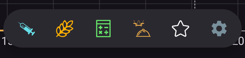
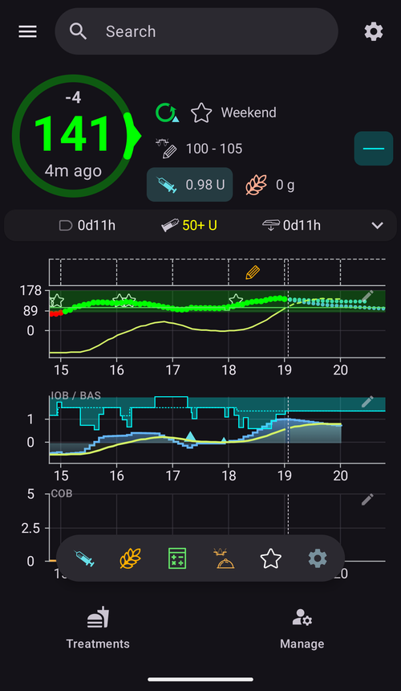
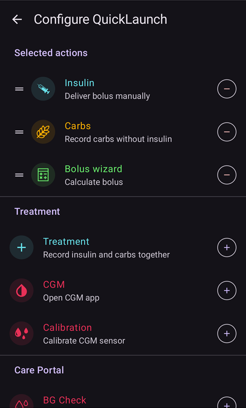
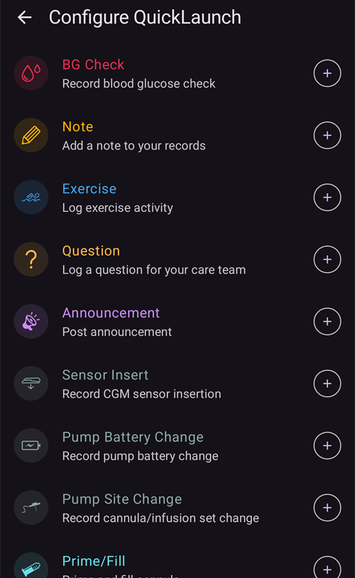
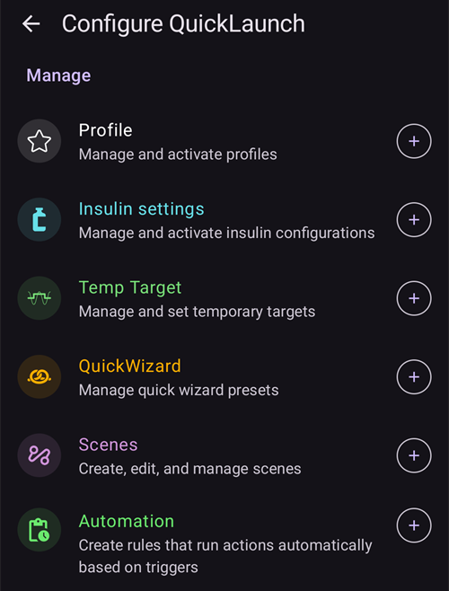
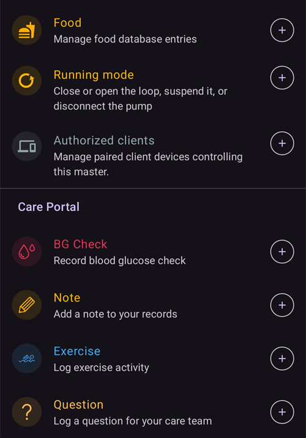
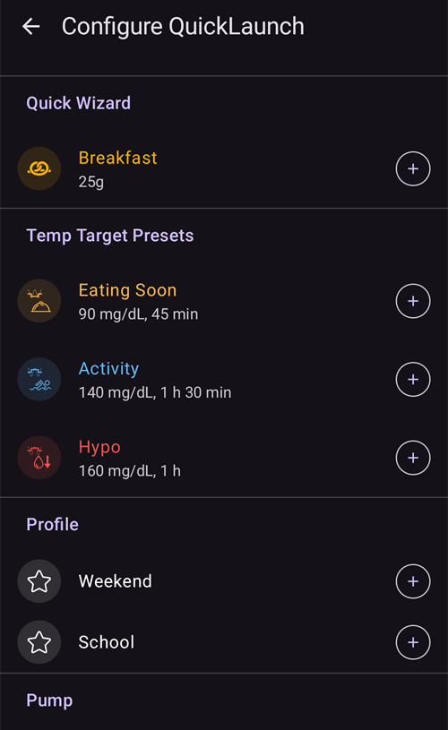
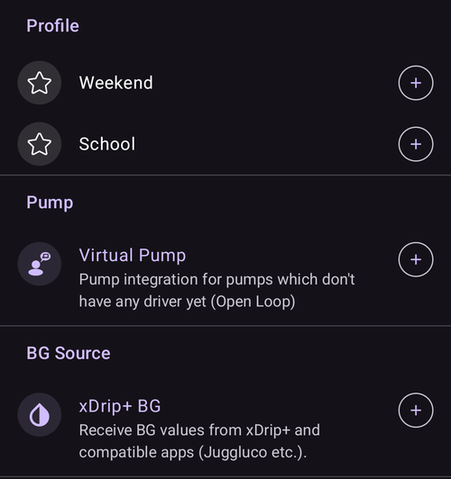
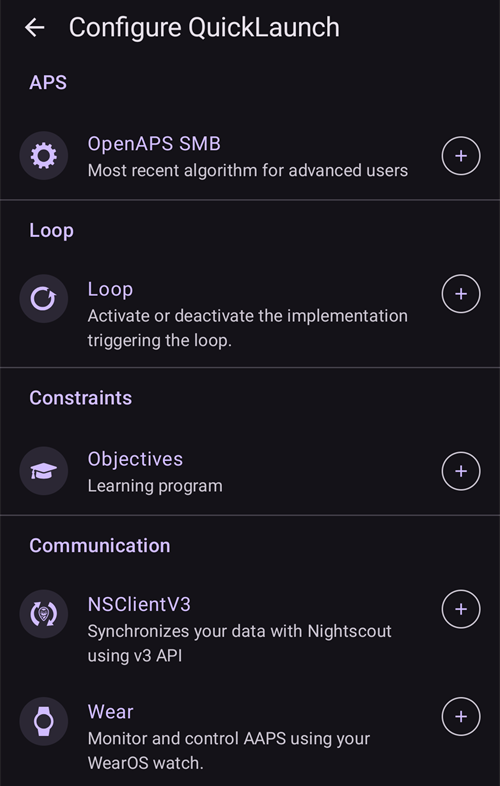

(quicklaunch)=
# Hurtigstart (værktøjslinje med hurtige handlinger i oversigten)

**Hurtigstart** er den lille **værktøjslinje med hurtige handlinger**, som ligger nederst i **AAPS**-oversigten, lige over navigationen nederst. Det er en række knapper, som du selv kan tilpasse, og som virker med ét tryk: Du bestemmer, hvilke handlinger der er der, og i hvilken rækkefølge. Så er det, du gør oftest, altid kun ét tryk væk på hovedskærmen.

```{contents} Table of contents
:depth: 2
:local: true
```



---

## Brug af værktøjslinjen

Værktøjslinjen ligger i **oversigten**, mellem graferne og navigationen nederst:



- **Tryk** på et ikon for at udføre dets handling – præcis som hvis du havde åbnet den fra dens normale skærm (en bolus eller behandling viser stadig først den sædvanlige bekræftelse).
- **Tryk længe** på et ikon for at se et **værktøjstip** med handlingens navn og en kort beskrivelse.
- Hvis du tilføjer **flere knapper, end der er plads til** på skærmen, flyttes de ekstra knapper til en **overløbsmenu** (knappen **⋮** i slutningen af værktøjslinjen).
- Hvert ikon beholder sin handlings **farve** (f.eks. insulin, kulhydrater, midlertidigt mål), så du kan genkende det med det samme.

```{admonition} The toolbar is always there
:class: note
Den sidste knap er altid **Konfigurer Hurtigstart** (tandhjulet **⚙️**). Den kan ikke fjernes, så du altid kan komme til konfigurationsskærmen direkte fra værktøjslinjen. Som standard har værktøjslinjen kun to knapper – **Bolusberegner** og dette tandhjul.
```

---

## Konfiguration af Hurtigstart

Tryk på tandhjulet **⚙️** på værktøjslinjen (eller åbn **[Konfiguration](../SettingUpAaps/ConfigBuilder.md) → … → Konfigurer Hurtigstart**) for at åbne skærmen **Konfigurer Hurtigstart** (*»Tilpas hurtigknapper på oversigten«*).



Skærmen har to dele:

- **Valgte handlinger** (øverst) – de knapper, der lige nu er på din værktøjslinje, i samme rækkefølge som på værktøjslinjen.
- Et **katalog** under det – alle handlinger, du kan tilføje, sorteret i kategorier. Hver post i kataloget har en **➕**-knap til at tilføje den.

### Valgte handlinger – ændr rækkefølge, rediger, fjern

Hver valgt handling har:

- et **⠿ trækhåndtag** – tryk og træk for at **ændre rækkefølgen** af knapperne (rækkefølgen her er rækkefølgen på værktøjslinjen),
- en **−**-knap – **fjern** den fra værktøjslinjen,
- og kun for en **Profil**-genvej en **✏️**-knap til at redigere procent/varighed (se [Profilgenveje](#profile-shortcuts)).

Ændringer virker **med det samme** – der er ingen separat *Gem*. En handling, du tilføjer, kommer i slutningen af værktøjslinjen; flyt den derfra.

---

## Kategorierne af handlinger

Kataloget samler alt, hvad du kan tilføje, i de følgende kategorier, i denne rækkefølge. Kategorier, der ikke har noget at tilbyde (f.eks. hvis du ikke har nogen scener), vises bare ikke.

### Behandling

De daglige dialoger til behandling og CGM:

- **Insulin** – giv en bolus manuelt.
- **Kulhydrater** – registrer kulhydrater uden insulin.
- **Bolusberegner** – åbn bolusberegneren.
- **Behandling** – registrer insulin og kulhydrater sammen.
- **CGM** – åbn din CGM-app (f.eks. xDrip).
- **Kalibrering** – kalibrer CGM-sensoren.

### Careportal

Careportal-hændelser og registreringer af vedligeholdelse af enheder:

- **BS-kontrol**, **Notat**, **Motion**, **Spørgsmål**, **Meddelelse**,
- **Sensorindstik**, **Skift af pumpebatteri**, **Skift indstikssted**, **Klargør/Fyld**, **Rotation af indstikssteder**.

**Klargør/Fyld** og **Skift af pumpebatteri** vises kun, når din pumpe bruger dem. Patchpumper fylder og skifter f.eks. batteri i deres egne aktiveringstrin, så disse poster vises ikke for dem (ligesom i arket **Administrer**).



Det er de samme poster, som du ellers finder i arkene **[Behandlinger](#v4changes-treatments)** og **[Administrer](#v4changes-manage)** – Hurtigstart lægger bare dem, du bruger, i oversigten.

### Administrer

Skærmene i arket **[Administrer](#v4changes-manage)**, i samme rækkefølge, så du kan åbne den, du bruger mest, fra værktøjslinjen:

- **Profil**, **Insulinindstillinger** (administrer og aktiver insulinkonfigurationer – med vilje et andet navn end **Insulin**, fordi den knap giver en bolus), **Midlertidigt mål**, **Hurtigbolus**, **Scener**, **Automatisering**, **Mad**,
- **Loop-tilstand** – luk eller åbn loopet, suspender det, eller afbryd pumpen,
- **Godkendte klienter** – kun på en hovedenhed eller en parret klient.

Disse knapper åbner skærmen; de starter ikke noget af sig selv. For at starte en scene eller en hurtigbolus med ét tryk skal du tilføje den fra kategorien **Scener** eller **Hurtigbolus** nedenfor.

 

### Hurtigbolus

Hvert af dine forvalg for **[Hurtigbolus](QuickWizards.md)** kan tilføjes som en knap, så et måltid, du ofte spiser, kun er ét tryk væk i oversigten. Knappen har forvalgets navn og viser mængden af kulhydrater/insulin; når du trykker på den, kører hurtigbolussen med sin sædvanlige bekræftelse.

Hurtigboluser, der kun skal vises på uret, tilbydes ikke. En hurtigbolus-knap på værktøjslinjen følger de samme regler som i arket **Behandlinger**: Den er skjult uden for sit [gyldige tidsrum](#quickwizard_validity) og i kort tid efter brug. Den bliver i konfigurationen af din værktøjslinje og kommer tilbage, når hurtigbolussen kan bruges igen.

### Scener

Hver aktiveret **[scene](Scenes.md)** kan tilføjes som en knap. Når du trykker på den, bliver du bedt om at bekræfte, og så aktiveres scenen (den samme samling af handlinger, som du får fra skærmen Scener). Denne kategori vises kun, hvis du har mindst én scene.

Værktøjstippet og kataloget viser det samme resumé som **Administrer → Scener**, for eksempel *»3 handlinger, 2 t → Nedkøling«*, hvor navnet efter pilen er den scene, der følger efter.

### Automatisering

Dine automatiseringsregler af typen **brugerhandling** (dem, du selv starter) kan tilføjes som knapper. Når du trykker på en, bliver du bedt om at bekræfte, og så udføres regelens handlinger.

```{admonition} Automation buttons run on the master
:class: note
Automatisering kører på **hovedenheden**, så automatiseringsgenveje tilbydes og kører kun på hovedenheden. De er ikke tilgængelige på en parret **[klient](../RemoteFeatures/ClientMasterControl.md)**.
```

### Forvalg for midlertidige mål

Hvert af dine forvalg for **[Midlertidigt mål](TempTargets.md)** kan tilføjes som en knap (navn, mål og varighed vises, for eksempel *»Spiser snart – 5,0 mmol/l, 45 min«*). Når du trykker på den, bliver du bedt om at bekræfte, og så starter det midlertidige mål.



(profile-shortcuts)=
### Profil

Hver **[profil](ProfileSwitch-ProfilePercentage.md)** kan tilføjes som en **genvej**, der laver et **profilskift** med ét tryk. I modsætning til de fleste genveje har en profilgenvej sin egen **procent** og **varighed**, som du indstiller, efter du har tilføjet den, med **✏️**-knappen:

- **Procent** (30–250%, i trin på 5%) – skalerer profilen, når den bruges. 100% bruger den, som den er.
- **Varighed** (0–10080 min, det vil sige op til 7 dage, i trin på 10 min) – hvor længe skiftet varer. **0 = Permanent** (indtil du skifter igen).



Så kan du have flere knapper til den **samme** profil med forskellig styrke – for eksempel *»Profil 100%«* og *»Profil 70% i 2 t«* – og bruge hver af dem med ét tryk. (Du kan tilføje den samme profil mere end én gang med forskellige indstillinger.)

### Plugins



Til sidst kan ethvert **aktiveret plugin**, der har sin egen skærm, tilføjes som en genvej, der åbner det direkte. De er sorteret efter plugin-type – **Pumpe**, **BS-kilde**, **APS**, **Loop**, **Detektering af følsomhed**, **Udjævning**, **Kalibrering**, **Begrænsninger**, **Kommunikation** og **Generelt** – så du for eksempel kan gå direkte til din pumpe- eller loop-skærm fra oversigten.

---

## Hurtigstart og hovedenhed/klient

I modsætning til de fleste af dine indstillinger bliver **Hurtigstart-værktøjslinjen konfigureret for hver enhed** – den er gemt **lokalt og synkroniseres ikke** mellem din hovedenhed og parrede klienter, så hver enhed har sit eget sæt knapper. (Den *er* med i en **sikkerhedskopi/eksport** af indstillingerne, så en gendannelse bringer den tilbage på den samme enhed.)

Hvad hver enhed kan lægge på sin værktøjslinje, afhænger stadig af, hvad den har: Hurtigboluser, scener, forvalg for midlertidige mål og profiler synkroniseres alle, så en klients katalog tilbyder de samme elementer – du vælger dem bare for hver enhed. Et par ting, du skal vide:

- Knapper, hvis mål ikke længere findes (en slettet hurtigbolus, scene eller et slettet forvalg, en deaktiveret regel), **springes automatisk over**.
- Genveje til **Automatisering** tilbydes og kører kun på **hovedenheden** (automatisering kører på hovedenheden). Knapper til scener, hurtigboluser, midlertidige mål og profiler er tilgængelige på en klient.
- Når du trykker på en knap på en klient, som skal køres på hovedenheden (en bolus, et midlertidigt mål, et profilskift eller en scene), udfører **hovedenheden** den og står for bekræftelsen. Se [Styring mellem hovedenhed ↔ klient](../RemoteFeatures/ClientMasterControl.md).

---


<!-- =====================================================================
     Screenshots captured from a real master device:
       - quicklaunch_toolbar.png    (cropped close-up of the overview toolbar pill)
       - quicklaunch_overview.png   (full overview showing the toolbar in place)
       - quicklaunch_config.png     (Configure QuickLaunch: Selected actions + Treatment + start of Manage)
       - quicklaunch_dynamic.png    (catalog: Quick Wizard / Scenes / Automation / Temp Target Presets)
       - quicklaunch_categories.png (catalog: Profile shortcuts + plugin categories)
     No QuickLaunch action was actually run (nothing delivered; only scrolled).
     Maintainers: relocate page + images and fix cross-links as needed.
     ===================================================================== -->
