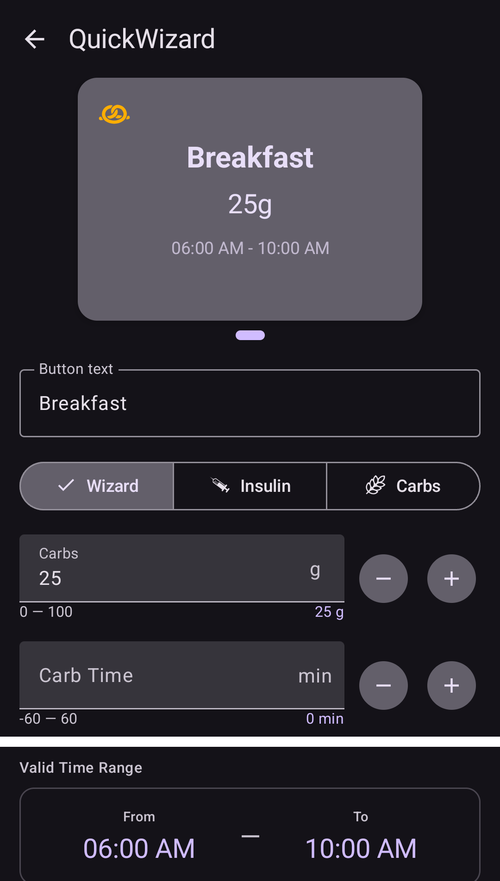
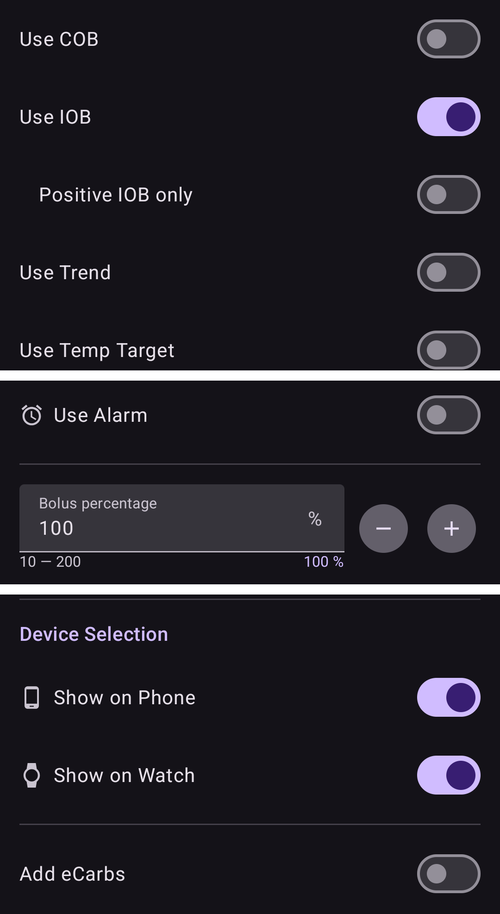
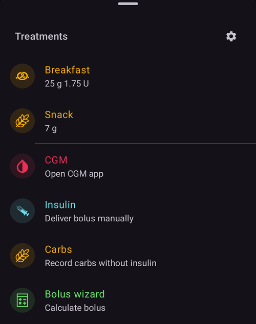
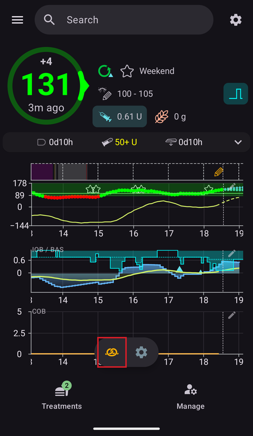
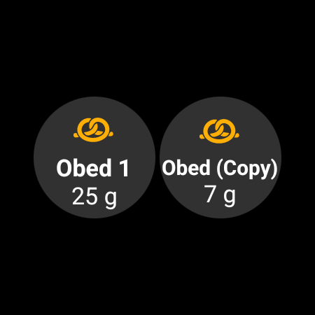

(quickwizards)=
# Hurtigboluser (bolus med ét tryk)

En **Hurtigbolus** er en gemt knap til et måltid eller en situation, der kommer igen og igen. Du bruger den med ét tryk. Den har en fast mængde **kulhydrater** (og hvordan der skal doseres for dem). Så kan du give en bolus – eller kun registrere kulhydrater – med ét tryk og en bekræftelse, i stedet for at åbne hele bolusberegneren hver gang.

```{contents} Table of contents
:depth: 2
:local: true
```

---

## Sådan åbner du Hurtigbolus

Åbn skærmen **Administrer** (navigation nederst), og vælg **Hurtigbolus** (*»Administrer forvalg til hurtigbolus«*).

---

## Administration af hurtigboluser

Dine hurtigboluser vises som en **karrusel af kort, som du kan swipe** (hvert kort viser knapteksten, kulhydrater og det gyldige tidsrum). Editoren nedenfor indstiller den **valgte**; handlingslinjen nederst har **➕ tilføj**, **⧉ klon**, **🗑️ slet** og en **▶**-knap, som kører den valgte hurtigbolus.



Editorens vigtigste felter er:

- **Knaptekst** — den tekst, der vises på knappen.
- **Kulhydrater** og **Kulhydrattid** — mængden af kulhydrater og tidsforskydningen.
- **Gyldigt tidsrum** — se [Gyldighed](#quickwizard_validity).
- **Beregnerindstillinger** og **Valg af enhed** — se nedenfor.

---

## De tre tilstande

Vælgeren øverst i editoren — **Beregner / Insulin / Kulhydrater** — bestemmer, **hvad knappen gør**, når du trykker på den:

- **Beregner** — kører hele **bolusberegneren** for de indstillede kulhydrater og bruger dit nuværende **BS, IOB, COB og trend** (efter *Beregnerindstillinger* nedenfor). Den giver den *beregnede* bolus og registrerer kulhydraterne. Det er den klassiske hurtigbolus.
- **Insulin** — giver en **fast, forudindstillet insulinmængde**, som du selv angiver — uden beregning.
- **Kulhydrater** — registrerer **kun de indstillede kulhydrater**,**uden bolus**.

---

## Beregnerindstillinger (tilstanden Beregner)

For en knap i tilstanden **Beregner** vælger du, hvilke værdier beregningen bruger:

- **Brug BS**, **Brug COB**, **Brug IOB** (med *Kun positiv IOB*), **Brug trend** (*Alle / Kun positiv / Kun negativ*), **Brug midlertidigt mål**, **Brug alarm**.
- **Bolusprocent** — skalerer den beregnede bolus.
- **Tilføj e-kulhydrater** — planlægger også forlængede kulhydrater.



---

## Gyldighed — hvornår knappen vises

(quickwizard_validity)= **Gyldigt tidsrum** (*Fra / Til*) styrer, **hvornår** en hurtigbolus vises og kan bruges. En knap, der f.eks. er sat til **06:00–10:00**, vises kun om morgenen — så en hurtigbolus til *Morgenmad* ikke fylder din skærm (eller bliver trykket ved en fejl) ved aftensmaden. Uden for sit tidsrum er knappen skjult i arket **Behandlinger** og på [Hurtigstart-værktøjslinjen](QuickLaunch.md). En knap på værktøjslinjen bliver ikke slettet: den kommer tilbage, når tidsrummet begynder igen.

Når det gyldige tidsrum er kortere end 4 timer, er knappen også skjult i 30 minutter, efter du har brugt den, så det samme måltid ikke bliver indtastet to gange ved en fejl.

---

## Hvor du bruger den

Knapperne under **Valg af enhed** bestemmer, hvor hver hurtigbolus vises:

- **Vis på telefon** — den vises i **arket [Behandlinger](../Maintenance/V4Changes.md)** (med den beregnede dosis vist direkte på knappen). En hurtigbolus, der vises på telefonen, kan også **fastgøres som en knap til hurtig handling i oversigten**: åbn *Konfigurer Hurtigstart* (⚙ på værktøjslinjen [Hurtigstart](QuickLaunch.md)), og tilføj den fra kategorien **Hurtigbolus**.
- **Vis på ur** — den vises på **Wear OS-feltet Hurtigbolus** (swipe til det i urets karrusel af felter, og tryk på en knap for at køre den — ligesom [scenefeltet](#scenes-from-watch)).

```{admonition} Don't see Device Selection?
:class: note
Afsnittet **Valg af enhed** vises kun i editoren, når pluginet **Ur** er aktiveret og indstillingen **Styring fra ur** er slået til. Uden den vises alle hurtigboluser bare på telefonen.
```

På telefonen vises hurtigboluserne øverst i arket **Behandlinger** nederst på skærmen:



…og som en knap til hurtig handling i oversigten:





En parret **klient** (**AAPSClient**) kan også starte en hurtigbolus — **hovedenheden** beregner og giver den (se [Styring mellem hovedenhed ↔ klient (signeret fjernstyring)](../RemoteFeatures/ClientMasterControl.md)).

Uanset hvor den startes, viser en hurtigbolus altid en **bekræftelse** (bekræftelsen fra hovedenheden, når den startes fra en klient eller et ur), før noget bliver givet.

En hurtigbolus bliver afvist, når dens dosis er over din maks. bolus, eller når dens kulhydrater eller e-kulhydrater er over dine maks. kulhydrater (f.eks. efter at du har sænket grænsen). Når kulhydraterne er over grænsen, er knappen i arket **Behandlinger** deaktiveret. Rediger hurtigbolussen eller grænsen.

---

## Tilføj og fjern

- **➕ Tilføj** — opret en ny hurtigbolus.
- **⧉ Klon** — kopier en som udgangspunkt.
- **🗑️ Slet** — fjern en.

Med to eller flere hurtigboluser kan du også ændre deres rækkefølge i karrusellen: tryk på ikonet **Skift rækkefølge** (⇅) i den øverste linje, flyt kortet i midten med **◀ / ▶-flytteknapperne**, og bekræft med **✓**. (Knapperne ser ud på samme måde som ved [ændring af profilernes rækkefølge](ProfileSwitch-ProfilePercentage.md).)

Hurtigboluser er en del af den synkroniserede konfiguration, så de deles mellem din hovedenhed og parrede klienter.

---


<!-- =====================================================================
     Screenshots captured from a real master device:
       - quickwizard_editor.png   (Manage → QuickWizard: carousel, mode, carbs, carb time, valid time range)
       - quickwizard_options.png  (Calculator Options, Bolus percentage, Device Selection)
       - quickwizard_overview.png (the QuickWizard quick-action button on the overview)
       - quickwizard_watch_tile.png (the Wear OS QuickWizard tile)
     No QuickWizard was actually run (no bolus delivered).
     Maintainers: relocate page + images and fix cross-links as needed.
     ===================================================================== -->
