(scenes)=
# Scener (forudindstillinger til situationer)

En **scene** er en forudindstilling med et navn, som udfører **flere handlinger på én gang** — f.eks. en forudindstilling til *Søvn*, *Motion* eller *Sygedag*, som skifter din profil, sætter et midlertidigt mål, slår SMB til eller fra og tilføjer et Careportal-notat med et enkelt tryk, eventuelt i en bestemt periode.

```{contents} Table of contents
:depth: 2
:local: true
```

---

## Hvad er en scene

I stedet for at ændre flere ting manuelt, hver gang en situation gentager sig, sætter du dem op én gang som en scene og aktiverer den med ét tryk. En scene kan samle alle disse handlinger:

- **Profilskift** — skift profil og/eller juster den med en procent (f.eks. 70%).
- **Midlertidigt mål** — sæt et midlertidigt mål (f.eks. *Aktivitet*, *Spiser snart* eller en brugerdefineret værdi).
- **SMB til/fra** — aktiver eller deaktiver SMB (super-mikro-boluser), mens scenen er aktiv.
- **Loop-tilstand** — skift loop-tilstand (f.eks. til en mere forsigtig tilstand).
- **Careportal-notat** — registrer en hændelse (f.eks. *Motion*, *Sygdom*), så den vises på grafen og i Nightscout.

En scene har også en **varighed** — en fast tid (minutter/timer/dage) eller *Ubegrænset (manuel afslutning)* — og en **sluthandling**, som udføres, når scenen slutter: enten en **notifikation**, eller scenen kan **kædes** sammen med en anden scene (f.eks. *Sygedag → Motion*).

---

## Administrer scener

Åbn **Administrer → Scener** for at se, oprette, redigere, aktivere/deaktivere og ændre rækkefølgen af dine scener.

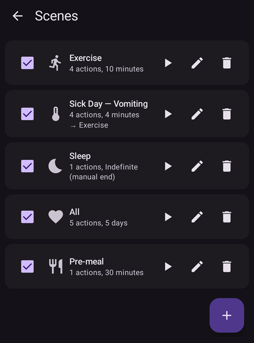

Hvert scenekort viser:

- et **afkrydsningsfelt** til at aktivere/deaktivere scenen,
- et **ikon** og et **navn**,
- et resumé — *»N handlinger, varighed«* — og **→ kædet scene**, hvis scenen er kædet sammen med en anden,
- og tre knapper: **▶ aktiver**, **✏️ rediger**, **🗑️ slet**.

Tryk på knappen **+** for at oprette en ny scene.

---

## Opret eller rediger en scene

### Start fra en skabelon

For at **oprette** en scene skal du trykke på knappen **+** på skærmen Scener. Det første trin er **Start fra skabelon**: vælg en færdig scene til en almindelig situation — *Motion*, *Sygedag*, *Sygedag — opkast*, *Søvn*, *Nat efter motion*, *Før måltid*, *Alkohol*, *Bilkørsel*, *Badning*, *Lutealfase*, *Varmt vejr*, *Medicinsk indgreb* — eller start fra en *Tom* scene. Hver skabelon **udfylder de anbefalede handlinger på forhånd**, og du kan justere alt i de følgende trin. For example, the *Sleep* template lasts 8 hours and sets a temporary target: it selects your *Custom* temp target preset if you have one, otherwise you choose a preset in the *Temporary target* step.

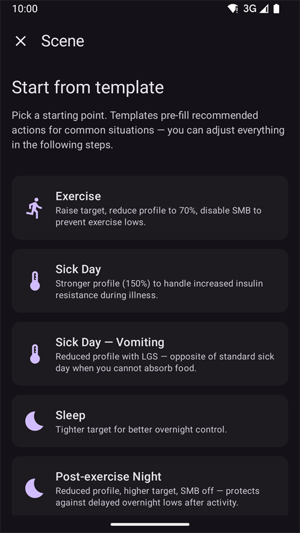

Når du har valgt en skabelon, bliver dens formål forklaret — *hvornår* og *hvorfor* du skal bruge den — før du fortsætter:

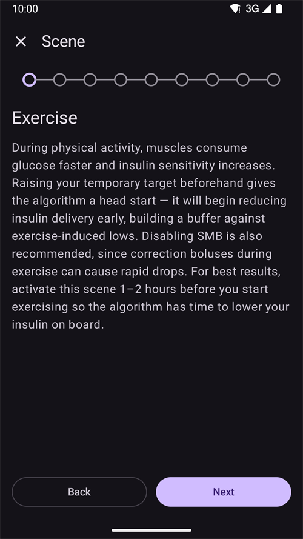

### Gå igennem handlingerne

Resten af editoren er en kort guide, som går **trin for trin**. Hvert trin er én type handling med en kontakt *»Medtag … i scenen«* — slå den kun til for de handlinger, som scenen skal udføre, og lad resten være slået fra.

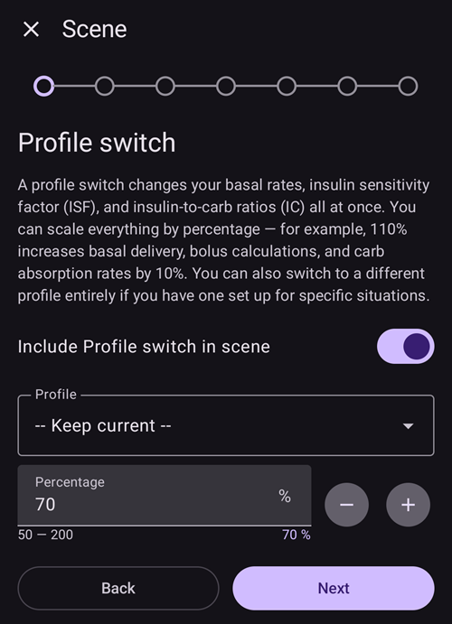

Gå igennem trinnene med **Næste**/**Tilbage**: *Profilskift*, *Midlertidigt mål*, *SMB*, *Loop-tilstand*, *Careportal-notat*, derefter **varigheden**, **sluthandlingen** (notifikation eller kæde til en anden scene) og til sidst scenens **navn og ikon**. Gem, når du er færdig. (For at **redigere** en eksisterende scene skal du trykke på dens knap **✏️** — så kommer du direkte ind i disse trin.)

Hvert trin starter med en kort forklaring af, hvad handlingen gør. Trinnene ser sådan ud, her med skabelonen *Motion*:

**Midlertidigt mål** — vælg en af dine forudindstillinger for midlertidigt mål:

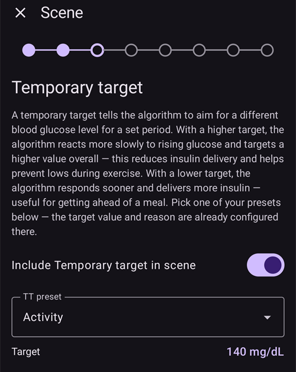

**SMB** — aktiver eller deaktiver SMB, mens scenen er aktiv:

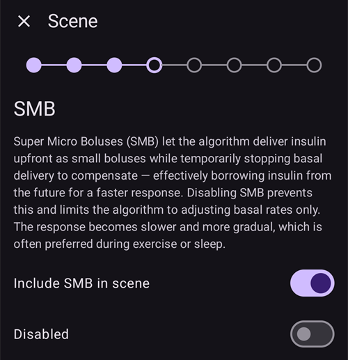

**Loop-tilstand** — skift eventuelt loop-tilstand:

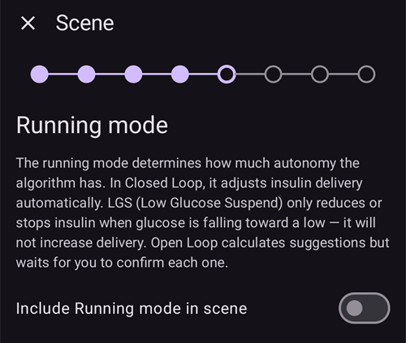

**Careportal** — den type hændelse og det notat, der skal registreres:

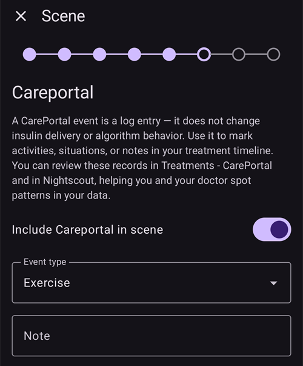

**Varighed** — hvor længe scenen er aktiv; 0 betyder, indtil du selv afslutter den:

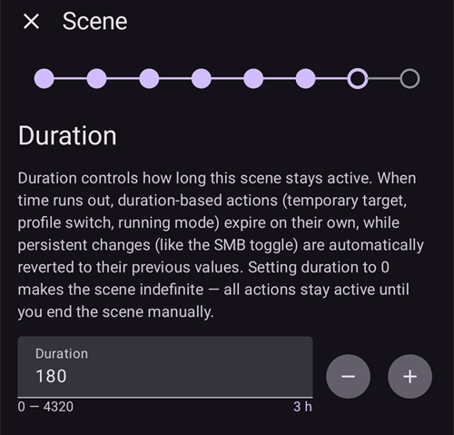

**Opfølgende scene** — eventuelt den scene, der starter, når denne slutter:

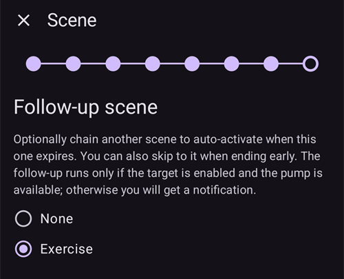

**Scene** — navnet og ikonet. Tryk på **Afslut** for at gemme:

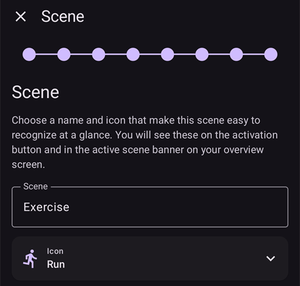

---

## Aktiver en scene

Aktiver en scene fra listen **Scener** (knappen **▶**) eller fra punktet **Scener** i den nederste navigation. I arket **Scener** i den nederste navigation viser hver scene det samme resumé som i listen Scener, og **blyanten** øverst i arket åbner **Administrer → Scener**, hvor du kan oprette eller redigere dine scener.

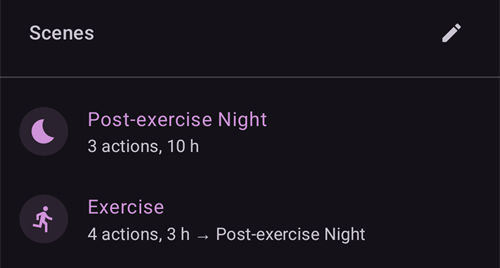

Hvis [Bolusbeskyttelse](#Preferences-protection) er slået til, beder **AAPS** om den, før en scene starter eller slutter. For at ændre en scene skal du i stedet bruge [Beskyttelse af indstillinger](#Preferences-settings-protection).

Før noget bliver udført, får du en **bekræftelse**, som viser præcis, hvad scenen vil gøre, så du kan kontrollere det:

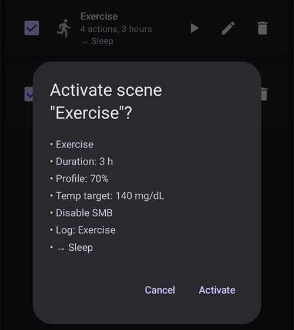

Hvis scenen er kædet sammen med en anden, slutter bekræftelsen med **→** og navnet på den opfølgende scene, på samme måde som i listen Scener.

Når du starter scenen fra punktet **Scener** i den nederste navigation, er bekræftelsen en enklere dialog med den samme liste over handlinger. Tryk på **OK** for at aktivere:

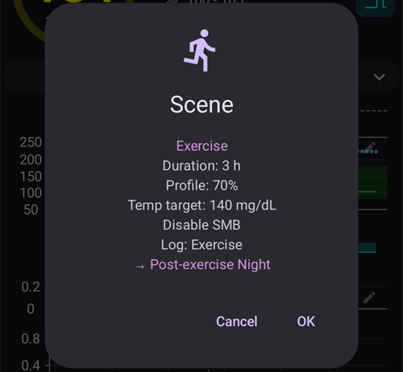

Når du har bekræftet, bliver handlingerne udført, og den **aktive scene** vises øverst i oversigten med knappen **Afslut scene**. Hvis scenen er kædet sammen med en anden, viser banneret også navnet på den opfølgende scene:

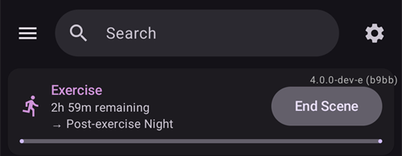

Scenens handlinger gælder, indtil:

- dens **varighed** slutter (**sluthandlingen** udføres — en notifikation, eller den næste scene i kæden starter), eller
- du trykker på **Afslut scene** for at afslutte den manuelt. Hvis scenen er kædet sammen med en anden, får du to valg: **Spring til** den opfølgende scene (den aktive scene slutter, og den opfølgende scene starter nu) eller **Afslut scene** (den aktive scene slutter, og den opfølgende scene starter ikke).

En scene uden opfølgende scene beder dig kun om at bekræfte:

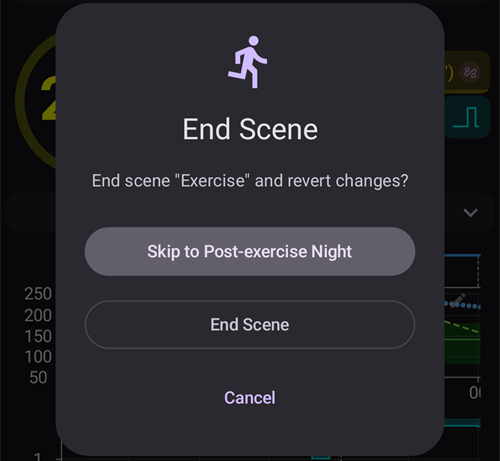

Når en scene afsluttes, bliver de ændringer, den har lavet, **fortrudt** (f.eks. det profilskift og det midlertidige mål, som scenen startede). The confirmation asks *End scene "..." and revert changes?* and lists what will be undone, one line per change: for example *Cancel temporary target*, *Revert profile change*, *Re-enable SMB* or *Cancel running mode override*. Care-portal notes stay: the list then ends with *CarePortal entries will not be reverted*. You get the same confirmation whether you end the scene from the banner on the main screen or from the Scenes screen.

Mens en scene er aktiv, har profilen og målet på hovedskærmen et lille sceneikon, når det er scenen, der har sat dem. Arket **Scener** i den nederste navigation er stadig tilgængeligt, så du kan starte en anden scene:

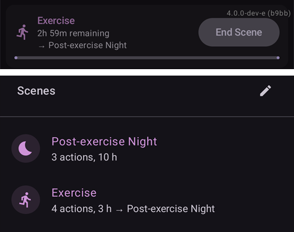

Når varigheden selv løber ud, bliver ændringerne fortrudt med det samme, og banneret skifter til **Scene afsluttet** med knappen **Afvis**. Når du afviser, fjernes kun banneret fra skærmen — selve scenen er allerede slut, så automatiseringsregler og en kædet scene fortsætter uden at vente på det.

---

## Start scener fra Automatisering

En scene behøver ikke at blive startet manuelt — **Automatisering** kan starte den for dig. Når du tilføjer en handling til en automatiseringsregel (**Administrer → Automatisering**), har listen over handlinger en kategori **Scener**:

- **Kør scene** — aktiver en scene, når reglens udløsere bliver opfyldt (f.eks. på et bestemt tidspunkt, når du kommer til et bestemt sted, eller når glukose krydser en grænse).
- **Aktiver scene** / **Deaktiver scene** — gør en scene tilgængelig (eller ikke tilgængelig) uden at aktivere den.

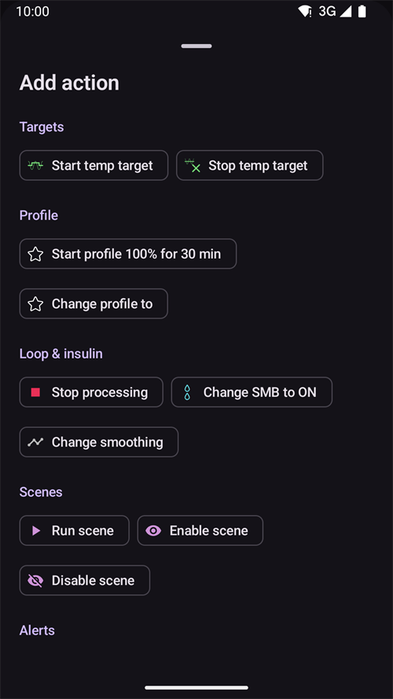

Automatisering kan også **reagere på** en scene: listen over udløsere har udløseren **Scene**, så en regel kun kører, mens en bestemt scene er aktiv. Sammen med en scenes **sluthandling** (fortryd, giv besked eller kæd til en anden scene) kan scener på denne måde starte, følge efter hinanden og slutte automatisk.

---

## Scener med hovedenhed/klient og et ur

Den **aktuelt aktive scene bliver synkroniseret** på alle dine parrede enheder — aktiver den på én telefon, så viser de andre den også.

En parret **klient** (**AAPSClient**) kan også aktivere eller afslutte en scene: anmodningen bliver sendt til **hovedenheden**, som laver bekræftelsen og udfører scenen på sin egen tilstand. Se [Styring mellem hovedenhed ↔ klient (signeret fjernstyring)](../RemoteFeatures/ClientMasterControl.md) for at se, hvordan det virker.

(scenes-from-watch)=
### Fra et Wear OS-ur

Scener er tilgængelige på et **Wear OS-ur** som et **Scene-felt**. Swipe til feltet **Scene** i urets karrusel af felter (tilføj det først fra karrusellens liste over felter, hvis det ikke er der endnu), og tryk på den scene, du vil starte:

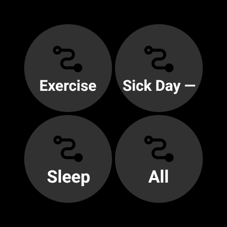

Feltet har fire pladser. Som standard bliver hver plads **automatisk** udfyldt med den næste af dine aktiverede scener, i den rækkefølge de har på telefonen. Hvis du selv vil vælge, så **tryk længe på feltet** og åbn dets indstillinger: for hver af de fire pladser kan du beholde **Automatisk**, fastgøre en **bestemt scene** eller vælge **Ingen** for at lade pladsen være tom. En plads, der er fastgjort til en scene, som siden er blevet slettet eller deaktiveret, viser **Ikke tilgængelig** — vælg en anden scene til pladsen.

Uret viser derefter en bekræftelse — tryk på **✓** for at aktivere, eller swipe tilbage for at annullere:

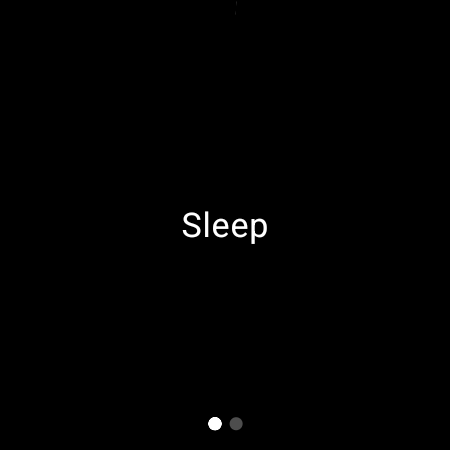

Ligesom på en klient er det **hovedenheden, der laver bekræftelsen og kører scenen**; uret sender kun anmodningen videre (via klienttelefonen, hvis uret er parret med en klient).

Mens en scene kører — eller dens banner **Scene afsluttet** stadig vises på telefonen — viser feltet knappen **Afslut** med navnet på scenen under den. Tryk på den for at afslutte den aktive scene eller for at fjerne det resterende banner, direkte fra dit håndled.

Hvis den kørende scene er kædet sammen med en anden, viser feltet også knappen **Spring over** med navnet på den opfølgende scene under den. Det er de samme to valg som på telefonen:

- **Afslut** — den aktive scene slutter. Bekræftelsen fortæller dig, at den opfølgende scene ikke vil starte.
- **Spring over** — den aktive scene slutter, og den opfølgende scene starter nu. Bekræftelsen viser navnene på begge scener.

Urets [skærm Loop-status](#WearOsSmartwatch-loop-status) viser også den aktive scene, den tid der er tilbage, og den opfølgende scene.

---


<!-- =====================================================================
     Screenshots captured from a real master device:
       - scenes_list.png        (Manage → Scenes management list)
       - templates_picker.png   (create: "Start from template" picker)
       - template_explanation.png (create: chosen template's explanation)
       - scene_editor.png       (scene editor, Profile switch step)
       - scene_confirmation.png (scene activation confirmation — also used on the Client/Master page)
       - scene_active_banner.png (overview active-scene banner with the End Scene button)
       - automation_scene_action.png (Automation action picker — Scenes category)
       - scene_watch_tile.png    (Wear OS Scene tile)
       - scene_watch_confirm.png (Wear OS scene confirmation)
     Maintainers: relocate page + images and fix cross-links as needed.
     ===================================================================== -->
