# Midlertidige mål

## Hvad er midlertidige mål, og hvor kan jeg vælge og indstille dem?

Et **midlertidigt mål** (kort **TT**) er en funktion i **AAPS**, som lader brugeren ændre sit [**BS**-målområde](#profile-glucose-targets) til planlagte aktiviteter. Det gør **AAPS** ved at ændre brugerens insulinforbrug.

Et glukosemål, især hvis det kun gælder kort tid (under 4 timer), behøver ikke at være den *faktiske værdi*, du forventer eller ønsker, at dit glukoseniveau når. Det er snarere en god måde at fortælle **AAPS**, at den skal være mere eller mindre aggressiv, mens dit glukoseniveau stadig holdes inden for området.

Midlertidige mål kan indstilles inden for disse grænser:

|          | Midlertidigt mål          |
| -------- | ------------------------- |
| Minimum  | 4 mmol/l eller 72 mg/dl   |
| Maksimum | 10 mmol/l eller 180 mg/dl |

**AAPS** har tre indbyggede forvalg for **midlertidige mål**: til motion (**Aktivitet**), til måltider (**Spiser snart**) og til forventet hypoglykæmi (**Hypo**). De ligger på skærmen **Midlertidigt mål** (**Administrer** → **Midlertidigt mål**), som du også kan åbne ved blot at trykke på **målchippen** på hovedskærmen.

Brugerne bør have realistiske forventninger til de resultater, der kan opnås, når de vælger et **midlertidigt mål** i **AAPS**. Om det lykkes at nå et ønsket **BS**-mål, afhænger af mange faktorer, f.eks.: hvor gode brugerens **AAPS**-indstillinger er, den samlede **BS**-kontrol, **IOB**, insulinfølsomhed, insulinresistens, hvor hårdt man træner og så videre.

Et **midlertidigt mål** kan tage ca. 30 minutter eller længere om at nå et ønsket **BS**-mål. **AAPS** kan ikke nå et **BS**-mål med det samme, og det bør brugerne huske, når de vælger et **midlertidigt mål**.

Afsnittene nedenfor opsummerer funktionerne i **midlertidigt mål – Aktivitet**, **midlertidigt mål – Spiser snart** og **midlertidigt mål – Hypo**. De viste værdier er standardværdierne fra start – du kan [tilpasse hvert forvalg](#TempTargets-change-preset-defaults) til dine egne behov.

### TT – Aktivitet

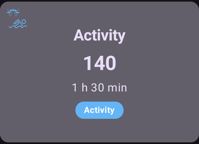

**BS-mål (standardforvalg, kan ændres)**

AAPS vil forsøge at nå 140 mg/dl eller 7,8 mmol/l i 1 t 30 min

**Andre ting, som brugerne kan tage med i overvejelserne, når de vælger**:

Afhængigt af **BS**-niveauet vil **AAPS** »sænke« insulinforbruget for at nå **BS**-målet. Hvis **BS**-målet ikke er inden for området (dvs. over det **BS**-mål, der er valgt i brugerens **profil**), kan **AAPS** beholde basalen.

I lukket loop gælder for **SMB**:

- *kan blive* deaktiveret (se mere nedenfor), og/eller
- basal may be activated if **AAPS** is in negative **IOB** or < 0.

Brugerne kan også overveje:

- at *vælge* denne **TT** 1-2 timer før den planlagte motion for at sikre lavere IOB (det rigtige tidspunkt for denne TT er forskelligt fra person til person); og
- at *vælge* en midlertidig profil (sænkning) i den planlagte aktivitets varighed for at sikre lavere **IOB**;
- at *sørge for*, at **TT** bliver *deaktiveret* kort før motionen, fordi **IOB** allerede er lavere, og nogle brugere oplever en hurtig stigning i **BS** efter motion.

### TT – Spiser snart

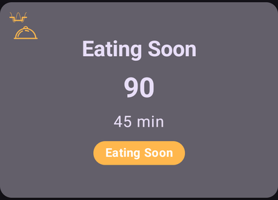

**BS-mål (standardforvalg, kan ændres)**

AAPS vil forsøge at nå 90 mg/dl eller 5,0 mmol/l i 45 minutter

**Andre ting, som brugerne kan tage med i overvejelserne, når de vælger**:

I lukket loop gælder for **SMB**:

- forbliver aktiveret, og/eller
- basal kan også blive aktiveret, afhængigt af indstillingerne i brugerens **profil**.

Afhængigt af **BS**-niveauet vil **AAPS** »øge« insulinforbruget inden for brugerens **AAPS**-indstillinger for at nå det ønskede **BS**-mål.

### TT – Hypo

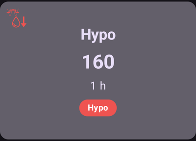

**BS-mål (standardforvalg, kan ændres)**

AAPS vil forsøge at nå 160 mg/dl eller 8,9 mmol/l i 1 time

**Andre ting, som brugerne kan tage med i overvejelserne, når de vælger**:

I lukket loop gælder for **SMB**:

- *kan blive* deaktiveret (se mere nedenfor), og/eller
- basal may be activated if **AAPS** is in negative **IOB** or < 0.

(TempTargets-manage-v4)=

## Indstilling og styring af midlertidige mål (Administrer → Midlertidigt mål)

I **AAPS** v4 administrerer du dine **forvalg** for TT og starter et midlertidigt mål fra skærmen **Administrer** (navigation i bunden) → **Midlertidigt mål** (*»Administrer og sæt midlertidige mål«*).

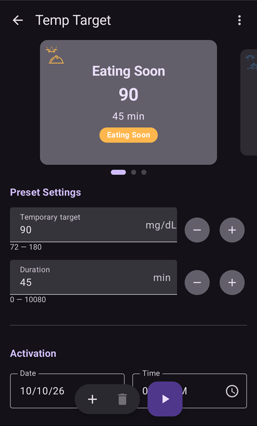

Skærmen har tre dele:

1. **Karrusel med forvalg** (øverst) – stryg gennem dine forvalg for TT. Hvert kort viser forvalgets **navn**, **mål** og **varighed**; den TT, der kører lige nu, er fremhævet.
2. **Editor** (i midten) – værdierne **Midlertidigt mål** og **Varighed**, der faktisk bliver brugt, samt dato/tid for **Aktivering**.
3. **Action bar** (bottom) — **➕ add**, **delete** and the **▶ activate** button.

Når du vælger et kort med et forvalg, bliver dets **mål** og **varighed** indlæst i editoren.

```{admonition} Indbyggede og egne forvalg :class: note De indbyggede forvalg – **Spiser snart**, **Aktivitet** og **Hypo** – findes altid og **kan ikke slettes** (men du kan ændre deres værdier og gemme dem). Forvalg, som du selv opretter, er **egne** forvalg og kan frit redigeres eller slettes.

    <br />### Aktivering af et midlertidigt mål
    
    Stryg til det forvalg, du vil bruge (dets værdier indlæses i editoren), tilpas eventuelt **mål**/**varighed** i editoren, og tryk derefter på **▶ Aktiver**. En bekræftelse viser det præcise mål, varighed og årsag, før noget starter:
    
    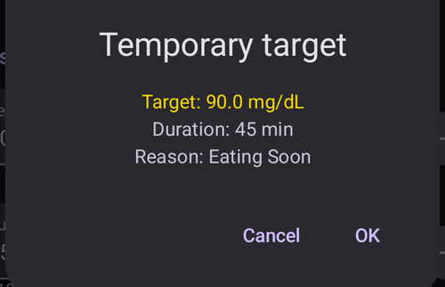
    
    Når du bekræfter, starter det midlertidige mål med det samme (eller på det valgte tidspunkt for **Aktivering**) og kører i den indstillede **varighed**.
    
    ```{admonition} Ændring af tallene gælder kun én gang – det ændrer ikke forvalget
    :class: important
    **Mål** og **varighed** i editoren er de værdier, som **Aktiver** bruger *lige nu*. Hvis du ændrer dem, er ændringen **midlertidig**: Den gælder kun for denne aktivering og **ændrer ikke det gemte forvalg**. På den måde kan du »justere og aktivere« en TT én gang (f.eks. aktivere *Aktivitet* med et lidt andet mål i dag) uden at ændre forvalget for altid.
    

### Gem ændringer i et forvalg

Hvis du *gerne* vil beholde en ændret værdi, så tryk på **Gem**: Når editoren er forskellig fra det valgte forvalg, vises et **Gem**-ikon i værktøjslinjen øverst. Når du trykker på det, gemmes det aktuelle **mål** og den aktuelle **varighed** (og navnet for egne forvalg) i det valgte forvalg. For de indbyggede forvalg vises der også en knap **Gendan standardværdier** (↺) i handlingslinjen: Den henter forvalgets standardværdier tilbage.

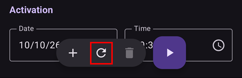

Tommelfingerreglen er altså:

- **Aktiver** → brug tallene **én gang** (forvalget er uændret).
- **Gem** → gør tallene til forvalgets **nye standardværdier**.

Hvis du vil sætte et indbygget forvalg tilbage til, som det var fra start, så vælg det og tryk på knappen **↺ Gendan**. Den vises kun i handlingslinjen for et **indbygget** forvalg, hvis værdier lige nu er forskellige fra fabriksindstillingerne, og den gendanner forvalgets oprindelige **mål** og **varighed**.

### Tilføj og fjern forvalg

- **➕ Tilføj** – opret et **nyt eget forvalg** ud fra de aktuelle værdier i editoren. Det nye kort vises i karrusellen.
- **Delete** — remove the selected **custom** preset. Indbyggede forvalg (*Spiser snart*, *Aktivitet*, *Hypo*) kan ikke slettes.

Når du har mindst to **egne** forvalg, kan du også ændre deres rækkefølge i karrusellen: Tryk på ikonet **Skift rækkefølge** (⇅) i den øverste linje, flyt kortet i midten med **flytteknapperne ◀ / ▶**, og bekræft derefter med **✓**. De indbyggede forvalg bliver på deres pladser – kun egne forvalg kan flyttes. (Knapperne ser ud på samme måde som ved [ændring af profilernes rækkefølge](ProfileSwitch-ProfilePercentage.md).)

Dine forvalg er en del af den synkroniserede konfiguration, så de deles mellem din hovedenhed og de parrede klienter.

### Andre måder at sætte et midlertidigt mål på

Et midlertidigt mål kan også sættes uden at åbne denne skærm:

- med **TT-kontakterne i dialogen Kulhydrater** – se [nedenfor](#TempTargets-carbs-dialog),
- med en **forvalgsknap på [Hurtigstart-værktøjslinjen](QuickLaunch.md)** – kategorien *Forvalg for midlertidige mål* i *Konfigurer Hurtigstart* giver en knap med ét tryk for hvert af dine forvalg,
- fra et **Wear OS-ur** (menupunktet / feltet **Midlertidigt mål**),
- fra en parret **klient** – se [Styring mellem hovedenhed ↔ klient](../RemoteFeatures/ClientMasterControl.md),
- som en del af en **[scene](Scenes.md)** (handlingen *Midlertidigt mål*), eller
- fra en **Automatisering**-regel (*Start midlertidigt mål* / *Stop midlertidigt mål*).

* * *

(TempTargets-where-can-i-select-a-temp-target)=

## Hvor kan jeg vælge et midlertidigt mål?

Den hurtigste måde er at trykke på **målchippen** på hovedskærmen (den viser dit aktuelle målområde):

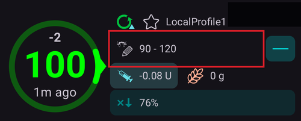

Det åbner skærmen **Midlertidigt mål**, som er beskrevet ovenfor – stryg til et forvalg, og tryk på **▶ Aktiver**. Du kan også komme til den samme skærm via **Administrer** → **Midlertidigt mål**.

(TempTargets-carbs-dialog)= Når du indtaster kulhydrater, behøver du slet ikke at åbne skærmen **Midlertidigt mål**: **Dialogen Kulhydrater** (**Behandlinger** → **Kulhydrater**) har kontakterne **Start "Hypo" mål**, **Start "Spiser snart" mål** og **Start "Aktivitet" mål** øverst. Slå en af dem til, så bliver det tilhørende forvalg aktiveret sammen med kulhydraterne:

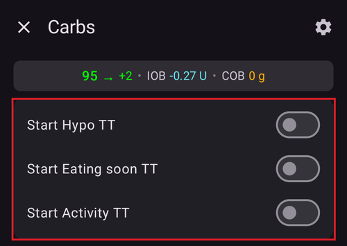

    {admonition} Automatisk Hypo-TT
    :class: note
    Hvis du åbner **dialogen Kulhydrater**, mens dit glukoseniveau er under 72 mg/dl (4 mmol/l), vælger **AAPS** kontakten **Start "Hypo" mål** for dig på forhånd (medmindre et højere midlertidigt mål med længere resterende varighed allerede kører).

(TempTargets-change-preset-defaults)=

## Hvor kan jeg ændre standardværdierne for midlertidige mål til mine egne?

Hvert forvalgs **mål** og **varighed** redigeres direkte på skærmen **Midlertidigt mål** – der er ikke længere et separat punkt i indstillingerne til dette:

1. Åbn skærmen **Midlertidigt mål** (tryk på målchippen, eller **Administrer** → **Midlertidigt mål**).
2. Stryg til det forvalg, du vil ændre.
3. Tilpas **Midlertidigt mål** og/eller **Varighed** i editoren.
4. Tryk på ikonet **Gem**, som vises i værktøjslinjen øverst.

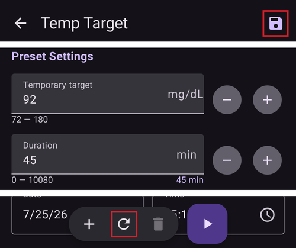

Så længe editoren er forskellig fra et indbygget forvalgs fabriksværdier, vises der også en knap **↺ Gendan** i handlingslinjen – tryk på den for at gendanne forvalgets oprindelige mål og varighed.

## Hvordan annullerer jeg et midlertidigt mål?

Mens et midlertidigt mål kører, viser målchippen på hovedskærmen målet og den resterende tid. Tryk på den – på skærmen **Midlertidigt mål** er det kørende forvalg fremhævet som **AKTIV**, og en rød knap **✗ Annuller** vises i slutningen af værktøjslinjen nederst, lige til venstre for knappen **▶ Aktiver**. Tryk på den, og bekræft:

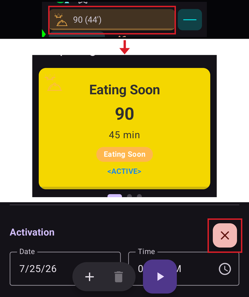

Et kørende midlertidigt mål kan også stoppes fra et **Wear OS-ur**, fra en parret **klient** eller af en **Automatisering**-regel (*Stop midlertidigt mål*).

(TempTargets-hypo-temp-target)=

## Midlertidigt mål – Hypo

**Midlertidigt mål – Hypo** gør det muligt for **AAPS** at hjælpe brugeren med at undgå lavt blodsukker ved at give mindre insulin. Hvis brugeren forventer, at **BS** bliver lavt: Normalt bør **AAPS** klare det, men meget afhænger af, hvor stabile brugerens **AAPS**-indstillinger er. Med et **midlertidigt mål – Hypo** kan brugeren komme det forventede lave BS i forkøbet og få **AAPS** til at give mindre insulin.

Nogle gange, når man spiser kulhydrater for at behandle en hypo, kan brugerens **BS** stige hurtigt, og **AAPS** vil korrigere det hurtigt stigende **BS** ved at give **SMB'er**.

Nogle brugere vil gerne undgå, at der gives **SMB'er** under et **midlertidigt mål – Hypo**. Det gør du ved at slå *'Aktiver SMB ved højt midlertidigt mål'* fra i **Indstillinger** → **OpenAPS SMB** (se længere nede):

- Avanceret, læringsmål 9: Brugeren kan slå *»Højt midlertidigt mål hæver følsomheden«* til for **midlertidige mål** på 100 mg/dl (5,6 mmol/l) eller højere i OpenAPS SMB. Så bliver **AAPS** mere følsom.

- Avanceret, læringsmål 9: Brugeren kan slå *»Aktiver SMB ved højt midlertidigt mål«* fra, så **AAPS** ikke giver SMB'er, mens høje midlertidige mål er aktive – heller ikke når **AAPS** har COB > 0, »Aktiver SMB ved lavt midlertidigt mål« eller »Aktiver SMB altid« er slået til, og OpenAPS SMB er aktiv.

Bemærk: Hvis du åbner **dialogen Kulhydrater**, mens dit blodsukker er under 72 mg/dl eller 4 mmol/l, vælger **AAPS** automatisk kontakten **Start "Hypo" mål** på forhånd.

(TempTargets-activity-temp-target)=

## Midlertidigt mål – Aktivitet

Før og under motion kan brugeren have brug for et højere mål for at undgå hypoglykæmi under aktiviteten.

For at gøre **midlertidigt mål – Aktivitet** nemmere kan brugeren indstille et standard **midlertidigt mål – Aktivitet**, der hæver **BS** ved at give mindre insulin, så **BS** falder langsommere og hypoglykæmi undgås.

Nye brugere af **AAPS** skal måske eksperimentere og tilpasse deres standardindstillinger for **midlertidigt mål – Aktivitet**, så funktionen virker bedst for dem. Alle er forskellige, når det handler om at holde et stabilt BS under motion. Se også [afsnittet om sport i Ofte stillede spørgsmål for loopere](#FAQ-sports).

Nogle brugere foretrækker også at aktivere et **profilskift** (en profil under 100%, så **AAPS** giver mindre insulin) før og mens **midlertidigt mål – Aktivitet** er slået til. Du kan starte begge dele i ét trin: Tryk på profilnavnet på hovedskærmen, tryk på den runde knap **▶**, sæt en **Procentdel** under 100% og en **Varighed**, og slå derefter **Midlertidigt mål / Aktivitet** til. Se [Skift profilprocent](#ProfileSwitch-change-percentage).

Avanceret, læringsmål 9: Brugerne kan slå *'Højt midlertidigt mål hæver følsomheden'* til for **midlertidige mål** på 100 mg/dl (5,6 mmol/l) eller højere i OpenAPS **SMB**. Et mål på 99 mg/dl (5,5 mmol/l) er et normalt mål, hverken højt eller lavt. Så er **AAPS** mere følsom.

Hvis *'Aktiver SMB ved højt midlertidigt mål'* er slået fra, vil **AAPS** desuden ikke give **SMB'er**, heller ikke når COB > 0, *'Aktiver SMB ved lavt midlertidigt mål'* eller *'Aktiver SMB altid'* er slået til, og OpenAPS **SMB** er aktiv.

(TempTargets-eating-soon-temp-target)=

## Midlertidigt mål – Spiser snart

**Midlertidigt mål – Spiser snart** kan hjælpe med at sænke **BS** blidt og sikre, at der er nok **IOB**, før man spiser.

Det kan være et vigtigt værktøj for brugere, der ikke giver bolus før måltidet. Men hvor godt **midlertidigt mål – Spiser snart** virker, afhænger af flere faktorer, bl.a.: brugerens indstillinger, om de spiser lavkulhydratkost, og om de bruger en hurtigtvirkende insulin (som Fiasp eller Lyumjev), så de ikke behøver at give bolus før måltidet. Indtil brugerne har erfaring med **AAPS**, bør de normalt regne med at give bolus før måltidet, når de bruger **midlertidigt mål – Spiser snart**. Det gælder især, hvis de spiser meget kulhydrat.

Du kan læse mere om »Eating soon mode« i artiklen ['How to do “eating soon” mode'](https://diyps.org/2015/03/26/how-to-do-eating-soon-mode-diyps-lessons-learned/) (på engelsk) eller [her](https://diyps.org/tag/eating-soon-mode/).

Avanceret, [læringsmål 9](#objectives-objective9): Hvis du bruger OpenAPS SMB og har slået *'Lavt midlertidigt mål sænker følsomheden'* til, arbejder **AAPS** lidt mere aggressivt. Denne mulighed kræver, at det **midlertidige mål** er 98 mg/dl (5,4 mmol/l) eller lavere.

## Hvordan slår jeg SMB fra under midlertidige mål?

Det gør du ved at åbne **Indstillinger** → **OpenAPS SMB** og slå *'Aktiver SMB ved højt midlertidigt mål'* fra.

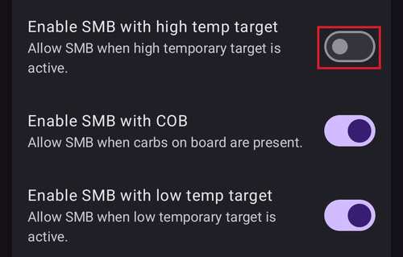

Det sikrer, at **AAPS** ikke giver **SMB'er**, heller ikke når COB > 0, *'Aktiver SMB ved lavt midlertidigt mål'* eller *'Aktiver SMB altid'* er slået til, og OpenAPS SMB er aktiv.