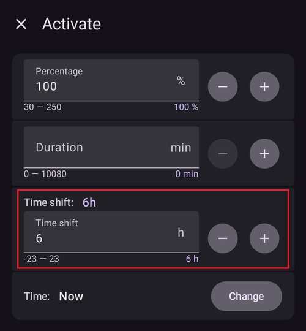

# Skift af tidszone og sommertid

Når tidszonen på din telefon ændres, beregner **AAPS** **IOB**, basal og følsomhed for fortiden helt forfra, ca. 10 sekunder efter ændringen. Mens det kører, kan det tage et øjeblik, før graferne og værdierne på hovedskærmen bliver opdateret.

(timezone-traveling-with-pumps)=

## Skift af tidszone for Omnipod Dash

* Opdater pumpestatus i **Administrer → Pumpe**
* Vælg midlertidigt en anden **profil**, og skift så tilbage til din oprindelige eller ønskede **profil**

## Skift af tidszone for DanaR, koreansk DanaR

Det er ikke et problem at skifte tidszone på telefonen, fordi pumpen ikke bruger historik

(timezone-traveling-danarv2-danars)=

## Skift af tidszone for DanaRv2, DanaRS, Dana-i

Disse pumper kræver særlig omhu, fordi **AAPS** bruger historikken fra pumpen, men posterne i pumpen har ikke noget tidszonestempel. **Det betyder, at hvis du skifter tidszone på din telefon, bliver posterne læst med en anden tidszone og bliver dobbelte.**

For at undgå dette er der to muligheder:

### Mulighed 1: Behold hjemmetiden, og lav tidsforskydning på profilen

* Slå »Automatisk dato og tid« (Automatic date and time) fra i telefonens indstillinger (manuelt skift af tidszone).

* Din telefon skal beholde din normale tid hjemmefra i hele rejseperioden.

* Lav tidsforskydning på din **profil** efter tidsforskellen mellem hjemmetiden og tiden på rejsemålet.
   
   * Tryk på **profilnavnet** på hovedskærmen for at åbne [profilskærmen](#ProfileSwitch-manage-v4)
   * Vælg din **profil**, og tryk på **▶ Aktiver**
   * Indstil »**Tidsforskydning**« efter dit rejsemål, og tryk på **Aktiver**.
   
   
   
   * f.eks. Wien -> New York: **Profilskift** +6 timer
   * f.eks. Wien -> Sydney: **Profilskift** -8 timer

### Mulighed 2: Slet pumpehistorikken

* Slå »Automatisk dato og tid« (Automatic date and time) fra i telefonens indstillinger (manuelt skift af tidszone)

Når du står af flyet:

* sluk pumpen
* skift tidszone på telefonen
* sluk telefonen, tænd pumpen
* ryd historikken i pumpen
* skift tiden i pumpen
* tænd telefonen
* lad telefonen forbinde til pumpen og finjustere tiden

(timezone-traveling-insight)=

## Skift af tidszone for Insight

Driveren tilpasser automatisk pumpens tid til telefonens tid.

Insight gemmer også historikposter om, hvornår tiden blev ændret, og fra hvilken (gammel) tid til hvilken (ny) tid. Så kan det korrekte tidspunkt bestemmes i **AAPS** trods tidsskiftet.

Det kan give unøjagtigheder i **TDD**. Men det burde ikke være et problem.

Så Insight-brugeren behøver ikke bekymre sig om skift af tidszone og tid. Der er én undtagelse fra denne regel: Insight-pumpen har et lille indbygget batteri, der holder tiden osv. i gang, mens du skifter det »rigtige« batteri. Hvis batteriskiftet tager for lang tid, løber dette indbyggede batteri tør for strøm, uret nulstilles, og du bliver bedt om at indtaste tid og dato, når du har sat et nyt batteri i. I så fald springer AAPS alle poster fra før batteriskiftet over i beregningen, da det korrekte tidspunkt ikke kan bestemmes sikkert.

## Skift af tidszone for Accu-Chek Combo

[Combo-driveren](../CompatiblePumps/Accu-Chek-Combo-Pump-v2.md) tilpasser automatisk pumpens tid til telefonens tid. Combo kan ikke gemme tidszoner, kun lokal tid, og det er præcis det, driveren programmerer ind i pumpen. Derudover gemmer den tidszonen i de lokale AAPS-indstillinger, så den kan omregne pumpens lokale tid til et fuldt tidsstempel med tidszoneforskydning. Brugeren behøver ikke gøre noget; hvis tiden på Combo afviger for meget fra telefonens aktuelle tid, bliver pumpens tid tilpasset automatisk.

Bemærk dog, at det tager noget tid, da det kun kan gøres i fjernterminal-tilstanden, som generelt er langsom. Det er en begrænsning i Combo, som ikke kan løses.

## Skift af tidszone for Medtrum

Driveren tilpasser automatisk pumpens tid til telefonens tid.

Skift af tidszone bevarer historikken; kun TDD kan blive påvirket. Hvis du skifter tiden manuelt på telefonen, kan det give problemer med historikken og **IOB**. Hvis du skifter tiden manuelt, så kontroller **IOB** en ekstra gang.

Når tidszonen eller tiden ændres, bliver aktive **TBR** stoppet.

(time-adjustment-daylight-savings-time-dst)=

## SOMMERTID (DST)

Tidsjustering ved sommertid.

Afhængigt af din pumpe og CGM-opsætning kan spring i tiden give problemer, så **AAPS** ikke virker korrekt. For nogle pumper er det bedre at justere tidszonen, mens du er vågen før skiftet til sommertid, og ikke om natten.

### Automatisk tilpasning til sommertid for de fleste pumper

* Men **loopet** bliver deaktiveret i 3 timer EFTER skiftet til sommertid (normalt fra kl. 1), og **AAPS** går tilbage til baggrundsbasal som valgt i din **profil**. Det sker af sikkerhedsgrunde – **IOB** kan være for høj på grund af dobbelt bolus fra før skiftet til sommertid.
* Efter skiftet til sommertid laver du et **profilskift** til den ønskede **profil** for at aktivere **loopet**: tryk på profilnavnet på hovedskærmen og derefter på den runde knap **▶** (se [Aktivering af en profil](#ProfileSwitch-manage-v4)).
* Du får også en notifikation på **AAPS**-hovedskærmen før skiftet til sommertid om, at **loopet** er midlertidigt deaktiveret. Denne besked vises uden bip, vibration eller lignende lyd.

Hvis du giver bolus med **AAPS'** beregner, så brug ikke **COB**- og **IOB**-data, medmindre du er sikker på, at disse data er helt korrekte. Vær forsigtig, og brug ikke denne funktion i et par timer efter skiftet til sommertid.

### Sommertid for Accu-Chek Insight

* Skiftet til sommertid sker automatisk. Du skal ikke gøre noget.

### Sommertid for Accu-Chek Combo

* Skiftet til sommertid sker automatisk. Du skal ikke gøre noget.

### Sommertid for Medtrum

* Skiftet til sommertid sker automatisk. Du skal ikke gøre noget.

### Sommertid for Omnipod Dash

* Enten lader du **AAPS** midlertidigt gå tilbage til baggrundsbasal efter skiftet til sommertid, som forklaret ovenfor.
* Ellers, hvis du ikke vil have, at **AAPS** midlertidigt går tilbage til baggrundsbasal om natten, kan du skifte tidszone dagen før skiftet til sommertid for at undgå forstyrrelser om natten. BEMÆRK: DENNE MULIGHED KAN FÅ DIN POD TIL AT UDLØBE FOR TIDLIGT. HAV TILBEHØR MED DIG, HVIS DU VÆLGER FUNKTIONEN NEDENFOR.

#### Det skal du gøre før tidsskiftet

1. Slå alle telefonindstillinger FRA, der automatisk indstiller telefonens tidszone, så brugeren kan skifte til en ønsket tidszone, der ikke bruger sommertid. Hvordan du slår det til, afhænger af din smartphone og Android-version.
   
   * Nogle telefoner har to indstillinger: én til automatisk indstilling af tiden (som helst skal forblive slået til) og én til automatisk indstilling af tidszonen (som du skal slå FRA: **Indstil automatisk** under **Tidszone** på skærmbilledet nedenfor).
   * Desværre har nogle Android-versioner kun én kontakt til automatisk indstilling af både tid og tidszone. Du skal slå dette fra indtil videre.

2. Find en tidszone, der har samme tid som dit nuværende sted, men ikke bruger sommertid.
   
   * En liste over disse lande findes på [https://greenwichmeantime.com/countries](https://greenwichmeantime.com/countries/)
   * For centraleuropæisk tid (CET) kan det være »Brazzaville« (Congo). Skift telefonens tidszone til Congo.

3. Opdater din pumpe i **AAPS**, og skift til din ønskede **profil**.

4. Kontroller **IOB** og **COB** i **AAPS**, og hvis de er unøjagtige, så deaktiver **loopet** i mindst én DIA eller den maksimale absorptionstid for kulhydrater (**Maks. absorptionstid**), alt efter hvad der er længst.

5. Det skal du gøre efter tidsskiftet. Et godt tidspunkt at skifte tilbage til den lokale tidszone er, når **IOB** er lav. F.eks. en time før et måltid, som f.eks. morgenmad. Helst skal både din **COB** og din **IOB** være tæt på nul.