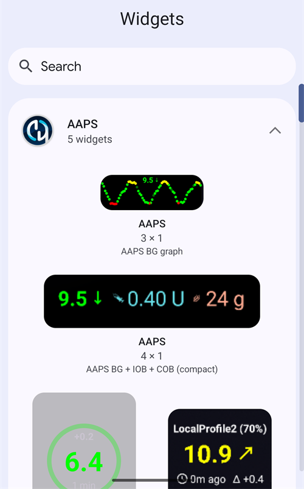
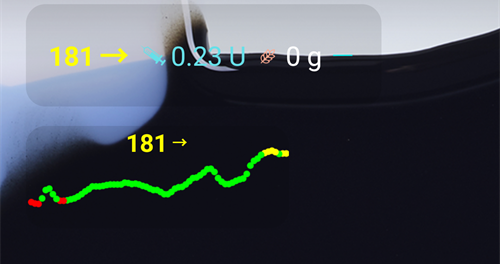
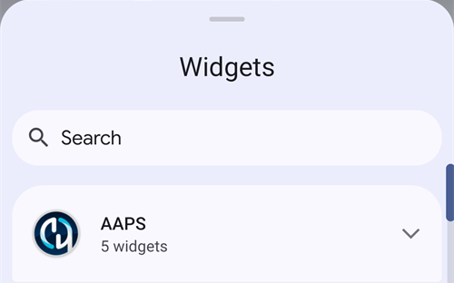
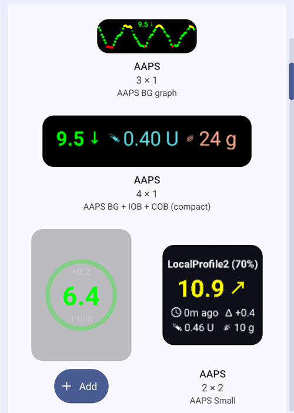
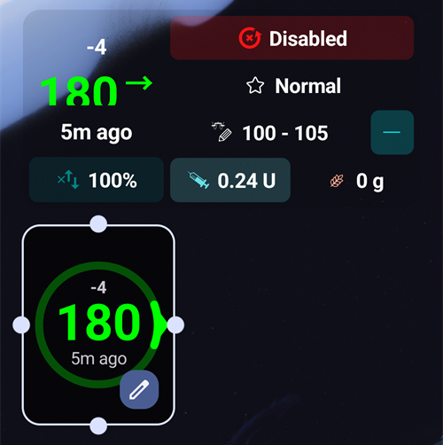
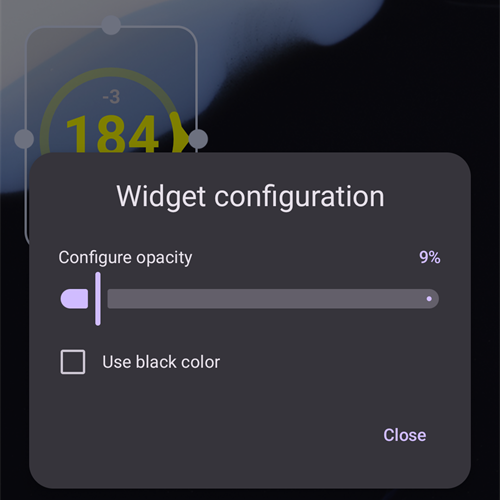

(widgets)=
# Widgets på startskærmen

**AAPS** har widgets, som du kan tilføje til startskærmen på din telefon. En widget viser dine aktuelle data, uden at du skal åbne appen. Tryk på en widget for at åbne **AAPS**.

```{contents} Table of contents
:depth: 2
:local: true
```

---

## Tilgængelige widgets

Der er fem widgets. De står under **AAPS** i Androids liste over widgets:



| Widget                            | Standardstørrelse | Hvad den viser                                                                                                                                                                                                                                                                          |
| --------------------------------- | ----------------- | --------------------------------------------------------------------------------------------------------------------------------------------------------------------------------------------------------------------------------------------------------------------------------------- |
| **AAPS widget**                   | 5 × 2             | Statusblokken fra hovedskærmen: BS med trend og delta, loop-tilstanden som et ikon ved siden af profilnavnet, målværdi, følsomhed (vist som på hovedskærmen), IOB og COB. Teksterne bliver mindre, så de passer til den størrelse, du giver widgetten, i stedet for at blive skåret af. |
| **AAPS glukosecirkel**            | 2 × 2             | BS-cirklen fra hovedskærmen: en ring i BS-farven, trendbuen, deltaen, BS-værdien og tiden siden den sidste måling.                                                                                                                                                                      |
| **AAPS lille**                    | 2 × 2             | Profilnavn, BS med trendpil, tid siden den sidste måling, delta, IOB og COB.                                                                                                                                                                                                            |
| **AAPS BS + IOB + COB (kompakt)** | 4 × 1             | Én linje med BS og trendpil, IOB og COB.                                                                                                                                                                                                                                                |
| **AAPS BS-graf**                  | 3 × 1             | BS-værdien med en lille graf over de seneste målinger.                                                                                                                                                                                                                                  |

Widgetten **AAPS widget**, **glukosecirklen** og widgetten **lille** på en startskærm:


Widgetten **kompakt** og widgetten **BS-graf**:



BS-værdier har de samme farver som i **AAPS**: grøn inden for området, gul over området, rød under området.

---

## Tilføj en widget

De præcise trin afhænger af din telefon og dens launcher (startskærm-app). På de fleste telefoner:

1. Tryk længe på et tomt sted på startskærmen, og vælg **Widgets**.

   

2. Åbn **AAPS** i listen, og tryk på den widget, du vil have.
3. Tryk på **Tilføj** (eller træk widgetten derhen, hvor du vil have den).

   

Widgetten bliver placeret på startskærmen. Lige efter at du har tilføjet den, vises den med håndtag: træk i et håndtag for at **ændre størrelsen** på widgetten, eller træk i widgetten for at flytte den. Glukosecirklen kan få en hvilken som helst størrelse.



Hvis siden på startskærmen er fuld, lægger telefonen widgetten på en ny side.

---

## Widget-konfiguration

Tryk på knappen med **blyanten**, som vises på widgetten, lige efter at du har tilføjet den. Senere kan du trykke længe på widgetten for at få håndtagene og blyanten frem igen.

Dialogen **Widget-konfiguration** har to indstillinger:

- **Indstil gennemsigtighed** — hvor dækkende baggrunden på widgetten er. En lav værdi gør, at baggrundsbilledet kan ses igennem.
- **Brug sort farve** — brug en sort baggrund i stedet for standardbaggrunden.



Hver widget har sin egen konfiguration.

---

## Godt at vide

- En widget **viser** kun data. Du kan ikke give bolus eller ændre noget fra en widget.
- Widgetten bliver opdateret af **AAPS**. Hvis **AAPS** ikke kører, eller hvis Android begrænser appen i baggrunden, kan widgetten vise gamle data. Kontroller tiden siden den sidste måling, og sørg for, at **AAPS** er undtaget fra [batterioptimering](#SetupWizard-StoragePermission).
- Med **AAPSClient**, **AAPSClient2** og **AAPSClient3** er baggrunden på widgetten gul, blå eller grøn, så du kan kende apps fra hinanden. Gør baggrunden mere dækkende (en højere værdi) i widget-konfigurationen, hvis farven er svær at se. Se [Om AAPSClient, AAPSClient2 og AAPSClient3](#remotecontrol-aapsclient-versions).
