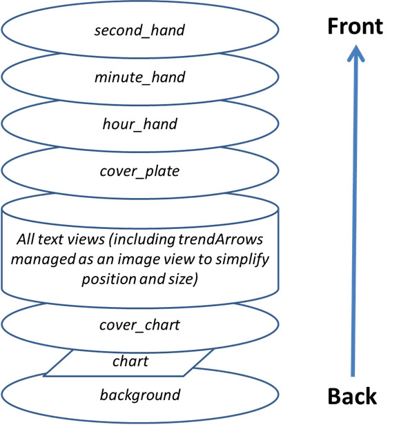
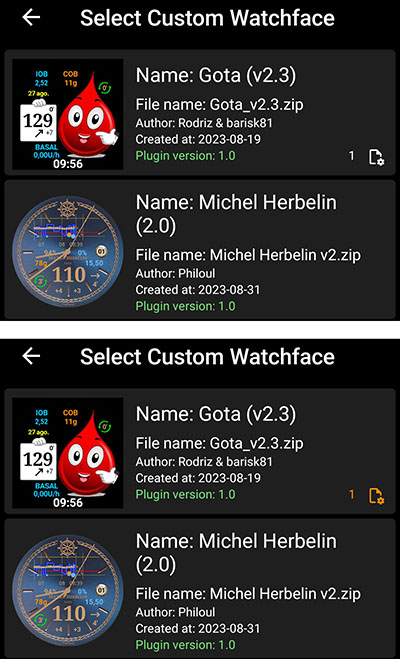
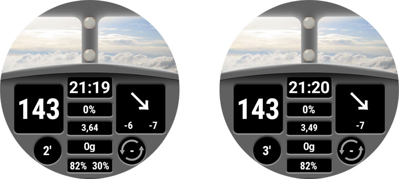
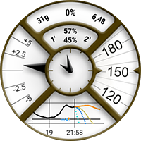
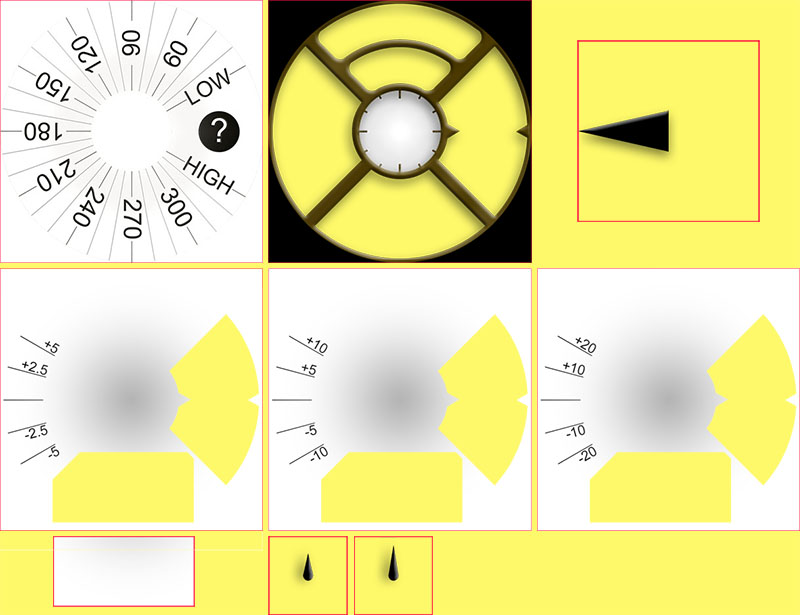
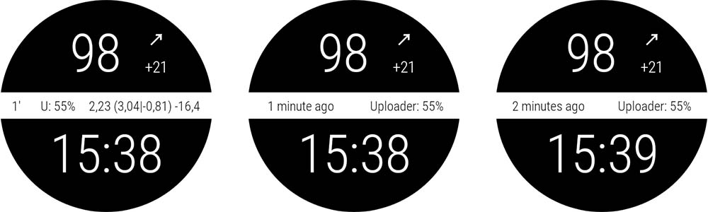
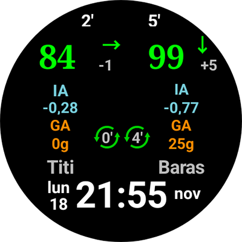

# Referencedokument for brugerdefinerede urskiver

Denne side er til dem, der designer nye urskiver. Den viser alle de nøgleord og funktioner, der kan bruges, når du vil lave eller animere en ny urskive.

- Nye funktioner og nøgler i Custom Watchface V2 (Wear apk 3.3.0 eller nyere) er beskrevet [her](#cwf-reference-new-v2-features)

## Format for brugerdefinerede urskiver

Custom Watchface er et åbent format, der er designet til AAPS og hører til den nye urskive »AAPS (Custom)«, som findes på uret.

Urskive-filen er en almindelig zip-fil, men for at blive genkendt som en urskive-fil skal zip-filen indeholde følgende filer:

- Én billedfil med navnet CustomWatchface (det kan være bitmapfiler `CustomWatchface.jpg`, `CustomWatchface.png` eller en vektorfil `CustomWatchface.svg`). Denne fil er det lille ikon, der bruges til at vælge urskiven, når du klikker på knappen »Indlæs urskive«. Det er også det billede, der ses i Ur-pluginet i AAPS.
- Én fil med navnet `CustomWatchface.json` (se [JSON-struktur](#cwf-reference-json-structure) herunder). Den anden fil er hovedfilen. Den indeholder alle de oplysninger, der skal bruges til at designe urskiven. Denne json-fil skal være gyldig (det er nok det sværeste, når du redigerer filen manuelt i en teksteditor, fordi ét manglende eller ét ekstra komma er nok til at ødelægge json-formatet). Denne JSON-fil skal også indeholde en `"metadata"`-blok med en `"name"`-nøgle, der ikke er tom. Dette bliver navnet på din brugerdefinerede urskive (se [Indstillinger for metadata](#cwf-reference-metadata-settings) herunder)
- denne zip-fil skal være så lille som muligt (under ca. 500 kb). Hvis denne fil er for stor, bliver den blokeret og ikke sendt til uret.

Zip-filen kan også indeholde nogle ekstra ressourcefiler:

- Faste filnavne for billeder, der bruges i standardvisningerne på urskiven (f.eks. `Background`, `CoverChart`... se [Liste over faste ressourcefiler](#cwf-reference-list-of-hardcoded-resource-files) herunder). Alle disse filer kan være i formatet `jpg`, `png` eller `svg`. men til de fleste af dem skal du bruge `png` eller `svg`, som kan håndtere gennemsigtighed (jpg-filer er mindre end png-filer, men har ingen gennemsigtighed). Bemærk, at den bedste kvalitet med den mindste størrelse normalt fås med svg-filer (vektorformat).
- Ekstra ressourcefiler med frit valgte navne. Disse ekstra filer kan være billedfiler eller skrifttypefiler (formaterne `ttf` og `otf` kan bruges til skrifttyper). Bemærk, at for disse ekstra filer bruges `filename` (uden endelse) som keyValue i JSON-filen for at angive, hvor eller hvornår disse filer skal bruges.
  - billedfiler bruges ofte som baggrund for tekstvisninger eller til dynamisk animation (f.eks. batteriniveau fra 0% til 100%)
  - skrifttypefiler giver dig mulighed for at bruge særlige skrifttyper på din urskive

(cwf-reference-json-structure)=

## JSON-struktur

JSON-filer kan redigeres i teksteditoren Notepad (eller Notepad++) (vælg helst Notepad++, som genkender JSON og bruger farver i formateringen)

- den indeholder strengnøgler `"string_key":` og nøgleværdier, som kan være tekststrenge som `"key value"`, heltal, booleske værdier som `true` eller `false` eller en datablok.
- hver værdi er adskilt med et komma `,`
- En datablok starter med `{` og slutter med `}`
- json-filen er én samlet blok, så den starter med `{` og slutter med `}`. Inde i filen er alle indlejrede blokke knyttet til en `"key"`, som skal være unik i blokken
- For at gøre json-filen lettere at læse er den normalt indrykket (hver ny nøgle står på en ny linje, og hver ny blok er rykket 4 mellemrum til højre)

(cwf-reference-metadata-settings)=

### Indstillinger for metadata

Denne blok er den første blok i json-filen og skal altid være med. Den indeholder alle oplysninger om denne urskive, f.eks. navnet, forfatteren, datoen for oprettelse eller opdatering, forfatterens version eller pluginets version.

Se et eksempel på en metadata-blok herunder:

```text
"metadata": {
    "name": "Default Watchface",
    "author": "myName",
    "created_at": "07\/10\/2023",
    "author_version": "1.0",
    "cwf_version": "1.0",
    "comment": "Default watchface, you can click on EXPORT WATCHFACE button to generate a template"
},
```

Bemærk, at `/`, som bruges i datoen, er et specialtegn. For at det kan læses korrekt i json-filen, skal du sætte et »escape«-tegn `\` foran.

I nogle json-filer kan du se en ekstra nøgle `"filename"`. Denne nøgle bliver automatisk oprettet eller opdateret, når den brugerdefinerede urskive indlæses i AAPS (den bruges til at vise brugeren navnet på zip-filen i mappen exports). Du kan derfor fjerne denne nøgle fra metadata-blokken.

(cwf-reference-general-parameter-settings)=

### Generelle parametre

Efter den første blok med metadata angiver du nogle generelle parametre (se [Liste over generelle parametre](#cwf-reference-list-of-general-parameters) herunder). De giver dig mulighed for at sætte farverne i grafen (kulhydrater, bolus, BS-værdier...) og også standardfarverne for værdier i område, hyperglykæmi eller hypo (standardfarver for BS-værdi og pile)

Se et eksempel på generelle parametre herunder

```text
"highColor": "#FFFF00",
"midColor": "#00FF00",
"lowColor": "#FF0000",
"lowBatColor": "#E53935",
"carbColor": "#FB8C00",
"basalBackgroundColor": "#0000FF",
"basalCenterColor": "#64B5F6",
"gridColor": "#FFFFFF",
"pointSize": 2,
"enableSecond": true,
```
(cwf-reference-imageview-settings)=

### Indstillinger for ImageView

Et brugerdefineret billede kan tilpasses ved at bruge det rigtige filnavn for hver ImageView i layoutet for den brugerdefinerede urskive. json-blokken bruges så kun til at angive positionen, størrelsen, om visningen er synlig eller ej, og eventuelt til at tilpasse farven:

Se herunder et eksempel på en billedblok for second_hand (i dette tilfælde er der intet billede i zip-filen, så standardbilledet for sekundviseren bruges, men med en brugerdefineret farve).

```text
"second_hand": {
    "width": 400,
    "height": 400,
    "topmargin": 0,
    "leftmargin": 0,
    "visibility": "visible",
    "color": "#BC906A"
}
```
For at give second_hand standard-BS-farven (lowRange, midRange eller highRange) skal du bare ændre den sidste linje til nøgleværdien `bgColor`

```json
    "color": "bgColor"
```

(cwf-reference-textview-settings)=

### Indstillinger for TextView

TextView har flere parametre end ImageView: du kan tilpasse drejning (heltal i grader), textsize (heltal i pixels), gravity (om tekstværdien skal centreres (standardværdi) eller justeres til venstre eller højre), vælge font, fontStyle og fontColor og også baggrundsfarven for TextView

```text
"basalRate": {
    "width": 91,
    "height": 32,
    "topmargin": 133,
    "leftmargin": 249,
    "rotation": 0,
    "visibility": "visible",
    "textsize": 23,
    "gravity": "center",
    "font": "default",
    "fontStyle": "bold",
    "fontColor": "#BDBDBD"
},
```
Bemærk, at hvis du ikke vil bruge en visning på din urskive, skal du sætte nøglen `"visibility"` til `"gone"`, men også sætte størrelse og position uden for det synlige område på denne måde:

```text
"second": {
    "width": 0,
    "height": 0,
    "topmargin": 0,
    "leftmargin": 0,
    "rotation": 0,
    "visibility": "gone",
    "textsize": 46,
    "gravity": "center",
    "font": "default",
    "fontStyle": "bold",
    "fontColor": "#BDBDBD"
},
```
Hvis størrelse og position er inden for det synlige område, kan du se et kort »blink« af den skjulte værdi, når urskiven opdateres.

Hvis du vil tilpasse baggrundsbilledet for en tekstvisning, kan du bruge nøglen `"background":` og angive filnavnet på et billede i zip-filen som keyValue. Du kan også bare ændre baggrundsfarven med nøglen `"color:"`.

```json
"background": "fileName"
```

Der er også 4 særlige textViews (med navnene freetext1 til freetext4), som har en særlig parameter `"textvalue":`. Den kan f.eks. bruges til at angive en etiket

(cwf-reference-chartview-settings)=

### Indstillinger for ChartView

ChartView er en meget speciel visning, som kan dele nogle parametre med ImageView eller med TextView...

Standardindstillingerne for denne visning er meget enkle:

```text
"chart": {
    "width": 400,
    "height": 170,
    "topmargin": 230,
    "leftmargin": 0,
    "visibility": "visible"
},
```
De 2 ekstra parametre, du kan bruge til ChartView, er en baggrundsfarve (standard er gennemsigtig) med nøglen `"color"` eller et baggrundsbillede med nøglen `"background"`.

(cwf-reference-how-to-build-watchface)=

## Sådan bygger/designer du din første urskive

### Nødvendige værktøjer

- Teksteditor: Mit råd er at bruge NotePad++ (eller noget lignende). Det er en enkel teksteditor, men fordelen er, at teksten vises formateret med farvekoder, så det er lettere at finde fejl. enhver enkel teksteditor kan bruges. Formålet er nemlig at tilpasse json-oplysningerne.
- Billedredigeringsprogram (bitmap og/eller vektor)
  - Hvis du bruger bitmap
    - Billedredigeringsprogrammet skal kunne håndtere gennemsigtighed (nødvendigt for alle billeder over baggrunden) og png-formatet (hvis du bruger bitmapbilleder)
    - Baggrundsbilledet kan være i jpg-format (mindre end png)
    - Billedredigeringsprogrammet skal kunne måle grafiske objekter i pixels (det kan være en enkel firkant) (top, venstre, bredde, højde)
    - Billedredigeringsprogrammet skal kunne vise farver med RRGGBB-koden i hexadecimal form
    - Billedredigeringsprogrammet skal kunne ændre billedets størrelse til 400px x 400px (det er meget vigtigt at arbejde med denne opløsning)
  - Hvis du bruger vektor
    - Vektorbilleder skal eksporteres i svg-format

### Hent en skabelon, så du ikke skal starte fra bunden

Når du vil designe din første urskive, er det bedst at starte med standardurskiven (så er du sikker på at have den nyeste version med alle tilgængelige visninger i den rigtige rækkefølge)

- Du kan hente zip-filen ved at klikke på knappen »Eksporter skabelon« i Ur-pluginet. Zip-filen ligger derefter i mappen AAPS/exports
- Bemærk, at du skal have et ur forbundet til AAPS for at se knapperne for brugerdefinerede urskiver (men du skal også bruge uret til at kontrollere, teste og tilpasse din brugerdefinerede urskive)

Standardurskiven er meget enkel, og zip-filen indeholder kun de 2 filer:

- CustomWatchface.png (billede af standardurskiven til valg af urskive)
- CustomWatchface.json

### Organiser dine filer på din computer

Det letteste er at have telefonen forbundet til computeren og arbejde med to bestemte mapper:

- én stifinder åbnet i en bestemt mappe, som indeholder alle filer (json, bitmapbilleder, vektorbilleder, skrifttyper) og filen CustomWatchface.zip
- en anden stifinder (eller et tilpasset mappetræ) åbnet, så du har mappen Phone/AAPS/exports klar

Så er det meget let at arbejde: hver gang du ændrer json-filen i en teksteditor eller et billede i billedredigeringsprogrammet (bitmap eller vektor), skal du bare:

1. gemme dine ændringer i hver app
2. trække og slippe alle filer ind i filen CustomWatchface.zip
3. trække og slippe CustomWatchface.zip ind i mappen AAPS/exports på telefonen
4. sende CustomWatchface til uret for at kontrollere resultatet

### Start tilpasningen af urskiven

Som første trin skal du angive et navn til urskiven (nødvendigt for let at kunne vælge den, når du tester) og begynde at tilpasse metadata-nøglerne i begyndelsen af json-filen

Derefter skal du bestemme, hvilke oplysninger du vil vise, og dermed hvilke visninger der skal være synlige eller skjulte.

- vil du vise sekunder eller ej?
- vil du designe et analogt ur eller et digitalt ur (eller begge dele...)

Nu kan du begynde at ændre json-filen og sætte nøglen `"visibility":` for hver visning til `"visible"` eller `"gone"` (om du vil beholde visningen eller ej)

Du kan også begynde at tilpasse værdierne for top, venstre margen, bredde og højde nogenlunde for at begynde at organisere urskiven (disse værdier tilpasses senere med billedredigeringsprogrammet)

Bemærk: alt designes inden for et **rektangel på 400px x 400px**. Alt placeres derfor med absolutte koordinater inden for denne størrelse.

Når du designer din første urskive, skal du vide, at alt er ordnet i lag fra bagerst til forrest. Hver visning (ImageView eller TextView) kan derfor skjule noget, der ligger bagved...





I json-filen er alle visninger sorteret fra bagerst til forrest (det hjælper dig med at huske, hvad der ligger bag hvad...)

Hvis du designer eller tilpasser din første brugerdefinerede urskive, så start med enkle ting: ændr synligheden af nogle visninger, tilføj et særligt baggrundsbillede uden at ændre json-filen...

### Håndtering af farver

I json-filen er der flere nøgler til at angive farver: `"color"`, `"fontColor"` for visninger, men også `"highColor"`, `"midColor"`, `"lowColor"`, ... (se [Liste over generelle parametre](#cwf-reference-list-of-general-parameters))

Farver angives med et tekstfelt, der starter med `#` efterfulgt af RRGGBB-værdier (rød, grøn, blå) i hexadecimalt format:

- `"#FFFFFF"` er hvid, `"#000000"` er sort, `"#FF0000"` er rød...

Du kan også tilføje 2 ekstra værdier for alfalaget og angive et niveau af gennemsigtighed (AARRGGBB):

- `"#00000000"` er helt gennemsigtig, og `"#FF000000"` er helt uigennemsigtig (så `"#FF000000"` svarer til `"#000000"`)

Du kan også bruge den særlige nøgleværdi `"bgColor"` for automatisk at bruge `"highColor"`, `"midColor"` eller `"lowColor"` fra de generelle parametre efter BS-værdien:

- `"fontColor": "bgColor",` sætter automatisk skriftfarven i visningen efter BS-værdien
- Bemærk, at visningerne `sgv` (for BS-værdi) og `direction` (for trendpil) automatisk bruger de BS-farver, der er sat i de generelle parametre (hvis du vil have andre farver i disse 2 visninger, skal du bruge den avancerede funktion [dynData](#cwf-reference-dyndata-feature) med en farve i ét trin...)

Du kan læse mere om ImageViews og nøglen `"color":` i afsnittet [Tilpas billedfarve](#cwf-reference-tune-image-color) herunder.

### Tilføj faste billeder

den letteste måde at begynde at tilpasse din urskive på er at tilføje nogle billeder med bestemte navne i zip-filen (se [Liste over faste ressourcefiler](#cwf-reference-list-of-hardcoded-resource-files))

- Billedet skal være i formatet `.jpg`, `.png` eller `.svg`. men pas på: jpg kan ikke håndtere gennemsigtighed, så det bør kun bruges til baggrundslaget. Til alle mellemliggende lag (cover_chart, cover_plate, visere) skal du bruge enten `.png`- eller `.svg`-billeder

- Hvis du har et program til vektorbilleder (f.eks. Illustrator), så vælg dette format. Det giver små tekstfiler med endelsen `.svg` og den bedste kvalitet.
- Pas på, at du bruger det præcise filnavn (også store og små bogstaver)

Hvis du nu vil have et særligt baggrundsbillede, skal du bare tilføje en fil med navnet `Background.jpg` i zip-filen (uden at ændre noget andet). Send zip-filen til uret, og kontroller resultatet!

Hvis du vil tilpasse hour_hand, minute_hand eller second_hand til et analogt ur, skal du bare tilføje `HourHand.png` (eller `HourHand.svg`), `MinuteHand.png` og `SecondHand.png`.

- disse billeder drejer automatisk omkring billedets midte, så billederne skal vise 00:00:00 (og til et analogt ur, der fylder hele skærmen, skal du bruge en størrelse på 400 x 400 px placeret ved top 0 og venstre 0)

Du kan også se i [Liste over faste ressourcefiler](#cwf-reference-list-of-hardcoded-resource-files), at der for hver billedvisning er to ekstra faste filnavne med `High` og `Low` (du kan f.eks. tilføje andre billeder med navnene `BackgroundHigh.jpg` og `BackgroundLow.jpg` i zip-filen). så skifter billedet automatisk efter dit BS-niveau (i målområde, hyperglykæmi eller hypo). Se urskiven AIMICO som eksempel.

(cwf-reference-tune-image-color)=

### Tilpas billedfarve

Nøglen `"color"` kan bruges til at tilpasse standardfarven på et billede:

- bruges den på baggrundsvisningen, sætter den baggrundsfarven (standard sort)
- bruges den på cover_plate (enkel urskive) eller på viserne, ændrer den standardbilledet (hvidt) til den angivne farve (også `"bgColor"`)

Når du bruger nøglen `"color"` på et bitmapbillede (`.jpg` eller `.png`), giver farven en interessant effekt på farvemætningen. Så kan du stadig genkende din bitmap.

Til sidst: på en `.svg`-billedfil har nøglen `"color"` ingen virkning. Farven i vektorfiler er fast i selve billedet. Hvis du vil ændre farverne, skal du tilføje flere `svg`-filer og bruge den avancerede funktion [dynData](#cwf-reference-dyndata-feature) til at skifte mellem dem

### Brug ekstra skrifttyper til TextViews

Der findes allerede flere standardskrifttyper i Wear-apk'en (se skrifttype-nøglerne i afsnittet [Nøgleværdier](#cwf-reference-key-values)). Men hvis du vil bruge ekstra skrifttyper, som ikke findes som standard, kan du tilføje dem i zip-filen:

- de 2 skriftformater, der kan bruges, er `.ttf`- og `.otf`-filer
- hvis du tilføjer en brugerdefineret skrifttype i zip-filen, f.eks. en fil med navnet `myCustomFont.ttf`, skal du bruge filnavnet for at bruge den i json-filen til en TextView:

```
"font": "myCustomFont",
```

Husk, at nogle skrifttyper kan ligge i store filer (og der er en grænse for, hvor stor zip-filen må være). Hvis du kun bruger meget få tegn (tal, `.`, `,`), kan du bruge gratis værktøjer til at fjerne de tegn, du ikke bruger (f.eks. [her](https://products.aspose.app/font/generator/ttf-to-ttf)), og dermed gøre skrifttypefilen mindre.

(cwf-reference-advanced-features)=

## Avancerede funktioner

(cwf-reference-preference-feature)=

### Funktionen Preferences (indstillinger)

CustomWatchface kan automatisk tilpasse nogle indstillinger på uret, så urskiven vises korrekt (hvis brugeren har givet tilladelse til det i Ur-indstillingerne).

Men denne funktion skal bruges med omtanke. Indstillingerne er fælles for alle andre urskiver. Der er derfor nogle regler, du skal følge med denne funktion:

- sæt aldrig indstillinger for skjulte visninger
- prøv at gøre de synlige visninger så store som muligt
- du må gerne gøre nogle visninger ekstra brede:
  - TBR kan vises i procent (smal bredde), men også som absolutte værdier (meget bredere)
  - delta eller gennemsnitlig delta med detaljerede oplysninger kan være brede
  - det samme gælder iob2: denne visning kan vise samlet IOB, men hvis detaljeret IOB er valgt, kan teksten blive meget lang

Hvis du stadig har brug for meget specielle indstillinger for at få en korrekt visning (i eksemplet herunder: hvis der ikke er plads nok til detaljeret IOB, kan du »tvinge« denne parameter på dit ur til `false`), kan du tilføje sådanne krav til indstillinger i metadata-blokken

```text
"metadata": {
    "name": "Default Watchface",
    "author": "myName",
    "created_at": "07\/10\/2023",
    "author_version": "1.0",
    "cwf_version": "1.0",
    "comment": "Default watchface, you can click on EXPORT WATCHFACE button to generate a template",
    "key_show_detailed_iob": false
},
```

Hvis brugeren tillader den brugerdefinerede urskive at ændre urets parametre (indstilling i Ur-pluginet), så bliver »Vis detaljeret IOB« sat til »deaktiveret« og låst (parameteren kan ikke ændres, før tilladelsen bliver slået fra i Ur-pluginets indstillinger, eller en anden urskive bliver valgt)

- Bemærk, at når en bruger vælger en urskive, kan brugeren se antallet af »nødvendige parametre«, mens urskiven vælges

I eksemplet herunder har urskiven Gota én nødvendig parameter. Hvis tilladelsen ikke er givet, vises tallet med hvid farve. Hvis tilladelsen er givet, bliver parameteren sat og låst på uret (i dette tilfælde vises tallet med orange farve)




(cwf-reference-twinview-feature)=

### Funktionen TwinView

Tvillingevisninger (twin views) gør det let at justere en visnings position efter, hvilke visninger der er synlige. Det er ikke lige så kraftfuldt som et layout, der er bygget helt med LinearLayout, men det kan klare mange almindelige tilfælde.

I eksemplet herunder kan du se urskiven AAPS (Cockpit) med alle visninger synlige i indstillingerne, og den samme urskive med »Vis Rig-batteri« og »Vis GnsDelta« slået fra



Du kan se, at når den ene tvillingevisning er skjult, bliver den anden flyttet, så den står i midten

i dette eksempel kan du se, at i blokken `"uploader_battery"` er nøglen `"twinView":` tilføjet for at angive visningen `"rig_battery"`, og i blokken `"rig_battery"` angiver nøglen `"twinView":` visningen `"uploader_battery"` som tvilling. Den ekstra nøgle `"leftOffsetTwinHidden":` angiver, hvor mange pixels visningen skal flyttes, når tvillingen er skjult.

For at beregne dette tal kan du se, at forskellen mellem leftMargin for de to tvillingevisninger er 50 pixels. Forskydningen, der holder visningen i midten, er derfor det halve i den ene eller den anden retning.

Hvis tvillingevisningerne står lodret over hinanden, skal du i stedet bruge nøglen `"topOffsetTwinHidden":`

```text
"uploader_battery": {
    "width": 49,
    "height": 30,
    "topmargin": 354,
    "leftmargin": 150,
    "rotation": 0,
    "visibility": "visible",
    "textsize": 23,
    "gravity": "center",
    "font": "roboto_condensed_bold",
    "fontStyle": "bold",
    "fontColor": "#FFFFFF",
    "twinView": "rig_battery",
    "leftOffsetTwinHidden": 25
},
"rig_battery": {
    "width": 49,
    "height": 30,
    "topmargin": 354,
    "leftmargin": 200,
    "rotation": 0,
    "visibility": "visible",
    "textsize": 23,
    "gravity": "center",
    "font": "roboto_condensed_bold",
    "fontStyle": "bold",
    "fontColor": "#FFFFFF",
    "twinView": "uploader_battery",
    "leftOffsetTwinHidden": -25
},
```
(cwf-reference-dyndata-feature)=

### Funktionen DynData

DynData er den mest kraftfulde funktion, hvis du vil have animation på din urskive efter nogle interne værdier (f.eks. BS-værdi, BS-niveau, delta, batteri i %... se listen over data, der kan bruges, [her](#cwf-reference-dyndata-key-values))

For at vise denne funktion bruger jeg urskiven AAPS (SteamPunk) som eksempel:



På denne urskive skal vi styre [drejningen efter BS-værdien](#cwf-reference-background-management) (fra 30 grader til 330 grader) til højre, [det dynamiske område for avg_delta](#cwf-reference-avg-delta-management) (skala op til 5 mg/dl, 10 mg/dl eller 20 mg/dl afhængigt af værdien), [viserens drejning](#cwf-reference-dynamic-rotation-management), som skal passe til skalaen, og også visningernes forskellige lag...

Herunder kan du se alle de billeder, der er i zip-filen, og som skal bruges til denne urskive:

Bemærk: for at du kan se gennemsigtigheden, er alle billederne vist på en gul baggrund med en rød firkant omkring



- I første række bliver Background.jpg og CoverPlate.png automatisk knyttet til den tilhørende visning (standardfilnavne for visningerne), og steampunk_pointer.png styres af dynData
- I anden række ser du de 3 skalaer for det dynamiske område for avg_delta, som også styres af dynData
- I tredje række bliver chartBackground.jpg knyttet manuelt til grafvisningen, og filerne HourHand.png og MinuteHand.png bliver automatisk knyttet til de tilhørende visninger

(cwf-reference-background-management)=

#### Håndtering af baggrund

For det første: billedet for BS-værdien kan kun ligge i baggrundslaget (ellers ligger det foran grafvisningen, og grafen kan ikke ses!). Vi skal altså knytte BS-værdien til baggrunden og derefter dreje baggrundsbilledet efter BS-værdien.

I blokken `"background"` tilføjer vi 2 særlige nøgler til denne drejning:

```text
"background": {
    "width": 400,
    "height": 400,
    "topmargin": 0,
    "leftmargin": 0,
    "dynData": "rotateSgv",
    "rotationOffset": true,
    "visibility": "visible"
},
```
Nøglen `"dynData":` angiver, hvilken blok der skal bruges til at definere animationen (værdi, område, omregning...). Her fik blokken navnet »rotateSgv« (vælg et tydeligt navn, når du bruger denne funktion),

`"rotationOffset": true,` angiver, at animationen efter værdien skal være en drejning. (andre mulige nøgler er `"leftOffset"` og `"topOffset"`, hvis du vil lave en skyder)

Nu går vi til slutningen af filen, efter den sidste visning:

```text
"second_hand": {
    "width": 120,
    "height": 120,
    "topmargin": 140,
    "leftmargin": 140,
    "visibility": "gone"
},
"dynData": {
    "rotateSgv": {
        "valueKey": "sgv",
        "minData": 30,
        "maxData": 330
    },
```
Du kan se, at vi efter den sidste visning (`"second_hand"`) har tilføjet en ny `"dynData": { ... }`-blok, som skal indeholde alle animationerne:

Blokken, der blev angivet i visningen `"background"`, hed `"rotateSgv"`. Det er den første blok, du finder i `"dynData"`!

Denne blok er enkel: der er en første nøgle med navnet `"valueKey":`, som angiver, hvilken værdi der skal bruges. i dette tilfælde er `"sgv"` en »keyValue«, der angiver BS-værdien (bemærk, at keyValue i de fleste tilfælde har samme navn som den visning, der viser denne oplysning).

For BS-værdien er standard min data sat til 39 mg/dl og maks data sat til 400 mg/dl (se [Nøgleværdier for DynData](#cwf-reference-dyndata-key-values) herunder for alle keyValues og de tilhørende min/maks-dataværdier).

I blokken `"rotateSgv"` bruges de to ekstra nøgler (`"minData":` og `"maxData":`) til at sætte min. og maks. data til 30 og 330. Med disse min.- og maks.-værdier kan vi bruge dataværdien direkte (uden omregning) til at dreje baggrunden i grader. I dette tilfælde bliver alle BS-værdier over 330 mg/dl begrænset til 330, som er billedets øvre grænse.

#### Håndtering af graf

Grafens standardbaggrund er gennemsigtig. For at skjule BS-skalaen i baggrundsbilledet skal vi derfor tilføje et særligt baggrundsbillede (dette billede indeholder de samlede skygger fra Steampunk-urskiven). Linket til filen chartBackground.jpg laves med nøglen `"background":`

Størrelsen og placeringen af visningen skal selvfølgelig passe helt præcist, ned til den enkelte pixel!

```text
"chart": {
    "width": 216,
    "height": 107,
    "topmargin": 280,
    "leftmargin": 80,
    "visibility": "visible",
    "background": "chartBackground"
},
```
(cwf-reference-avg-delta-management)=

#### Håndtering af gennemsnitlig delta

For at styre det dynamiske område for gennemsnitlig delta bruger vi de fire freetext-visninger. freetext1 bruges til at styre billedskalaen, og freetext2 til freetext4 bruges til at styre viserens drejning efter skalaen.

**freetext1**

Som forklaret før ligger freetext-visningerne foran grafen og foran baggrunden. Derfor har vi lavet et gennemsigtigt område, så man kan se disse billeder (billedets højre side og nederste del)

Bemærk, at den fjernede nederste del af disse billeder er brugt som baggrund for grafen, så det passer perfekt sammen.

```text
"freetext1": {
    "width": 400,
    "height": 400,
    "topmargin": 0,
    "leftmargin": 0,
    "rotation": 0,
    "visibility": "visible",
    "dynData": "avgDeltaBackground"
},
```
Til denne visning tilføjer vi linket til en anden `"dynData"`-blok med navnet `avgDeltaBackground`. Denne blok styrer avgDelta-skalaen efter avgDelta-værdien.

```text
"avgDeltaBackground": {
    "valueKey": "avg_delta",
    "minData": -20,
    "maxData": 20,
    "invalidImage": "steampunk_gauge_mgdl_5",
    "image1": "steampunk_gauge_mgdl_20",
    "image2": "steampunk_gauge_mgdl_20",
    "image3": "steampunk_gauge_mgdl_10",
    "image4": "steampunk_gauge_mgdl_5",
    "image5": "steampunk_gauge_mgdl_5",
    "image6": "steampunk_gauge_mgdl_10",
    "image7": "steampunk_gauge_mgdl_20",
    "image8": "steampunk_gauge_mgdl_20"
},
```
- `"valueKey":` laver linket til værdien `"avg_delta"`
- min. og maks. Data begrænser også området til den største værdi, der er mulig på denne urskive (fra -20 mg/dl til 20 mg/dl). Hvis du bruger mmol, skal du huske, at alle interne værdier i AAPS altid er i mg/dl.

Her ser vi derefter, hvordan man styrer et dynamisk baggrundsbillede efter værdien.

`"invalidImage":` er nøglen til det billede, der skal vises, når data er ugyldige (eller mangler). Her laver vi linket til et ekstra ressourcebillede i zip-filen med en skala på 5 mg/dl

Derefter bruger vi en serie billeder fra `"image1":` til `"image8":`. Antallet af billeder bestemmer antallet af trin mellem `minData` og `maxData`.

- `image1` angiver det billede, der vises, når avg_delta er lig med eller tæt på `minData`, og billedet med det højeste nummer (her `image8`) angiver det billede, der vises, når avg_delta er lig med eller tæt på `maxData`
- mellem -20 mg/dl og 20 mg/dl er hele området 40 mg/dl. Delt med 8 (antallet af billeder) giver det 8 trin på 5 mg/dl
- Nu kan vi knytte baggrundsbilleder til avg_delta-værdien, startende fra de laveste værdier: mellem -20 og -15 og også mellem -15 og -10 bruger vi `steampunk_gauge_mgdl_20` som skala, derefter mellem -10 og -5 `steampunk_gauge_mgdl_10`, og så videre op til +15 og +20, hvor vi igen bruger baggrundsbilledet `steampunk_gauge_mgdl_20`

(cwf-reference-dynamic-rotation-management)=

**freetext2 til freetext4**

Til disse visninger kombinerer vi dynamiske billeder og drejningsfunktionen, som er forklaret før:

```text
"freetext2": {
    "width": 276,
    "height": 276,
    "topmargin": 64,
    "leftmargin": 64,
    "rotation": 0,
    "visibility": "visible",
    "dynData": "avgDelta5",
    "rotationOffset": true
},
"freetext3": {
    "width": 276,
    "height": 276,
    "topmargin": 64,
    "leftmargin": 64,
    "rotation": 0,
    "visibility": "visible",
    "dynData": "avgDelta10",
    "rotationOffset": true
},
"freetext4": {
    "width": 276,
    "height": 276,
    "topmargin": 64,
    "leftmargin": 64,
    "rotation": 0,
    "visibility": "visible",
    "dynData": "avgDelta20",
    "rotationOffset": true
},
```
Her hører hver visning til en bestemt skala (og er derfor knyttet til en særlig dynData-blok). Du kan også se, at nøglen `"rotationOffset":` er slået til for disse 3 visninger. Se nu på den første dynData-blok:

```text
"avgDelta5": {
    "valueKey": "avg_delta",
    "minData": -20,
    "maxData": 20,
    "rotationOffset": {
        "minValue": -120,
        "maxValue": 120
    },
    "invalidImage": "null",
    "image1": "null",
    "image2": "null",
    "image3": "null",
    "image4": "steampunk_pointer",
    "image5": "steampunk_pointer",
    "image6": "null",
    "image7": "null",
    "image8": "null"
},
```
Selv om det dynamiske område kun bruges mellem -5 og +5 for avg_delta-data, er det vigtigt at beholde hele området på -20 til +20 mg/dl, så viseren passer med baggrunden, når skalaen skifter. Derfor beholder vi det samme samlede område som for `avgDeltaBackground` og det samme antal trin (8 billeder).

Du kan se, at både `"invalidImage"` og flere `"imagexx"` har nøgleværdien `"null"` (det kan være enhver tekst, der ikke findes som filnavn i zip-filen). Når et filnavn ikke findes, bliver visningens baggrundsbillede gennemsigtigt. Indstillingen sikrer altså, at viseren kun er synlig ved trin 4 og trin 5 (gennemsnitlig delta mellem -5 mg/dl og +5 mg/dl) og ikke er synlig uden for dette område.

Nu kan vi se en ny blok `"rotationOffset":`, som indeholder to nøgler: `"minValue":` og `"maxValue":`. Disse værdier bruges til at omregne mellem de interne data (i mg/dl) og den drejningsvinkel, vi ønsker.

- Steampunk-urskiven er designet, så viseren højst drejer fra -30 grader til 30 grader. Efter skalaen (her fra -5 mg/dl til 5 mg/dl) vil vi altså have 30 grader for disse værdier. Fordi `minData` og `maxData` er 4 gange større, er de tilsvarende minValues og maxValues 4 * 30 grader, altså -120 og +120 grader. Men ved alle drejninger over eller under +-30 grader bliver viseren skjult (intet billede synligt), og viseren er kun synlig ved værdier mellem -5 og +5 mg/dl... Det er præcis det, vi ønsker her.

De andre dynData-blokke er angivet på samme måde for at tilpasse `"avgDelta10"` og `"avgDelta20"`

#### Visningen loop

på Steampunk-urskiven er loopets grønne og røde pile (for status) slået fra. Det styres også med en særlig dynData-blok, der er knyttet til visningen loop.

```text
    "loopArrows": {
        "invalidImage": "greyArrows",
        "image1": "greenArrows",
        "image2": "redArrows"
    }
```
Fordi denne blok kun bruges af visningen loop, og de standarddata, som denne visning viser, er loop-oplysninger, er nøglen `"valueKey":` valgfri.

Standardværdierne for `minData` og `maxData` for loop er 0 min og 28 min. Med to billeder bliver alle dataværdier under 14 min derfor vist med baggrunden `image1`, og alle dataværdier over 14 min bliver vist med `image2`. 14 min er præcis grænsen, hvor der skiftes fra grøn pil til rød pil.

I dette eksempel er filerne `greyArrows`, `greenArrows` og `redArrows` ikke med i zip-filen, så pilene bliver bare fjernet (usynlige). Men du kan bruge denne blok, som den er, hvis du vil tilpasse statuspilene med dine egne baggrundsbilleder.

#### Visningerne rig_battery og uploader_battery

For at afslutte gennemgangen af funktionen dynData ser vi på håndtering af batteri. Ideen er her at tilpasse tekstfarven efter batteriniveauet (fra 0 til 100%)

```text
"uploader_battery": {
    "width": 60,
    "height": 28,
    "topmargin": 100,
    "leftmargin": 170,
    "rotation": 0,
    "visibility": "visible",
    "textsize": 20,
    "gravity": "center",
    "font": "default",
    "fontStyle": "bold",
    "fontColor": "#00000000",
    "dynData": "batteryIcons",
    "twinView": "rig_battery",
    "topOffsetTwinHidden": -13
},
"rig_battery": {
    "width": 60,
    "height": 28,
    "topmargin": 74,
    "leftmargin": 170,
    "rotation": 0,
    "visibility": "visible",
    "textsize": 20,
    "gravity": "center",
    "font": "default",
    "fontStyle": "bold",
    "fontColor": "#00000000",
    "dynData": "batteryIcons",
    "twinView": "uploader_battery",
    "topOffsetTwinHidden": 13
},
```
Du kan se, at begge visninger her bruger den samme `dynData`-blok med navnet `batteryIcons`. Det er muligt, fordi de tilknyttede data som standard er visningens egne data (så uden en `"valueKey":`-nøgle i blokken `batteryIcons` bliver den brugt med data fra `uploader_battery` eller `rig_battery` afhængigt af visningen).

Bemærk, at disse to visninger også bruger funktionen TwinView, som er forklaret [her](#cwf-reference-twinview-feature).

Lad os nu se på dynData-blokken:

```text
"batteryIcons": {
    "invalidFontColor": "#00000000",
    "fontColor1": "#A00000",
    "fontColor2": "#000000",
    "fontColor3": "#000000",
    "fontColor4": "#000000",
    "fontColor5": "#000000"        
},
```
Her bruger vi nøjagtig samme logik som for det dynamiske baggrundsbillede, men med særlige nøgler (`"invalidFontColor"` og `"fontColor1"` til `"fontColor5"` for at angive 5 trin på hver 20%).

- `"fontColor1"` (mørkerød) bruges til alle værdier under 20%, og hvid bruges til alle værdier over denne grænse.
- Hvis du vil sænke grænsen til »under 10%«, skal du bare tilføje 5 ekstra nøgler fra `"fontColor6"` til `"fontColor10"`. Du kan også justere hver farve, hvis du vil have en gradvis overgang fra grøn til gul, orange og rød...

(cwf-reference-dynpref-feature)=

### Funktionen DynPref

Før du læser dette afsnit, skal du forstå, hvordan [dynData](#cwf-reference-dyndata-feature) virker, fordi DynPref er en avanceret brug af DynData: Du kan nu justere hver DynData-blok efter de indstillinger, som brugeren har valgt:

For at vise funktionen DynPref bruger vi to eksempler:

- Steampunk-urskiven (enkel brug, hvor en mg/dl- og en mmol-version er samlet i den samme urskive; urskiven skifter automatisk efter den enhed, der er valgt i AAPS).
- Urskiven AAPS V2 kombinerer forskellige indstillinger, så tekstfarve og baggrund kan styres efter indstillingerne dark og match divider.

#### Enkel brug af dynPref på Steampunk-urskiven

På Steampunk-urskiven har vi to sæt billeder afhængigt af enheden: `background`-billedet, som har BS-skalaen og drejer efter BS-værdien. og `freeText1`, som indeholder en dynamisk skala efter avgDelta-værdien. For at have én urskive, der automatisk viser de rigtige enheder, skal vi vælge billedet efter den valgte enhed.

For at gøre det erstatter vi nøglen `dynData` med en `dynPref`-nøgle i visningens blok:

```text
 "background": {
    "width": 400,
    "height": 400,
    "topmargin": 0,
    "leftmargin": 0,
    "dynPref": "rotateSgv",
    "rotationOffset": true,
    "visibility": "visible"
},
```
`dynPref`-nøgler bruges næsten på samme måde som `dynData`-nøglerne, der er forklaret i det forrige afsnit

Nu ser vi på slutningen af json-filen, efter blokken `dynData`:

```text
"dynData": {
    ...
},
"dynPref": {
    "rotateSgv": {
        "prefKey": "key_units",
        "true": {
            "valueKey": "sgv",
            "minData": 30,
            "maxData": 330,
            "invalidImage": "Background_mgdl",
            "image1": "Background_mgdl"
        },
        "false": {
            "valueKey": "sgv",
            "minData": 30,
            "maxData": 330,
            "invalidImage": "Background_mmol",
            "image1": "Background_mmol"
        }
    },
    ...
}
```
Du kan se, at dynPref-nøglen, der er angivet i blokken for visningen `background` (`"dynPref": "rotateSgv"`), findes i json-blokken `dynPref` i slutningen af json-filen:

Denne blok skal indeholde en `"prefKey"`-nøgle, som angiver, hvilken indstilling der skal bruges. I dette eksempel er nøglen `"key_units"` knyttet til de enheder, der er valgt i AAPS på telefonen. Værdien er `"true"`, hvis den valgte enhed er mgdl, og `"false"`, hvis den valgte enhed er mmol.

Derefter finder du to json-blokke i »dynData«-format, som bruges afhængigt af den valgte indstilling

Bemærk, at det »faste« filnavn for baggrundsbilledet nu er erstattet af et dynamisk billede, som er det samme uanset BS-værdien (filen `Background_mgdl.png`, hvis key_units er »true«, og `Background_mmol.png`, hvis key_units er false). Vi tilføjer også en `"invalidImage"`-nøgle, så der altid er et baggrundsbillede, også selv om der ikke er modtaget data fra telefonen.

#### Kombiner forskellige indstillinger i dynPref med AAPS V2

Når du vælger en indstilling, er det som regel ikke for at få en »dynamisk opførsel«, men kun for at få resultatet af det, du vælger. Men i dynPref betragtes det som en dynamisk funktion...

- hvor du i `dynData` angiver én hel blok med parametre (med billeder, fontColor, Color, ...), kan du med `dynPref` kombinere hver parameter efter en bestemt indstilling.
- Her ser vi, hvordan indstillingen match divider kombineres med indstillingen dark, så der, når den er slået til (true), vises hvid tekst på sort baggrund på en mørk urskive (dark er true) eller sort tekst på hvid baggrund på en lys urskive (dark er false)...

Lad os først se på begyndelsen af json-filen:

```text
"dynPrefColor": "prefColorDark",
"pointSize": 2,
"enableSecond": false,
"background": {
    "width": 400,
    "height": 400,
    "topmargin": 0,
    "leftmargin": 0,
    "visibility": "visible",
    "dynPref": "dark"
},
```
`"dynPrefColor": "prefColorDark"` angiver dynPref-blokken for alle standardfarver uden for visningerne. Disse farver tilpasses efter parameteren dark i `"prefColorDark"`:

Og til sidst, i blokken `dynPref`, finder du en særlig dynPref-blok for standardfarverne:

```text
"prefColorDark": {
    "prefKey": "key_dark",
    "true": {
        "highColor": "#FFFF00",
        "midColor": "#00FF00",
        "lowColor": "#FF0000",
        "lowBatColor": "#E53935",
        "carbColor": "#FB8C00",
        "basalBackgroundColor": "#0000FF",
        "basalCenterColor": "#64B5F6",
        "gridColor": "#FFFFFF"
    },
    "false": {
        "highColor": "#A0A000",
        "midColor": "#00A000",
        "lowColor": "#A00000",
        "lowBatColor": "#E53935",
        "carbColor": "#D07C00",
        "basalBackgroundColor": "#0000A0",
        "basalCenterColor": "#64B5F6",
        "gridColor": "#303030"
    }
}
```
Forskellen mellem denne dynPref-blok og de andre almindelige dynPref-blokke for visninger er, at du her ikke har en dynData-blok for hver værdi af parameteren `"key_dark"`, men kun listen over hovedfarverne (`highColor`, `midColor`, ...)

Lad os nu se på de elementer, der er i »skillelinjebanneret« (i eksemplet herunder visningen `"basalRate"`, som er knyttet til dynPref-visningen `"matchDivider"`):

```text
"basalRate": {
    "width": 90,
    "height": 32,
    "topmargin": 127,
    "leftmargin": 242,
    "rotation": 0,
    ...
    "leftOffsetTwinHidden": 33,
    "dynPref": "matchDivider"
},
```
I dynPref-blokken kan du se, at parameteren Match divider (nøglen `key_match_divider`) har de 2 blokke »true« og »false«. Men disse to blokke bruges kun til at angive, at visningen enten skal bruge dynBlock »dark« (altså nøjagtig samme baggrunds- og tekstfarve som de andre visninger uden for banneret) eller dynBlock »white«, som sætter modsatte farver for baggrund og tekst...

```text
"matchDivider": {
    "prefKey": "key_match_divider",
    "true": {
        "dynPref": "dark"
    },
    "false": {
        "dynPref": "white"
    }
},
"dark": {
    "prefKey": "key_dark",
    "true": {
        "color1": "#000000",
        "fontColor1": "#FFFFFF"
    },
    "false": {
        "color1": "#FFFFFF",
        "fontColor1": "#000000"
    }
},
```
Bemærk, at du her er i en »dynData«-blok. For at angive en color eller en fontColor bruger du derfor en dynData (ikke angivet her) og ét enkelt trin (`"color1"` og `'fontColor1'` bruges)

- for alle parametre undtagen `image` er standardværdien for »ugyldig« (hvis den ikke er sat med nøglen `"invalidColor"` eller `"invalidFontColor"`) `"color1"` og `"fontColor1"`.


Derefter ser vi et tredje eksempel med IOB-visningerne (`iob1` og `iob2`), hvor vi bruger mindre tekst til detaljeret IOB og større tekst til samlet IOB:

```text
"iob1": {
    "width": 125,
    "height": 33,
    "topmargin": 168,
    "leftmargin": 275,
    "rotation": 0,
    "visibility": "visible",
    "textsize": 19,
    ...
    "dynPref": "prefIob1"
},
"iob2": {
    "width": 125,
    "height": 33,
    "topmargin": 196,
    "leftmargin": 275,
    "rotation": 0,
    "visibility": "visible",
    "textsize": 24,
    ...
    "leftOffsetTwinHidden": -10,
    "dynPref": "prefIob2"
},
```
I visningens standardindstillinger ser du tekststørrelsen (19 i `iob1` og 24 i `iob2`) og de to forskellige `dynPref`-blokke, der skal tilpasse tekststørrelsen (efter parameteren for detaljeret IOB) og farverne (efter parameteren dark)

```text
"prefIob1": {
    "prefKey": "key_show_detailed_iob",
    "true": {
        "dynPref": "dark",
        "textsize1": 24
    },
    "false": {
        "dynPref": "dark"
    }
},
"prefIob2": {
    "prefKey": "key_show_detailed_iob",
    "true": {
        "dynPref": "dark",
        "textsize1": 19
    },
    "false": {
        "dynPref": "dark"
    }
},
```
Her kan du se, at efter parameteren for detaljeret IOB (nøglen `"key_show_detailed_iob"`) bliver textsize sat til en fast værdi, der er større end standard (24 i stedet for 19), når den er »true«. Det gøres med textsize-funktionen »step« med kun én værdi, altså ét trin... (bemærk, at for alle parametre undtagen billeder bruges textsize1 til ugyldige data, hvis invalidTextSize ikke er sat)

Derefter bruges dynPref-blokken »dark« til at sætte color og fontColor

I dette eksempel er den dynData-blok, der bruges til visningen iob1, når detaljeret IOB er slået til og dark er slået til:

```text
{
    "color1": "#000000",
    "fontColor1": "#FFFFFF",
    "textsize1": 24
},
```

Teksten bliver altså hvid på sort baggrund, og størrelsen 24 erstatter standardstørrelsen 19, som er sat i visningen

Den dynData-blok, der bruges til den samme visning iob1, når detaljeret IOB er slået fra og dark er slået fra, er:

```text
{
    "color1": "#FFFFFF",
    "fontColor1": "#000000"
},
```

Nu bliver teksten sort på hvid baggrund med størrelsen 19

#### Tips og tricks til dynPref

- Du kan kombinere så mange indstillinger, du vil, men pas på: antallet af blokke, du skal beskrive, kan vokse meget hurtigt (eksponentielt). Hvis du kæder 3 parametre sammen og vil angive alle situationer, skal du beskrive 8 blokke, selv om hver parameter kun har 2 værdier...
- Pas på ikke at lave en »uendelig løkke« (f.eks. hvis blokken dynpref1 skal gøres færdig af blokken dynpref2, som skal gøres færdig af blokken dynpref1...). I dette tilfælde bliver dynPref-blokkene betragtet som ugyldige...
- Glem ikke at tilføje talindekset efter nøglen (når du f.eks. bruger nøglen `"textsize"` i en visning, skal du bruge `"textsize1"` i dynPref-værdiblokken, fordi det er et »dynData«-format og derfor knyttet til værdien med ét enkelt trin i dette tilfælde)
- Der må kun være én nøgle `"valueKey"` for hver visning. Hvis den endelige `dynData`-blok er bygget af flere `dynPref`-blokke, må du derfor ikke tilføje flere `"valueKey"` (og de tilhørende `"minData"`, `"maxData"`, ...)

(cwf-reference-new-v2-features)=

### Nye funktioner i CustomWatchface V2 (AAPS V3.3.0 eller nyere)

Bemærk, at urskiver, der bruger disse nye funktioner eller visninger, kræver den nyeste Wear-apk bygget fra version 3.3.0 af AAPS.

Hvis du bruger en »v2«-zip-fil med et ur, der har CustomWatchface V1, vil der mangle oplysninger, eller der vil være forkert indhold på urskiven.

CustomWatchface V2 har disse nye funktioner:

- [Ny visning: Status](#cwf-reference-new-status-feature)
- [Ny visning: TempTarget](#cwf-reference-new-temp-target-feature)
- [Ny visning: Reservoir Level](#cwf-reference-new-reservoir-level-feature)
- [Ny formateringsfunktion](#cwf-reference-new-formating-feature)
- [Vis eksterne data for følger](#cwf-reference-show-external-datas) (op til 3 sæt data på én enkelt urskive, til AAPS, AAPSCLIENT og AAPSCLIENT2)

(cwf-reference-new-status-feature)=

#### Ny visning: Status

Nøglen for denne visning er `"status"`, og den tilhørende blok er automatisk med i skabelonen, der eksporteres fra Wear-apk'ens »Custom Watchface V2« (bygget fra AAPS version 3.3.0 eller nyere)

Denne visning fandtes allerede i de tidligere urskiver AAPS (NoChart), AAPS (BigChart) og AAPS (Large) og indeholder en tekstværdi (bygget i Wear-apk'en).

Disse tidligere urskiver er fjernet og erstattet af 3 nye brugerdefinerede urskiver i AAPS 3.3.0.

- den mindste oplysning er IOB-værdien (altid synlig, uanset IOB-indstillingen på uret)
- derefter de detaljerede IOB-værdier (BolusIOB|BasalIOB), hvis det er slået til i indstillingerne
- og BGI-værdien (igen hvis det er slået til i indstillingerne)

Denne `"status"`-visning er knyttet til nøglen `"key_show_loop_status"` (i dynPref), som styrer synligheden.

I V1 kunne denne visning laves med de eksisterende visninger `"iob1"`, `"iob2"` og `"bgi"`, men det krævede komplicerede dynPref-indstillinger for at styre afstanden mellem oplysningerne efter de forskellige indstillinger, der er valgt på uret.

(cwf-reference-new-temp-target-feature)=

#### Ny visning: TempTarget

Nøglen for denne visning er `"tempTarget"`, og den tilhørende blok er automatisk med i skabelonen, der eksporteres fra Wear-apk'ens »Custom Watchface V2« (bygget fra AAPS version 3.3.0 eller nyere).

Den viser på urskiven:

- Profilens mål (én værdi eller min.-maks. målværdier) (standardfarve hvid)
- Mål justeret af loopet (standardfarve grøn)
- Midlertidigt mål sat af brugeren (standardfarve gul)

Denne `"tempTarget"`-visning er knyttet til nøglen `"key_show_temp_target"` (i dynPref), som styrer synligheden.

DynData-nøglen (knyttet til farveoplysningen) er `"tempTarget"` (standard DynData-nøgle for visningen TempTarget)

DynData-værdien er:

- 0 (profilens mål),
- 1 (loopets mål) eller
- 2 (brugerens midlertidige mål)

Bemærk, at denne visning også kan bruges til eksterne data (se [herunder](#cwf-reference-show-external-datas)) med nøglerne `"tempTarget_Ext1"` og `"tempTarget_Ext2"` (visning og DynData)

(cwf-reference-new-reservoir-level-feature)=

#### Ny visning: Reservoir Level

Nøglen for denne visning er `"reservoir"`, og den tilhørende blok er automatisk med i skabelonen, der eksporteres fra Wear-apk'ens »Custom Watchface V2« (bygget fra AAPS version 3.3.0 eller nyere).

Denne visning viser reservoirniveauet (i `U`) med hvid som standardfarve, gul ved advarselsniveau og rød ved akut niveau

Denne `"reservoir"`-visning er knyttet til nøglen `"key_show_reservoir_level"` (i dynPref), som styrer synligheden.

DynData-nøglerne for reservoirniveau er:

-  `"reservoir"` (standard DynData-nøgle for visningen Reservoir Level), knyttet til insulinniveauet i `U`
  - Min. værdi er 0,0 IE
  - Maks. værdi er 500,0 IE
-  `"reservoirLevel"`
  - 0 (normalt niveau, hvid farve som standard)
  - 1 (advarselsniveau, gul farve som standard)
  - 2 (akut niveau, rød farve som standard)

Bemærk, at denne visning også kan bruges til eksterne data (se [herunder](#cwf-reference-show-external-datas)) med nøglerne `"reservoir_Ext1"`, `"reservoir_Ext2"`, `"reservoirLevel_Ext1"` og `"reservoirLevel_Ext2"` (visning og DynData).

(cwf-reference-new-formating-feature)=

#### Ny formateringsfunktion til DynData eller DynPref

Du kan nu lave din egen formatering af de råværdier, som uret modtager, og som står i [tabellen over nøgleværdier for DynData](#cwf-reference-dyndata-key-values) herunder.

For at vise, hvordan denne funktion virker, tager vi urskiven AAPS (Large) som eksempel og ser på resultatet afhængigt af værdien »tid siden« og om den nye visning »status« er synlig eller ej:



- På det første skærmbillede til venstre er statusvisningen synlig (med IOB, detaljeret IOB og BGI), så kun 1/3 af linjen er ledig til at vise tidspunktet (meget kort oplysning med `1'` og for uploaderens batteri `U: 55%`)
- På det andet skærmbillede er visningen `status` nu skjult i urets parametre, så der er meget plads til at vise den fulde tekst for tidspunktet og uploaderens batteri (`1 minute ago` og `Uploader : 55%`)
- På det tredje skærmbillede til højre er indstillingerne på uret præcis de samme, men nu har tidspunktet ændret sig og er over »1«. nu kan den brugerdefinerede urskive vise teksten opdateret med korrekt flertal (`2 minutes ago`)

Jeg forklarer ikke herunder, hvordan alle visningerne styres i zip-filen (placering af hver visning efter forskellige indstillinger). Jeg ser kun på, hvordan vi styrer formateringsfunktionen og den tilhørende dynamiske værdi på urskiven AAPS (Large).


**Denne funktion kræver en »dynamisk blok«** (det kan være enten en `dynData`-blok eller en `dynPref`-blok)

- På urskiven AAPS (Large) ville vi have formatet tilpasset efter parametrene (kort eller langt format afhængigt af, om visningen `status` er synlig), så vi brugte en `dynPref`-blok til det.

Lad os først starte med visningerne:

```text
"uploader_battery": {
    "width": 200,
    "height": 50,
    "topmargin": 175,
    "leftmargin": 0,
    "rotation": 0,
    "visibility": "visible",
    "textsize": 25,
    "gravity": "center",
    "font": "roboto_condensed_light",
    "fontStyle": "normal",
    "dynPref": "uploader",
    "dynValue": false,
    "fontColor": "#BDBDBD"
},

"timestamp": {
    "width": 200,
    "height": 50,
    "topmargin": 175,
    "leftmargin": 0,
    "rotation": 0,
    "visibility": "visible",
    "textsize": 25,
    "gravity": "center",
    "font": "roboto_condensed_light",
    "fontStyle": "normal",
    "dynPref": "timestamp",
    "dynValue": false,
    "fontColor": "#FFFFFF"
},
```
her er den vigtigste nøgle `"dynValue"`: Med denne nøgle slås dynamisk håndtering af råværdien til. den booleske værdi (true eller false) angiver, om værdien skal »omregnes eller ej«

- `false`: råværdien bruges, som den er, uden begrænsning eller omregning
- `true`: råværdien bliver omregnet (med nøglerne `minData` og `maxData` i dynData-blokken og med `minValue` og `maxValue`, der er angivet i dynData)

På denne urskive bruges råværdierne uden omregning, så for begge visninger er nøglen `"dynValue"` sat til `false`.


Nu ser vi på blokken `"uploader"`, der er angivet i `"dynPref"`:

```text
"uploader": {
    "prefKey": "key_show_loop_status",
    "true": {
        "dynPref": "uploader_true_ago",
        "invalidTextvalue": "U: --",
        "textvalue1": "U: %.0f%%"
    },
    "false": {
        "dynPref": "uploader_false_ago",
        "invalidTextvalue": "Uploader: --",
        "textvalue1": "Uploader: %.0f%%"
    }
},
```
Som standard er visningen `"uploader_battery"` knyttet til `"uploader_battery"`, så det er ikke nødvendigt at tilføje en ekstra linje med

`"valueKey": "uploader_battery"` (min. værdi 0, maks. værdi 100, og råværdien er telefonens batteri i procent)

Formatstrengen står i nøglen `"textvalue1"` (nøglerne `"textvalue1"`, `"textvalue2"` osv. hører sammen med nøglen `"textvalue"`, som kan stå i blokken `view`)

- Nøglen `"textvalue"` kan bruges med formateringsoplysninger i visningens blok (i dette tilfælde er formatet fast, uanset værdien eller indstillingerne)
- Hvis du vil ændre formateringen efter indstillinger eller værdier, kan alle dynData-funktioner bruges. De særlige nøgler er `"invalidTextValue"` (uden »formateringsoplysninger«, fordi værdien ikke er gyldig) og `"textvalue1"`, `"textvalue2"`... (og så mange værdier, som du vil bruge til trin mellem minData og maxData)
- de ekstra `"dynPref"`-nøgler bruges til at angive andre blokke til ændring af placering og farve afhængigt af de synlige visninger og af indstillingerne dark og matchDivider

Formatstrengen skrives på denne måde: `%[flags][width][.precision]f`

- `%` er starten på en formatering, `f` er slutningen og skal bruges til omregning af Double-værdier.
  - Bemærk, at hvis du vil bruge tegnet `%` i din tekst, skal du skrive `%%` for at vise, at det ikke er en formatstreng, men et procenttegn.
- `[flag]` er valgfri. Den kan især være `+`, hvis du altid vil have et fortegn foran tallet, eller `(`, hvis du vil have negative værdier i parentes
- `[width]` er valgfri og angiver det mindste antal tegn, der skal skrives
- `[.precision]` bruges til at angive antallet af cifre efter decimaltegnet.
  - Bemærk, at værdierne er af typen Double, så det er klogt altid at angive en præcision (for at undgå mange tegn efter decimaltegnet på grund af præcisionen i Kotlin)

I eksemplet ovenfor viser `%.0f` altså Double-værdien som et heltal


Lad os nu se på dynPref-blokken for timestamp, som styrer flertal:

```text
"timestamp": {
    "prefKey": "key_show_loop_status",
    "true": {
        "dynPref": "timestamp_true_uploader",
        "invalidTextvalue": "U: --",
        "textvalue1": "%.0f'"
    },
    "false": {
        "dynPref": "timestamp_false_uploader",
        "minData": 0,
        "maxData": 3,
        "invalidTextvalue": "-- minute ago",
        "textvalue1": "%.0f minute ago",
        "textvalue2": "%.0f minutes ago"
    }
},
```
- hvis visningen `status` her er synlig (altså nøglen `"key_show_loop_status"` er `true`), bruges ét enkelt format (`"textvalue1"`) med `'` som »enhed«
- hvis visningen `status` er skjult, bruges 2 forskellige formater: ét for 0 eller 1 i ental og et andet format for værdier fra 2 og op i flertal
  - `"minData"` og `"maxData"` bruges til at angive området og sikre, at skiftet fra ental til flertal sker mellem værdierne 1 og 2
  - Bemærk, at `"maxData"` (heltal) er sat til 3 og ikke 2, fordi de Double-data, som systemet håndterer, ikke er heltal. En værdi lidt over eller lidt under 1 kan derfor få ental eller flertal, selv om værdien er 1 efter afrunding til et heltal.

- For visningen `timestamp` er det vigtigt at sætte nøglen `"dynValue"` til `false`. Ellers bliver alle værdier over 3 på grund af formateringen (ental/flertal) begrænset til `3 minutes ago` ved omregning med `maxData`...


**Ekstra bemærkninger om formateringsfunktionen**

- husk, at de eneste dynamiske værdier, der kan bruges, er dem, der står [her](#cwf-reference-dyndata-key-values)
- Alle `BG`-værdier er i enheden mg/dl. Hvis du vil bruge formateringsfunktionen til at vise værdier i mmol, skal du selv sørge for omregningen fra mg/dl til mmol. I en `dynData`- eller `dynPref`-blok skal den nøgle, der navngiver blokken med `"minValue"` og `"maxValue"` til omregning af værdier, hedde `"dynValue": { ...  }`. (se [DynData-nøgler](#cwf-reference-dyndata-keys))
- Hvis du i en visning vil bruge en fast formatstreng med nøglen `"textvalue"` til at angive formatet og nøglen `"dynValue"` til at bruge en dynamisk værdi, skal du også bruge en `"dynData"`- eller en `"dynPref"`-blok (også selv om den er tom) for at kunne bruge formateringsfunktionen.
- `"textvalue1"`, `"textvalue2"` til textvalue*n* kan bruges uden formateringsfunktionen til at erstatte et trin for Double-værdien med en særlig tekst (f.eks. med nøgleværdien `"day_name"` og syv trin til at angive dine egne navne på ugens dage, ...)

- Den fulde dokumentation finder du i [Class Formatter](https://docs.oracle.com/javase/8/docs/api/java/util/Formatter.html)

(cwf-reference-show-external-datas)=

#### Vis eksterne data for følger

Custom Watchface kan nu vise op til 3 sæt data på den samme urskive: AAPS, AAPSCLIENT og AAPSCLIENT2

For at bruge denne funktion skal du:

- have mindst 2 af de 3 følgende apps installeret på telefonen (AAPS, AAPSCLIENT, AAPSCLIENT2)
- slå udsendelse af data (Broadcast data) til i AAPSCLIENT og/eller AAPSCLIENT2, så data sendes til den hovedapp, der synkroniserer med CustomWatchface (AAPS eller AAPSCLIENT)
- Bruge en CustomWatchface, der har visninger med nøgler, som indeholder `_Ext1` eller `_Ext2` (se [Oversigt over Key og KeyValue](#cwf-reference-key-and-keyvalue-reference) herunder)

Bemærk, at hvis hovedappen på telefonen er AAPSCLIENT, og den anden app, der udsender data, er AAPSCLIENT2, skal du slå parameteren `Skift eksterne data på urskiven` til i parametrene for Custom Watchface, hvis du bruger en urskive med standardvisninger og de ekstra visninger Ext1 (Ext1 hører til AAPSCLIENT, og Ext2 hører til AAPSCLIENT2)

Desuden er der tilføjet tre nye visninger (`"patient_name"`, `"patient_name_Ext1"` og `"patient_name_Ext2"` *), så patientens navn (angivet i AAPS-indstillingerne) automatisk kan vises på urskiven (se eksemplet herunder)



(cwf-reference-key-and-keyvalue-reference)=

## Oversigt over Key og KeyValue

(cwf-reference-list-of-metadata-keys)=

### Liste over metadata-nøgler

(cwf-reference-list-of-standard-metadata-keys)=

#### Liste over standardnøgler for metadata-oplysninger

| Nøgle              | Kommentar                                                                                                                       |
| ------------------ | ------------------------------------------------------------------------------------------------------------------------------- |
| `"name"`           | Navnet på den brugerdefinerede urskive                                                                                          |
| `"author"`         | Navn eller kaldenavn på forfatteren/forfatterne                                                                                 |
| `"created_at"`     | Dato for oprettelse (eller opdatering). Pas på: `/` er et specialtegn, så hvis du bruger det i datoen, skal du sætte `\` foran |
| `"cwf_version"`    | Urskive-plugin, der passer til designet af din urskive                                                                          |
| `"author_version"` | Forfatteren kan her angive versionen af sin urskive                                                                             |
| `"comment"`        | Fri tekst, der kan bruges til at give oplysninger om eller begrænsninger for den aktuelle urskive                               |

(cwf-reference-preference-keys)=

#### Nøgler for indstillinger

| Nøgle                         | Standardværdi og kommentar                                                                                                                                                                                                                                        |
| ----------------------------- | ----------------------------------------------------------------------------------------------------------------------------------------------------------------------------------------------------------------------------------------------------------------- |
| `"key_show_detailed_iob"`     | true låser detaljerede IOB-data i visningen `iob2`, og `iob1` (hvis den er synlig og ikke erstattet af et ikon) viser så samlet IOB.<br />false låser samlet IOB i visningen `iob2`. kan bruges, hvis `iob2` er for smal til at vise detaljeret IOB korrekt |
| `"key_show_detailed_delta"`   | false (kun hvis designet ikke passer til bredden af detaljeret delta i visningerne `delta` og `avg_delta`)                                                                                                                                                        |
| `"key_show_bgi"`              | true, hvis dit design kræver oplysningen `bgi`                                                                                                                                                                                                                    |
| `"key_show_iob"`              | true, hvis dit design kræver visningerne `iob1` eller `iob2`                                                                                                                                                                                                      |
| `"key_show_cob"`              | true, hvis dit design kræver visningerne `cob1` eller `cob2`                                                                                                                                                                                                      |
| `"key_show_delta"`            | true, hvis dit design kræver oplysningen `delta`                                                                                                                                                                                                                  |
| `"key_show_avg_delta"`        | true, hvis dit design kræver oplysningen `avg_delta`                                                                                                                                                                                                              |
| `"key_show_temp_target"`      | true, hvis dit design kræver oplysningen `tempTarget`                                                                                                                                                                                                             |
| `"key_show_reservoir_level"`  | true, hvis dit design kræver oplysningen `reservoir`                                                                                                                                                                                                              |
| `"key_show_uploader_battery"` | true, hvis dit design kræver oplysningen `uploader_battery` (telefonens batteri)                                                                                                                                                                                  |
| `"key_show_rig_battery"`      | true, hvis dit design kræver oplysningen `rig_battery`                                                                                                                                                                                                            |
| `"key_show_temp_basal"`       | true, hvis dit design kræver oplysningen `basalRate`                                                                                                                                                                                                              |
| `"key_show_direction"`        | true, hvis dit design kræver oplysningen `direction` (pile for BS-ændring)                                                                                                                                                                                        |
| `"key_show_ago"`              | true, hvis dit design kræver oplysningen `timestamp` (minutter siden sidste modtagne BS)                                                                                                                                                                          |
| `"key_show_bg"`               | true, hvis dit design kræver oplysningen `sgv` (BS-værdi)                                                                                                                                                                                                         |
| `"key_show_loop_status"`      | true, hvis dit design kræver oplysningen `loop` (loop-status og tid siden)                                                                                                                                                                                        |
| `"key_show_week_number"`      | true, hvis dit design kræver oplysningen `week_number`                                                                                                                                                                                                            |
| `"key_show_date"`             | true, hvis dit design kræver oplysningen `Date`, `Month` eller `Day of the week`                                                                                                                                                                                  |

#### Interne nøgler

| Nøgle                 | Kommentar                                                                                                                                                                                 |
| --------------------- | ----------------------------------------------------------------------------------------------------------------------------------------------------------------------------------------- |
| `"filename"`          | Denne nøgle bliver oprettet (eller opdateret) automatisk, når urskiven indlæses, og den indeholder navnet på den lokale zip-fil i mappen exports                                          |
| `"cwf_authorization"` | denne nøgle bliver oprettet (når urskiven indlæses) og opdateret, hver gang indstillingen for tilladelse ændres i Ur-indstillingerne. Den bruges til at synkronisere tilladelsen til uret |

(cwf-reference-list-of-general-parameters)=

### Liste over generelle parametre

| Nøgle                    | Kommentar                                                                                                                                                                                                                                                  |
| ------------------------ | ---------------------------------------------------------------------------------------------------------------------------------------------------------------------------------------------------------------------------------------------------------- |
| `"highColor"`            | `"#FFFF00"`(standard gul): Farve på BS-værdi, trendpile og BS-værdi i grafen, hvis BS er over den øvre grænse (hyperglykæmi)                                                                                                                               |
| `"midColor"`             | `"#00FF00"`(standard grøn): Farve på BS-værdi, trendpile og BS-værdi i grafen, hvis BS er i målområdet                                                                                                                                                     |
| `"lowColor"`             | `"#FF0000"`(standard rød): Farve på BS-værdi, trendpile og BS-værdi i grafen, hvis BS er under den nedre grænse (hypo)                                                                                                                                     |
| `"lowBatColor"`          | `"#E53935"`(standard mørkerød): Farve på `uploader_battery`, når værdien er lav (under 30%)                                                                                                                                                                |
| `"carbColor"`            | `"#FB8C00"`(standard orange): Farve på kulhydratpunkter i grafen                                                                                                                                                                                           |
| `"basalBackgroundColor"` | `"#0000FF"`(standard mørkeblå): Farve på TBR-kurven i grafen                                                                                                                                                                                               |
| `"basalCenterColor"`     | `"#64B5F6"`(standard lyseblå): Farve på bolus- eller SMB-punkter i grafen                                                                                                                                                                                  |
| `"gridColor"`            | `"#FFFFFF"`(standard hvid): Farve på linjer og tekstskala i grafen                                                                                                                                                                                         |
| `"pointSize"`            | 2 (standard): størrelse på punkter i grafen (1 for små punkter, 2 for store punkter)                                                                                                                                                                       |
| `"enableSecond"`         | false (standard): angiver, om urskiven skal vise sekunder i visningerne `time`, `second` eller `second_hand`. det er vigtigt, at visningernes synlighed passer sammen med denne overordnede indstilling, som gør det muligt at opdatere tiden hvert sekund |
| `"dayNameFormat"`        | "E" (standard): fra "E" til "EEEE" angiver formatet for ugedagens navn (tal, kort navn, fuldt navn)                                                                                                                                                        |
| `"monthFormat"`          | "MMM" (standard): fra "M" til "MMMM" angiver formatet for måneden (tal, kort navn, fuldt navn)                                                                                                                                                             |

(cwf-reference-list-of-hardcoded-resource-files)=

### Liste over faste ressourcefiler

For de fleste billeder kan endelserne High og Low bruges til at tilpasse billedet efter BS-niveauet (i område, hyperglykæmi eller hypo)

| Filnavne                                                        | Kommentar                                                                                                                                                                                       |
| --------------------------------------------------------------- | ----------------------------------------------------------------------------------------------------------------------------------------------------------------------------------------------- |
| CustomWatchface                                                 | Billede, der vises ved valg af urskive og i Ur-pluginet                                                                                                                                         |
| Background,<br />BackgroundHigh,<br />BackgroundLow | ingen (standard sort): Baggrundsbillede. baggrunden er altid synlig, og standardfarven er sort, hvis der ikke er noget billede. Farven kan ændres, så den passer til urskivens design           |
| CoverChart,<br />CoverChartHigh,<br />CoverChartLow | ingen (standard): Billede foran grafen (der skal være gennemsigtighed, så grafen bagved kan ses). Kan bruges til at begrænse grafens kanter                                                     |
| CoverPlate,<br />CoverPlateHigh,<br />CoverPlateLow | enkel urskive (standard): billede foran alle tekstværdier. gennemsigtighed er nødvendig for at se alle værdier, der ligger bagved                                                               |
| HourHand,<br />HourHandHigh,<br />HourHandLow       | hour_hand (standard): billede af timeviseren. der følger et standardbillede med, som kan farves, så det passer til et analogt design. Bemærk, at aksen for drejningen er midten af billedet     |
| MinuteHand,<br />MinuteHandHigh,<br />MinuteHandLow | minute_hand (standard): billede af minutviseren. der følger et standardbillede med, som kan farves, så det passer til et analogt design. Bemærk, at aksen for drejningen er midten af billedet  |
| SecondHand,<br />SecondHandHigh,<br />SecondHandLow | second_hand (standard): billede af sekundviseren. der følger et standardbillede med, som kan farves, så det passer til et analogt design. Bemærk, at aksen for drejningen er midten af billedet |
| ArrowNone                                                       | ?? (standard): billede, der vises, når der ikke er nogen gyldig pil.                                                                                                                            |
| ArrowDoubleUp                                                   | ↑↑ (standard): billede af dobbelt pil op                                                                                                                                                        |
| ArrowSingleUp                                                   | ↑ (standard): billede af enkelt pil op                                                                                                                                                          |
| Arrow45Up                                                       | ↗ (standard): billede af pil 45 grader op                                                                                                                                                       |
| ArrowFlat                                                       | → (standard): billede af vandret pil                                                                                                                                                            |
| Arrow45Down                                                     | ↘ (standard): billede af pil 45 grader ned                                                                                                                                                      |
| ArrowSingleDown                                                 | ↓ (standard): billede af enkelt pil ned                                                                                                                                                         |
| ArrowDoubleDown                                                 | ↓↓ (standard): billede af dobbelt pil ned                                                                                                                                                       |

For hvert af filnavnene ovenfor kan endelsen være `.jpg`, `.png` eller `.svg`. Men pas på: `.jpg` kan ikke håndtere gennemsigtighed (så de fleste filer bør være .png eller .svg, så de ikke skjuler visninger, der ligger bagved...)

(cwf-reference-list-of-view-keys)=

### Liste over nøgler for visninger

Denne liste er sorteret fra baggrund til forgrund. Det er meget vigtigt at kende denne rækkefølge, når du organiserer din urskive, fordi nogle billeder eller tekster kan blive skjult af andre billeder.

Bemærk: alle nøgler, der ender med `_Ext1` eller `_Ext2`, er nye og beregnet til urskiver med flere brugere.

| Nøgle                                                                                  | Type af visning   | Tilknyttede data                                                                                                                               | DynData-nøgle                                                                                                                                    |
| -------------------------------------------------------------------------------------- | ----------------- | ---------------------------------------------------------------------------------------------------------------------------------------------- | ------------------------------------------------------------------------------------------------------------------------------------------------ |
| `"background"`                                                                         | Image View        |                                                                                                                                                |                                                                                                                                                  |
| `"chart"`                                                                              | Særlig Chart View | Grafiske kurver                                                                                                                                |                                                                                                                                                  |
| `"cover_chart"`                                                                        | Image View        |                                                                                                                                                |                                                                                                                                                  |
| `"freetext1"`                                                                          | Text View         |                                                                                                                                                |                                                                                                                                                  |
| `"freetext2"`                                                                          | Text View         |                                                                                                                                                |                                                                                                                                                  |
| `"freetext3"`                                                                          | Text View         |                                                                                                                                                |                                                                                                                                                  |
| `"freetext4"`                                                                          | Text View         |                                                                                                                                                |                                                                                                                                                  |
| `"patient_name"` *<br/>`"patient_name_Ext1"` *<br/>`"patient_name_Ext2"` * | Text View         | Patientens navn                                                                                                                                |                                                                                                                                                  |
| `"iob1"`<br/>`"iob1_Ext1"` *<br/>`"iob1_Ext2"` *                           | Text View         | IOB-etiket eller samlet IOB                                                                                                                    |                                                                                                                                                  |
| `"iob2"`<br/>`"iob2_Ext1"` *<br/>`"iob2_Ext2"` *                           | Text View         | Samlet IOB eller detaljeret IOB                                                                                                                |                                                                                                                                                  |
| `"cob1"`<br/>`"cob1_Ext1"` *<br/>`"cob1_Ext2"` *                           | Text View         | Kulhydrat-etiket                                                                                                                               |                                                                                                                                                  |
| `"cob2"`<br/>`"cob2_Ext1"` *<br/>`"cob2_Ext2"` *                           | Text View         | COB-værdi                                                                                                                                      |                                                                                                                                                  |
| `"delta"`<br/>`"delta_Ext1"` *<br/>`"delta_Ext2"` *                        | Text View         | Kort delta (5 min)                                                                                                                             | delta<br/>delta_Ext1<br/>delta_Ext2                                                                                                  |
| `"avg_delta"`<br/>`"avg_delta_Ext1"` *<br/>`"avg_delta_Ext2"` *            | Text View         | Gennemsnitlig delta (15 min)                                                                                                                   | avg_delta<br/>avg_delta_Ext1<br/>avg_delta_Ext2                                                                                  |
| `"tempTarget"`*<br/>`"tempTarget_Ext1"` *<br/>`"tempTarget_Ext2"` *        | Text View         | BS-mål (én værdi eller min.-maks. målværdier)                                                                                                  | tempTarget<br/>tempTarget_Ext1<br/>tempTarget_Ext2                                                                                   |
| `"reservoir"`*<br/>`"reservoir_Ext1"` *<br/>`"reservoir_Ext2"` *           | Text View         | Reservoirniveau                                                                                                                                | reservoir<br/>reservoirLevel<br/>reservoir_Ext1<br/>reservoirLevel_Ext1<br/>reservoir_Ext2<br/>reservoirLevel_Ext2 |
| `"uploader_battery"`                                                                   | Text View         | telefonens batteriniveau (%)                                                                                                                   | uploader_battery                                                                                                                                 |
| `"rig_battery"`<br/>`"rig_battery_Ext1"` *<br/>`"rig_battery_Ext2"` *      | Text View         | riggens batteriniveau (%)                                                                                                                      | rig_battery<br/>rig_battery_Ext1<br/>rig_battery_Ext2                                                                            |
| `"basalRate"`<br/>`"basalRate_Ext1"` *<br/>`"basalRate_Ext2"` *            | Text View         | % eller absolut værdi                                                                                                                          |                                                                                                                                                  |
| `"bgi"`<br/>`"bgi_Ext1"` *<br/>`"bgi_Ext2"` *                              | Text View         | mgdl/(5 min) eller mmol/(5 min)                                                                                                                |                                                                                                                                                  |
| `"status"` *<br/>`"status_Ext1"` *<br/>`"status_Ext2"` *                   | Text View         | Samlet oversigt over IOB (uanset IOB-indstillingen på uret), detaljeret IOB (efter indstillingen på uret) og BGI (efter indstillingen på uret) |                                                                                                                                                  |
| `"time"`                                                                               | Text View         | HH:MM eller HH:MM:SS                                                                                                                           |                                                                                                                                                  |
| `"hour"`                                                                               | Text View         | HH                                                                                                                                             |                                                                                                                                                  |
| `"minute"`                                                                             | Text View         | MM                                                                                                                                             |                                                                                                                                                  |
| `"second"`                                                                             | Text View         | SS                                                                                                                                             |                                                                                                                                                  |
| `"timePeriod"`                                                                         | Text View         | AM eller PM                                                                                                                                    |                                                                                                                                                  |
| `"day_name"`                                                                           | Text View         | navnet på ugedagen (se dayNameFormat)                                                                                                          | day_name                                                                                                                                         |
| `"day"`                                                                                | Text View         | DD dato                                                                                                                                        | day                                                                                                                                              |
| `"week_number"`                                                                        | Text View         | (WW) ugenummer                                                                                                                                 | week_number                                                                                                                                      |
| `"month"`                                                                              | Text View         | navnet på måneden (se monthFormat)                                                                                                             |                                                                                                                                                  |
| `"loop"`<br/>`"loop_Ext1"` *<br/>`"loop_Ext2"` *                           | Text View         | min. siden sidste kørsel og status (farvede pile i baggrunden). De farvede pile kan tilpasses med DynData                                      | loop                                                                                                                                             |
| `"direction"`<br/>`"direction_Ext1"` *<br/>`"direction_Ext2"` *            | Image View        | TrendArrows                                                                                                                                    | direction                                                                                                                                        |
| `"timestamp"`<br/>`"timestamp_Ext1"` *<br/>`"timestamp_Ext2"` *            | Text View         | heltal (min. siden)                                                                                                                            | timestamp                                                                                                                                        |
| `"sgv"`<br/>`"sgv_Ext1"` *<br/>`"sgv_Ext2"` *                              | Text View         | sgv-værdi (mgdl eller mmol)                                                                                                                    | sgv<br />sgvLevel<br/>sgv_Ext1<br />sgvLevel_Ext1<br/>sgv_Ext2<br />sgvLevel_Ext2                                  |
| `"cover_plate"`                                                                        | Image View        |                                                                                                                                                |                                                                                                                                                  |
| `"hour_hand"`                                                                          | Image View        |                                                                                                                                                |                                                                                                                                                  |
| `"minute_hand"`                                                                        | Image View        |                                                                                                                                                |                                                                                                                                                  |
| `"second_hand"`                                                                        | Image View        |                                                                                                                                                |                                                                                                                                                  |

**Visning tilføjet i Custom Watchface V2.0 eller nyere (findes i Wear-apk'en fra AAPS 3.3.0 eller nyere)*

(cwf-reference-list-of-json-keys)=

### Liste over json-nøgler

(cwf-reference-common-keys)=

#### Fælles nøgler

 som kan bruges i alle typer visninger (Text View, Image View, grafvisning)

| Nøgle                    | type    | kommentar / værdi                                                                                                                                                                                                 |
| ------------------------ | ------- | ----------------------------------------------------------------------------------------------------------------------------------------------------------------------------------------------------------------- |
| `"width"`                | int     | visningens bredde i pixels                                                                                                                                                                                        |
| `"height"`               | int     | visningens højde i pixels                                                                                                                                                                                         |
| `"topmargin"`            | int     | topmargen i pixels                                                                                                                                                                                                |
| `"leftmargin"`           | int     | venstre margen i pixels                                                                                                                                                                                           |
| `"rotation"`             | int     | drejningsvinkel i grader                                                                                                                                                                                          |
| `"visibility"`           | string  | se tabellen over nøgleværdier                                                                                                                                                                                     |
| `"dynData"`              | string  | navnet på den nøgleblok, der angiver, hvilke dynamiske data der skal knyttes til, og den tilhørende animation (farver, billede, forskydning, drejning)<br />`"dynData": "customName",` (se herunder)        |
| `"leftOffset"`           | boolean | tilføj denne nøgle med nøgleværdien true for at slå vandret forskydning til (positiv eller negativ værdi) efter dynData-værdien                                                                                   |
| `"topOffset"`            | boolean | tilføj denne nøgle med nøgleværdien true for at slå lodret forskydning til (positiv eller negativ værdi) efter dynData-værdien                                                                                    |
| `"rotationOffset"`       | boolean | tilføj denne nøgle med nøgleværdien true for at slå drejning til (positiv eller negativ værdi) efter dynData-værdien                                                                                              |
| `"twinView"`             | string  | nøglen for den anden visning (normalt har den anden visning også parameteren twinView med nøglen for denne visning)                                                                                               |
| `"topOffsetTwinHidden"`  | int     | antal pixels, visningen skal flyttes lodret, hvis tvillingevisningen er skjult (positiv eller negativ værdi)<br />topOffsetTwinHidden = (topOffset twinView - topOffset thisView)/2                         |
| `"leftOffsetTwinHidden"` | int     | antal pixels, visningen skal flyttes vandret, hvis tvillingevisningen er skjult (positiv eller negativ værdi)<br />leftOffsetTwinHidden= (leftOffset twinView - leftOffset thisView)/2                      |
| `"dynPref"`              | string  | navnet på den nøgleblok, der angiver, hvilken dynamisk indstilling der skal knyttes til, og den tilhørende animation (farver, billede, forskydning, drejning)<br />`"dynPref": "customName",` (se herunder) |

(cwf-reference-textview-keys)=

#### Nøgler for TextView

| Nøgle          | type    | comment                                                                                                                                                                                                                                                                                                                                                                                                                                                                                                                                                                                                                                                                                                                                                                                                                    |
| -------------- | ------- | -------------------------------------------------------------------------------------------------------------------------------------------------------------------------------------------------------------------------------------------------------------------------------------------------------------------------------------------------------------------------------------------------------------------------------------------------------------------------------------------------------------------------------------------------------------------------------------------------------------------------------------------------------------------------------------------------------------------------------------------------------------------------------------------------------------------------- |
| `"textsize"`   | int     | skriftstørrelse i pixels (husk, at skrifttypen kan have en top- og bundmargen, så den reelle tekststørrelse normalt er mindre end det angivne antal pixels). Bemærk, at størrelsen skal være mindre end visningens højde, så teksten ikke bliver skåret af                                                                                                                                                                                                                                                                                                                                                                                                                                                                                                                                                                 |
| `"gravity"`    | string  | se tabellen over nøgleværdier                                                                                                                                                                                                                                                                                                                                                                                                                                                                                                                                                                                                                                                                                                                                                                                              |
| `"font"`       | string  | se tabellen over nøgleværdier for de skrifttyper, der kan bruges.<br />Kan også være filnavnet (uden endelse) på en skrifttype, der er med i zip-filen                                                                                                                                                                                                                                                                                                                                                                                                                                                                                                                                                                                                                                                               |
| `"fontStyle"`  | string  | se tabellen over nøgleværdier                                                                                                                                                                                                                                                                                                                                                                                                                                                                                                                                                                                                                                                                                                                                                                                              |
| `"fontColor"`  | string  | Styrer skriftfarven<br />`"#RRGGBB"`: farvekode i RGB-format, hexadecimale værdier, #FF0000 er rød<br />`"#AARRGGBB"`: AA er alfa-oplysningen (gennemsigtighed), 00 er gennemsigtig, FF er uigennemsigtig<br />`"bgColor"`: nøgleværdien bgColor er en let måde at bruge highColor, midColor eller lowColor efter BS-værdien                                                                                                                                                                                                                                                                                                                                                                                                                                                                             |
| `"allCaps"`    | boolean | true, hvis du vil have teksten med store bogstaver (mest navnet på ugedagen eller måneden)                                                                                                                                                                                                                                                                                                                                                                                                                                                                                                                                                                                                                                                                                                                                 |
| `"background"` | string  | `resource_filename`: du kan bruge et ressourcebillede som baggrund for tekstvisningen (ressourcefilen bliver tilpasset til tekstvisningens højde og bredde, men billedets forhold bevares). tekstværdien ligger foran baggrundsbilledet.<br />- Bemærk, at denne nøgle også kan bruges til visningen `chart` for at give grafen en egen baggrund foran baggrundsbilledet                                                                                                                                                                                                                                                                                                                                                                                                                                             |
| `"color"`      | string  | Styrer farven på visningens baggrund eller tilpasser billedets farve (kun bitmap)<br />`"#RRGGBB"`: farvekode i RGB-format, hexadecimale værdier, #FF0000 er rød<br />`"#AARRGGBB"`: AA er alfa-oplysningen (gennemsigtighed), 00 er gennemsigtig, FF er uigennemsigtig<br />`"bgColor"`: nøgleværdien bgColor er en let måde at bruge highColor, midColor eller lowColor efter BS-værdien<br />- For indbyggede standardbilleder (visere, urskive) bruges farven direkte. For bitmapbilleder (jpg eller png) lægges et filter med mætningsgradient på billedet<br />- For svg har denne parameter ingen virkning (farven i svg-filer kan ikke ændres)<br />- Bemærk, at denne nøgle også kan bruges til visningen `chart` for at give grafen en egen baggrund foran baggrundsbilledet |
| `"textvalue"`  | string  | Nøgle, der kun gælder de 4 fritekstvisninger i layoutet (fra freetext1 til freetext4). Den giver dig mulighed for at angive den tekst, der skal vises (det kan være en etiket eller bare `:`, hvis du vil have en skillelinje mellem time- og minutvisningen...)  
Fra Custom Watchface plugin v2 (AAPS 3.3) kan textvalue bruges til at angive en formatstreng for de andre textViews (bruges med nøglen `dynValue` og `dynData` eller `dynPref`). for eksempel                                                                                                                                                                                                                                                                                                                                                           |
| `"dynValue"`*  | boolean | true, hvis du vil bruge råværdien (double). Nyttig sammen med nøglen `textvalue`, hvis du vil have et særligt format til at vise værdien                                                                                                                                                                                                                                                                                                                                                                                                                                                                                                                                                                                                                                                                                   |

**Nøgle tilføjet i Custom Watchface V2.0 eller nyere (findes i Wear-apk'en fra AAPS 3.3.0 eller nyere)*

(cwf-reference-imageview-keys)=

#### Nøgler for ImageView

| Nøgle     | type   | comment                                                                                                                                                                                                                                                                                                                                                                                                                                                                                                                                                                                                                                                                                                                                                                                                                    |
| --------- | ------ | -------------------------------------------------------------------------------------------------------------------------------------------------------------------------------------------------------------------------------------------------------------------------------------------------------------------------------------------------------------------------------------------------------------------------------------------------------------------------------------------------------------------------------------------------------------------------------------------------------------------------------------------------------------------------------------------------------------------------------------------------------------------------------------------------------------------------- |
| `"color"` | string | Styrer farven på visningens baggrund eller tilpasser billedets farve (kun bitmap)<br />`"#RRGGBB"`: farvekode i RGB-format, hexadecimale værdier, #FF0000 er rød<br />`"#AARRGGBB"`: AA er alfa-oplysningen (gennemsigtighed), 00 er gennemsigtig, FF er uigennemsigtig<br />`"bgColor"`: nøgleværdien bgColor er en let måde at bruge highColor, midColor eller lowColor efter BS-værdien<br />- For indbyggede standardbilleder (visere, urskive) bruges farven direkte. For bitmapbilleder (jpg eller png) lægges et filter med mætningsgradient på billedet<br />- For svg har denne parameter ingen virkning (farven i svg-filer kan ikke ændres)<br />- Bemærk, at denne nøgle også kan bruges til visningen `chart` for at give grafen en egen baggrund foran baggrundsbilledet |

(cwf-reference-chartview-keys)=

#### Nøgler for ChartView

| Nøgle          | type   | comment                                                                                                                                                                                                                                                                                                                                                                                                                                                                                                                                                                                                                                                                                                                                                                                                                    |
| -------------- | ------ | -------------------------------------------------------------------------------------------------------------------------------------------------------------------------------------------------------------------------------------------------------------------------------------------------------------------------------------------------------------------------------------------------------------------------------------------------------------------------------------------------------------------------------------------------------------------------------------------------------------------------------------------------------------------------------------------------------------------------------------------------------------------------------------------------------------------------- |
| `"color"`      | string | Styrer farven på visningens baggrund eller tilpasser billedets farve (kun bitmap)<br />`"#RRGGBB"`: farvekode i RGB-format, hexadecimale værdier, #FF0000 er rød<br />`"#AARRGGBB"`: AA er alfa-oplysningen (gennemsigtighed), 00 er gennemsigtig, FF er uigennemsigtig<br />`"bgColor"`: nøgleværdien bgColor er en let måde at bruge highColor, midColor eller lowColor efter BS-værdien<br />- For indbyggede standardbilleder (visere, urskive) bruges farven direkte. For bitmapbilleder (jpg eller png) lægges et filter med mætningsgradient på billedet<br />- For svg har denne parameter ingen virkning (farven i svg-filer kan ikke ændres)<br />- Bemærk, at denne nøgle også kan bruges til visningen `chart` for at give grafen en egen baggrund foran baggrundsbilledet |
| `"background"` | string | `resource_filename`: du kan bruge et ressourcebillede som baggrund for tekstvisningen (ressourcefilen bliver tilpasset til tekstvisningens højde og bredde, men billedets forhold bevares). tekstværdien ligger foran baggrundsbilledet.<br />- Bemærk, at denne nøgle også kan bruges til visningen `chart` for at give grafen en egen baggrund foran baggrundsbilledet                                                                                                                                                                                                                                                                                                                                                                                                                                             |

(cwf-reference-key-values)=

### Nøgleværdier

| Nøgleværdi                   | key        | comment                                                                                |
| ---------------------------- | ---------- | -------------------------------------------------------------------------------------- |
| `"gone"`                     | visibility | visningen er skjult                                                                    |
| `"visible"`                  | visibility | visningen er synlig på urskiven (men synligheden kan slås til eller fra i parametrene) |
| `"center"`                   | gravity    | teksten er centreret lodret og vandret i visningen                                     |
| `"left"`                     | gravity    | teksten er centreret lodret, men venstrejusteret i visningen                           |
| `"right"`                    | gravity    | teksten er centreret lodret, men højrejusteret i visningen                             |
| `"sans_serif"`               | font       |                                                                                        |
| `"default"`                  | font       |                                                                                        |
| `"default_bold"`             | font       |                                                                                        |
| `"monospace"`                | font       |                                                                                        |
| `"serif"`                    | font       |                                                                                        |
| `"roboto_condensed_bold"`    | font       |                                                                                        |
| `"roboto_condensed_light"`   | font       |                                                                                        |
| `"roboto_condensed_regular"` | font       |                                                                                        |
| `"roboto_slab_light"`        | font       |                                                                                        |
| `"normal"`                   | fontStyle  |                                                                                        |
| `"bold"`                     | fontStyle  |                                                                                        |
| `"bold_italic"`              | fontStyle  |                                                                                        |
| `"italic"`                   | fontStyle  |                                                                                        |

(cwf-reference-dyndata-keys)=

### DynData-nøgler

| Nøgle                     | type   | comment                                                                                                                                                                                                                                                                                                                                                                                                                                                                                                                               |
| ------------------------- | ------ | ------------------------------------------------------------------------------------------------------------------------------------------------------------------------------------------------------------------------------------------------------------------------------------------------------------------------------------------------------------------------------------------------------------------------------------------------------------------------------------------------------------------------------------- |
| `"dynData"`               | block  | angiver blokken med alle de dynamiske datablokke, der bruges til visningerne. normalt efter den sidste visning.<br />Alle nøgler, der er angivet i denne blok, bruges som nøgleværdi i visningens blok:<br />`"dynData": { dynData blocks }`<br />og hver blok er angivet med et selvvalgt navn og flere nøgler inde i blokken:<br />`"customName": { one dynData block }`                                                                                                                                    |
| `"valueKey"`              | string | navnet på de dynamiske data, der skal bruges (normalt det samme som nøglen for den tilhørende visning).<br />Hvis den ikke findes, bruges som standard værdierne for den visning, der bruger denne blok. <br />du kan f.eks. lave én blok til at tilpasse batteriniveauet i procent uden at angive valueKey og derefter bruge den samme blok til at tilpasse uploader_battery og rig_battery                                                                                                                            |
| `"minData"`               | int    | angiver den mindste værdi, der bruges for AAPS-data: hvis værdien f.eks. er sgv (internt i enheden mg/dl), og minData er sat til 50, bliver alle BS-værdier under 50 mg/dl sat til 50.<br />- Bemærk, at minData og maxData bruges til at beregne dynamiske værdier (i pixels eller i grader).                                                                                                                                                                                                                                  |
| `"maxData"`               | int    | angiver den største værdi, der bruges for AAPS-data: hvis værdien f.eks. er sgv (internt i enheden mg/dl), og maxData er sat til 330, bliver alle BS-værdier over 330 mg/dl sat til 330.                                                                                                                                                                                                                                                                                                                                              |
| `"leftOffset"`            | block  | Angiver visningens vandrette forskydning i pixels efter min.- og maks.-værdierne.<br />- Den indeholder nøglen `minValue`, nøglen `maxValue` og nøglen `invalidValue` (valgfri)<br />- Hvis data er under eller lig med minData, flyttes visningen minValue pixels, og hvis data er over eller lig med maxData, flyttes visningen maxValue pixels<br />Bemærk, at `leftOffset` skal være sat til true i visningen, for at denne forskydning bruges                                                                  |
| `"topOffset"`             | block  | Angiver visningens lodrette forskydning i pixels efter min.- og maks.-værdierne.<br />- Den indeholder nøglen `minValue`, nøglen `maxValue` og nøglen `invalidValue` (valgfri)<br />- Hvis data er under eller lig med minData, flyttes visningen minValue pixels, og hvis data er over eller lig med maxData, flyttes visningen maxValue pixels<br />Bemærk, at topOffset skal være sat til true i visningen, for at denne forskydning bruges                                                                      |
| `"rotationOffset"`        | block  | Angiver visningens drejningsvinkel i grader efter min.- og maks.-værdierne.<br />- Den indeholder nøglen `minValue`, nøglen `maxValue` og nøglen `invalidValue` (valgfri)<br />- Hvis data er under eller lig med `minData`, drejes visningen `minValue` grader, og hvis data er over eller lig med `maxData`, drejes visningen `maxValue` grader<br />Bemærk, at `rotationOffset` skal være sat til true i visningen, for at denne drejning bruges                                                                 |
| `"dynValue"`*             | block  | Angiver omregningen af dynValue fra min.- og maks.-området til min.- og maks.-værdierne.<br />- Den indeholder nøglen `minValue`, nøglen `maxValue` og nøglen `invalidValue` (valgfri)<br />- Hvis data er under eller lig med `minData`, bliver den sendte dynValue minValue (omregnet til double), og hvis data er over eller lig med `maxData`, bliver den beregnede dynValue maxValue (omregnet til double)<br />Bemærk, at nøglen `dynValue` skal være sat til true i visningen, for at denne omregning bruges |
| `"minValue"`              | int    | den resulterende værdi, der skal bruges på visningen (nøglen kan kun bruges i en blok af typen leftOffset, topOffset eller rotationOffset)                                                                                                                                                                                                                                                                                                                                                                                            |
| `"maxValue"`              | int    | den resulterende værdi, der skal bruges på visningen (nøglen kan kun bruges i en blok af typen leftOffset, topOffset eller rotationOffset)                                                                                                                                                                                                                                                                                                                                                                                            |
| `"invalidValue"`          | int    | den resulterende værdi, der skal bruges på visningen, hvis data er ugyldige (nøglen kan kun bruges i en blok af typen leftOffset, topOffset eller rotationOffset)                                                                                                                                                                                                                                                                                                                                                                     |
| `"invalidImage"`          | string | `resource_filename`, der skal bruges til ImageView eller til baggrunden for TextView, hvis data er ugyldige                                                                                                                                                                                                                                                                                                                                                                                                                           |
| image*1_to_n*           | string | `resource_filename`: billede, der skal bruges for hvert trin mellem minData (eller tæt på minData) med `"image1"` og maxData (eller tæt på maxData) med image*n*<br />Hvis du f.eks. bruger 5 billeder (fra image1 til image5), bliver området mellem minData og maxData delt i 5 trin, og det tilhørende billede vises efter dataværdien                                                                                                                                                                                       |
| `"invalidFontColor"`      | string | Styrer trin for fontColor, hvis data er ugyldige<br />`"#RRGGBB"` eller `"#AARRGGBB"`: Farve, der bruges, hvis der modtages ugyldige data (kan være gennemsigtig, hvis AA=00)                                                                                                                                                                                                                                                                                                                                                   |
| fontColor*1_to_n*       | string | Styrer trin for fontColor<br />`"#RRGGBB"` eller `"#AARRGGBB"`: farve, der bruges for hvert trin mellem minData (eller tæt på minData) med `"fontColor1"` og maxData (eller tæt på maxData) med fontColor*n*                                                                                                                                                                                                                                                                                                                    |
| `"invalidColor"`          | string | Styrer trin for baggrundsfarve eller billedfarve, hvis data er ugyldige<br />`"#RRGGBB"` eller `"#AARRGGBB"`: Farve, der bruges, hvis der modtages ugyldige data (kan være gennemsigtig, hvis AA=00)                                                                                                                                                                                                                                                                                                                            |
| color*1_to_n*           | string | Styrer trin for baggrundsfarve eller billedfarve<br />`"#RRGGBB"` eller `"#AARRGGBB"`: farve, der bruges for hvert trin mellem minData (eller tæt på minData) med `"color1"` og maxData (eller tæt på maxData) med color*n*                                                                                                                                                                                                                                                                                                     |
| `"invalidTextSize"`       | int    | Styrer trin for tekststørrelse, hvis data er ugyldige                                                                                                                                                                                                                                                                                                                                                                                                                                                                                 |
| textsize*1_to_n*        | int    | Styrer den tekststørrelse, der skal bruges for hvert trin mellem minData (eller tæt på minData) med `"textsize1"` og maxData (eller tæt på maxData) med textsize*n*                                                                                                                                                                                                                                                                                                                                                                   |
| `"invalidLeftOffset"`     | int    | Styrer trin for leftOffset, hvis data er ugyldige                                                                                                                                                                                                                                                                                                                                                                                                                                                                                     |
| leftOffset*1_to_n*      | int    | Styrer den leftOffset, der skal bruges for hvert trin mellem minData (eller tæt på minData) med `"leftOffset1"` og maxData (eller tæt på maxData) med leftOffset*n*<br />Bemærk: kan bruges med dynPref til at flytte en visning, når en anden er skjult...                                                                                                                                                                                                                                                                     |
| `"invalidTopOffset"`      | int    | Styrer trin for topOffset, hvis data er ugyldige                                                                                                                                                                                                                                                                                                                                                                                                                                                                                      |
| topOffset*1_to_n*       | int    | Styrer den topOffset, der skal bruges for hvert trin mellem minData (eller tæt på minData) med topOffset1 og maxData (eller tæt på maxData) med topOffset*n*<br />Bemærk: kan bruges med dynPref til at flytte en visning, når en anden er skjult...                                                                                                                                                                                                                                                                            |
| `"invalidRotationOffset"` | int    | Styrer trin for rotationOffset, hvis data er ugyldige                                                                                                                                                                                                                                                                                                                                                                                                                                                                                 |
| rotationOffset*1_to_n*  | int    | Styrer den rotationOffset, der skal bruges for hvert trin mellem minData (eller tæt på minData) med rotationOffset1 og maxData (eller tæt på maxData) med rotationOffset*n*                                                                                                                                                                                                                                                                                                                                                           |
| `"invalidTextvalue"`*     | string | Styrer textvalue, hvis data er ugyldige                                                                                                                                                                                                                                                                                                                                                                                                                                                                                               |
| textvalue*1_to_n* *     | string | Styrer den textvalue, der skal bruges for hvert trin mellem minData (eller tæt på minData) med textvalue1 og maxData (eller tæt på maxData) med textvalue*n*<br />Bemærk: kan indeholde en formatstreng, hvis `"dynValue"` er sat til true i visningen                                                                                                                                                                                                                                                                          |

**Nøgle tilføjet i Custom Watchface V2.0 eller nyere (findes i Wear-apk'en fra AAPS 3.3.0 eller nyere)*

(cwf-reference-dyndata-key-values)=

### Nøgleværdier for DynData

| Nøgleværdi                                                                                  | key      | comment                                                                                                                                                                                                                                                                            |
| ------------------------------------------------------------------------------------------- | -------- | ---------------------------------------------------------------------------------------------------------------------------------------------------------------------------------------------------------------------------------------------------------------------------------- |
| `"sgv"`<br/>`"sgv_Ext1"` *<br>`"sgv_Ext2"` *                                    | valueKey | standard minData = 39 mgdl<br />standard maxData = 400 mgdl<br />- Bemærk, at den reelle maxData afhænger af din sensor, og at enheden for interne værdier altid er mgdl                                                                                               |
| `"sgvLevel"`<br/>`"sgvLevel_Ext1"` *<br/>`"sgvLevel_Ext2"` *                    | valueKey | standard minData = -1 (hypo)<br />standard maxData = 1 (hyperglykæmi)<br />hvis BS er i målområdet = 0                                                                                                                                                                 |
| `"direction"`<br/>`"direction_Ext1"` *<br/>`"direction_Ext2"` *                 | valueKey | standard minData = 1 (dobbelt ned)<br />standard maxData = 7 (dobbelt op)<br />vandret pil = 4<br />fejl eller manglende data = 0                                                                                                                                |
| `"delta"`<br/>`"delta_Ext1"` *<br/>`"delta_Ext2"` *                             | valueKey | standard minData = -25 mgdl<br />standard maxData = 25 mgdl<br />- Bemærk, at de reelle min- og maxData kan være højere, og at enheden for interne værdier altid er mgdl                                                                                               |
| `"avg_delta"`<br/>`"avg_delta_Ext1"` *<br/>`"avg_delta_Ext2"` *                 | valueKey | standard minData = -25 mgdl<br />standard maxData = 25 mgdl<br />- Bemærk, at de reelle min- og maxData kan være højere, og at enheden for interne værdier altid er mgdl                                                                                               |
| `"tempTarget"`*<br/>`"tempTarget_Ext1"` *<br/>`"tempTarget_Ext2"` *             | valueKey | standard minData = 0 (profilens mål)<br />standard maxData = 2 (midlertidigt mål)<br />mål justeret af loopet = 1<br/>standard eller manglende oplysning = 0                                                                                                     |
| `"reservoir"`*<br/>`"reservoir_Ext1"` *<br/>`"reservoir_Ext2"` *                | valueKey | standard minData = 0 IE<br />standard maxData = 500 IE                                                                                                                                                                                                                       |
| `"reservoirLevel"`*<br/>`"reservoirLevel_Ext1"` *<br/>`"reservoirLevel_Ext2"` * | valueKey | standard minData = 0 (normal farve)<br/>standard maxData = 2 (akut farve)<br/>advarselsfarve = 1                                                                                                                                                                       |
| `"uploader_battery"`                                                                        | valueKey | standard minData = 0 %<br />standard maxData = 100%                                                                                                                                                                                                                          |
| `"rig_battery"`<br/>`"rig_battery_Ext1"` *<br/>`"rig_battery_Ext2"` *           | valueKey | standard minData = 0 %<br />standard maxData = 100%                                                                                                                                                                                                                          |
| `"timestamp"`<br/>`"timestamp_Ext1"` *<br/>`"timestamp_Ext2"` *                 | valueKey | standard minData = 0 min<br />standard maxData = 60 min                                                                                                                                                                                                                      |
| `"loop"`<br/>`"loop_Ext1"` *<br/>`"loop_Ext2"` *                                | valueKey | standard minData = 0 min<br />standard maxData = 28 min<br />- Bemærk, at statuspilene er grønne under 14 min og røde over 14 min. Hvis du bruger 2 billeder, kan du derfor erstatte statusbaggrunden med dine egne billeder med standardværdierne for min- og maxData |
| `"day"`                                                                                     | valueKey | standard minData = 1<br />standard maxData = 31                                                                                                                                                                                                                              |
| `"day_name"`                                                                                | valueKey | standard minData = 1<br />standard maxData = 7                                                                                                                                                                                                                               |
| `"month"`                                                                                   | valueKey | standard minData = 1<br />standard maxData = 12                                                                                                                                                                                                                              |
| `"week_number"`                                                                             | valueKey | standard minData = 1<br />standard maxData = 53                                                                                                                                                                                                                              |

**Nøgle tilføjet i Custom Watchface V2.0 eller nyere (findes i Wear-apk'en fra AAPS 3.3.0 eller nyere)*

(cwf-reference-dynpref-keys)=

### DynPref-nøgler

| Nøgle            | type   | comment                                                                                                                                                                                                                                                                                                                                                                                                                                                                                                                                                       |
| ---------------- | ------ | ------------------------------------------------------------------------------------------------------------------------------------------------------------------------------------------------------------------------------------------------------------------------------------------------------------------------------------------------------------------------------------------------------------------------------------------------------------------------------------------------------------------------------------------------------------- |
| `"dynPref"`      | block  | angiver blokken med alle de dynamiske indstillingsblokke, der bruges til visningerne. Normalt efter den sidste visning eller efter dynData-blokken.<br />Alle nøgler, der er angivet i denne blok, bruges som nøgleværdi i visningens blok:<br />`"dynPref": { dynPref blocks }`<br />og hver blok er angivet med et selvvalgt navn og flere nøgler inde i blokken:<br />`"customName": { one dynPref block }`                                                                                                                        |
| `"dynPref"`      | string | *I en visnings blok*<br />navnet på den dynamiske dynPref-blok, der skal bruges (normalt det samme som nøglen for den tilhørende visning eller den tilhørende indstilling).                                                                                                                                                                                                                                                                                                                                                                             |
| `"dynPref"`      | string | *I en delvis dynData-blok inde i en dynPref-blok*<br />navnet på den dynamiske dynPref-blok, der skal bruges til at gøre dynData-blokken færdig. Det giver dig mulighed for at tilpasse en dynData-blok efter flere indstillinger                                                                                                                                                                                                                                                                                                                       |
| `"dynPrefColor"` | string | denne nøgle gælder kun for hovedblokken med alle hovedfarverne (highColor, midColor, lowColor, grafens farver...). du bruger den, hvis du vil tilpasse hovedfarverne efter indstillingerne                                                                                                                                                                                                                                                                                                                                                                    |
| `"prefKey"`      | string | angiver den nøgleværdi for indstillingen, der bruges til at hente brugerens indstillinger (se [Værdier for PrefKey](#cwf-reference-prefkey-values) herunder). Denne nøgle skal bruges i en `dynPref`-blok.<br />Afhængigt af indstillingsnøglen skal `dynPref`-blokken så indeholde lige så mange nøgler, som prefKey har værdier.<br />Bemærk, at de fleste indstillinger er »Boolean« (sand/falsk), så du bør finde disse to dynData-blokke i dynPref-blokken: <br />`"true": { dynData Block },`<br />`"false": { dynData Block }` |
| `"true"`         | block  | de fleste indstillinger sætter en boolesk værdi `"true"` eller `"false"`. Her angiver du den dynData-blok, der skal bruges, hvis den indstilling, brugeren har valgt, er true.<br />Bemærk, at hvis blokken også indeholder en `"dynPref":`-nøgle, bliver dynData-blokken slået sammen med den anden blok. Det giver dig f.eks. mulighed for at tilpasse farven efter én indstilling og tekststørrelsen efter en anden indstilling                                                                                                                      |
| `"false"`        | block  | de fleste indstillinger sætter en boolesk værdi `"true"` eller `"false"`. Her angiver du den dynData-blok, der skal bruges, hvis den indstilling, brugeren har valgt, er false.<br />Bemærk, at hvis blokken også indeholder en `"dynPref":`-nøgle, bliver dynData-blokken slået sammen med den anden blok. Det giver dig f.eks. mulighed for at tilpasse farven efter én indstilling og tekststørrelsen efter en anden indstilling                                                                                                                     |

(cwf-reference-prefkey-values)=

### Værdier for PrefKey

Alle nøgler i afsnittet [Nøgler for indstillinger](#cwf-reference-preference-keys) ovenfor kan bruges til at tilpasse visningens parametre

Du kan også bruge disse ekstra nøgler herunder, som findes i de særlige parametre for AAPS (Custom):

| Nøgle                 | type    | comment                                                                                                                                                                                                                                                                                                                                                                  |
| --------------------- | ------- | ------------------------------------------------------------------------------------------------------------------------------------------------------------------------------------------------------------------------------------------------------------------------------------------------------------------------------------------------------------------------ |
| `"key_units"`         | boolean | *true*: hvis den valgte enhed i AAPS er mgdl<br />*false*: hvis den valgte enhed i AAPS er mmol                                                                                                                                                                                                                                                                    |
| `"key_dark"`          | boolean | *true*: for at bruge en mørk baggrund<br />*false*: for at bruge en lys baggrund<br />Bemærk: denne parameter bruges ofte i tidligere AAPS-urskiver (AAPS, AAPS V2...)                                                                                                                                                                                       |
| `"key_match_divider"` | boolean | *true*: skillelinjen i AAPS- og AAPS v2-urskiverne er ikke synlig<br />*false*: skillelinjen i AAPS- og AAPS v2-urskiverne er synlig<br />Bemærk: denne indstilling kombineres ofte med indstillingen dark (med nøglen `dynPref` i `dynData`-blokken) for at sætte tekstfarven (og baggrunden) til den samme eller den modsatte farve af parameteren dark... |
