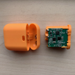
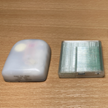
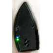
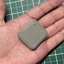

# Kompatible pumper

AAPS virker med en række insulinpumper. Listen herunder viser de enheder, der understøttes i dag. I parentes står der, om AAPS kommunikerer med pumpen via telefonens indbyggede Bluetooth, eller om der skal bruges en RileyLink-kompatibel enhed.

<!-- List of hidden pages to avoid overcrowding the menu -->

```{toctree}
:hidden:

../CompatiblePumps/Accu-Chek-Combo-Pump-v2.md
../CompatiblePumps/Accu-Chek-Insight-Pump.md
../CompatiblePumps/CareLevo.md
../CompatiblePumps/DanaR-Insulin-Pump.md
../CompatiblePumps/DanaRS-Insulin-Pump.md
../CompatiblePumps/DiaconnG8.md
../CompatiblePumps/EOPatch2.md
../CompatiblePumps/Equil5.3.md
../CompatiblePumps/MedtronicPump.md
../CompatiblePumps/MedtrumNano.md
../CompatiblePumps/OmnipodDASH.md
../CompatiblePumps/OmnipodEros.md
../CompatiblePumps/Future-possible-Pump-Drivers.md
```

- [Accu-Chek Combo](../CompatiblePumps/Accu-Chek-Combo-Pump-v2.md) (Bluetooth; se også [Tips til grundlæggende brug](#combov2-tips-for-basic-usage))
- [Accu-Chek Insight](../CompatiblePumps/Accu-Chek-Insight-Pump.md) (Bluetooth)
- [CareLevo](../CompatiblePumps/CareLevo.md) (Bluetooth)
- [DanaR](../CompatiblePumps/DanaR-Insulin-Pump.md) (Bluetooth)
- [DanaRS](../CompatiblePumps/DanaRS-Insulin-Pump.md) (Bluetooth)
- [Dana-i](../CompatiblePumps/DanaRS-Insulin-Pump.md) (Bluetooth)
- [Dana-i2](../CompatiblePumps/DanaRS-Insulin-Pump.md) (Bluetooth)
- [Diaconn G8](../CompatiblePumps/DiaconnG8.md) (Bluetooth)
- [EOPatch2](../CompatiblePumps/EOPatch2.md) (Bluetooth)
- [Equil 5.3](../CompatiblePumps/Equil5.3.md) (Bluetooth)
- Visse ældre [Medtronic](../CompatiblePumps/MedtronicPump.md) (kræver en [ekstra kommunikationsenhed](#CompatiblePumps-additional-communication-device))
- [Medtrum Nano 200U](../CompatiblePumps/MedtrumNano.md) (Bluetooth)
- [Medtrum 300U](../CompatiblePumps/MedtrumNano.md) (Bluetooth)
- [Omnipod DASH](../CompatiblePumps/OmnipodDASH.md) (Bluetooth)
- [Omnipod Eros](../CompatiblePumps/OmnipodEros.md) (kræver en [ekstra kommunikationsenhed](#CompatiblePumps-additional-communication-device))

## Min pumpe er ikke på listen

Status for andre pumper, som måske kan komme til at virke med AAPS, finder du på siden [Fremtidige (mulige) pumpedrivere](../CompatiblePumps/Future-possible-Pump-Drivers.md).

(CompatiblePumps-additional-communication-device)=
## Ekstra kommunikationsenhed

Hvis der ikke står en ekstra kommunikationsenhed, foregår kommunikationen mellem insulinpumpen og **AAPS** via Androids indbyggede Bluetooth. Der skal ikke bruges en ekstra enhed til at oversætte kommunikationsprotokollen.

Til gamle Medtronic-pumper og Omnipod Eros skal der bruges en ekstra kommunikationsenhed (ud over din telefon), som »oversætter« radiosignalet fra pumpen til Bluetooth. Enheden skal bruge den samme radiofrekvens som din pumpe:

- **Omnipod Eros**: 433 MHz.
- **Medtronic**: 916 MHz for pumper solgt i USA og Canada, 868 MHz for pumper solgt andre steder. Se [Sådan finder du ud af, hvilken frekvens din pumpe bruger](#MedtronicPump-faq).

Tilgængelige kommunikationsenheder:

-   [OrangeLink-websted](https://getrileylink.org/product/orangelink)
-  [433MHz RileyLink](https://getrileylink.org/product/rileylink433)
-   [Emalink-websted](https://github.com/sks01/EmaLink) - [Kontaktinfo](mailto:getemalink@gmail.com)
-   DiaLink - [Kontaktinfo](mailto:Boshetyn@ukr.net)
-   [LoopLink-websted](https://www.getlooplink.org/) - [Kontaktinfo](https://jameswedding.substack.com/) - Ikke testet