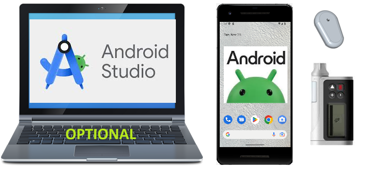

# Oversigt over komponenter

**AAPS** er ikke kun en (selvbygget) app; den er et af flere moduler i dit lukkede loop-system. Før du vælger komponenter, er det en god idé at se på dokumentationen for komponenterne.



```{admonition} IMPORTANT SAFETY NOTICE
:class: important

Grundlaget for de sikkerhedsfunktioner i **AAPS**, der er beskrevet i denne dokumentation, bygger på sikkerhedsfunktionerne i den hardware, du bruger til dit system. For at lukke et loop med automatisk insulindosering er det meget vigtigt, at du kun bruger en insulinpumpe og en CGM, der er testet, virker fuldt ud og er godkendt af de officielle myndigheder i dit land. Ændringer i hardware eller software i disse komponenter kan give uventet insulindosering og dermed en stor risiko for brugeren. Hvis du finder eller får tilbudt ødelagte, ændrede eller hjemmelavede insulinpumper eller CGM-modtagere, så **brug dem ikke** til at lave et **AAPS**-system.

Det er lige så vigtigt kun at bruge originalt tilbehør, f.eks. indføringsenheder, kanyler og insulinbeholdere, som producenten har godkendt til brug med din pumpe eller CGM. Utestet eller ændret tilbehør kan give unøjagtige CGM-værdier og fejl i insulindoseringen. Insulin er meget farligt, hvis dosis er forkert. Leg ikke med dit liv ved at »hacke« dit tilbehør.

Sidst, men ikke mindst, må du ikke tage SGLT-2-hæmmere (gliflozin), da de sænker blodsukkeret på en måde, der ikke kan beregnes. Kombinationen med et system, der sænker basalraten for at få BS til at stige, er særlig farlig. På grund af gliflozinen sker denne stigning i BS måske ikke, og der kan opstå en farlig tilstand med mangel på insulin. [Mere information her](#PreparingForAaps-no-sglt-2-inhibitors).
```

## Nødvendige moduler

### En god individuel dosering til din diabetesbehandling

Selv om det ikke er noget, du laver eller køber, er det nok det mest undervurderede »modul« – men det er afgørende. Når du lader en algoritme hjælpe med at styre din diabetes, skal den kende de rigtige indstillinger, så den ikke laver alvorlige fejl. Selv om du stadig mangler andre moduler, kan du allerede nu kontrollere og tilpasse din **profil** sammen med dit diabetesteam.

**Profilen** indeholder:

- BR (basalrater): giver baggrundsinsulin;
- ISF (insulinfølsomhedsfaktor): hvor meget dit blodsukker falder af 1 enhed insulin;
- CR (kulhydratforhold): hvor mange gram kulhydrat der dækkes af én enhed insulin.

De fleste loopere bruger døgnvarierende BR, ISF og CR, som tilpasser sig kroppens skiftende insulinfølsomhed i løbet af dagen.

Ud over din **profil** skal du også indstille din **insulin** i **Administrer → Insulinindstillinger**, herunder dens DIA (varighed af insulinvirkning) – se [Insulinindstillinger](#Config-Builder-insulin-dia).

Mere information om din **profil** [på siden om profilen](../SettingUpAaps/YourAapsProfile.md).

### Telefon

Se siden [Telefoner](../Getting-Started/Phones.md).

### Insulinpumpe

Se siden [Kompatible pumper](../Getting-Started/CompatiblePumps.md).

**Fordele og ulemper ved nogle pumpemodeller**

Combo, Insight og de ældre Medtronic er solide pumper, og de kan bruges til loop. Combo har den fordel, at der er mange flere typer infusionssæt at vælge imellem, da den har en standard Luer-Lock. Og batteriet er et almindeligt batteri, som du kan købe på enhver tankstation eller døgnkiosk, og hvis du virkelig har brug for et, kan du stjæle/låne det fra fjernbetjeningen på hotelværelset ;-).

Fordelene ved DanaR/RS og Dana-i frem for Combo som valg af pumpe er dog:

- Den første parring er nemmere med Dana-i/RS. Men det gør du normalt kun én gang, så det betyder kun noget, hvis du vil teste en ny funktion med forskellige pumper.
- Indtil videre virker Combo ved at aflæse skærmen. Generelt virker det godt, men det er langsomt. For loopet betyder det ikke meget, da alt sker i baggrunden. Alligevel skal du være forbundet meget længere tid, så der er mere tid, hvor BT-forbindelsen kan blive afbrudt. Det er ikke så nemt, hvis du går væk fra din telefon, mens du giver bolus & laver mad.
- Combo vibrerer ved slutningen af en TBR, DanaR vibrerer (eller bipper) ved SMB. Om natten bruger du sandsynligvis TBR mere end SMB.  Dana-i/RS kan indstilles, så den hverken bipper eller vibrerer.
- Historikken på Dana-i/RS kan læses på få sekunder med kulhydrater. Det gør det nemt at skifte telefon, mens du er offline, og fortsætte med loopet, så snart der er nogle CGM-værdier.
- Alle pumper, som **AAPS** kan tale med, er vandtætte ved levering. Kun Dana-pumperne er også »vandtætte med garanti« på grund af det forseglede batterirum og systemet til at fylde reservoiret.

### BS-kilde

Se siden [Kompatible CGM'er](../Getting-Started/CompatiblesCgms.md).

### **AAPS**-.apk-fil

Systemets vigtigste komponent. For at installere appen skal du først selv bygge apk-filen. Vejledningen finder du [her](../SettingUpAaps/BuildingAaps.md).

### Rapporteringsserver

En rapporteringsserver viser dine glukose- og behandlingsdata og laver rapporter til detaljeret analyse. Der er i øjeblikket to rapporteringsservere, som du kan bruge med AAPS: [Nightscout](#SettingUpTheReportingServer-nightscout) og [Tidepool](#SettingUpTheReportingServer-tidepool). Begge viser dine diabetesdata over tid og giver statistik om **tid i målområde** (TIR) og andre målinger.

Rapporteringsserveren er uafhængig af de andre moduler. Hvis du ikke vil bruge en rapporteringsserver, skal du vide, at den ikke er nødvendig for at køre **AAPS** på lang sigt. Men du skal stadig sætte en op, da den er nødvendig for at gennemføre [**Mål 1**](#objectives-objective1).

Mere information om, hvordan du sætter din rapporteringsserver op, finder du [her](../SettingUpAaps/SettingUpTheReportingServer.md).

## Valgfrie moduler

### Smartur

Du kan vælge et hvilket som helst smartur med **Wear OS 3** eller nyere. Se [Smarture og AAPS](../Getting-Started/Watches.md) for detaljer.

Brugerne laver en [liste over testede telefoner og ure](#Phones-list-of-tested-phones). Der er forskellige urskiver til brug med **AAPS**, som du kan finde [her](../WearOS/WearOsSmartwatch.md).

### xDrip

Selv om du ikke har brug for xDrip-appen som **BS-kilde**, kan du stadig bruge den, f.eks. til alarmer eller til at vise blodsukkeret på en anden måde. Du kan have så mange alarmer, du vil, vælge hvornår en alarm skal være aktiv, vælge om den må overstyre lydløs tilstand osv. Lidt information om xDrip finder du [her](../CompatibleCgms/xDrip.md). Vær opmærksom på, at dokumentationen for denne app ikke altid er opdateret, da den ændrer sig hurtigt.

## Hvad du kan gøre, mens du venter på modulerne

Det tager nogle gange et stykke tid at få alle modulerne til at lukke loopet. Men bare rolig, der er mange ting, du kan gøre, mens du venter. It is **necessary** to check and (where appropriate) adapt basal rates (BR), insulin-carb ratio (IC), insulin-sensitivity-factors (ISF) etc. Og måske kan åbent loop være en god måde at teste systemet på og lære **AAPS** at kende. I denne tilstand giver **AAPS** forslag til behandling, som du selv kan udføre.

Du kan blive ved med at læse dokumentationen her, komme i kontakt med andre loopere online eller offline, [læse](../UsefulLinks/BackgroundReading.md) dokumentation, eller hvad andre loopere skriver (men vær forsigtig: ikke alt er rigtigt eller godt for dig at gøre efter).

**Færdig?** Hvis du har alle dine **AAPS**-komponenter samlet (tillykke!) eller i det mindste nok til at starte i åbent loop, så læs først [beskrivelsen af læringsmålene](../SettingUpAaps/CompletingTheObjectives.md) før hvert nyt læringsmål, og sæt din hardware op.
