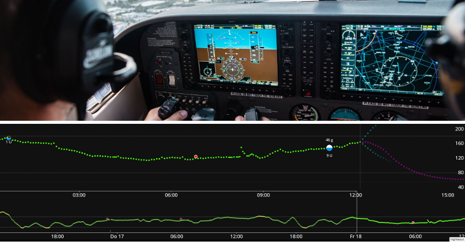
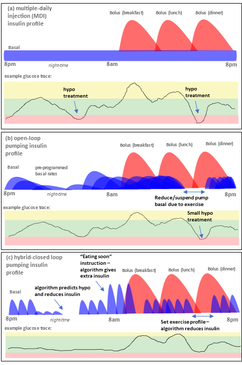
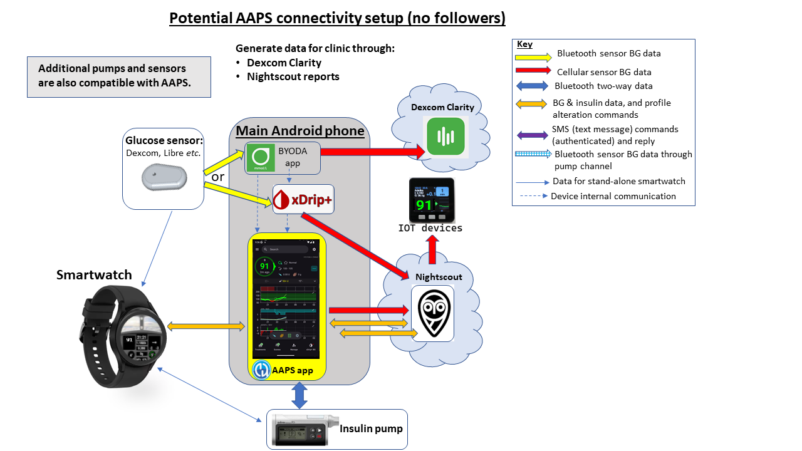
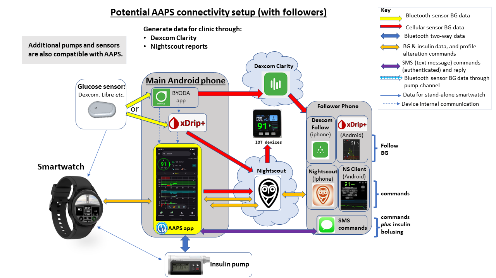

# Introduktion til APS og AAPS

```{contents} In this page
:backlinks: entry
:depth: 2
```

## Hvad er et »kunstigt bugspytkirtelsystem«?

En menneskelig bugspytkirtel gør mange ting ud over at regulere blodsukkeret. Men udtrykket **»kunstigt bugspytkirtelsystem« (APS, Artificial Pancreas System)** betyder normalt et system, der automatisk holder blodsukkeret inden for sunde grænser.

Den mest enkle måde at gøre det på er at måle **glukoseniveauet**, bruge værdierne til **beregninger** og derefter give kroppen den (forudsagte) rigtige mængde **insulin**. Systemet gentager beregningen med få minutters mellemrum, døgnet rundt. Det bruger **alarmer** og **advarsler** til at fortælle brugeren, når der er brug for handling eller opmærksomhed. Et sådant system består normalt af en **glukosesensor**, en **insulinpumpe** og en **controller**, som laver beregningerne. I **AAPS** og andre open source-systemer er controlleren en app på en telefon. I de fleste kommercielle systemer er det software, der er bygget ind i selve pumpen, og en app på telefonen bruges mest til visning og betjening.

Denne oversigtsartikel fra 2022 er et godt sted at starte, hvis du vil vide, hvordan systemer med lukket loop er udviklet, og hvordan de virker. Husk, at den er ældre end de fleste systemer, der findes i dag, så den er ikke en guide til, hvad der er på markedet nu:

 [Closed-Loop Insulin Delivery Systems: Past, Present, and Future Directions](https://www.frontiersin.org/journals/endocrinology/articles/10.3389/fendo.2022.919942/full) (Templer, _Frontiers in Endocrinology_, 2022).

Såkaldte »dobbelthormon«-systemer giver glukagon sammen med insulin for at forebygge svære hypoer og give en endnu tættere blodsukkerkontrol. Det første system af denne type er godkendt i Europa, men det fås kun gennem studier og projekter, og andre er stadig under udvikling. Ingen af dem er endnu til salg for alle.

Man kan tænke på en kunstig bugspytkirtel som en [»autopilot til din diabetes«](https://www.artificialpancreasbook.com/). Hvad betyder det?

I et fly gør en autopilot ikke hele pilotens arbejde, og piloten kan ikke sove under hele flyvningen. Autopiloten hjælper piloten i arbejdet. Den fjerner byrden ved hele tiden at skulle styre flyet, så piloten kan koncentrere sig om den bredere overvågning. Autopiloten modtager signaler fra forskellige sensorer, en computer vurderer dataene sammen med pilotens angivelser og laver derefter de nødvendige justeringer og advarer piloten, hvis noget er bekymrende. Piloten behøver ikke længere hele tiden at træffe beslutninger, og denne sammenligning kan bruges om **AAPS**.



(Introduction-what-does-hybrid-closed-loop-mean)=
## Hvad betyder hybrid lukket loop?

Den bedste løsning for type 1-diabetes ville være en »funktionel helbredelse« (sandsynligvis et implantat med bugspytkirtelceller, som er beskyttet mod immunsystemet). Mens fællesskabet af personer med type 1-diabetes (T1D) venter på det, er en kunstig bugspytkirtel med »fuldt lukket loop« nok det næstbedste. Det er et teknisk system, som ikke har brug for input fra brugeren (som f.eks. at give bolus til måltider eller melde motion), og som regulerer blodsukkeret godt. Næsten alle systemer i daglig brug er et »hybrid« lukket loop, fordi de bruger en kombination af automatisk teknologi og input fra brugeren. De første systemer med fuldt lukket loop blev godkendt i Europa i 2026, men ingen af dem er endnu bredt tilgængelige.

## Hvordan og hvorfor startede looping?

Udviklingen af kommerciel teknologi til personer med type 1-diabetes (T1D) går meget langsomt. I 2013 startede T1D-fællesskabet bevægelsen #WeAreNotWaiting. De udviklede selv systemer med eksisterende godkendt teknologi (insulinpumper og sensorer) for at forbedre blodsukkerkontrol, sikkerhed og livskvalitet. De kaldes OS-AID-systemer (Open-Source Automated Insulin Delivery, open source-systemer til automatisk insulintilførsel), tidligere DIY-systemer, fordi de ikke er formelt godkendt af sundhedsmyndigheder (FDA, NHS osv.). Der findes fire store OS-AID-systemer: [OpenAPS](https://openaps.org/what-is-openaps/), **AAPS**, [Loop](https://loopkit.github.io/loopdocs/#what-is-loop) og [Trio](https://triodocs.org).

En god måde at forstå det grundlæggende i OS-AID-looping på er at læse Dana Lewis' bog »Automated Insulin Delivery«. Du kan læse den gratis [her](https://www.artificialpancreasbook.com/) (eller købe bogen i en trykt udgave). Hvis du vil forstå mere om [OpenAPS](https://openaps.org/what-is-openaps/), som **AAPS** er udviklet ud fra, er [OpenAPS-webstedet](https://openaps.org/what-is-openaps/) en god kilde.

Der er også kommet flere kommercielle systemer med hybrid lukket loop. De er meget anderledes end OS-AID-systemer, først og fremmest fordi mange af dem har en »lærende algoritme«, som justerer, hvor meget insulin der gives, ud fra dit insulinbehov de foregående dage. Mange i OS-AID-fællesskabet har allerede prøvet kommercielle systemer og sammenlignet dem med deres OS-AID-system. Du kan få mere at vide om, hvordan de forskellige systemer er i forhold til hinanden, ved at spørge i de Facebook-grupper, der findes for de enkelte systemer, i [AAPS' Facebook-gruppe](https://www.facebook.com/groups/AndroidAPSUsers/) eller på [Discord](https://discord.com/invite/4fQUWHZ4Mw).

## Hvad er Android APS (AAPS)?


**Figur 1**. Grundlæggende oversigt over Android APS (kunstigt bugspytkirtelsystem), AAPS.

Android APS (**AAPS**) er et system med hybrid lukket loop, også kaldet et kunstigt bugspytkirtelsystem (APS, Artificial Pancreas System). Det beregner insulindoser med anerkendte [OpenAPS](https://openaps.org/)-algoritmer (et sæt regler), som er udviklet af T1D-fællesskabet #WeAreNotWaiting.

Fordi OpenAPS kun virker med bestemte ældre insulinpumper, blev **AAPS** (som kan bruges med flere insulinpumper) først udviklet i 2016 til et familiemedlem med type 1-diabetes. Siden de første dage er **AAPS** hele tiden blevet udviklet og forbedret af et team af frivillige udviklere og andre entusiaster, som har en forbindelse til type 1-diabetesverdenen. I dag bruges **AAPS** af mange tusinde mennesker over hele verden. Det er et meget fleksibelt system, som kan tilpasses på mange måder, og fordi det er open source, er det også nemt at bruge sammen med mange andre open source-programmer og -platforme til diabetes. De grundlæggende komponenter i det nuværende **AAPS**-system er vist i **Figur 1** ovenfor.


## Hvad er de grundlæggende komponenter i AAPS?

»Hjernen« i AAPS er en **app**, som du selv bygger. Der er en detaljeret trin-for-trin-vejledning til dette. Derefter installerer du **AAPS-appen** på en [kompatibel](../Getting-Started/Phones.md) **Android-smartphone** (**1**). Mange brugere foretrækker at have deres loop på en anden telefon end deres primære telefon. Du behøver altså ikke bruge en Android-telefon til alt andet i dit liv, kun til at køre dit AAPS-loop.

Ud over **AAPS** skal der også være en anden app installeret på **Android-smartphonen**. Denne [ekstra app](../Getting-Started/CompatiblesCgms.md) modtager glukosedata fra en sensor (**2**) via Bluetooth og sender derefter dataene internt på telefonen til **AAPS-appen**.

**AAPS-appen** bruger en beslutningsproces (en **algoritme**) fra OpenAPS. Nye brugere starter med den grundlæggende **oref0**-algoritme, men det er muligt at skifte til den nyere **oref1**-algoritme, efterhånden som du kommer videre med AAPS. Hvilken algoritme du bruger (oref0 eller oref1), afhænger af, hvad der passer bedst til din situation.  I begge tilfælde tager algoritmen hensyn til mange faktorer og laver hurtige beregninger, hver gang der kommer en ny måling fra sensoren. Derefter sender algoritmen via Bluetooth besked til insulinpumpen (**3**) om, hvor meget insulin den skal give. Alle oplysninger kan sendes til internettet (**4**) via mobildata eller Wi-Fi. Disse data kan også deles med følgere, hvis du ønsker det, og/eller samles til analyse. Du kan også parre et [smartur](../Getting-Started/Watches.md) (**5**) med telefonen for hurtigt at se dine data og, med nogle ure, sende enkle kommandoer til **AAPS**.

## Hvad er fordelene ved AAPS-systemet?

OpenAPS-algoritmen i **AAPS** styrer blodsukkeret uden input fra brugeren ud fra de parametre, som brugeren har valgt (de vigtigste er basalrater, insulinfølsomhedsfaktorer, insulin til kulhydrat-forhold, varighed af insulinvirkning osv.), og den reagerer hvert 5. minut på nye sensordata.

Nogle af de fordele ved **AAPS**, som brugerne nævner, er mange muligheder for finjustering, **Automatisering** og større gennemsigtighed i systemet for patienten/omsorgspersonen. Det kan give bedre kontrol over din diabetes (eller diabetes hos en, du passer), og det kan igen give bedre livskvalitet og mere ro i sindet.

Hvis du bruger tid på det, kan **AAPS** muligvis føre til:

- mindre stress og byrde med at håndtere type 1-diabetes;

- færre af de mange daglige småbeslutninger, som type 1-diabetes giver;

- personlig og dynamisk insulindosering ud fra data i realtid, som kan mindske behovet for at behandle hypoer og mindske antallet af episoder med hyperglykæmi;

- mere viden om insulinbehandling og mere selvtillid til at finjustere dine indstillinger;

- mulighed for at lave automatiske indstillinger (**automatiseringer**), der passer til din livsstil;

- bedre søvn og generelt færre indgreb om natten;

- fjernovervågning og fjernstyring af insulintilførslen for omsorgspersoner til personer med type 1-diabetes; og

- samling af alt dit bærbare diabetesudstyr (modtager til kontinuerlig glukosemåling og enheder til insulinstyring) i én Android-telefon, som styres af **AAPS**.


I sidste ende kan **AAPS** hjælpe den enkelte til at håndtere sin diabetes bedre, med et stabilt blodsukker og bedre helbred på lang sigt.

### Særlige fordele er bl.a.:

#### 1) Indbygget sikkerhed
Du kan læse om sikkerhedsfunktionerne i algoritmerne, som hedder oref0 og oref1, [her](https://openaps.org/reference-design/). Brugeren har selv kontrol over sine sikkerhedsgrænser.

#### 2) Fleksibel hardware

**AAPS** virker med mange forskellige insulinpumper og sensorer og giver fleksibilitet, når livet ændrer sig. Hvis du f.eks. bliver allergisk over for limen på Dexcom-sensorens plaster, kan du skifte til en Libre-sensor i stedet. Brugerne behøver ikke at bygge eller installere **AAPS**-appen igen. Du vælger bare en anden pumpe eller BS-kilde i **Konfiguration** for at skifte hardware. **AAPS** er uafhængig af bestemte pumpedrivere og har også en »virtuel pumpe«, så brugerne kan eksperimentere sikkert, før de bruger det på sig selv.

#### 3) Kan tilpasses meget, med brede parametre

Brugerne kan nemt tilføje eller fjerne moduler eller funktioner, og **AAPS** kan bruges både i åbent og lukket loop. Her er nogle eksempler på mulighederne med **AAPS**-systemet:

 a) Mulighed for at sætte en lavere **BS**-målværdi 30 min før du spiser; du kan sætte målværdien helt ned til 72 mg/dl (4,0 mmol/l).

 b) Hvis du er insulinresistent og derfor har højt blodsukker, kan du i **AAPS** lave en **automatiseringsregel**, som aktiveres, når BS stiger over 8 mmol/l (144 mg/dl), og som f.eks. skifter til en profil på 120% (det giver 20% mere basal og gør også de andre faktorer stærkere i forhold til din normale **profil**). Automatiseringen varer i den planlagte tid, som du indstiller. En sådan automatisering kan indstilles til kun at være aktiv på bestemte ugedage, på bestemte tidspunkter af dagen og endda på bestemte steder.

 c) Hvis dit barn uden varsel hopper på en trampolin, kan du i **AAPS** stoppe insulinen i et bestemt tidsrum direkte fra telefonen.

 d) Når du igen tilslutter en pumpe med slange, som har været afbrudt under svømning, beregner **AAPS** den basalinsulin, du har manglet, mens pumpen var afbrudt, og giver den forsigtigt ud fra dit aktuelle BS. Insulin, som der ikke er brug for, kan tilsidesættes ved blot at »annullere« den manglende basal.

 e) **AAPS** giver dig mulighed for at lave forskellige profiler til forskellige situationer og nemt skifte mellem dem. Funktioner, som får algoritmen til at sænke et forhøjet BS hurtigere (som super-mikroboluser (»**SMB**«) og uanmeldte måltider (»**UAM**«)), kan f.eks. indstilles til kun at virke om dagen, hvis du er bekymret for hypoer om natten.

Det er alle eksempler. Alle funktionerne tilsammen giver stor fleksibilitet i hverdagen, også ved sport, sygdom, hormoncyklusser _osv._ I sidste ende er det brugeren, der bestemmer, hvordan denne fleksibilitet bruges, og der findes ikke én automatisering, der passer til alle.

#### 4) Fjernovervågning
Der findes flere mulige måder at overvåge på (Sugarmate, Dexcom Follow, xDrip, Android Auto _osv._), som er nyttige for forældre/omsorgspersoner og for voksne i visse situationer (søvn/bilkørsel), der har brug for advarsler, som kan tilpasses. I nogle apps (xDrip) kan du også slå alarmerne helt fra. Det er godt, hvis du har en ny sensor, som er ved at falde til, og som du endnu ikke vil loope med.

#### 5) Fjernstyring
En stor fordel ved **AAPS** i forhold til kommercielle systemer er, at følgere kan sende mange forskellige kommandoer tilbage til **AAPS**-systemet med godkendte tekstkommandoer (SMS) eller en parret **AAPSClient**-app. Denne funktion bruges meget af forældre til børn med type 1-diabetes, som bruger **AAPS**.

Fjernstyringen kan være meget nyttig: f.eks. på legepladsen, hvis du vil give en bolus før et mellemmåltid fra din egen telefon, mens dit barn har travlt med at lege. Det er også muligt at overvåge systemet fra et smartur (_f.eks._ Garmin) eller sende enkle kommandoer fra det (_f.eks._ et Wear OS-ur som Samsung Galaxy Watch).

#### 6) Ingen kommercielle begrænsninger takket være åbne programgrænseflader
Ud over den åbne kildekode, som gør det muligt at se kildekoden til **AAPS** når som helst, giver princippet om åbne programmeringsgrænseflader også andre udviklere mulighed for at bidrage med nye idéer. **AAPS** er tæt integreret med Nightscout. Det gør udviklingen hurtigere og giver brugerne mulighed for at tilføje funktioner, som gør livet med diabetes endnu nemmere. Gode eksempler på sådanne integrationer er [Nightscout](https://nightscout.github.io/), [Nightscout Reporter](https://nightscout-reporter.zreptil.de/), xDrip, [M5 stack](https://github.com/mlukasek/M5_NightscoutMon/wiki) osv. Der er en løbende dialog mellem open source-udviklere og dem, der udvikler kommercielle systemer. Mange af de nye løsninger fra OS-AID bliver gradvist overtaget af kommercielle systemer, hvor udviklingen naturligt nok går langsommere, bl.a. fordi grænsefladerne mellem systemer fra forskellige firmaer (pumper, apps, sensorer _osv._) skal forhandles og licenseres omhyggeligt. Det kan også bremse nye løsninger, som er praktiske for patienten (eller en lille gruppe patienter med et meget specielt behov), men som ikke giver nogen stor fortjeneste.

#### 7) Detaljeret app-grænseflade
Med **AAPS** er det nemt at holde øje med ting som: insulinmængde i pumpen, kanylens alder, sensorens alder, alder på pumpens batteri, insulin om bord _osv._ Mange handlinger kan udføres i **AAPS**-appen (klargøring af pumpen, afbrydelse af pumpen _osv._) i stedet for på selve pumpen. Det betyder, at pumpen kan blive i lommen eller i bæltet (dit eget eller hos en, du passer).

#### 8) Tilgængelighed og overkommelig pris
**AAPS** giver personer, der ikke selv har råd, eller som ikke har tilskud/forsikring, adgang til et system med hybrid lukket loop, som i princippet er flere år foran de kommercielle systemer i udviklingen. Lige nu skal du bruge en rapporteringsserver (Nightscout eller Tidepool) for at sætte **AAPS** op, men den er ikke nødvendig for den daglige drift af **AAPS**-loopet. Mange fortsætter med at bruge Nightscout til at samle deres data og til fjernovervågning. Selvom **AAPS** i sig selv er gratis, kan det koste penge (€0 - €12) at sætte Nightscout op via en af de forskellige platforme. Det afhænger af, hvor meget support du ønsker (se sammenligningstabellen), og om du vil fortsætte med at bruge Nightscout efter opsætningen eller ej. **AAPS** virker med mange forskellige [Android-telefoner](https://docs.google.com/spreadsheets/u/1/d/e/2PACX-1vScCNaIguEZVTVFAgpv1kXHdsHl3fs6xT6RB2Z1CeVJ561AvvqGwxMhlmSHk4J056gMCAQE02sAWJvT/pubhtml?gid=683363241&single=true) til en overkommelig pris (fra ca. €150). Der findes forskellige versioner til bestemte steder og sprog, og AAPS kan også bruges af personer, der er [blinde](#accessibility-for-users-aaps-who-are-partially-or-completely-blind).

#### 9) Hjælp
Intet system til automatisk insulintilførsel er perfekt. Kommercielle systemer og open source-systemer har mange af de samme fejl, både i kommunikationen og ved midlertidige hardwarefejl. Du kan få hjælp fra fællesskabet af AAPS-brugere på Facebook, Discord og GitHub, som har designet og udviklet **AAPS** og bruger det i dag over hele verden. Der findes også Facebook-støttegrupper og hjælp fra klinikker/firmaer til de kommercielle APS-systemer - det er en god idé at tale med brugere eller tidligere brugere af disse systemer for at høre om de almindelige fejl, kvaliteten af undervisningen og hvor meget løbende support der gives.

#### 10) Forudsigelighed, gennemsigtighed og sikkerhed
**AAPS** er gennemsigtigt, logisk og forudsigeligt. Det kan gøre det nemmere at se, når en indstilling er forkert, og at justere den. Du kan se præcis, hvad systemet gør, og hvorfor det gør det, og du kan sætte dets grænser. Det giver dig kontrollen (og ansvaret). Det kan give brugeren tryghed og en bedre nattesøvn.

#### 11) Adgang til avancerede funktioner via udviklerversioner (dev), bl.a. fuldt lukket loop
Denne **AAPS**-dokumentation handler om den almindelige **»master«**-gren af **AAPS**. Men der foregår hele tiden forskning og udvikling. Mere erfarne brugere vil måske prøve de eksperimentelle funktioner i **development**-grenen (udviklingsgrenen). Udviklingen fokuserer på strategier for fuldt lukket loop (hvor du ikke skal give bolus til måltider _osv._) og generelt på at gøre livet med type 1-diabetes så nemt som muligt.

#### 12) Mulighed for selv at bidrage til nye forbedringer
Type 1-diabetes kan være meget frustrerende og give en følelse af at være alene. Det kan være meget givende at have kontrol over sin egen diabetesteknologi og at kunne »give det videre« ved at hjælpe andre på deres vej, så snart man selv gør fremskridt. Du kan lære selv, finde forhindringerne og følge med i - og endda bidrage til - nye udviklinger og dokumentationen. Der vil være andre i fællesskabet med samme mål, som du kan dele idéer med og arbejde sammen med. Det er kernen i #WeAreNotWaiting.

## Hvordan er AAPS sammenlignet med MDI og åbent loop?

Flere daglige injektioner (MDI, (a) i **Figur 2** nedenfor) betyder normalt én injektion om dagen med en langtidsvirkende insulin (_f.eks._ Tresiba) og injektioner med en hurtigere virkende insulin (_f.eks._ Novorapid, Fiasp) ved måltider eller til korrektioner. Ved åben pumpebehandling (b) bruger man en pumpe, som giver basal med hurtigtvirkende insulin efter forudprogrammerede rater, og man giver boluser med pumpen ved måltider eller til korrektioner. Grundprincippet i et loop-system er, at loop-appen bruger glukosedata fra sensoren til at bede pumpen om at stoppe insulintilførslen, når den forudser, at du er på vej mod et lavt blodsukker, og til at give dig ekstra insulin, når dit glukoseniveau stiger og forventes at blive for højt (c). Figuren er meget forenklet i forhold til virkeligheden, men den viser de vigtigste forskelle mellem metoderne. Det er muligt at opnå meget god glukosekontrol med alle tre metoder.




**Figur 2**. Grundlæggende oversigt over (a) MDI, (b) pumpebehandling med åbent loop og (c) pumpebehandling med hybrid lukket loop.

## Hvordan er AAPS sammenlignet med andre loop-systemer?

Pr. 25. juni 2023 findes der fire store open source-systemer med lukket loop: [OpenAPS](https://openaps.readthedocs.io/), **AAPS**, [Loop](https://loopkit.github.io/loopdocs/#what-is-loop) og [Trio](https://triodocs.org) (tidligere FreeAPS X). Funktionerne i de forskellige systemer er vist i tabellen nedenfor:


| Enhedstype | Navn                                                                | [AAPS](https://wiki.aaps.app)                  | [Loop](https://loopkit.github.io/loopdocs/)    | [Open APS](https://openaps.readthedocs.io/en/latest/) | [Trio](https://triodocs.org)                   |
| ---------- | ------------------------------------------------------------------- | ---------------------------------------------- | ---------------------------------------------- | ----------------------------------------------------- | ---------------------------------------------- |
| Telefon    | Android                                                             |         |  |         |  |
| Telefon    | iPhone                                                              |  |         |         |         |
| Rig        | lille computer (1)                                                  |  |  |                |  |
| PUMP       | [Dana I](../CompatiblePumps/DanaRS-Insulin-Pump.md)                 |         |         |         |         |
| PUMP       | [Dana RS](../CompatiblePumps/DanaRS-Insulin-Pump.md)                |         |         |         |         |
| PUMP       | [Dana R](../CompatiblePumps/DanaR-Insulin-Pump.md)                  |         |  |         |  |
| PUMP       | [Omnipod (Dash)](../CompatiblePumps/OmnipodDASH.md)                 |         |         |         |         |
| PUMP       | [Omnipod (Eros)](../CompatiblePumps/OmnipodEros.md)                 |         |         |         |         |
| PUMP       | [Diaconn G8](../CompatiblePumps/DiaconnG8.md)                       |         |  |         |  |
| PUMP       | [EOPatch 2](../CompatiblePumps/EOPatch2.md)                         |         |  |         |  |
| PUMP       | [Medtrum TouchCare Nano 200U](../CompatiblePumps/MedtrumNano.md)    |         |         |         |         |
| PUMP       | [Medtrum TouchCare 300U](../CompatiblePumps/MedtrumNano.md)         |         |         |         |         |
| PUMP       | [Roche Combo](../CompatiblePumps/Accu-Chek-Combo-Pump-v2.md)        |         |  |         |  |
| PUMP       | [Roche Insight](../CompatiblePumps/Accu-Chek-Insight-Pump.md)       |         |  |         |  |
| PUMP       | [Ældre Medtronic](../CompatiblePumps/MedtronicPump.md)              |         |         |                |         |
| PUMP       | [Equil 5.3](../CompatiblePumps/Equil5.3.md)                         |         |  |         |  |
| PUMP       | [CareLevo](../CompatiblePumps/CareLevo.md)                          |         |  |         |  |
| PUMP       | [AP550](../CompatiblePumps/AP550-Insulin-Pump.md)                   |         |  |         |  |
| CGM        | [Dexcom G7/One+/Stelo](../CompatibleCgms/DexcomG7.md)               |         |         |         |         |
| CGM        | [Dexcom One](../CompatibleCgms/DexcomG6.md)                         |         |         |         |         |
| CGM        | [Dexcom G6](../CompatibleCgms/DexcomG6.md)                          |         |         |                |         |
| CGM        | [Libre 3/3+](../CompatibleCgms/Libre3.md)                           |         |         |         |         |
| CGM        | [Libre 2/2+](../CompatibleCgms/Libre2.md)                           |         |         |         |         |
| CGM        | [Libre 1](../CompatibleCgms/Libre1.md)                              |         |         |         |         |
| CGM        | [Eversense](../CompatibleCgms/Eversense.md)                         |         |         |         |         |
| CGM        | [MM640g/MM630g](../CompatibleCgms/MM640g.md)                        |         |  |         |  |
| CGM        | [PocTech](../CompatibleCgms/PocTech.md)                             |         |  |         |  |
| CGM        | [Ottai](../CompatibleCgms/OttaiM8.md)                               |         |  |         |  |
| CGM        | [Syai Tag](../CompatibleCgms/SyaiTagX1.md)                          |         |  |         |  |
| CGM        | [Nightscout som BS-kilde](../CompatibleCgms/CgmNightscoutUpload.md) |         |         |                |         |

_Noter til tabellen:_
1. En **rig** er en lille computer uden skærm, som du bærer med dig. Én understøttet enhedstype er Intel Edison + Explorer Board, og den anden er Raspberry Pi + Explorer HAT eller Adafruit RFM69HCW Bonnet. De første APS-systemer byggede på denne opsætning, fordi mobiltelefoner ikke kunne køre de nødvendige algoritmer. Disse systemer bruges mindre nu, fordi opsætningen på mobiltelefoner er blevet nemmere, og telefoner har en skærm. Intel er også stoppet med at sælge Intel Edison. De fremragende OpenAPS-algoritmer **oref0** og **oref1** er nu en del af AAPS og Trio.


En international, fagfællebedømt konsensuserklæring med praktisk vejledning om open source-looping blev skrevet af og til sundhedspersonale og udgivet i et førende medicinsk tidsskrift i 2022: [_Lancet Diabetes Endocrinol_, 2022; 10: 58–74](https://www.ncbi.nlm.nih.gov/pmc/articles/PMC8720075/)(_1_). Den er værd at læse (også for din diabetesklinik) og opsummerer de vigtigste tekniske forskelle mellem de forskellige open source-systemer med hybrid lukket loop.

Det er svært at få en »fornemmelse« af et system uden at bruge det eller tale med andre, der bruger det, så kontakt endelig andre på Facebook/Discord og spørg. De fleste synes, at **AAPS** er meget avanceret sammenlignet med andre systemer med hybrid lukket loop (især de kommercielle systemer), med et stort antal indstillinger og funktioner, som kan tilpasses, som beskrevet ovenfor. Nogle synes, at det er lidt overvældende i starten, men der er ingen grund til at undersøge alle mulighederne på én gang. Du kan gå så langsomt eller så hurtigt frem, som du vil, og der er hjælp at få ved hvert trin.


## Bruger AAPS kunstig intelligens eller en lærende algoritme?

Den nuværende version af **AAPS** (4.0) har ingen algoritmer med maskinlæring, ingen modeller for insulinrespons med mange parametre og ingen kunstig intelligens. Systemet er derfor åbent og gennemsigtigt i, hvordan det virker, og det kan forstås ikke kun af eksperter, men også af sundhedspersonale og patienter. Det betyder også, at hvis din hverdag ændrer sig meget (f.eks. fra en stresset uge på arbejdet til en afslappende ferie), og du sandsynligvis har brug for en helt anden mængde insulin, kan du straks skifte **AAPS** til en svagere/stærkere tilpasset profil. Et »lærende system« laver denne justering automatisk for dig, men det tager sandsynligvis længere tid at justere insulintilførslen.

(which-system-is-right-for-me-or-my-dependent)=
## Hvilket system passer til mig eller til en, jeg passer?

I praksis er dit valg af system ofte begrænset af, hvilken pumpe du allerede har eller kan få fra dit behandlingssted, og af dit valg af telefon (Apple eller Android). Hvis du endnu ikke har en pumpe, har du det største udvalg af systemer. Teknologien udvikler sig hele tiden: pumper går ud af produktion, og nye pumper og sensorer kommer på markedet. De fleste open source-systemer virker med de vigtigste sensorer (Libre og Dexcom) eller bliver hurtigt tilpasset til nye sensorer cirka et år efter, at de er kommet på markedet (med lidt forsinkelse på grund af test af sikkerhed og stabilitet).

De fleste **AAPS**-brugere oplever mere tid i målområde, lavere HbA1c og bedre livskvalitet, fordi systemet automatisk kan justere basalraterne om natten, mens de sover. Det gælder for de fleste hybride lukkede loop-systemer. Nogle foretrækker et meget enkelt system, som ikke kan tilpasses meget (så foretrækker du måske et kommercielt system), mens andre synes, at den manglende kontrol er meget frustrerende (så foretrækker du måske et open source-system). Hvis du (eller en, du passer) lige har fået diagnosen, er en almindelig vej først at vænne sig til MDI og en glukosesensor, derefter skifte til en pumpe, som kan bruges til looping, og så skifte til **AAPS**. Men nogle (især små børn) går direkte til en pumpe.

Det er vigtigt at vide, at **AAPS**-brugeren selv skal være aktiv for at finde og løse problemer, med hjælp fra fællesskabet. Det er en meget anden tankegang end ved brug af et kommercielt system. Med **AAPS** har brugeren mere kontrol, men også ansvaret, og skal være tryg ved det.

## Er det sikkert at bruge open source-systemer som AAPS?

### Sikkerheden i AAPS-systemet
Et mere præcist spørgsmål er nok: »Er det sikkert **sammenlignet** med mit nuværende system til insulintilførsel?«, for ingen metode til insulintilførsel er uden risiko. Der er mange kontroller og sikkerhedsmekanismer i **AAPS**. En nyere [artikel](https://www.liebertpub.com/doi/epub/10.1089/dia.2019.0375) undersøgte brugen af **AAPS** i en computersimulering. Det var en effektiv måde at teste objektivt, hvor sikkert og effektivt systemet er. Mere generelt bruger mange tusinde mennesker over hele verden open source-systemer til automatisk insulintilførsel, og antallet stiger fortsat globalt.

Enhver enhed, der bruger radiokommunikation, kan blive hacket, og det gælder også for en insulinpumpe, der ikke looper. Vi kender i dag ikke til nogen, der har forsøgt at skade andre ved at hacke deres medicinske diabetesudstyr. Men der er flere måder at beskytte sig mod sådanne risici på:

1.  Begræns i pumpens indstillinger både den højeste tilladte bolus og den højeste midlertidige basal til mængder, som du mener er mest sikre. Det er faste grænser, som vi ikke tror, at en ondsindet hacker kan komme uden om.

2.  Slå dine CGM-alarmer til for både højt og lavt blodsukker.

3.  Hold øje med din insulintilførsel online. Nightscout-brugere kan sætte ekstra alarmer op, som advarer om mange forskellige situationer, også situationer, der er meget mere sandsynlige end et ondsindet angreb. Ud over højt og lavt blodsukker kan Nightscout vise diagnostiske data, som hjælper med at kontrollere, at pumpen virker som ønsket, bl.a. aktuel IOB, pumpens historik for midlertidig basal og pumpens bolushistorik. Nightscout kan også indstilles til at advare brugerne på forhånd om uønskede situationer, f.eks. forudsagt højt og lavt blodsukker, lidt insulin i reservoiret og lavt batteri i pumpen.

Hvis der blev lavet et ondsindet angreb på din insulinpumpe, ville disse strategier mindske risikoen meget. Alle, der overvejer at bruge **AAPS**, skal afveje risikoen ved at bruge **AAPS** mod risikoen ved at bruge et andet system.

#### Sikkerhed, når blodsukkerkontrollen forbedres for hurtigt

Et hurtigt fald i HbA1c og bedre blodsukkerkontrol lyder fristende. Men hvis det gennemsnitlige blodsukker sænkes _for hurtigt_, når man starter et lukket loop-system, kan det give varige skader, også på øjnene, og smertefuld neuropati, som aldrig forsvinder. Disse skader kan undgås ved blot at sænke niveauet langsommere. Hvis du i dag har et forhøjet HbA1c og skifter til AAPS (eller et andet lukket loop-system), så tal med dit behandlerteam om denne mulige risiko, før du starter, og aftal en tidsplan med dem. Mere generel information om, hvordan du sænker dit glukoseniveau sikkert, med links til medicinsk litteratur, findes i afsnittet om sikkerhed [her](#preparing-safety-first).

#### Medicinsk sikkerhed for enheder, forbrugsvarer og anden medicin

Brug en testet, fuldt fungerende FDA- eller CE-godkendt insulinpumpe og CGM til et loop med kunstig bugspytkirtel. Ændringer i hardware eller software i disse komponenter kan give uventet insulindosering og dermed en stor risiko for brugeren. Hvis du finder eller bliver tilbudt ødelagte, ændrede eller hjemmelavede insulinpumper eller CGM-modtagere, må du ikke bruge dem til at lave et AAPS-system.

Brug originale forbrugsvarer som indføringsenheder, kanyler og insulinbeholdere, der er godkendt af producenten af din pumpe og din CGM. Utestet eller ændret tilbehør kan give unøjagtige CGM-værdier og fejl i insulindoseringen. Insulin er meget farligt, hvis det doseres forkert - leg ikke med dit liv ved at hacke dine forbrugsvarer.

Tag ikke SGLT-2-hæmmere (gliflozines) mens du bruger **AAPS**, fordi de sænker blodsukkeret på en måde, som ikke kan beregnes. Det er farligt at kombinere denne effekt med et system, som sænker basalraterne for at hæve BS. Der er flere detaljer om dette i det vigtigste [afsnit om sikkerhed](#preparing-safety-first).

(introduction-how-can-i-approach-discussing-aaps-with-my-clinical-team)=
## Hvordan kan jeg tale med mit behandlerteam om AAPS?

Vi opfordrer brugerne til at tale med deres behandlere om, at de vil bruge **AAPS**. Vær ikke bange for at have en ærlig samtale med dit diabetesteam, hvis du vil bruge **AAPS** (eller et andet OS-AID-loop). Åbenhed og tillid mellem patient og læge er meget vigtigt.

### Forslag til, hvordan du kan gøre:
Start en samtale med din behandler for at finde ud af, hvor godt de kender diabetesteknologi som CGM, pumper, hybride loops og kommercielle loop-systemer, og hvad de mener om det. Din behandler/endokrinolog bør kende den grundlæggende teknologi og være villig til at tale med dig om de nyeste kommercielle loop-produkter, der findes i deres område.

#### Lokale erfaringer

Find ud af, hvad dine behandlere/endokrinologer mener om OS-AID-loop _kontra_ kommercielle loop-systemer, og hvor meget de ved om området. Kender de **AAPS**, og kan de fortælle dig om nyttige erfaringer med patienter, der bruger OS-AID-looping?

Spørg, om dit team har patienter, der allerede bruger OS-AID-looping. På grund af tavshedspligten må læger ikke give dig oplysninger om andre patienter uden deres samtykke. Men hvis du vil, **kan** du bede dem om at give **dine** kontaktoplysninger til en patient, der allerede bruger OS-AID-looping, hvis behandleren mener, at I vil »passe godt sammen«, og sige, at du gerne vil kontaktes af patienten for at tale om OS-AID-looping. Behandlerne har ikke pligt til at gøre det, men nogle gør det gerne, fordi de ved, hvor vigtig støtte fra andre patienter er i behandlingen af type 1-diabetes. Det kan også være nyttigt at møde venlige OS-AID-loopere i dit område. Det er selvfølgelig op til dig, og det er ikke strengt nødvendigt.

#### Nationale og internationale erfaringer

Hvis du føler, at dit team ikke støtter dig i at loope med **AAPS**, kan disse argumenter måske hjælpe:

a) **AAPS**-systemet er udviklet AF patienter og deres omsorgspersoner. Det er først og fremmest udviklet med fokus på sikkerhed, men det bygger også på patienternes store erfaring. Der er mange tusinde **AAPS**-brugere over hele verden. Derfor er der sandsynligvis andre patienter i din kliniks patientgruppe, som bruger OS-AID-looping (uanset om klinikken ved det eller ej).

b) En nyere, fagfællebedømt vejledning i det internationalt førende medicinske tidsskrift [The Lancet](https://www.ncbi.nlm.nih.gov/pmc/articles/PMC8720075/pdf/nihms-1765784.pdf)(_1_) har bekræftet, at OS-AID-loops er **sikre** og **effektive til at forbedre diabeteskontrollen**, også tiden i målområde. Der er jævnligt artikler i førende tidsskrifter som [Nature](https://doi.org/10.1038/d41586-023-02648-9)(_3_), som fremhæver de fremskridt, OS-AID-fællesskabet gør.

c) At starte med **AAPS** betyder en _gradvis_ overgang fra pumpebehandling med »åbent« loop over stop ved lavt BS til hybrid »lukket« loop, ved at gennemføre en række læringsmål. Der er altså et struktureret forløb, hvor brugeren skal vise et vist niveau af kompetence på hvert trin og finjustere sine grundindstillinger (basal, ISF og IC) før loopet kan lukkes.

d) Du kan få teknisk hjælp fra OS-AID-fællesskabet via GitHub, Discord og lukkede Facebook-grupper.

e) Du kan vise **både CGM-data og data om insulin/loop/pumpe** som samlede rapporter ved besøg i klinikken (via Nightscout eller Tidepool), enten udskrevet eller på skærmen (hvis du tager en bærbar computer/tablet med). Når CGM-data og insulindata er samlet, kan din behandler bruge sin tid bedre på at gennemgå dine rapporter, og det hjælper jer med at vurdere dine fremskridt.

f) Hvis dit team stadig er meget imod, så giv din behandler udskrifter af de artikler, der er linket til her i teksten, og giv dem linket til **AAPS**-afsnittet for sundhedspersonale: [Til sundhedspersonale – En generel introduktion og vejledning til **AAPS**](../UsefulLinks/ClinicianGuideToAaps.md)

#### Støtte til OS-AID-looping fra andre behandlere

Artiklen i [Lancet Diabetes Endocrinology](https://www.ncbi.nlm.nih.gov/pmc/articles/PMC8720075/)(_1_) (ledet i fællesskab af King's og Guy's and St Thomas' NHS Foundation Trust og af dr. Sufyan Hussain, overlæge i diabetologi og æresseniorlektor ved King's i London) giver:

a) **Forsikring** til fagfolk om, at OS-AID-systemer med kunstig bugspytkirtel / open source er en »sikker og effektiv behandling« af type 1-diabetes, og vejledning om anbefalinger, samtaler, støtte og dokumentation;

b) **Anerkendelse** af, at open source-systemer til automatisk insulintilførsel (»AID«) kan øge tiden i målområde (TIR) og samtidig mindske udsvingene i blodsukkeret og antallet af hypo- og hyperglykæmiske episoder i forskellige aldersgrupper, køn og fællesskaber;

c) **Anbefaling** af, at sundhedspersonale skal **støtte** type 1-patienter eller deres omsorgspersoner, som vælger at behandle deres diabetes med et open source-AID-system;

d) Anbefaling af, at sundhedspersonale skal forsøge at lære om alle behandlingsmuligheder, der kan gavne patienterne, også de tilgængelige open source-AID-systemer.  Hvis sundhedspersonale ikke har ressourcer til at sætte sig ind i det, eller hvis de er bekymrede for juridiske eller regulatoriske forhold, bør de overveje at **samarbejde med andre sundhedspersoner**, som har det;

e) Understregning af, at alle CGM-brugere altid skal have åben adgang i realtid til **deres egne sundhedsdata**

f) Understregning af, at disse open source-systemer ikke har været igennem den samme myndighedsvurdering som kommercielt tilgængelig medicinsk teknologi, og at der ikke er kommerciel teknisk support. Men **der er omfattende støtte fra fællesskabet**; og

g) En anbefaling af, at **regler og lovgivning** bliver opdateret, så det er klart, at etisk og effektiv behandling med sådanne open source-systemer er tilladt.

En anden artikel i [Medical Law International, 2021](http://pure-oai.bham.ac.uk/ws/files/120241375/0968533221997510.pdf)(_4_) fremhæver også, at det britiske General Medical Councils »vejledning om samtykke« lægger stor vægt på, at læge og patient træffer beslutninger sammen. Lægen bør forklare de mulige fordele, risici, byrder og bivirkninger ved OS-AID APS og kan anbefale en bestemt løsning uden at presse patienten.

I sidste ende er det patienten, der skal afveje disse faktorer sammen med andre ikke-kliniske forhold, der er vigtige for dem, og beslutte, hvilken behandling de vil tage imod, hvis nogen.

Hvis en læge i klinikken opdager, at patienten looper med et OS-AID-system, er lægen ikke fritaget for sin pligt til at overvåge patienten, bare fordi lægen ikke har ordineret den teknologi, patienten bruger; behandlerne skal fortsat overvåge patienterne.

Læger (i hvert fald i Storbritannien) har ikke forbud mod at ordinere medicin uden godkendelse og kan bruge deres kliniske skøn. De bør derfor bruge deres kliniske skøn til at vurdere, om et OS-AID APS passer til en bestemt patient, og tale med patienten om, hvad de ser som fordele og ulemper.

#### Artiklerne nævnt ovenfor og andre nyttige links og holdningserklæringer står herunder:

1. Open-source automated insulin delivery: international consensus statement and practical guidance for health-care professionals [_Lancet Diabetes Endocrinol_, (2022) _10_, 58–74](https://www.ncbi.nlm.nih.gov/pmc/articles/PMC8720075/)
2. [In Silico Trials of an Open-Source Android-Based Artificial Pancreas: A New Paradigm to Test Safety and Efficacy of Do-It-Yourself Systems, 2020](https://www.liebertpub.com/doi/epub/10.1089/dia.2019.0375)
3. A DIY ‘bionic pancreas’ is changing diabetes care — what's next? [_Nature_ (2023), _620_, 940-941](https://doi.org/10.1038/d41586-023-02648-9)
4. Prescribing unapproved medical devices? The case of DIY artificial pancreas systems [_Medical law international_, (2021), _21_, 42-68](http://pure-oai.bham.ac.uk/ws/files/120241375/0968533221997510.pdf)
5. [Berlin Institute of Health, holdningserklæring, 2022](https://www.bihealth.org/en/notices/do-it-yourself-solutions-for-people-with-diabetes-are-safe-and-recommended)
6. Do-It-Yourself Automated Insulin Delivery: A Health-care Practitioner User’s Guide (holdning og vejledning fra Diabetes Canada) [_Canadian Journal of Diabetes_ (2023), _47_, E8, 389-397](https://www.canadianjournalofdiabetes.com/article/S1499-2671(23)00138-7/fulltext)
7.  Holland (EN/NL) - til sundhedspersonale - [sådan hjælper du personer, der bruger open source-systemer til automatisk insulintilførsel](https://www.diabetotech.com/blog/how-to-help-people-on-open-source-automated-insulin-delivery-systems)
8. First Use of Open-Source Automated Insulin Delivery AndroidAPS in Full Closed-Loop Scenario: Pancreas4ALL Randomized Pilot Study [_Diabetes Technol. Ther._, 25, _5_, 2023](https://www.liebertpub.com/doi/pdf/10.1089/dia.2022.0562?casa_token=D13eFx5vCwwAAAAA:MYvO8hChbViXVJFgov1T11RXBPx2N_wOMThLHwl3TVUxbCuANegPrIFRC5R5VXx_S71FoQYW-qg)
9. Pre-school and school-aged children benefit from the switch from a sensor-augmented pump to an AndroidAPS hybrid closed loop: A retrospective analysis [_Pediatr. Diabetes_ 2021, _22_, 594-604. 2021](https://onlinelibrary.wiley.com/doi/epdf/10.1111/pedi.13190)
10. Resultater fra OPEN-projektet, et EU-finansieret projekt om Outcomes of Patient’s Evidence with Novel, Do-it-Yourself Artificial Pancreas Technology (https://www.open-diabetes.eu/publications)


## Hvorfor kan jeg ikke bare downloade AAPS og bruge det med det samme?

**AAPS**-appen findes ikke i Google Play - af juridiske grunde skal du selv bygge den ud fra kildekoden. **AAPS** har ingen godkendelse, dvs. at appen ikke er godkendt af nogen myndighed i noget land. Brugen af **AAPS** betragtes som et medicinsk eksperiment på dig selv og sker på brugerens egen risiko.

Det kræver tålmodighed, vilje og en gradvis opbygning af teknisk viden at sætte systemet op. Al information og hjælp findes i denne dokumentation, andre steder online eller hos andre, der allerede har gjort det. Mange tusinde mennesker over hele verden har bygget **AAPS** med succes og bruger det i dag.

Udviklerne af **AAPS** tager sikkerhed meget alvorligt og ønsker, at andre får en god oplevelse med **AAPS**. Derfor er det vigtigt, at hver bruger (eller omsorgsperson, hvis brugeren er et barn):

- selv bygger AAPS-systemet og gennemfører **læringsmålene**, så de har rimeligt gode personlige indstillinger og forstår det grundlæggende i, hvordan **AAPS** virker, når de »lukker loopet«;

- sikkerhedskopierer sit system ved at eksportere og gemme vigtige filer (som keystore og indstillingsfilen .json) et sikkert sted, så du hurtigt kan sætte det op igen, hvis det bliver nødvendigt;

- opdaterer til nyere master-versioner, når de bliver tilgængelige; og

- vedligeholder og overvåger systemet for at sikre, at det virker korrekt.

## Hvordan er AAPS-systemet forbundet?

**Figur 3 (nedenfor)** viser et eksempel på **AAPS**-systemet for en bruger, som ikke har brug for følgere, der interagerer med systemet. Anden open source-software og andre platforme, som ikke er vist, kan også integreres.




**Figur 4 (nedenfor)** viser alle mulighederne i **AAPS**-systemet for en bruger, som har følgere og har brug for at overvåge og justere systemet på afstand (f.eks. et barn med type 1-diabetes). Anden open source-software og andre platforme, som ikke er vist, kan også integreres.



## Hvordan bliver AAPS hele tiden udviklet og forbedret?

De fleste **AAPS**-brugere bruger den fuldt testede **master**-version af AAPS, som er testet for fejl og problemer, før den bliver frigivet til fællesskabet. Bag kulisserne afprøver udviklerne nye forbedringer og tester dem i »udvikler«-versioner (**dev**) af **AAPS** sammen med en gruppe brugere, som gerne installerer fejlrettelser med kort varsel. Hvis forbedringerne virker godt, bliver de frigivet som en ny »master«-version af **AAPS**. Hver ny master-version bliver annonceret i Facebook-gruppen, så de almindelige **AAPS**-brugere kan læse om den og opdatere til den nye master-version.

Nogle erfarne og selvsikre **AAPS**-brugere laver eksperimenter med ny teknologi og med dev-versioner af **AAPS**-appen. Det kan være interessant for mindre eventyrlystne brugere at læse om, uden at de selv skal gøre det! Folk deler ofte også disse eksperimenter i Facebook-gruppen.

Du kan læse mere om nogle af disse eksperimenter og diskussioner om ny teknologi her:

Tim Street [https://www.diabettech.com/](https://www.diabettech.com/)

David Burren [https://bionicwookie.com/](https://bionicwookie.com/)

## Hvem kan have gavn af AAPS?

| Brugertype                                                        |
| ----------------------------------------------------------------- |
| ✔️ person med type 1-diabetes                                     |
| ✔️ omsorgsperson eller forælder til en person med type 1-diabetes |
| ✔️ blinde brugere med type 1-diabetes                             |
| ✔️ *behandlere og sundhedspersonale                               |

Tabellen ovenfor forudsætter, at brugeren har adgang til både en CGM (kontinuerlig glukosemåler) og en insulinpumpe.

*Alle data fra **AAPS** kan gøres tilgængelige for sundhedspersonale via platforme til datadeling, bl.a. Nightscout, som giver logning og overvågning i realtid af CGM-data, insulintilførsel, indtastede kulhydrater, forudsigelser og indstillinger. Nightscout-data omfatter daglige og ugentlige rapporter, som kan hjælpe sundhedspersonale i samtalen med type 1-patienter, med mere præcise data om glukosekontrol og adfærd.

(accessibility-for-users-aaps-who-are-partially-or-completely-blind)=

### Tilgængelighed for AAPS-brugere, der er svagtseende eller blinde

#### Daglig brug af AAPS:
AAPS kan bruges af blinde. På Android-enheder har styresystemet et program, der hedder TalkBack. Det gør det muligt at orientere sig på skærmen via taleoutput som en del af styresystemet. Med TalkBack kan du betjene både din smartphone og AAPS uden at kunne se.

#### Byg AAPS-appen:
Som bruger bygger du AAPS-appen i Android Studio. Mange bruger Microsoft Windows til dette. Her findes en skærmlæser, der svarer til TalkBack. Fordi Android Studio er et Java-program, skal komponenten »Java Access Bridge« være aktiveret i Kontrolpanel. Ellers vil skærmlæseren på pc'en ikke læse op i Android Studio.

Hvordan du gør det, afhænger af dit styresystem. Herunder er beskrevet to metoder:

1) Skriv »Kontrolpanel« i søgefeltet i Windows' startmenu, og åbn med Enter. Vinduet »Alle elementer i Kontrolpanel« åbnes.

Åbn »Center for Nem adgang«.

Åbn derefter »Brug computeren uden en skærm« med Enter.

Under **Hør tekst læst højt** skal du vælge **Slå Oplæser til** og **Slå lydbeskrivelse til** og derefter klikke på **Anvend**.

eller:

2) Tryk på Windows-tasten, skriv »Kontrolpanel« i søgefeltet, og åbn med Enter. Vinduet »Alle elementer i Kontrolpanel« åbnes.

Tryk på bogstavet C for at komme til »Center for Nem adgang«, og åbn med Enter.

Åbn derefter »Brug computeren uden en skærm« med Enter.

Nederst finder du afkrydsningsfeltet »Aktivér Java Access Bridge«. Sæt hak i det.

Færdig, luk bare vinduet! Skærmlæseren skulle nu virke.


Vil du vide, hvordan du kommer i gang med at sætte AAPS op? Se afsnittet [Forberedelse til at starte med AAPS](../Getting-Started/PreparingForAaps.md).
