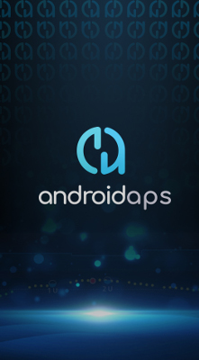

# Telefoner

<!-- List of hidden pages to avoid overcrowding the menu -->

```{toctree}
:hidden:

../CompatiblePhones/Jelly.md
../CompatiblePhones/Huawei.md
```

Den nuværende version af **AAPS** (4.0) kræver en Android-smartphone med Google **Android 12.0 eller nyere**. Hvis du overvejer at købe en ny telefon, er **Android 16 at foretrække** (januar 2026). Android 15 anbefales ikke.

Se [Facebook eller Discord](../GettingHelp/WhereCanIGetHelp.md) for de nyeste opdateringer om dette emne.

Af sikkerhedshensyn opfordrer vi kraftigt brugerne til at holde deres build af **AAPS** opdateret. Brugere, der ikke kan bruge en enhed med Android 12.0 eller nyere, kan dog stadig bruge ældre versioner af **AAPS**, som passer til ældre Android-versioner. Se: [Udgivelsesnoter](#maintenance-android-version-aaps-version).

- [Indstillinger for Jelly Pro](../CompatiblePhones/Jelly.md)
- [Indstillinger for Huawei](../CompatiblePhones/Huawei.md)

(Phones-list-of-tested-phones)=

## Liste over testede telefoner

Vi har en liste over [testede hardwareopsætninger](https://docs.google.com/spreadsheets/u/1/d/e/2PACX-1vScCNaIguEZVTVFAgpv1kXHdsHl3fs6xT6RB2Z1CeVJ561AvvqGwxMhlmSHk4J056gMCAQE02sAWJvT/pubhtml?gid=683363241&single=true), som du kan [udforske med en brugervenlig visning](https://vnniyb.github.io/androidAPS_testedHardwareEasyBrowser/). Bidrag ved at udfylde [Google-formularen](https://docs.google.com/forms/d/e/1FAIpQLSfoGKLYEx4aUAJ5RWL3xLJeNdmRyxtXmDzpGhuU3Rfcj2H_Jw/viewform) og tilføje din opsætning!

Denne liste viser brugernes erfaringer med at bruge en telefon sammen med **AAPS** og en bestemt pumpe og CGM. Den kan hjælpe dig med at se, om andre brugere har brugt din telefon / pumpe / CGM med succes.

Dokumentet er skrivebeskyttet. Med CTRL-F kan du søge i teksten i Google-regnearket.

Hvis du vil registrere din test af en hardwareopsætning, så udfyld denne [formular](https://docs.google.com/forms/d/e/1FAIpQLSfoGKLYEx4aUAJ5RWL3xLJeNdmRyxtXmDzpGhuU3Rfcj2H_Jw/viewform). Når du har udfyldt formularen, bliver regnearket opdateret automatisk hvert 5. minut.

Hvis der er problemer med regnearket, så kontakt den person, der vedligeholder det, *@theodoor5137*, på Discord, eller se siden om, [hvor du kan få hjælp](../GettingHelp/WhereCanIGetHelp.md).

## Jeg kunne ikke finde min telefon

Hvis du har spørgsmål om en bestemt telefonmodel, så søg eller spørg i vores [Facebook- eller Discord-fællesskab](../GettingHelp/WhereCanIGetHelp.md).

Hvis du vil donere modeller af smartphones eller smarture, som stadig skal testes, så send en e-mail til <donations@androidaps.org>.

(Phones-phone-wallpaper)=

## Baggrundsbillede til telefonen

Hvis du vil pynte din telefon med mere **AAPS**, kan du downloade baggrundsbilledet [her](../images/bg_phone.jpg)!



Design: Thiago :)