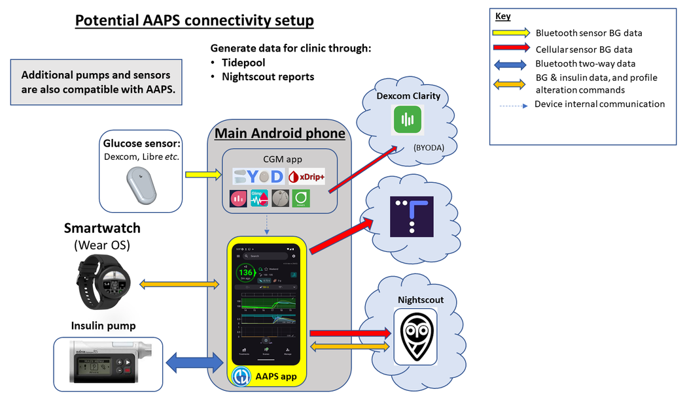
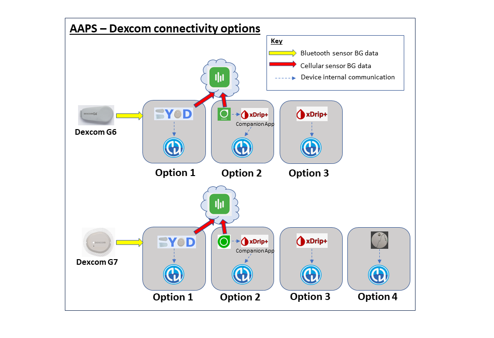
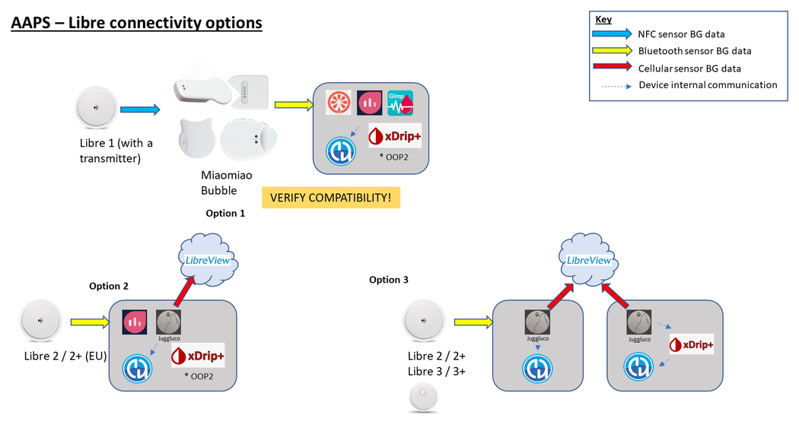
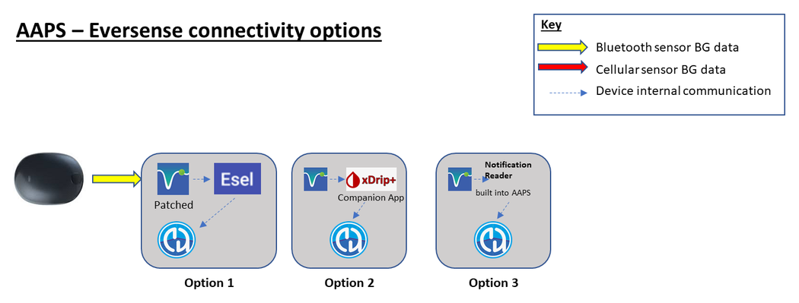

# Forberedelse til at starte med AAPS

Velkommen. Denne dokumentation skal hjælpe brugere, der forbereder sig på at sætte Android Artificial Pancreas System (**AAPS**) op og begynde at bruge det.

## Sådan finder du rundt i dokumentationen

Et **indeks** og en forklaring på dokumentationens opbygning finder du [her](../index.md). Du kan også komme dertil ved at klikke på **AAPS**-symbolet øverst til venstre i dokumentationen. Der finder du en oversigt over, hvad de forskellige afsnit i dokumentationen handler om. Du kan også bruge overskrifterne til venstre på denne side til at navigere rundt i dokumentationen. Endelig er der en praktisk søgefunktion lige under **AAPS**-symbolet.

Vi vil gøre det let at se, hvad **AAPS** kan, og hvad det ikke kan. Det kan være skuffende at opdage, efter at du har brugt tid på at læse dokumentationen, at du måske ikke har en kompatibel insulinpumpe eller CGM, eller at **AAPS** har andre funktioner, end du havde håbet.

Mange detaljer i dokumentationen til **AAPS**, som bygger på erfaring, giver mere mening, når du faktisk bruger **AAPS** i hverdagen. Ligesom det er svært at lære en sport kun ved at læse reglerne, kræver det en kombination: først skal du lære de grundlæggende regler for at bruge **AAPS** sikkert, og derefter lære, hvordan du bedst bruger reglerne, når du begynder at bruge **AAPS**.

(preparing-safety-first)=

## Sikkerhed først
»Med stor magt følger stort ansvar …«

### Teknisk sikkerhed
**AAPS** har mange sikkerhedsfunktioner. De giver begrænsninger, som gradvist fjernes, efterhånden som du gennemfører en række [læringsmål](../SettingUpAaps/CompletingTheObjectives.md) trin for trin. Her tester du bestemte parametre og svarer på multiple choice-spørgsmål. Funktioner i **AAPS** låses op, efterhånden som du gennemfører læringsmålene. På den måde kan brugeren trygt gå trin for trin fra åbent loop til lukket loop og samtidig lære de forskellige funktioner i **AAPS** at kende.

[Læringsmålene](../SettingUpAaps/CompletingTheObjectives.md) er lavet for at give den bedst mulige introduktion til **AAPS**. De tager højde for de typiske fejl og generelle tendenser, som udviklerne af **AAPS** har set hos nye brugere. Der kan ske fejl, fordi en nybegynder mangler erfaring og er for ivrig efter at komme i gang med **AAPS**, eller fordi vigtige punkter er blevet overset. [Læringsmålene](../SettingUpAaps/CompletingTheObjectives.md) skal mindske disse problemer.

### Medicinsk sikkerhed
```{admonition} Avoid permanent and painful damage to your eyes and nerves
:class: danger
Vær forsigtig med hurtige forbedringer i blodsukkerkontrollen og med at sænke HbA1c 
```

En vigtig sikkerhedsovervejelse er, at **et hurtigt fald i HbA1c og bedre blodsukkerkontrol hos personer, der har haft forhøjet glukose i nogen tid, kan give varige skader**. Mange mennesker med diabetes kender ikke til dette, og ikke alle læger gør deres patienter opmærksomme på problemet.

Disse skader kan omfatte **synstab og varig neuropati (smerter)**. Du kan undgå disse skader ved at sænke dit gennemsnitlige glukoseniveau langsommere. Hvis du lige nu har en forhøjet HbA1c og skifter til **AAPS** (eller et andet lukket loop-system), så tal _venligst_ med dit behandlerteam om denne mulige risiko, før du starter, og aftal med dem en tidsplan, hvor de sikre glukosemål sænkes gradvist. Du kan nemt sætte højere glukosemål i **AAPS** i starten (lige nu er det højeste mål, du kan vælge, 11,1 mmol/l, men du kan også bevidst bruge en svag profil, hvis det er nødvendigt) og så sænke målet, som månederne går.

#### Hvor hurtigt kan jeg sænke min HbA1c uden risiko for varige skader?

En retrospektiv [undersøgelse](https://pubmed.ncbi.nlm.nih.gov/1464975/) af 76 patienter viste, at risikoen for forværring af retinopati steg 1,6 gange, 2,4 gange og 3,8 gange, hvis HbA1c faldt henholdsvis 1%, 2% eller 3% over en periode på 6 måneder. De foreslog, at **»faldet i HbA1c i en hvilken som helst 6-måneders periode bør begrænses til mindre end 2% for at forhindre forværring af retinopati .... Et for hurtigt fald ved starten af glykæmisk kontrol kan give alvorlig eller forbigående forværring af retinopatien.«**

NB! Hvis du bruger andre HbA1c-enheder (mmol/mol i stedet for %), så klik [her](https://www.diabetes.co.uk/hba1c-units-converter.html) for en HbA1c-beregner.

I en anden retrospektiv [vurdering](https://academic.oup.com/brain/article/138/1/43/337923) af 954 patienter bemærkede forskerne, at:

**»Ved et fald i HbA1c på 2–3 procentpoint over 3 måneder var der en absolut risiko på 20% for at udvikle behandlingsudløst neuropati ved diabetes. Ved et fald i HbA1c på >4 procentpoint over 3 måneder var den absolutte risiko for at udvikle behandlingsudløst neuropati ved diabetes over 80%.«**

En [kommentar](https://academic.oup.com/brain/article/138/1/2/340563) til dette arbejde var enig i, at for at undgå komplikationer **bør målet være at sænke A1c med <2% over 3 måneder.** Du kan læse andre artikler om emnet [her](https://www.ncbi.nlm.nih.gov/pmc/articles/PMC6587545/pdf/DOM-21-454.pdf) og [her](https://www.mdpi.com/1999-4923/15/7/1791).

Det er almindeligt anerkendt, at personer med _nyopdaget_ type 1-diabetes (som ofte har en meget høj HbA1c ved diagnosen, før insulinbehandlingen starter) ser ud til at kunne sænke deres HbA1c hurtigt lige efter diagnosen uden at få disse risici i samme grad, fordi de ikke har haft forhøjet blodsukker i så lang tid. Det er dog stadig noget, du bør tale med din læge om.

(PreparingForAaps-no-sglt-2-inhibitors)=
### Ingen SGLT-2-hæmmere

```{admonition} NO SGLT-2 inhibitors
:class: danger
SGLT-2-hæmmere, også kaldet gliflozin-lægemidler, hæmmer nyrernes genoptagelse af glukose. Gliflozin-lægemidler sænker blodsukkeret på en måde, der ikke kan beregnes, og derfor MÅ du IKKE tage dem, mens du bruger et lukket loop-system som AAPS! Der vil være en betydelig risiko for ketoacidose og/eller hypoglykæmi! Kombinationen af denne medicin med et system, der sænker basalrater for at øge BS, er særlig farlig. 

Kort fortalt:
- **Eksempel 1: risiko for hypo**
>Til frokost bruger du **AAPS** til at give bolus for 45 g kulhydrater. Problemet er, at hæmmerne får kroppen til at udskille noget af kulhydraterne, uden at AAPS ved det. Så har din krop for meget insulin i forhold til de optagne kulhydrater, og det giver hypoglykæmi.

- **Eksempel 2: risiko for ketoacidose**
>Hæmmerne fjerner noget af kulhydraterne i baggrunden, og det får dit BS til at falde. **AAPS** vil automatisk få pumpen til at give mindre insulin, også basal. Med tiden kan det betyde, at dit BS bliver under målværdien, indtil kroppen ikke har nok basalinsulin til at optage kulhydrater, og det giver ketoacidose. Normalt udvikler ketoacidose sig hos personer med type 1-diabetes, fordi deres pumpe svigter. Det vil udløse advarsler på telefonen og kan ses på en høj BS-værdi. Faren ved gliflozin-lægemidler er dog, at der ikke kommer nogen advarsler fra AAPS, fordi pumpen stadig virker, og BS måske bliver inden for målområdet.

Kendte handelsnavne for SGLT-2-hæmmere er bl.a.: Invokana, Farxiga, Jardiance, Glyxambi, Synjardy, Steglatro og Xigduo XR samt andre.
```


### Vigtige principper for at loope med AAPS

Du skal forstå de vigtigste principper og begreber for at loope, før du bruger **AAPS**. Det gør du ved at bruge din egen tid på at læse dokumentationen til **AAPS** og ved at gennemføre læringsmålene, som skal give dig et solidt grundlag for at bruge **AAPS** sikkert og effektivt. Mængden af dokumentation til **AAPS** kan virke overvældende i starten, men vær tålmodig og stol på processen – med den rigtige tilgang skal du nok nå målet!

Hvor hurtigt du kommer frem, afhænger af den enkelte, men vær klar over, at det typisk tager 6–9 uger at gennemføre alle læringsmålene. Mange begynder at bygge, installere og sætte **AAPS** op i god tid, før de begynder at bruge det. For at hjælpe med dette har systemet en »virtuel pumpe«, som du kan bruge, mens du gennemfører de første læringsmål. Så kan du lære **AAPS** at kende uden at bruge det til at give insulin. Nedenfor er en detaljeret tidsplan. Vær opmærksom på, at du ved læringsmål 7 i **AAPS** bruger lukket loop. De senere læringsmål tilføjer ekstra funktioner som **SMB** og **automatisering**, som er nyttige for nogle brugere, men ikke nødvendige for kernefunktionen i **AAPS**.

For at få succes med **AAPS** skal du være aktiv, være villig til at tænke over dine BS-data og være fleksibel nok til at lave de nødvendige justeringer i **AAPS** for at forbedre dine resultater. Ligesom det næsten er umuligt at lære en sport ved kun at læse reglerne, gælder det samme for **AAPS**.

#### Regn med forsinkelser og små problemer, før alt er sat op og kører

I de første faser, når du starter med **AAPS**, kan det være svært at få alle dele af loopet til at kommunikere godt med hinanden (og med eventuelle følgere), og når du finjusterer dine indstillinger. Nogle fejl kan først løses, når **AAPS** bruges i hverdagen, men der er masser af hjælp at få i Facebook-gruppen og på Discord. Planlæg derfor, og vælg »gode« tidspunkter til at finde og løse problemer, f.eks. en rolig morgen i en weekend (altså ikke sent om aftenen, når du er træt, eller før et stort møde eller en rejse).

#### Kompatibel teknologi

**AAPS** virker kun med bestemte typer insulinpumper, CGM'er og telefoner, og noget teknologi er måske ikke tilgængeligt i alle lande. For at undgå skuffelser eller frustrationer bør du læse afsnittene om [CGM](../Getting-Started/CompatiblesCgms.md), [pumpe](../Getting-Started/CompatiblePumps.md) og [telefon](../Getting-Started/Phones.md).

#### Tid til at bygge appen og nå frem til fuldt loop

Tiden det tager at bygge **AAPS**-appen, afhænger af din erfaring og dine tekniske evner. For uerfarne brugere kan det typisk tage op til en halv eller en hel dag (med hjælp fra fællesskabet) at bygge **AAPS**. Processen går meget hurtigere ved nyere versioner af **AAPS**, efterhånden som du får mere erfaring.

Flere dele af denne dokumentation skal hjælpe dig gennem bygningen:

- [Byg AAPS](../SettingUpAaps/BuildingAaps.md) fører dig trin for trin gennem at bygge appen og installere den på din telefon;

- [Ofte stillede spørgsmål for loopere](../UsefulLinks/FAQ.md) svarer på almindelige spørgsmål og forklarer de fejl, der oftest opstår; og

- siden [Fejlfinding](../GettingHelp/GeneralTroubleshooting.md) samler løsninger på de hyppigste problemer, sorteret efter emne.

Hvor lang tid det tager at nå frem til lukket loop, afhænger af den enkelte. En omtrentlig tidsplan for at nå frem til fuldt loop med **AAPS** finder du [nedenfor](#preparing-how-long-will-it-take).


#### Keystore og eksportfil med konfigurationsindstillinger

Et »keystore« (.jks-fil) er en adgangskodekrypteret fil, som er unik for din egen kopi af **AAPS**. Din Android-telefon bruger den til at sikre, at ingen andre kan opdatere din kopi uden dit keystore. Kort sagt skal du, som en del af at bygge **AAPS**:

1.  Gemme din keystore-fil (.jks-fil, som bruges til at signere din app) et sikkert sted;

2.  Skrive adgangskoden til din keystore-fil ned.

Hvordan du gemmer dit keystore, afhænger af, hvordan du bygger appen:

- **Build med Android Studio (computer)**: dit keystore oprettes under bygningen – se [Generer signeret APK](#Building-APK-generate-signed-apk) for at se, hvor du skal gemme det.
- **AAPS Builder**: gem sikkerhedskopifilen `aaps-keystore.jks`, som opsætningssiden tilbød dig, da du oprettede din nøgle, sammen med adgangskoden og aliasset. Hvis du uploadede dit eget keystore, så gem den fil.
- **Build i browseren med en fork**: brug det særlige workflow [Export keystore](#ci-keystore-export) til at hente en kopi til dit Google Drev.

Så er du sikker på, at du kan bruge præcis den samme keystore-fil, hver gang der laves en ny version af **AAPS**. I gennemsnit skal **AAPS** opdateres 2 gange om året.

Desuden kan du i **AAPS** [eksportere alle dine konfigurationsindstillinger](../Maintenance/ExportImportSettings.md). Så kan du trygt gendanne dit system, når du skifter telefon eller opdaterer/geninstallerer appen, med så få forstyrrelser som muligt. 

#### Fejlfinding

Kontakt gerne AAPS-fællesskabet, hvis der er noget, du er usikker på – der findes ingen dumme spørgsmål! Alle brugere, uanset erfaring, opfordres til at stille spørgsmål. Man får som regel hurtigt svar, fordi der er mange brugere af **AAPS**.

##### [spørg i AAPS-gruppen på Facebook](https://www.facebook.com/groups/AndroidAPSUsers/)

##### [spørg på AAPS-kanalen på Discord](https://discord.gg/4fQUWHZ4Mw)


#### [Hvor kan jeg få hjælp](../GettingHelp/WhereCanIGetHelp.md)?

Dette afsnit giver nye brugere links til ressourcer, hvor de kan få hjælp, bl.a. støtte fra fællesskabet med både nye og erfarne brugere, som kan svare på spørgsmål og hjælpe med de almindelige faldgruber i AAPS.

#### [Afsnit for sundhedspersonale](../UsefulLinks/ClinicianGuideToAaps.md)

Dette er et [afsnit specielt for sundhedspersonale](../UsefulLinks/ClinicianGuideToAaps.md), der vil vide mere om AAPS og open source-teknologi til kunstig bugspytkirtel. I introduktionen er der også vejledning om, [hvordan du taler med dit behandlerteam](#introduction-how-can-i-approach-discussing-aaps-with-my-clinical-team).

## Hvad skal vi bygge og installere?

Dette diagram giver en oversigt over de vigtigste dele (både hardware og software) af **AAPS**-systemet:




Ud over de tre grundlæggende hardwaredele (telefon, pumpe, glukosesensor) har vi også brug for: 1) **AAPS**-appen 2) En rapporteringsserver og 3) En app til kontinuerlig glukosemåling (CGM)

### 1) En app til Android-telefonen: **AAPS**

**AAPS** er en app, der kører på Android-smartphones og -enheder. Du skal selv bygge **AAPS**-appen (en apk-fil) efter en trin-for-trin-vejledning: du henter kildekoden til **AAPS** fra GitHub, installerer de nødvendige programmer (Android Studio, GitHub Desktop) på din computer og bygger din egen kopi af **AAPS**-appen. Derefter overfører du **AAPS**-appen til din smartphone (via e-mail, USB-kabel _osv._) og installerer den.

### 2) En rapporteringsserver: Nightscout (Tidepool*)

For at få fuldt udbytte af **AAPS** skal du sætte en Nightscout-server op. Du kan [gøre det selv](https://nightscout.github.io/nightscout/new_user/#free-diy) eller betale et lille beløb for at få sat en [administreret Nightscout-tjeneste](https://nightscout.github.io/#nightscout-as-a-service) op for dig. Nightscout bruges til at samle data fra **AAPS** over tid og kan lave detaljerede rapporter, der sammenholder CGM- og insulinmønstre. Omsorgspersoner kan også bruge Nightscout til at kommunikere med **AAPS**-appen på afstand og holde øje med deres barns diabetesbehandling. Disse fjernfunktioner omfatter overvågning af glukose og insulin i realtid, bolus af insulin på afstand (via SMS) og meddelelser om måltider. At prøve at vurdere din diabetesbehandling ved at se på CGM-data adskilt fra pumpedata er som at køre bil, hvor føreren er blind, og passageren beskriver, hvad der sker. Tidepool kan også bruges i stedet for Nightscout.

### 3) App til CGM-sensoren

Afhængigt af din glukosesensor/CGM skal du bruge en kompatibel app, der modtager glukoseværdierne og sender dem til **AAPS**. De forskellige muligheder er vist nedenfor, og du kan læse mere i afsnittet [Kompatible CGM'er](../Getting-Started/CompatiblesCgms.md):

  

### Vedligeholdelse af **AAPS**-systemet

Både **Nightscout** og **AAPS** skal opdateres cirka en gang om året, når der udkommer forbedrede versioner. I nogle tilfælde kan opdateringen vente, i andre tilfælde anbefales den kraftigt eller anses for nødvendig af hensyn til sikkerheden. Disse opdateringer bliver annonceret i Facebook-grupperne og på Discord-serverne. Udgivelsesnoterne gør det klart, hvilken situation der er tale om. Der vil sandsynligvis være mange, der stiller de samme spørgsmål som dig, når der skal opdateres, og du vil få hjælp til at udføre opdateringerne.

(preparing-how-long-will-it-take)=
## Hvor lang tid tager det at sætte det hele op?

Som nævnt tidligere er det at bruge **AAPS** mere en »rejse«, der kræver, at du bruger din egen tid. Det er ikke noget, du sætter op én gang for alle. Det anslås i dag, at det samlet tager cirka 4 til 6 måneder at bygge **AAPS**, installere og konfigurere **AAPS** og **CGM**-softwaren og komme fra åbent loop til hybrid lukket loop med **AAPS**. Det anbefales derfor, at du bygger **AAPS**-appen og går i gang med de første læringsmål så hurtigt som muligt, også selvom du stadig bruger et andet system til insulintilførsel (du kan bruge en virtuel pumpe op til læringsmål 5).

Nogle af læringsmålene kræver, at der går et bestemt antal dage, så du er sikker på at forstå de nye funktioner. Du kan ikke springe denne ventetid over; minimumsventetiderne er sat for din egen sikkerheds skyld.

Her er en omtrentlig tidsplan:

| Opgaver                                                        |           Cirka tid           |
| -------------------------------------------------------------- |:-----------------------------:|
| Første gennemlæsning af dokumentationen                        |           1-2 dage            |
| Konfiguration af GitHub til build i browseren                  |           1-4 timer           |
| Opsætning af en rapporteringsserver                            |            1 time             |
| Installation af en CGM-app (xDrip, BYODA, …)                   |            1 time             |
| Første konfiguration af CGM → xDrip → AAPS                     |            1 time             |
| Første konfiguration af AAPS → pumpe                           |            1 time             |
| Konfiguration af AAPS → Nightscout/Tidepool (kun rapportering) |            1 time             |
| Valgfrit: Konfiguration af Nightscout ↔ **AAPS** og NS-følgere |            1 time             |
| Læringsmål 1: Opsætning af visualisering og overvågning        |            1 time             |
| Læringsmål 2: Lær at styre AAPS                                |            2 timer            |
| Læringsmål 3: Bevis din viden                                  |        Op til 14 dage         |
| Læringsmål 4: Start med et åbent loop                          |         Mindst 7 dage         |
| Læringsmål 5: Forstå dit åbne loop                             |            7 dage             |
| Læringsmål 6: Begynd at lukke loopet (Stop ved lavt BS)        |   Mindst 5, op til 14 dage    |
| Læringsmål 7: Justering af det lukkede loop                    |  Mindst 1 dag, op til 7 dage  |
| Læringsmål 8: Juster basaler og forhold, aktiver Autosens      | Mindst 7 dage, op til 14 dage |
| Læringsmål 9: Aktivering af Super Micro Bolus (SMB)            |        Mindst 28 dage         |
| Læringsmål 10: Automatisering                                  |        Mindst 28 dage         |

Også når **AAPS** kører fuldt ud, skal du jævnligt finjustere dine indstillinger for at forbedre din samlede diabetesbehandling.

## Krav

### Medicinske overvejelser

Ud over de medicinske advarsler i [afsnittet om sikkerhed](#preparing-safety-first) er der også forskellige parametre, afhængigt af hvilken insulin du bruger i pumpen.

#### Valg af insulin

Beregningerne i **AAPS** er baseret på en insulinkoncentration på 100 IE/ml (samme som pumpens standard). Du konfigurerer din insulin i **Administrer → Insulinindstillinger**: indstil dens **Spids** og **DIA**, eller brug **Hent spids fra** til at udfylde det almindelige spidstidspunkt fra en af de faste insulintyper:

- **Novorapid** (også til Humalog og NovoLog)
- **Fiasp**
- **Lyumjev**

Erfarne brugere kan skrive et hvilket som helst spidstidspunkt (35 til 120 minutter) direkte, f.eks. til en blanding af insuliner. Se [Insulinindstillinger](#Config-Builder-insulin).


### Teknik

Denne dokumentation forsøger at gøre den nødvendige tekniske viden så lille som overhovedet muligt. Du har flere muligheder for at bygge **AAPS**-appen – se [Byg AAPS](../SettingUpAaps/BuildingAaps.md) for en oversigt:

- **Build i browseren** (anbefales): byg appen direkte fra din smartphone med GitHub Actions, uden computer og uden Android Studio. Med [AAPS Builder](../SettingUpAaps/BrowserBuildAapsBuilder.md) skal du kun have en GitHub-konto: du henter appen direkte fra GitHub. Metoden med en fork kræver også en Google-konto, så appen kan gemmes i dit Google Drev.
- **Build med Android Studio**: byg appen på din computer med Android Studio. Det bruges mest af udviklere, der vil ændre i koden.
- **Build på kommandolinjen**: til brugere, der vil bygge på deres egen computer uden at installere Android Studio.

Ud over at bygge appen skal du også sætte en rapporteringsserver op, konfigurere flere apps på din Android-telefon og lære meget om diabetesbehandling. Det kan du klare ved at tage et trin ad gangen, være tålmodig og få hjælp fra **AAPS**-fællesskabet. Hvis du allerede kan finde rundt på internettet og håndtere dine egne Gmail-e-mails, kan du godt bygge **AAPS**. Tag dig bare god tid.

### Smartphones

#### AAPS og Android-versioner

Den nuværende version af **AAPS** (4.0) kræver en Android-smartphone med Google **Android 12.0 eller nyere**. Hvis du overvejer at købe en ny telefon (pr. januar 2026), er Android 16 at foretrække.<br/> Brugere opfordres kraftigt til at holde deres build af **AAPS** opdateret af hensyn til sikkerheden. For brugere, der ikke kan bruge en enhed med Android 12.0 eller nyere, findes der stadig ældre versioner af **AAPS**, der virker med ældre Android-versioner, se: [Udgivelsesnoter](#maintenance-android-version-aaps-version).

#### Valg af smartphonemodel
Hvilken model du køber, afhænger af, hvilke funktioner du ønsker. På siden [Telefoner](../Getting-Started/Phones.md) finder du anbefalinger og erfaringer fra brugere med opsætninger, der virker.

Brugere opfordres til at holde Android-versionen på deres telefon opdateret, også med sikkerhedsopdateringer. Men hvis du er ny med **AAPS** eller ikke er teknisk ekspert, kan det være en god idé at vente med at opdatere din telefon, til andre har gjort det og har bekræftet i vores forskellige fora, at det er sikkert.

```{admonition} Delaying Samsung phone updates
:class: warning
Samsung har desværre før tvunget opdateringer igennem på deres telefoner, og det kan give problemer med Bluetooth-forbindelsen. For at slå disse tvungne opdateringer fra skal du sætte telefonen i »udviklertilstand«:

1. Gå til **Indstillinger** > **Om telefonen** > **Softwareoplysninger**, og tryk derefter på **Buildnummer**, indtil telefonen bekræfter, at du har låst udviklertilstand op.
2. Gå tilbage til hovedmenuen **Indstillinger**, hvor du nu skulle se et nyt menupunkt **Udviklerindstillinger**.
3. Åbn **Udviklerindstillinger**, rul ned til **Automatisk systemopdatering**, og slå det fra.
```

```{admonition} Google Play Protect potential issue
:class: warning
Der har været flere rapporter om, at **AAPS** hver morgen bliver lukket ned uden grund af Google Play Protect. Hvis det sker, skal du gå til indstillingerne for Google Play og slå **Google Play Protect** fra. Ikke alle telefonmodeller eller Android-versioner er ramt.
```

```{admonition} Android developer verification
:class: note
Fra september 2026 indfører Google gradvist [bekræftelse af Android-udviklere](#android-developer-verification), som ændrer, hvordan en app, du selv har bygget, installeres på telefonen. Selve bygningen af **AAPS** påvirkes ikke, og der er stadig gratis måder at installere på – se den linkede side for detaljer.
```

