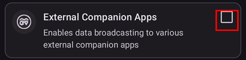
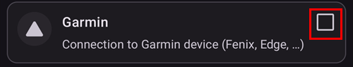
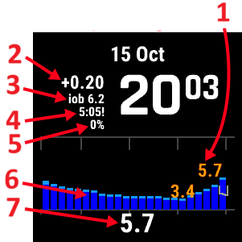
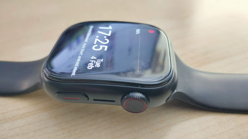

# Smarture og AAPS

Forskellige smarture kan bruges til at vise noget af informationen fra **AAPS** eller til at udføre handlinger på afstand.

Hvis et smartur skal styre **AAPS** (pumpe og sensor) direkte, skal det være et fuldt Android-ur (som regnes for en lille [smartphone](./Phones.md)).

Med nogle smarture kan du indtaste behandlinger og mere, men det er stadig telefonen, der styrer **AAPS**.

Smarture bruges mere og mere med **AAPS**, _både_ af voksne med diabetes og af omsorgspersoner/forældre til børn med diabetes.

## Generelle fordele ved at bruge smarture med **AAPS**


Smarture kan – afhængigt af modellen – bruges på mange forskellige måder med **AAPS**. De kan bruges til helt eller delvist at styre **AAPS** eller blot til at tjekke glukoseniveau, insulin om bord og andre værdier på afstand.

Et smartur sammen med **AAPS** kan være nyttigt i mange situationer, f.eks. når du kører bil eller (motor)cykel, og under motion. Nogle synes, at det er mere diskret at kigge på et ur (til et møde, en fest, ved middagsbordet osv.) end at kigge på en telefon. Af sikkerhedshensyn kan et smartur også være en fordel, når du er på farten: Du kan have din **AAPS**-telefon gemt af vejen (f.eks. i en taske) og stadig bruge smarturet til fjernstyring.

## Særlige fordele for forældre/omsorgspersoner, der bruger **AAPS**

For et barn – hvis barnets **AAPS**-telefon er i nærheden – kan en omsorgsperson bruge et smartur til at overvåge eller foretage ændringer uden at skulle bruge **AAPS**-telefonen. Det kan f.eks. være nyttigt, hvis **AAPS**-telefonen er gemt væk i et pumpebælte.

Et smartur kan bruges enten _sammen med_ eller _i stedet for_ TELEFON-baserede muligheder for fjernstyring eller [kun at følge](../RemoteFeatures/FollowingOnly.md).

I modsætning til følgertelefoner hos forældre/omsorgspersoner (som er afhængige af mobilnettet eller en Wi-Fi-forbindelse) kan smarture, der er forbundet via Bluetooth, også være nyttige på afsidesliggende steder, f.eks. i en grotte, i en båd eller halvvejs oppe ad et bjerg. Hvis begge enheder (**AAPS**-telefon og smartur) er på det samme Wi-Fi-netværk, kan de også bruge Wi-Fi.

## Forskellige måder, smartur og AAPS kan arbejde sammen på

Der er i øjeblikket fem hovedmåder at bruge smarture sammen med **AAPS** på. De er vist i tabellen nedenfor: 

| Opsætning af ur   | Funktioner                                       | Krav                                                                                                                                                                                                                                                                                                                |
| ----------------- | ------------------------------------------------ | ------------------------------------------------------------------------------------------------------------------------------------------------------------------------------------------------------------------------------------------------------------------------------------------------------------------- |
| Selvstændig       | AAPS uden en telefon                             | Fuldt Android-smartur (tjek min. Android)</br> Kører **app-fullRelease**                                                                                                                                                                                                                                            |
| Fuld fjernstyring | De fleste AAPS-funktioner                        | Android **Wear OS**-ur (tjek Android/API)</br>Kører **wear-fullRelease**                                                                                                                                                                                                                                            |
| Fjernstyring      | AAPSClient-funktioner                            | Android **Wear OS**-ur (tjek Android/API)</br>Kører **[wear-aapsclientRelease](https://github.com/nightscout/AndroidAPS/releases)**                                                                                                                                                                                 |
| Fjernstyring      | Nogle AAPSClient-funktioner                      | Garmin-ure</br>(kun ældre opsætninger med Samsung Tizen og Fitbit, anbefales ikke)</br>Se nedenfor.                                                                                                                                                                                                                 |
| Visning           | Glukose, tendens, IOB, COB, loop- og pumpestatus | Mange smarture via en ledsagerapp på **AAPS**-telefonen, der får data fra udsendelsen [Eksterne ledsagerapps](#watches-external-companion-apps): [WatchDrip+](https://bigdigital.home.blog/) (Xiaomi, Amazfit), [GlucoDataHandler](https://github.com/pachi81/GlucoDataHandler) (Wear OS), G-Watch</br>Se nedenfor. |

## Før du køber et smartur…

Hvilken model smartur du skal købe, afhænger af, hvilke funktioner du vil have. Du kan finde nyttige oplysninger på [siden Telefoner](#Phones-list-of-tested-phones), bl.a. en liste over testede telefoner, som også indeholder nogle smarture.

Populære urmærker er bl.a. Samsung Galaxy, Garmin, Fossil og Mi Band. De forskellige muligheder, der er opsummeret i tabellen ovenfor, er forklaret mere detaljeret nedenfor, så du kan vælge det smartur, der passer til din situation.

Hvis du bruger et smartur sammen med **AAPS** på en telefon for at styre **AAPS** på afstand, skal du også tjekke, om de to enheder virker sammen, især hvis du har en ældre eller en usædvanlig telefon.

Hvis du kun vil følge glukoseværdier og ikke betjene **AAPS**, er der generelt flere billige og enklere ure, du kan bruge.

Den bedste måde at vælge et smartur på er at søge efter »watch«-opslag i **AAPS**-grupperne på Discord eller Facebook. Læs om andres erfaringer, og stil konkrete spørgsmål, hvis ældre opslag ikke besvarer dit spørgsmål.

## Fuld Android

Det lyder som en god mulighed, ikke? Men i øjeblikket er det kun nogle få entusiaster, der eksperimenterer med **AAPS** på et selvstændigt ur. Der findes kun få smarture med en brugbar brugerflade, som også virker godt med selvstændig brug af **AAPS** og din CGM-app. Populære modeller er bl.a. LEMFO LEM 15 Pro og 16. Du skal installere **AAPS**-APK'en »full« på uret (den APK, der normalt installeres på en smartphone) og ikke **AAPS**-APK'en »wear«.

Der findes ingen klar specifikation, der fortæller dig, om et ur vil fungere godt med selvstændig **AAPS**, men følgende punkter hjælper:

1)  Android 12 eller nyere. 2)  At du kan slå urskivens »kvadratiske« tilstand fra, så teksten bliver større og lettere at læse. 3)  Meget god batteritid. 4)  God Bluetooth-rækkevidde.

Det meste af frustrationen ved selvstændige **AAPS**-ure kommer af den lille skærm, og af at den nuværende brugerflade i AAPS-appen »full« ikke er lavet til et ur. På grund af den lille skærm vil du måske hellere bruge en stylus til at ændre **AAPS**-indstillinger på uret, og nogle AAPS-knapper er måske ikke synlige på urets skærm.

Andre udfordringer er, at det er svært at få nok batteritid, og at ure med nok batteri ofte er store og tykke. Brugere fortæller om kampe med styresystemet og strømbesparende indstillinger, problemer med at starte sensorer på uret, dårlig Bluetooth-rækkevidde (for at holde forbindelsen til både sensor og pumpe) og tvivlsom vandtæthed. Der er eksempler på billederne nedenfor.


Hvis du vil sætte et selvstændigt ur op, så læs opslag og kommentarer i **AAPS**-gruppen på Facebook (gode søgeord er »standalone« og »Lemfo«) og på Discord for at få flere oplysninger.

## Wear OS

Koden til **AAPS** indeholder en app-udvidelse, som kan installeres på [**Wear OS**-smarture](https://wearos.google.com/#oem-carousel).


Kontroller, at dit smartur opfylder [kravene](#maintenance-android-version-aaps-version) til **AAPS**.

### Hvad _er_ Wear OS?

De første tre muligheder kræver, at smarturet har **Wear OS** installeret.

**Wear OS** er det styresystem, der kører på nogle moderne Android-smarture. Hvis beskrivelsen af smarturet kun nævner _kompatibilitet_ med Android og iOS, betyder det ikke, at det kører Wear OS. Det kan være et andet styresystem fra producenten, som ikke virker med **AAPS**. For at kunne installere og bruge en version af **AAPS** eller **AAPSClient** skal et smartur køre **Wear OS 3.0, 3.2 eller 3.5** (Android 11, API-niveau 30) **eller nyere**. Hver version af Wear OS følger den Android-version, den bygger på: **Wear OS 3** er Android 11 (API-niveau 30), **Wear OS 4** er Android 13 (API-niveau 33), **Wear OS 5** er Android 14 (API-niveau 34), og **Wear OS 6** er Android 16 (API-niveau 36). Ure med Wear OS 2 kan ikke køre **AAPS**.

Hvis du installerer **AAPS** wear.apk på et **Wear OS**-ur, kan du vælge mellem en række forskellige **AAPS**-urskiver. Du kan også bruge en almindelig urskive og få din **AAPS**-information vist i små felter på urskiven, kaldet »komplikationer«. En komplikation er alt, hvad der vises på en urskive ud over klokkeslættet.

```{note}
Nye ændringer i **Wear OS** ødelægger gradvist de særlige **AAPS**-urskiver (jo højere Wear OS-version, jo værre), men **komplikationer** virker stadig. Læs [Ændringer af urskiver i Wear OS](#wearos-watchface-changes), før du køber eller opdaterer et ur.
```


### Hvordan kan mit smartur se ud?

Når du har [installeret **AAPS** på dit ur](../WearOS/WearOsSmartwatch.md), kan du automatisk vælge din foretrukne urskive blandt disse **AAPS**-urskiver. På de fleste ure skal du blot trykke længe på startskærmen, indtil skærmen bliver mindre, og stryge til højre for at vælge en anden skærm:


Dette er de grundlæggende skærme, der er indbygget i **AAPS**. Der findes [flere urskiver](#WearOS_changing-to-AAPS-watchface), og du kan også bruge [komplikationer](#Watchfaces-complications).

### Hvordan bruger jeg et Wear OS-ur i hverdagen?

Du kan finde flere oplysninger om urskiverne og den daglige brug, f.eks. hvordan du laver (og deler) din egen urskive, i afsnittet [Opsæt AAPS på dit Wear OS-ur](../WearOS/WearOsSmartwatch.md).

(Watchfaces-tizen)= (watches-external-companion-apps)=

## Eksterne ledsagerapps

**AAPS** kan udsende sin status til andre apps, der er installeret på den samme telefon: glukose og tendens, IOB, COB, basal og midlertidig basal, profilnavn, loop-status, telefonens og pumpens batteri, reservoirniveau og bolusforløb. Flere ledsagerapps til ure læser denne udsendelse og viser dataene på ure, som **AAPS** ikke understøtter direkte. For at sende dataene skal du aktivere **Eksterne ledsagerapps** i **Konfiguration** > **Kommunikation** (se [Eksterne ledsagerapps](#external-companion-apps) på siden Konfiguration). Udsendelsen sendes med hver ny værdi og kan ikke hentes på forespørgsel: en opdateringsknap i ledsagerappen har ingen virkning på **AAPS**.



Ledsagerapps, som man ved bruger denne udsendelse:

- [WatchDrip+](https://bigdigital.home.blog/) til Xiaomi- og Amazfit-ure, se [Xiaomi- og Amazfit-ure](#watches-xiaomi-amazfit) nedenfor.
- [GlucoDataHandler](https://github.com/pachi81/GlucoDataHandler) til Wear OS-ure, som komplikation eller widget. Den er en nyttig reserveløsning på Wear OS-versioner, hvor **AAPS**-urskiverne ikke er pålidelige, se [Opsæt AAPS på dit Wear OS-ur](../WearOS/WearOsSmartwatch.md). Dens ledsagerapp GlucoDataAuto viser de samme data i en bil med Android Auto.
- [G-Watch-appen](https://play.google.com/store/apps/details?id=sk.trupici.g_watch) til Samsung Tizen-ure og dens senere version til Wear OS. I tidligere versioner af **AAPS** hed pluginet **Samsung Tizen** efter denne app.

```{warning}
**G-Watch-appen** og dens version til **Wear OS** bliver ikke længere vedligeholdt, og Samsung har flyttet sine smarture fra Tizen til Wear OS. G-Watch er kun relevant for eksisterende, ældre opsætninger og anbefales ikke til en ny installation. Se den særlige [Facebook-gruppe](https://www.facebook.com/groups/gwatchapp) for de seneste nyheder.
```

(Watchfaces-garmin)=

## Garmin

Der findes nogle urskiver til Garmin, som arbejder sammen med [AAPS](https://apps.garmin.com/search?keywords=androidaps), i Garmin ConnectIQ-butikken.



[AAPS Glucose Watch](https://apps.garmin.com/apps/3d163641-8b13-456e-84c3-470ecd781fb1) arbejder direkte sammen med **AAPS**. Den viser loop-status (insulin om bord, midlertidig basal) ud over glukoseværdier og sender pulsmålinger til **AAPS**. Den findes i ConnectIQ-butikken; aktiver pluginet **Garmin** i **Konfiguration → Kommunikation**. 

1. Højeste og laveste glukoseværdi på grafen
2. Glukoseændring pr. minut
3. Insulin om bord (IOB)
4. Tid siden den seneste glukoseværdi (minutter:sekunder)
5. Midlertidig basalrate i procent af profilens basalrate
6. Glukosegraf for de seneste 2 timer
7. Aktuel glukoseværdi


## Fitbit

```{warning}
Google flytter Fitbit ind i Google Health og fjerner apps og urskiver fra tredjeparter fra Fitbit-ure i EU. Fitbit-urskiver er derfor **ikke længere en anbefalet mulighed**, og det anbefales ikke at købe en Fitbit til brug med **AAPS**.
```

Til eksisterende Fitbit-ure viser [Nightscout-websiderne](https://nightscout.github.io/nightscout/wearable/#fitbit) nogle muligheder kun til overvågning, f.eks. [Glance](https://glancewatchface.com/). Det er også urskiver fra tredjeparter, så den samme begrænsning i EU gælder.

## Kun følge

Disse smarture viser noget af informationen fra **AAPS**; nogle kræver andre apps.

Der findes mange billige smarture, som kun kan vise data. Hvis du bruger Nightscout, finder du en god oversigt over alle mulighederne [her](https://nightscout.github.io/nightscout/wearable/#)

Her er nogle af de ure til kun at følge, som er populære blandt **AAPS**-brugere:

(watches-xiaomi-amazfit)=
### Xiaomi- og Amazfit-ure

**WatchDrip+** er en ledsagerapp, der er udviklet af fællesskabet, og som viser glukose- og loop-data på forskellige modeller af smarture, mest fra mærkerne Xiaomi (_f.eks._ Mi Band) og Amazfit:


Fra version 0.5 læser **WatchDrip+** sine data direkte fra **AAPS** uden xDrip+ som mellemled. På **AAPS**-telefonen:

1. Aktiver **Eksterne ledsagerapps** i **Konfiguration** > **Kommunikation**, se [ovenfor](#watches-external-companion-apps). Det giver den aktuelle glukose, delta, tendenspil, IOB og pumpestatus.
2. Aktiver pluginet **xDrip** i **Konfiguration** > **Kommunikation**, og slå **Send status til xDrip+** til i dets indstillinger. Det giver statuslinjen med IOB/COB, og glukosegrafen på uret fyldes ud efter nogle få værdier.
3. Hvis xDrip+ er installeret på telefonen, så slå dens **Broadcast Service API** fra (xDrip+ > Settings > Inter-app settings), så uret ikke modtager dataene to gange. Hvis xDrip+ kun sendte data videre til uret, kan du afinstallere den.

Opdateringsknappen i WatchDrip+ har ingen virkning med **AAPS**: dataene kommer med hver ny værdi.


Du kan læse mere om dem, bl.a. hvordan du sætter dem op, på [WatchDrip+-websiden](https://bigdigital.home.blog/). Fordelen ved disse ure er, at de er små og forholdsvis billige. De er populære især til børn og til personer med smalle håndled.

### Pebble-ur


Pebble-ure ([ikke længere produceret](https://en.wikipedia.org/wiki/Pebble_(watch))) blev solgt fra 2013 til 2016 og kan stadig købes brugt. Fitbit overtog Pebbles aktiver. Pebble-brugere kan bruge urskiven Urchin til at se Nightscout-data. De data, der kan vises, omfatter IOB, den aktuelle midlertidige basalrate og forudsigelser. Hvis du bruger åbent loop, kan du bruge IFTTT til at lave en applet, der sender enten en SMS eller en Pushover-notifikation, når der er kommet en notifikation fra **AAPS**.

### [Bluejay-ure](https://bluejay.website/)





Det er helt særlige enheder, som kan modtage glukosedata **direkte** fra Dexcom-senderen. Det er ikke almindeligt kendt, at Dexcom G6/G7-sendere faktisk udsender de aktuelle glukosedata på _to_ adskilte kanaler: en telefonkanal og en medicinsk kanal. Bluejay-urene kan indstilles til at modtage glukosedata på begge kanaler, så hvis **AAPS** bruger telefonkanalen, kan Bluejay-urene bruge den medicinske kanal.

Den største fordel er, at uret er uafhængigt af både telefonen og loop-systemet. Hvis du f.eks. afbryder pumpen og **AAPS**-telefonen på stranden eller i en forlystelsespark og er uden for rækkevidde af **AAPS**-telefonen, kan du stadig få værdier fra din Dexcom direkte på Bluejay-uret.

Det oprindelige **Bluejay GTS** produceres ikke længere og kan ikke læse Dexcom G7. De senere modeller (U1 og derefter den nuværende **U3**, som i skrivende stund sælges som »early access«) er fulde Android-ure med xDrip, som henter data direkte fra Dexcom G6 og G7. Producenten beskriver uret som et forskningsværktøj, ikke til medicinsk brug. De ulemper, som brugere nævner, er, at det ikke altid får en værdi hvert 5. minut, og at batteriet ofte skal oplades. Se [Bluejays webside](https://bluejay.website/) for den nuværende model, og om den kan købes.

### Apple Watch

Se [Nightscout på dit ur](https://nightscout.github.io/nightscout/wearable/#).

Apple Watch understøtter nu direkte forbindelse til G7 og kan bruges samtidig med **AAPS**.

