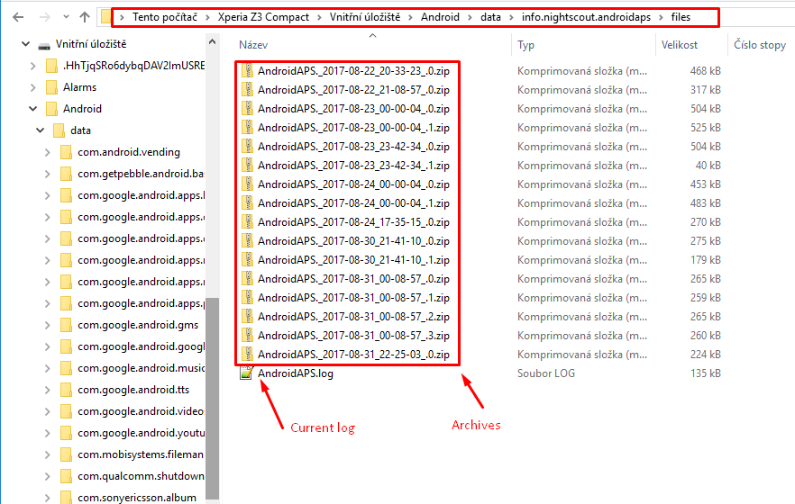

(Accessing-logfiles-accessing-logfiles)=

# Adgang til logfiler

* Forbind telefonen til en computer i tilstanden »Filoverførsel« (File transfer)
* Find logfilerne i AAPS-datamappen, i `Android\data\info.nightscout.androidaps\files`.  
    Navnet på rodmappen i lageret kan variere lidt fra telefon til telefon.
* For [AAPSClient](#RemoteControl_aapsclient) er placeringen `Android\data\info.nightscout.aapsclient\files`.
* Bemærk: placeringen af loggen er ændret i **AAPS 3.3**. Se dokumentationen til tidligere versioner, hvis du har brug for det.

* Den aktuelle log er en .log-fil, som du kan se på flere måder, f.eks. med [LogCat](https://developer.android.com/studio/debug/am-logcat.html) i Android Studio, med en app til visning af logfiler på Android eller blot som almindelig tekst. 
* Tidligere logfiler pakkes som zip og gemmes i mapper sorteret efter dato og tid. 
* Hvis du deler din logfil på [Discord](https://discord.gg/4fQUWHZ4Mw) for at tale om en mulig fejl, skal du pakke filen ud og uploade den fil, der er dateret før fejlen skete.