(bluetoothtroubleshooting-bluetooth-related-issues)=

# Bluetooth-relaterede problemer

Nogle brugere har haft problemer med fejl ved aktivering af Omnipod DASH, forbindelsesproblemer med Medtrum Nano og andre pod-fejl, der har med Bluetooth at gøre. Mange af disse problemer kan føres tilbage til en af følgende årsager.

Nogle af disse problemer gælder sandsynligvis også for andre Bluetooth-insulinpumper. Medtrum Nano har ligesom Omnipod DASH kendte problemer med tilladelsen til enheder i nærheden.

---

(bluetoothtroubleshooting-cannot-start-omnipod-with-android-16)=

## Kan ikke starte Omnipod med Android 16
- Android 16 kræver mindst **AAPS** version 3.3.2.1, for at Omnipod DASH virker rigtigt, fordi denne version har rettelser, der er lavet specielt til kendte problemer med Omnipod i Android 16.

---

(bluetoothtroubleshooting-bluetooth-battery-optimisation)=

## Batterioptimering for Bluetooth

Nyere versioner af Android har slået batterioptimering til for systemets Bluetooth-app. Det er kendt for at give problemer for Bluetooth-pumper og CGM'er.

Hvis du fulgte [AAPS-opsætningsguide](../SettingUpAaps/SetupWizard.md) og brugte indstillingerne i afsnittet [Batterioptimering for Bluetooth](#setup-wizard-bluetooth-battery-optimisation), bør denne indstilling være rigtig. Men hvis du fulgte en ældre version af denne guide, har du måske ikke ændret indstillingen.

Kontroller, at dette er sat rigtigt op, hvis du har afbrydelser af pumpe og CGM.

---

(bluetoothtroubleshooting-apps-using-nearby-device-permission)=

## Apps, der bruger Android-tilladelsen »Enheder i nærheden«, kan give tabt forbindelse og problemer med at aktivere pods

Android lader dig styre, hvad hver app kan gøre eller få adgang til på din telefon, via tilladelser. For hver installeret app kan du vælge at tillade eller afvise bestemte tilladelser, f.eks. adgang til filer på enheden, adgang til Bluetooth, søgning efter enheder i nærheden osv.

**AAPS** kræver en række bestemte tilladelser for at virke. En af dem, som er nødvendig for at pods virker, er tilladelsen »Enheder i nærheden«. Mange andre apps kræver også denne tilladelse. Brugerne har fundet ud af, at en række apps kan give problemer med at aktivere nye pods på nogle enheder, når de har fået denne tilladelse.

(bluetoothtroubleshooting-apps-using-nearby-device-permission-known-apps)=

### Apps, der bruger tilladelsen »Enheder i nærheden«, og som er kendt for at have givet problemer:

Apps på denne liste er blevet nævnt et eller flere steder i fællesskabet, fordi de giver problemer for Omnipod DASH og i nogle tilfælde også Medtrum Nano.

```{admonition} Updating the list
:class: note
Skriv til @XiTatiON på Discord-kanalen #omnipod-dash for at drøfte apps, der skal føjes til denne liste.
```

- **myBMW** MyBMW forstyrrede Medtrum Nano og Omnipod DASH. MyBMW-appen spørger kun én gang om tilladelsen »find enheder i nærheden«. Hvis du ikke giver den, virker appen stadig helt fint

- **Amazon Alexa**  At fjerne »Enheder i nærheden« fra Alexa-appen løste problemet for nogle, men så kan du ikke længere parre Matter IoT-enheder

- **MINI-appen**  Appen ser ud til at bygge på myBMW-appen og opfører sig måske derfor på samme måde

- **BM2** App til overvågning af solcellebatterier, som bruges i nogle autocampere og campingsolcelleanlæg: når appen kørte, forhindrede den aktivering af en ny pod. En løsning er at tvangsstoppe appen, mens du aktiverer en ny pod. Brug af appen derefter så ikke ud til at forstyrre Dash (på en Pixel 8 Pro med Android 16).

(bluetoothtroubleshooting-revoke-nearby-device-permission)=

### Sådan fjerner du tilladelsen »Enheder i nærheden« fra andre apps:
Hvis du har problemer med at aktivere en ny pod, og du bruger den rigtige understøttede version af **AAPS** til din version af Android, kan det være nødvendigt at fjerne tilladelsen fra andre apps, mens du aktiverer en ny pod.

Følg denne fremgangsmåde for at fjerne tilladelsen »Enheder i nærheden« fra alle apps undtagen **AAPS**:

```{admonition} Menus and settings
:class: note
Skærmbillederne og vejledningen i denne guide er fra en standard Android 16 på en Google Pixel 8 Pro. Andre producenter og enheder har sandsynligvis ikke præcis de samme menuer og indstillinger. Tilpas trinene til din enhed, og hvis du sidder fast, så se afsnittet [Hvor kan jeg få hjælp til Dash](#omnipod-dash-where-to-get-help-for-dash) om, hvordan du kan få hjælp fra fællesskabet.
```

1. Åbn Android-indstillingerne på din telefon, rul ned og tryk på **Sikkerhed og privatliv (1)**.

    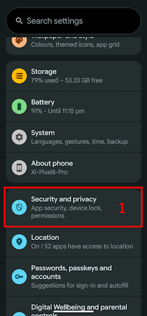

2. Rul ned og tryk på **Privatlivsindstillinger (1)**.

   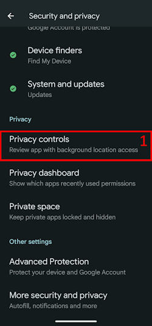

3. Tryk på **Tilladelsesadministrator (1)**.

   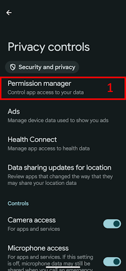

3. Rul ned og tryk på **Enheder i nærheden (1)**.

   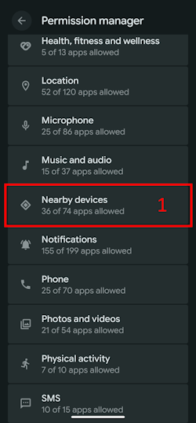

4. Gå listen over apps igennem, og tryk på den app, du vil fjerne tilladelsen **Enheder i nærheden** fra.

   I denne guide fjerner vi tilladelsen fra **Android Auto (1)**.

   For at undgå at flere pods bliver ødelagt, anbefaler vi, at alle til at begynde med fjerner tilladelsen fra alle apps undtagen **AAPS**.

```{admonition} Which app to select?
:class: tip
Hvis du ikke ved, hvilken app der giver dig problemer, så slå tilladelsen fra for dem alle (se også listen over kendte problemapps, og start med dem). Hvis du har råd til at miste et par pods undervejs, så giv tilladelsen til én app mere før hver ny pod-aktivering, indtil du har fundet ud af, præcis hvilken app der giver dine pod-problemer. Hvis du finder nye apps, der giver problemer, så fortæl os det på Discord-kanalen #omnipod-dash.
```

   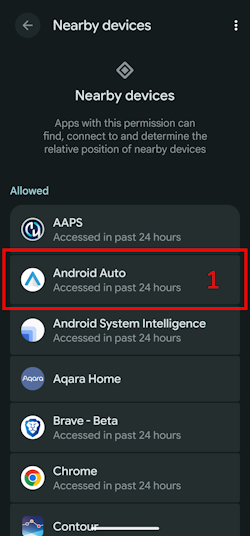

5. Fjern tilladelsen ved at trykke på **Tillad ikke (1)** og derefter på **Tillad ikke alligevel (2)**. Hvis det er gjort rigtigt, kan du se, at **Tillad ikke (3)** er det valgte punkt. Du kan nu gå tilbage til menuen **Enheder i nærheden** ved at trykke på **pilen Tilbage (4)** og ændre denne indstilling for andre apps, hvis det er nødvendigt.

   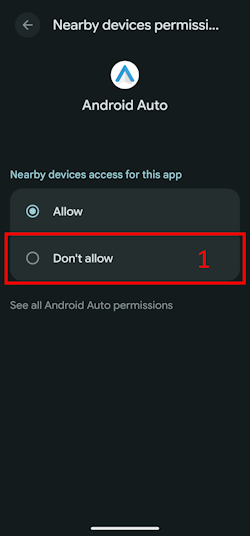 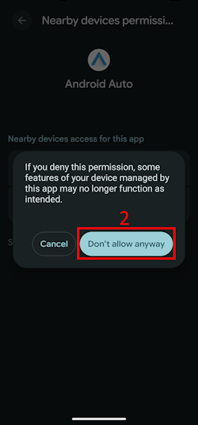  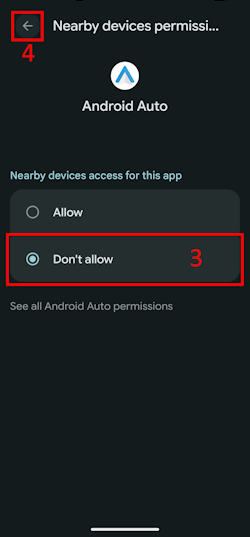

(bluetoothtroubleshooting-re-enable-nearby-device-permission)=

### Sådan giver du igen tilladelsen »Enheder i nærheden« til systemapps og andre apps:

1. Se om nødvendigt afsnittet **»Sådan fjerner du tilladelsen 'Enheder i nærheden' fra andre apps«** om, hvordan du kommer til appens privatlivsindstillinger. Når du er i konfigurationen af **Enheder i nærheden**, så fortsæt til punkt 2.

2. Gå listen over apps igennem, og tryk på den app, du vil give tilladelsen **Enheder i nærheden**.

   I denne guide giver vi tilladelsen til **Android Auto (1)**.

   Du vil se, at **Android Auto (1)** mangler i listen over apps, efter at tilladelsen er fjernet. Det er fordi appen **Android Auto** er en **systemapp**, og systemapps er som standard skjult.

   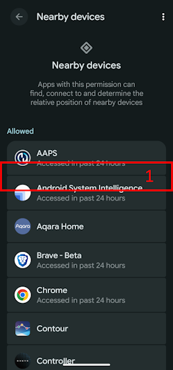

3. Vis skjulte systemapps ved at trykke på **menuen med tre prikker (⋮) (1)** i øverste højre hjørne og derefter på **»Vis system« (2)**. Du kan nu se den skjulte systemapp **Android Auto (3)** i listen.

```{admonition} Find your app
:class: tip
Hvis en app har fået tilladelsen fjernet, skal du rulle ned, indtil du ser listen over apps uden tilladelse længere nede.
```

   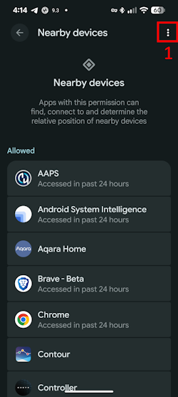 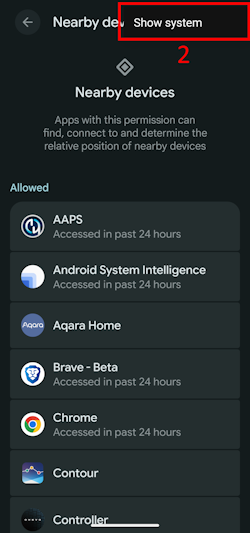 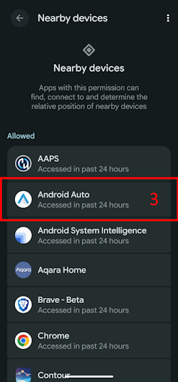

5. Følg vejledningen i **»Sådan fjerner du tilladelsen 'Enheder i nærheden' fra andre apps«** i omvendt rækkefølge for at give tilladelsen igen til hver app.

---

(bluetoothtroubleshooting-android-15-bluetooth-connection-problems)=

## Android 15: hyppige problemer med Bluetooth-forbindelsen

Efter en opdatering af Android eller skift til en nyere telefon mister **AAPS** ofte Bluetooth-forbindelsen til pumpen. Problemet forsvinder et stykke tid, når telefonen genstartes. Hvis du bruger en **Omnipod DASH**, og din telefon kører Android 15, kan det hjælpe på stabiliteten af Bluetooth-forbindelsen at slå indstillingen **Bluetooth-bonding** til. Sådan slår du den til:

```{admonition} Android 16
:class: warning
Slå kun **Bluetooth-bonding** til på Android 15, og kun hvis du har forbindelsesproblemer. Slå IKKE bonding til på Android 16.
```

1. Åbn [Dash-indstillingerne](#omnipod-dash-settings): åbn DASH-pumpeskærmen med **Administrer** > **Pumpe**, og tryk på ikonet **Indstillinger** (tandhjul) i øverste højre hjørne.

   

2. Åbn afsnittet **Avancerede indstillinger**, og slå **Bluetooth-bonding** til.

   

3. Hvis telefonen viser en anmodning om parring, så accepter den.

4. Genstart din telefon.
