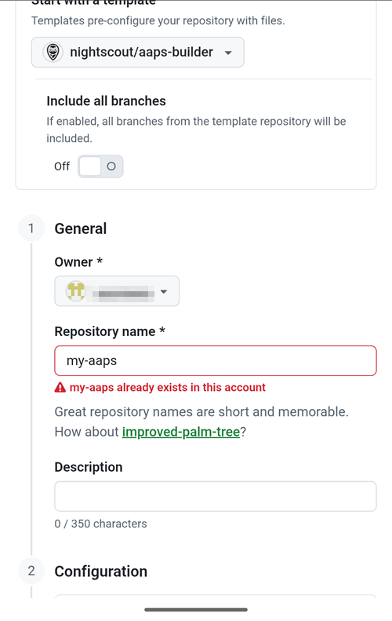
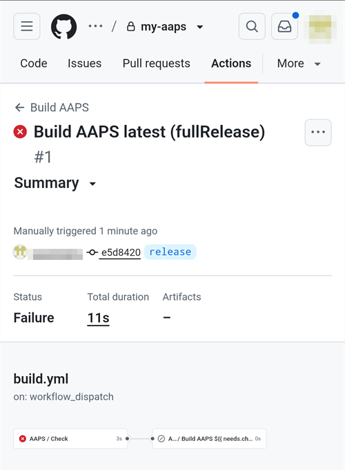
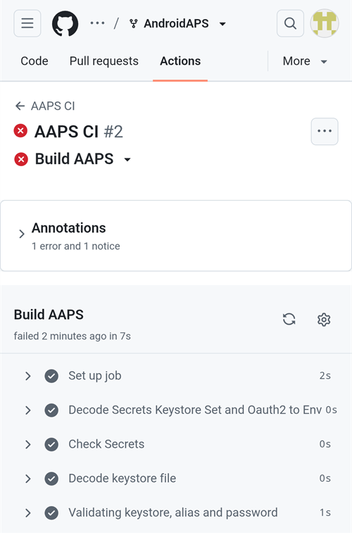
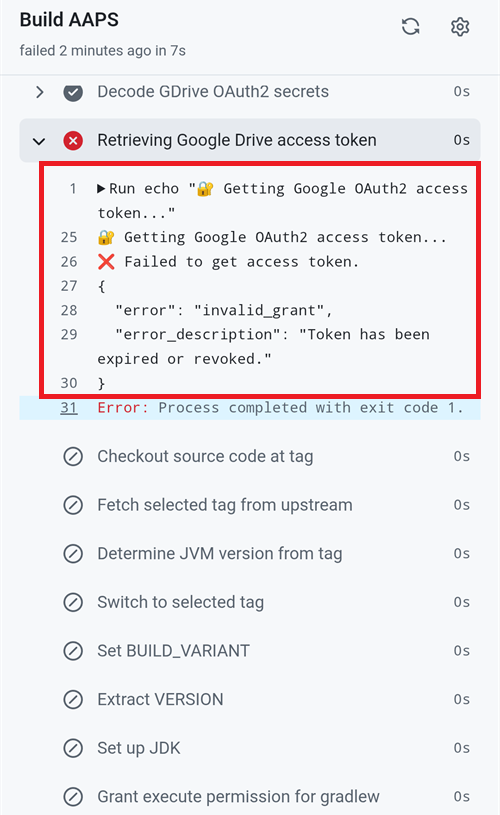
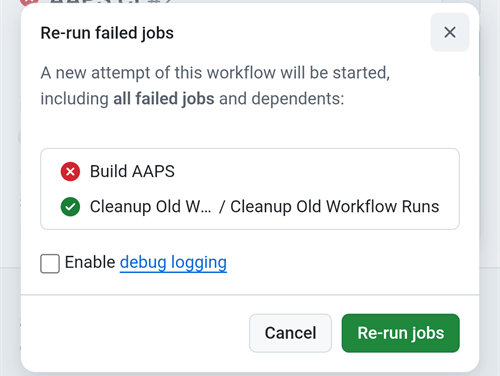
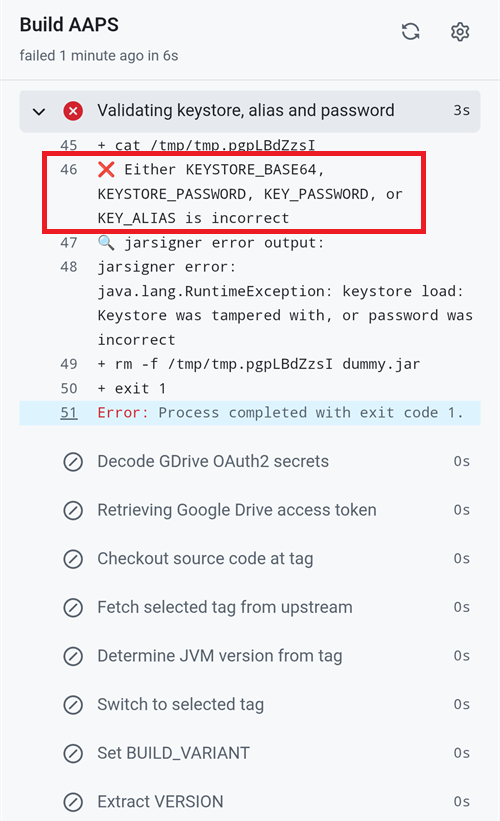
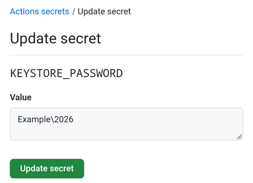

(aaps-ci-troubleshooting)=

# Build i browseren: fejlfinding

```{note}
Denne side samler tips til fejlfinding af [Build i browseren](../SettingUpAaps/BrowserBuild.md).
```

(aaps-builder-troubleshooting)=

## AAPS Builder

### Trin 1: repository'et

(aaps-builder-ts-repo-exists)=

#### "my-aaps already exists in this account"



Du har allerede dette repository, f.eks. fra et tidligere forsøg. Luk GitHub-fanen, behold det navn i trin 1 på opsætningssiden, og fortsæt. Hvis du allerede har lavet trin 2 og 3 for det, er din nøgle stadig i det: fortsæt med [trin 4](#aaps-builder-step4). Hvis det blev lavet med en ældre version af opsætningssiden, så opdater dets workflow én gang som forklaret i [Opdatering af AAPS](#aaps-builder-updates). Vil du hellere starte forfra? Skriv et andet navn, f.eks. `my-aaps-2`, og brug det samme keystore i trin 2.

(aaps-builder-ts-user-not-found)=

#### »Ingen GitHub-bruger med dette navn«


- **»Ingen GitHub-bruger med dette navn«** i trin 1: skriv dit GitHub-brugernavn, som det står i din GitHub-profil, ikke din e-mail.
- **Ingen knap »Build AAPS« eller »Run workflow«, eller repository'et er tomt**: repository'et blev ikke oprettet ud fra skabelonen. Slet det (**Settings** → nederst på siden → **Delete this repository**), og gentag [trin 1](#aaps-builder-step1) med knappen **Opret mit private repository**.

### Trin 3: secret'en

(aaps-builder-ts-404)=

#### "Page not found" (404)


- **"Page not found" (404), når opsætningssiden åbner GitHub**: log ind på github.com i den samme browser (GitHub viser 404 for private repositories, når du ikke er logget ind). Hvis du er logget ind, passer brugernavnet eller navnet på repository'et i trin 1 på opsætningssiden ikke med dit repository. Skriv navnene præcis.

### Trin 4: buildet

(aaps-builder-ts-workflow-not-found)=

#### "This workflow does not exist"


Lige efter at repository'et er oprettet, har GitHub måske ikke læst dets workflow-fil endnu: **Build AAPS** mangler under fanen **Actions**, og der er ingen knap **Run workflow**. En lille ændring i filen får GitHub til at læse den:

1. Åbn **Code** i dit repository, derefter mappen `.github`, så `workflows` og så filen `build.yml`.
2. Tryk på menuen **⋯** øverst til højre i filen og derefter på **Edit file… In place** (på en computer: klik på blyanten).

   

3. Tryk helt i slutningen af teksten, og tilføj en tom linje (Enter). Tryk på **Commit changes…** øverst.

   

4. Tryk på **Commit changes** igen.

   

5. Åbn fanen **Actions** igen: **Build AAPS** er nu i listen over workflows (på en telefon åbner listen med ikonet til venstre for **All workflows**). Tryk på det og derefter på **Run workflow**.

   

(aaps-builder-ts-build-failed)=

#### Buildet fejlede (rødt kryds)

1. Tryk på **Åbn mine builds** på opsætningssiden, og tryk på buildet med det røde kryds.

   

2. Siden for buildet viser **Failure**, og hvilken del der fejlede: **AAPS / Check** (repository'et, secret'en, versionen eller varianten: intet blev bygget) eller **AAPS / Build AAPS**.

   

3. Rul ned til **Annotations** med fingeren på teksten, ikke på diagrammet. De røde linjer forklarer problemet: tryk på **Show more** for at læse hele meddelelsen, og find den så nedenfor.

   

- **"Secret KEYSTORE_SET is missing"**: lav trin 3 på opsætningssiden.
- **Buildet stopper med "This repository is PUBLIC"**: åbn i dit repository **Settings** → **General** → **Danger Zone** → **Change visibility** → **Private**, og byg så igen.
- **"Version … does not exist"**: kun udgivne versioner af **AAPS** kan bygges, dvs. dem på [siden med tags](https://github.com/nightscout/AndroidAPS/tags) for nightscout/AndroidAPS, f.eks. `3.3.2.0`. Et navn på en gren, f.eks. `dev`, virker ikke. Brug `latest`, eller skriv et tag præcis, som det står i listen.
- **"Variant … is not supported"**: din workflow-fil er en ældre version. Erstat den som forklaret i [Opdatering af AAPS](#aaps-builder-updates).
- **"The secret is too short"**, **"The secret is not a valid code"** eller **"The secret does not contain a keystore"**: der blev sat forkert tekst ind i secret'en, ofte selve ordet `KEYSTORE_SET` eller kun en del af koden. Åbn i dit repository **Settings** → **Secrets and variables** → **Actions**, rediger `KEYSTORE_SET`, og indsæt den lange kode fra **Kopier secret** igen (gentag først trin 2 på opsætningssiden, hvis du har lukket den).
- **"Keystore, password or alias is wrong"**: kontroller adgangskoden og aliaset for dit keystore, og gentag så trin 2 og 3 på opsætningssiden.
- **"Google Drive access has expired or was revoked"**: gentag [trin 6](#aaps-builder-google-drive), og opdater secret'en `GDRIVE_OAUTH2`.
- **"Process completed with exit code 1" og en rød linje med kun et link til `services.gradle.org`** efter mindre end et minut: buildet kunne ikke downloade Gradle, et værktøj, som det skal bruge for at bygge appen. Gradle-hjemmesiden svarede ikke. Dit repository og dine indstillinger er i orden. Vent en halv time, og [kør så buildet igen](#aaps-ci-rerun).
- **En anden fejl**: [læs build-loggen](#aaps-ci-read-the-logs), og [kør så buildet igen](#aaps-ci-rerun). Hvis det fejler igen på samme måde, så bed om hjælp, og oplys navnet på det trin, der fejlede, og fejllinjerne. Del aldrig indholdet af dine secrets.

### Trin 5: appen

- **Intet link til Download, eller GitHub-appen åbnede**: GitHub-appen kan ikke downloade builds. Åbn buildet i Chrome som forklaret i [trin 5](#aaps-builder-step5). Sådan stopper du GitHub-links fra at åbne i appen: Android **Indstillinger** → **Apps** → **GitHub** → **Åbn som standard** → slå **Åbn understøttede links** fra.

## Fejlfinding af AAPS-CI

(aaps-ci-read-the-logs)=
### Først: find ud af, hvad der gik galt

Når et build fejler, gemmer GitHub en log over hvert trin. Loggen fortæller dig, hvilket trin der fejlede, og hvorfor. Læs den, før du prøver noget andet: det er fejlmeddelelsen, du skal lede efter på denne side, og det er den, hjælperne vil spørge om.

1. Åbn **Actions** i din GitHub-kopi af AndroidAPS. Et build, der fejlede, har et rødt kryds. Tryk på dets navn.

   

2. Oversigten over kørslen viser **Failure** og nedenunder det job, der fejlede (**Build AAPS**, med et rødt kryds).

   

3. Rul ned til **Annotations**, og tryk på den røde linje **Build AAPS**.

   

4. Jobbet åbner. Trin med et gråt flueben virkede. Trinnet med det røde kryds er det, der fejlede: GitHub åbner det for dig. Trinnene efter det blev sprunget over (grå cirkel).

   

5. Læs linjerne lige over `Error: Process completed with exit code 1.`: de forklarer problemet. I dette eksempel fejlede trinnet **Retrieving Google Drive access token** med `invalid_grant` og `Token has been expired or revoked.`, se [Googles refresh token er udløbet](#aaps-ci-google-token-expired).

   

```{tip}
Beder du om hjælp? Del navnet på det trin, der fejlede, og fejllinjerne (et skærmbillede som det ovenfor er fint). Del aldrig indholdet af dine secrets.
```

(aaps-ci-update-secret)=
#### Opdater en secret

Mange rettelser betyder, at du skal erstatte værdien af en secret. Gå i din GitHub-kopi af AndroidAPS til **Settings** → **Secrets and variables** → **Actions**, og tryk på blyanten ved siden af den secret.


Indtast eller indsæt den nye værdi, og tryk på **Update secret**. GitHub viser aldrig den gamle værdi: feltet er altid tomt.


(aaps-ci-rerun)=
#### Kør buildet igen efter en rettelse

Når du har rettet årsagen, behøver du ikke starte forfra: åbn kørslen, der fejlede, tryk på **...** (øverst til højre) og derefter på **Re-run failed jobs**.


Tryk på **Re-run jobs**. Du kan også starte et nyt build fra **Run workflow** som normalt.



(aaps-ci-preparation-web)=
### Websiden aaps-ci-preparation
  - Forberedelsessiden vises af en midlertidig lokal server (f.eks. Simple Web Server på en computer), som også modtager Googles refresh token.
  - Hvis du ser skærmen nedenfor, er den lokale server stoppet eller kan ikke nås.
  - Luk forberedelsessiden, kontroller, at den lokale server kører, åbn så aaps-ci-preparation.html igen på samme måde som i trin 2, og gennemfør de resterende trin. Det er især nødvendigt, når du opretter den første forbindelse til Google under opsætningen.

  

(aaps-ci-google-token-expired)=
### Googles refresh token er udløbet
  - Google OAuth2 refresh tokens udløber, hvis de ikke bliver brugt i 6 måneder, og de kan også blive ugyldige i andre situationer (f.eks. hvis du har ændret adgangskoden til din Google-konto eller selv har fjernet adgangen). Se [dokumentationen til Google OAuth2](https://developers.google.com/identity/protocols/oauth2) for flere detaljer.
  - I [build-loggen](#aaps-ci-read-the-logs) fejler trinnet **Retrieving Google Drive access token** med `invalid_grant` og `Token has been expired or revoked.`:

  

  - Hvis dit build fejler, fordi Googles refresh token er udløbet eller fjernet, skal du gentage trinnene i [Google Drive-godkendelse](#aaps-ci-google-drive-auth) for at få et nyt `GDRIVE_OAUTH2`-token, [opdatere secret'en](#aaps-ci-update-secret) i dit GitHub-repository og derefter [køre buildet igen](#aaps-ci-rerun).
  - Hvis godkendelsen fejler igen, eller Google ikke længere beder om dit samtykke, så fjern først den eksisterende AAPS-adgang fra din Google-konto, se [nedenfor](#aaps-ci-google-remove-access).

(aaps-ci-google-remove-access)=
### Fjern AAPS' adgang fra din Google-konto, og start godkendelsen forfra
  - Hvis godkendelsen af Google Drive bliver ved med at fejle, eller du vil starte helt forfra, så fjern først den adgang, du tidligere gav AAPS, og lav derefter godkendelsen igen.
  - Åbn [https://myaccount.google.com](https://myaccount.google.com) på din telefon, tryk på **Security**, rul ned til **Your connections to third-party apps & services**, og åbn listen over forbundne apps. Du kan også gå direkte til [https://myaccount.google.com/connections](https://myaccount.google.com/connections).
  - Tryk på **AAPS** i listen.

  

  - Siden viser den adgang, du gav AAPS (de Google Drive-filer, som bruges med appen). Tryk på **Delete all** for at fjerne forbindelsen, eller tryk på **See details** for først at se den igennem.

  

  - Tryk på **Remove all access** på siden med detaljer.

  

  - Tryk på **Confirm**.

  

  - Google bekræfter, at AAPS ikke længere har adgang. AAPS vises ikke længere i listen over forbundne apps.

  

  - Start nu godkendelsen helt forfra: luk **både** forberedelsessiden og filhåndtering-appen, åbn aaps-ci-preparation.html igen fra filhåndteringen, og gentag trinnene i [Google Drive-godkendelse](#aaps-ci-google-drive-auth). Google beder dig om at give adgang igen, og siden giver dig et nyt `GDRIVE_OAUTH2`-token.
  - [Opdater secret'en `GDRIVE_OAUTH2`](#aaps-ci-update-secret) i dit GitHub-repository med det nye token, og [kør derefter buildet igen](#aaps-ci-rerun).

(aaps-ci-disable-software)=
### Slå software fra, der kan forstyrre OAuth-verificeringen
  - Slå al VPN- og sikkerhedssoftware (firewall, antimalware ...) fra på telefonen, før du prøver at hente OAuth-nøglen.

(aaps-ci-actions-permission)=
### Kontroller indstillingerne for tilladelser til GitHub Actions
  - Sørg for, at politikken for GitHub Actions er sat til “Allow all actions and reusable workflows” (Settings → Actions → General). Hvis du ændrer den, så tryk på **Save** under valgmulighederne.

  

`actions/checkout@v4` and `actions/setup-java@v4` are not allowed to be used in `xxxxx/AndroidAPS`. Actions in this workflow must be: within a repository owned by `xxxxx`

(aaps-ci-workflow-permissions)=
### Kontroller indstillingerne for workflow-tilladelser på GitHub
  - Hvis buildet fejler med det samme med en fejl »Invalid workflow file« som den nedenfor, er standard-tilladelserne for workflows i dit repository for begrænsede:

```
Invalid workflow file
The workflow is not valid. .github/workflows/aaps-ci.yml (Line: 361, Col: 3):
Error calling workflow 'xxxxx/AndroidAPS/.github/workflows/cleanup-workflow-runs.yml@...'.
The nested job 'cleanup' is requesting 'actions: write', but is only allowed 'actions: none'.
```

  - Sørg for, at Workflow permissions er sat til “Read and write permissions” (Settings → Actions → General → Workflow permissions). Gem derefter, og kør build-workflowet igen.

  

(aaps-ci-password-special-characters)=
### Buildet fejler ved kontrol af keystore-adgangskoden
  - I [build-loggen](#aaps-ci-read-the-logs) fejler trinnet **Validating keystore, alias and password** med `Either KEYSTORE_BASE64, KEYSTORE_PASSWORD, KEY_PASSWORD, or KEY_ALIAS is incorrect`, efterfulgt af `Keystore was tampered with, or password was incorrect`. Buildet stopper der: keystore og adgangskoder bliver kontrolleret, før AAPS bliver bygget.

  

  - Build-workflowet beholder alle tegn i dine adgangskoder, som de er. Indtast `KEYSTORE_PASSWORD` og `KEY_PASSWORD` præcis, som de er, uden at tilføje en backslash eller et andet escape-tegn. Hvis du har tilføjet backslashes, så [opdater dine secrets](#aaps-ci-update-secret) med adgangskoden præcis, som den er. Eksemplet nedenfor er forkert: adgangskoden er `Example2026`, og backslashen er blevet tilføjet.

  

  - Hvis buildet stadig fejler, når APK'en signeres, selvom din adgangskode er korrekt, og adgangskoden indeholder `$`, en backtick, `"` eller `\`, så er workflow-filen i din fork ældre end september 2026 og fortolker stadig disse tegn. [Synkroniser din fork](#Update-to-new-version-update-your-repo) med den nyeste dev, og kør derefter build-workflowet igen.
  - Den lodrette streg `|` er et særligt tilfælde. Forberedelsessiden i [Mulighed 1](#aaps-ci-option1) samler keystore, adgangskoder og alias i én `KEYSTORE_SET`-secret, adskilt af `|`, og workflowet deler den op ved det tegn. Den adgangskode, som forberedelsessiden laver, indeholder kun bogstaver og tal, så det kan ikke ske med Mulighed 1. Det kan kun ske, hvis du selv har samlet en `KEYSTORE_SET`-secret med en adgangskode, der indeholder `|`. Slet i så fald `KEYSTORE_SET`, og indtast i stedet de separate secrets fra [Mulighed 2](#aaps-ci-option2).
