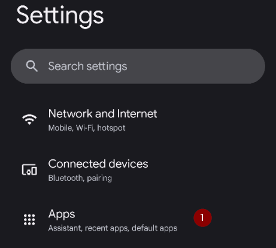
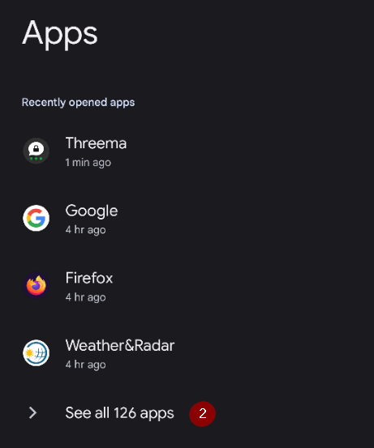
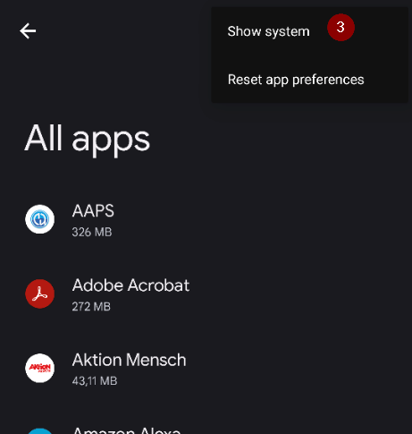
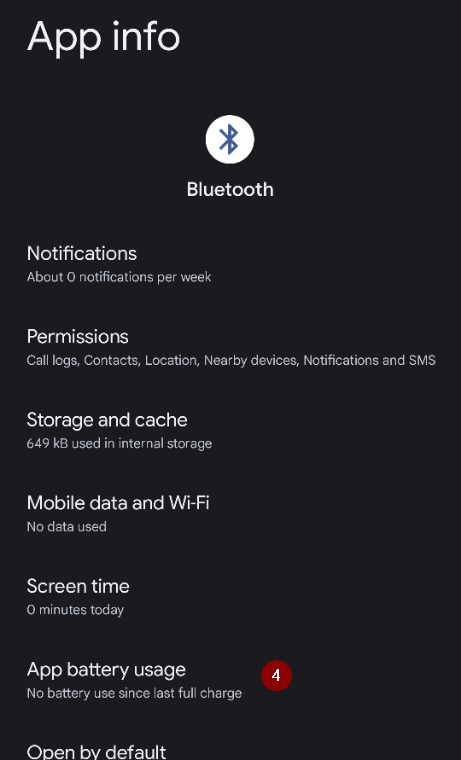
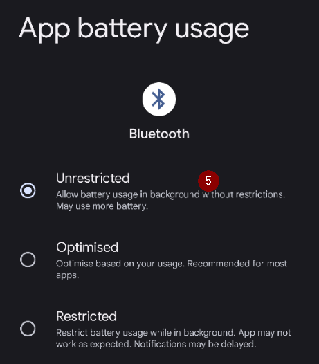
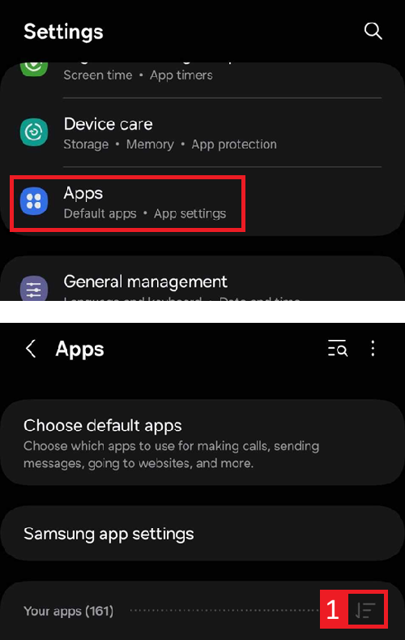
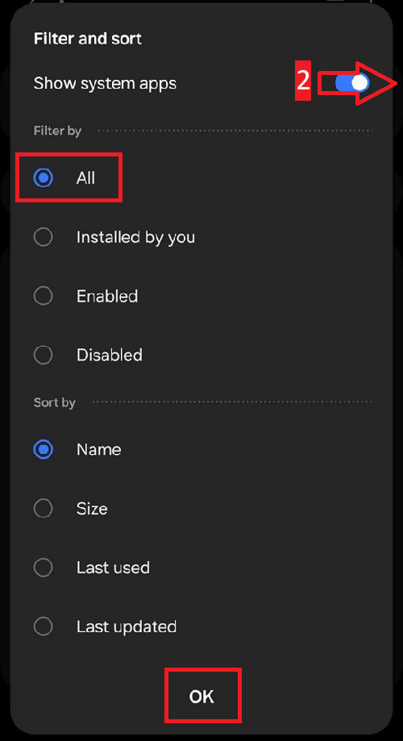
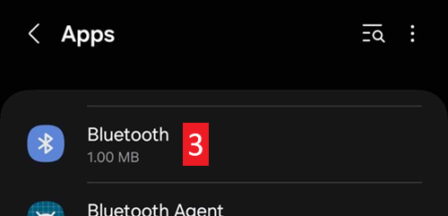
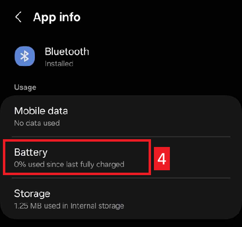
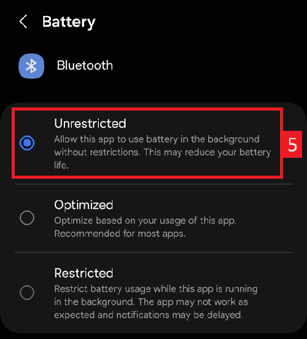

(generaltroubleshooting)=

# Fejlfinding

**Start her, når noget ikke virker.** Information om fejlfinding findes på mange sider i dokumentationen. Denne side samler den: den er en samling af links, sorteret efter emne, som hjælper dig med at løse de mest almindelige problemer.

Hvis du ikke finder dit svar nedenfor, så se også:

* [Ofte stillede spørgsmål for loopere](../UsefulLinks/FAQ.md) for svar på almindelige spørgsmål, og
* [Justering af din AAPS-profil](ProfileTuning.md), hvis dit loop kører, men din glukosekontrol skal forbedres.

```{admonition} Still stuck?
:class: tip
Hvis ingen af linkene løser dit problem, så se [Hvor kan jeg få hjælp?](WhereCanIGetHelp.md) for at spørge fællesskabet (Facebook, Discord), eller send dine [logfiler](AccessingLogFiles.md) til udviklerne.
```

---

(generaltroubleshooting-aaps-app)=

## AAPS-appen

### Byg og opdater

* Hvis build mislykkes, så se [Hvis build mislykkes](#building-aaps-troubleshooting): der står fejlfindingsafsnittet for hver byggemetode:
  * [AAPS Builder](#aaps-builder-troubleshooting)
  * [Build i browseren](#aaps-ci-troubleshooting)
  * [Android Studio](TroubleshootingAndroidStudio.md)
* Mistet keystore eller nyt keystore: [Geninstallation af AAPS](#reinstall-aaps)
* Opdatering af **AAPS**: [med AAPS Builder](#aaps-builder-updates), [med build i browseren (fork)](#update-browser-build-troubleshooting), [med Android Studio](#update-computer-build-troubleshooting)

### Installation

* [Advarsel fra Google Play Protect](#transferring-installing-play-protect-warning): appen bliver rapporteret som usikker.
* Installationen bliver **blokeret** med en besked om en ikke-verificeret udvikler: se [Udviklerverifikation på Android](#android-developer-verification) for de gratis installationsmetoder.

### Indstillinger

* [Profil: »Basalraten er ikke kompatibel med den aktuelle pumpe«](#your-aaps-profile-basal-not-compatible)
* [Pumpe: »Data kommer fra en anden pumpe«](#config-builder-wrong-pump-data)
* [Nightscout Client](TroubleshootingNsClient.md)
* **»AAPS-indstillingerne kan ikke læses«** ved start: indstillingerne er krypteret med en nøgle, som Android gemmer til **AAPS**, og den nøgle kan ikke længere åbne dem, f.eks. efter at telefonens nøglelager er blevet nulstillet. Mens denne skærm vises, kører **AAPS** ikke og styrer ikke pumpen. Tryk på **Prøv igen**: det lukker og genstarter **AAPS**. Hvis det ikke hjælper, så genstart telefonen. Brug kun **Start forfra**, når intet andet hjælper: det lægger den ulæselige indstillingsfil til side (den bliver omdøbt og gemt) og starter **AAPS** med tomme indstillinger. Importer derefter din seneste [eksport af indstillinger](../Maintenance/ExportImportSettings.md).

### Brug

* [Forkerte kulhydratværdier (langsom kulhydratabsorption)](#CobCalculation-detection-of-wrong-cob-values)
* [Automatisering](#automations-troubleshooting)
* [Fuldt lukket loop](#full-closed-loop-troubleshooting)

---

(generaltroubleshooting-bluetooth-related-issues)=


## Bluetooth-relaterede problemer

Kendte problemer med Bluetooth-forbindelser, afbrydelser af pumper/pods eller problemer med aktivering og forbindelse: se [Problemer med Bluetooth](../GettingHelp/BluetoothTroubleshooting.md)

---

(generaltroubleshooting-android-related-issues)=

## Problemer med Android

### Batterioptimering

**AAPS** kan hjælpe dig med at finde de rigtige indstillinger til din telefon: åbn **menuen** (☰) > **Om**, og tryk på **Dræb ikke min app?**. Det åbner vejledningen for dit telefonmærke på [Don't kill my app](https://dontkillmyapp.com/). [Opsætningsguiden](#setup-wizard-bluetooth-battery-optimisation) beder dig også om at slå batterioptimering fra for **AAPS** og Bluetooth.

Android har indstillinger til batteribesparelse, som er slået til som standard. Disse indstillinger sætter automatisk apps på pause, som systemet ikke behøver for at fungere. Det sparer batteri, fordi apps, der ikke altid behøver at køre, bruger mindre strøm.

Når den er slået til, vil den med stor sandsynlighed give problemer for **AAPS** og andre hjælpe-apps som **xDrip**.

Det er vigtigt, at du har slået batterioptimering fra, så **AAPS** og andre hjælpe-apps hele tiden forbliver aktive.

Afhængigt af din telefons model og mærke kan der være mere end ét sted og én indstilling, hvor dette skal slås fra.

***BEMÆRK:** Følg trinene nedenfor for at slå batterioptimering fra for Bluetooth-tjenesten, hvis din telefon har denne mulighed. De samme trin kan bruges til at slå den fra for **AAPS** og andre apps, men skærmbillederne viser kun, hvordan du gør det for Bluetooth-tjenesten.*

#### Pixel-telefoner (standard-Android)

* Gå til Android-indstillingerne, og vælg »Apps«.

  

* Vælg »Se alle apps«

  

* Vælg »Vis system« i menuen til højre for at se systemapps.

  

* Søg nu efter appen »Bluetooth«, og vælg den.

  

* Klik på »App-batteriforbrug«, og vælg »Ubegrænset« (hedder »Ikke optimeret« på nogle ældre Android-versioner).

  


#### Samsung-telefoner

* Gå til Android-indstillingerne, og vælg »Apps«

* Vælg »Vis systemapps« (2) via ikonet, der skulle ændre sorteringen (1).

  

  

* Søg nu efter Bluetooth-appen, og vælg den for at se dens indstillinger.

  

* Vælg »Batteri«.

  

* Sæt den til »Ubegrænset« (hedder »Ikke optimeret« på nogle ældre Android-versioner).

  

#### Huawei-telefoner

Se denne vejledning om [Bluetooth og batterioptimering på Huawei](../CompatiblePhones/Huawei.md)

---

(generaltroubleshooting-cgm)=

## Kontinuerlig glukosemåler (CGM)

Nyttige links til kendte problemer og løsninger for CGM'er.

* [Generelt](#general-cgm-troubleshooting)
* [Dexcom G6](#DexcomG6-troubleshooting-g6)
* [Libre 2 med Minimal Looper](#minimallooper-troubleshooting)
* [Libre 3](#libre3-experiences-and-troubleshooting)
* [xDrip – ingen CGM-data](#xdrip-identify-receiver)
* [xDrip – fejlfinding for Dexcom](#xdrip-troubleshooting-dexcom-g5-g6-and-xdrip)

---

(generaltroubleshooting-pumps)=

## Pumper

Nyttige links til kendte problemer og løsninger for pumper

* [Accu-Chek Combo](#combov2-tips-for-basic-usage)
* [Accu-Chek Insight](#Accu-Chek-Insight-Pump-insight-specific-errors)
* [CareLevo](#carelevo-alarms-and-notifications)
* [DanaRS](#DanaRS-Insulin-Pump-dana-rs-specific-errors)
* [Diaconn G8](#diaconn-g8-bluetooth-troubleshooting)
* [EOPatch2](#eopatch2-alarms-and-warnings)
* [Medtronic + RileyLink](#MedtronicPump-what-to-do-if-i-loose-connection-to-rileylink-and-or-pump)
* [Medtrum Nano](#medtrum-nano-troubleshooting)
* [Omnipod DASH](#omnipod-dash-troubleshooting)
* [Omnipod Eros](#OmnipodEros-troubleshooting)

---

(generaltroubleshooting-phones)=

## Telefoner

Nyttige links til kendte problemer og løsninger for telefoner

* [Liste over testede opsætninger af telefoner og enheder](https://docs.google.com/spreadsheets/u/1/d/e/2PACX-1vScCNaIguEZVTVFAgpv1kXHdsHl3fs6xT6RB2Z1CeVJ561AvvqGwxMhlmSHk4J056gMCAQE02sAWJvT/pubhtml?gid=683363241&single=true)
* [Jelly](../CompatiblePhones/Jelly.md)
* [Bluetooth og batterioptimering på Huawei](../CompatiblePhones/Huawei.md)

---

(generaltroubleshooting-remote-control)=

## Fjernstyring

* [AAPSClient og fjernstyring (parring, kommandoer bliver ikke modtaget)](#client-master-control-troubleshooting)
* [Problemer med »Nightscout access token«](#remotecontrol-nightscout-access-token)
* [SMS-kommandoer](#SMSCommands-troubleshooting)
* [Android Auto](#android-auto-troubleshooting)

---

(generaltroubleshooting-smartwatches)=

## Smarture

Nyttige links til kendte problemer og løsninger for smarture

* [Fejlfinding af Wear-appen](#Watchfaces-troubleshooting-the-wear-app)
* [Ur og telefon kommunikerer ikke](#wear-os-watch-phone-communication)
* [Wear OS 5](#wear-os-5-troubleshooting)
* [Byg Wear-appen](#building-aaps-wear-os-troubleshooting)
