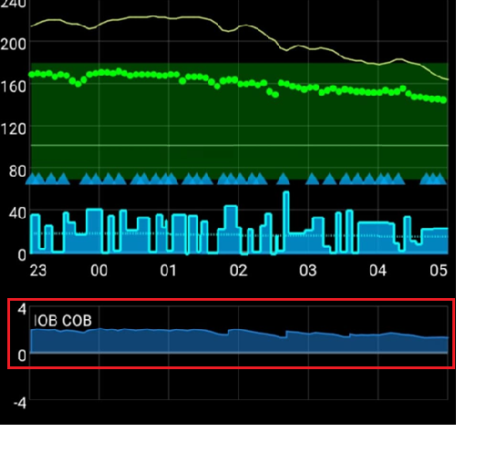
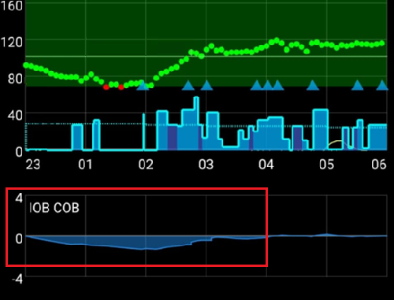
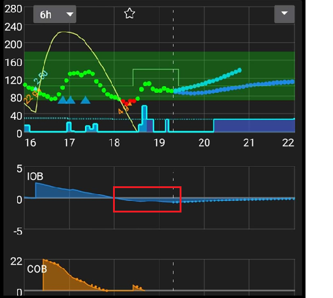
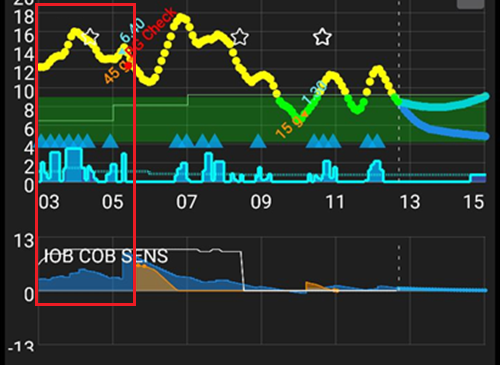
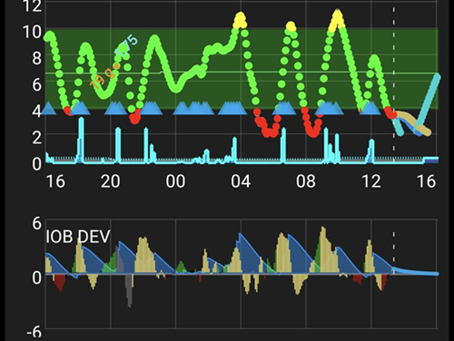
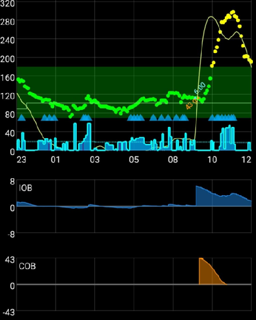

# Justering af din AAPS-profil

```{admonition} This is NOT a medical advice
:class: warning
Samarbejd med dit behandlerteam for at få støtte og råd om din diabetesbehandling.</br>
Brug kun denne vejledning, når du har [sat din **profil** korrekt op](https://androidaps.readthedocs.io/en/latest/SettingUpAaps/YourAapsProfile.md) og fulgt alle **AAPS**-læringsmål.
```

Denne vejledning forklarer logikken bag OpenAPS-algoritmens resultater med en given __profil__ og giver information om, hvilke værdier i **AAPS** du kan justere, når du ser bestemte situationer eller mønstre. Forslagene om basaltest nedenfor kan afvige fra det, dit behandlerteam råder dig til.

Med **lukket loop** kan basaltest blive nemmere, og risikoen for hypo kan blive meget mindre, hvis basal i din __profil__ er for stærk.

## Ændring af profilens indstillinger: sådan gør du

1. Sørg for, at du har læst og forstået __AAPS'__ anbefalede indstillinger og råd nedenfor. Hvis du ikke følger disse råd, kan justeringen blive besværlig, og det bliver mindre sandsynligt, at du får en godt justeret __profil__
2. Observer og sammenlign omhyggeligt, **over flere dage**, hvad der sker med dit __BS__ og din __IOB__.
3. Hold øje med mønstre i **AAPS**, der sker omkring samme tid (næsten) hver dag.
4. Det er vigtigt at gøre det over flere dage. Data fra kun én dag giver som regel dårlige resultater, når du skal beslutte ændringer i __profilen__.
5. Først når du har set et mønster, der gentager sig, f.eks. at du kl. 13 ser en stigning i __BS__ eller en negativ __IOB__-værdi, skal du begynde at lave små ændringer i din __profil__.
6. Det er vigtigt kun at ændre én ting ad gangen. F.eks. øg din basal med 10% omkring kl. 13.
7. Efter hver ændring er det vigtigt at følge virkningen på dit __BS__ og din __IOB__ de næste par dage.
8. Gentag dette mønster: observer, beslut, juster igen om nødvendigt

Lad være med at skynde dig, gå langsomt frem!

## Anbefalede indstillinger og råd, mens du justerer basal

- Lav alle test med [lukket loop aktiveret](#AapsScreens-loop-status).
- **Slå alle [automatiseringer](../DailyLifeWithAaps/Automations.md) <u>FRA</u>**
- **Slå [DynISF](#Open-APS-features-DynamicISF), [AutoISF](#Open-APS-features-auto-isf), [AutoSens](#Open-APS-features-autosens) <u>FRA</u>**, så de ikke prøver at tilpasse din profil.
- Lav ikke manuelle handlinger (manuel bolus, midlertidige mål osv.), mens du tester: lad systemet kun bruge indstillingerne i **profilen**.
- For de [ekstra grafer](#AapsScreens-section-g-additional-graphs): brug Insulin om bord og Basal på graf 1. Brug Kulhydrater om bord (og Ændring i følsomhed) på graf 2. Brug Afvigelser og Blodsukkerpåvirkning på graf 3. Når du beder om råd, så vis altid dem på dine skærmbilleder.
- COB=0[*](#profiletuning-cob-zero)

Andre forhold, som helst skal undgås, da de påvirker dataene og kan føre til forkerte konklusioner:
- Ingen fysisk aktivitet.
- Ingen stress.
- Ingen sygdom.
- Intet ekstremt vejr, f.eks. høje eller lave temperaturer.
- Ingen fejl i pumpe- eller CGM-sessioner.
- Ingen uanmeldte kulhydrater.

Bemærk også:
- Hvis din [basalrateprofil](#your-aaps-profile-basal-rates) er korrekt, og du er ved målværdien med COB=0[*](#profiletuning-cob-zero) og IOB=0, bliver du hele tiden ved målværdien, uanset din **ISF** (**ISF** bruges kun, når du er over din **BS**-målværdi).
- Du skal kontrollere den aktuelle **IOB**, men også **IOB**-grafen, for at se, hvordan **IOB** har udviklet sig de sidste par timer.

(profiletuning-cob-zero)=

***COB = 0**

Det betyder, at måltidet er fordøjet, og at der ikke er flere kulhydrater i din krop.

**AAPS** kan vise [COB=0, selv om du stadig har kulhydrater om bord](../DailyLifeWithAaps/CobCalculation.md).

## Definitioner for [profil](../SettingUpAaps/YourAapsProfile.md)

En for **stærk profil** betyder en kombination af følgende:

- [ISF](#your-aaps-profile-insulin-sensitivity-factor)-tallet er for lille.
- [Basal](#your-aaps-profile-basal-rates)-tallet er for stort.
- [I:C](#your-aaps-profile-insulin-to-carbs-ratio)-tallet er for lille.

## Observationer af IOB

*Bemærk: du kan også bruge Loopalyzer-grafen for IOB i Nightscout-rapporterne for at se IOB over flere dage.*

Hvis du ser følgende mønstre efter nogle dage, så overvej følgende ændringer:

### Positiv IOB

- Basal i **profilen** er måske ikke stærk nok (det kan også skyldes ting som uanmeldt mad, sygdom, dårlig absorption ved indstiksstedet osv.)



### Negativ IOB

- Standardbasal er for stærk.
- Kan være virkningen af tidligere motion/fysisk aktivitet.



- Forrige måltid: for meget bolus (som gav en meget lang nul-basal)



## Observationer af BS i forhold til målværdi

### Bliver ved med at være højt

- __ISF__-tallet er højt og ikke stærkt nok (den beregnede insulin er for svag)



- Basal i __profilen__ er måske ikke stærk nok (**SMB** har ikke nok »basallager« at bruge af)
- En sikkerhedsgrænse ([MaxIOB](#Open-APS-features-maximum-total-iob-openaps-cant-go-over)?) kan være slået til og begrænser insulintilførslen. Kontroller det på skærmen for **APS**-pluginet (**Konfiguration → APS → Åbn plugin**); se [SMB](#Open-APS-features-super-micro-bolus-smb).
- Tekniske problemer: absorption ved indstiksstedet, infusionssæt, ...

### Bliver ved med at være lavt

- __ISF__ er for stærk, og tallet skal være højere
- Basal i __profilen__ er for stærk (hvis IOB også er negativ)

### Rutsjebane (op og ned)

- Er **ISF** for stærk? Se [Din AAPS-profil](#your-aaps-profile-insulin-sensitivity-factor)



## Observationer af BS efter måltider

### Hurtig stigning, og BS bliver højt

- Maden indeholder hurtige kulhydrater (f.eks. frugtjuice).
- Overvej at give en bolus før måltidet eller at give den lidt tidligere.
- Bolus (IC eller procent injiceret) er ikke stærk nok.



### Hurtig stigning, og derefter bliver BS lavt

- Overvej at give en bolus før måltidet; din **profil** er måske for aggressiv (overkorrektion af stigningen)
- Bolus er for stærk.


## [Sådan beregner du din I:C](#your-aaps-profile-insulin-to-carbs-ratio)

1. Først skal du have de rigtige standardindstillinger for basal i din **profil**.
2. Start ved målværdien, helst uden negativ IOB.
3. Noter den samlede givne insulin i **Administrer → Pumpe** (eller pumpehistorikken), og kald det start-insulin. Mål en kendt portion kulhydrater meget præcist, og noter starttidspunktet og start-IOB. Indtast derefter kulhydrater og bolus i **AAPS** med bolusberegneren (med den aktuelt indstillede I:C). Glem ikke at spise kulhydraterne ;)
4. Efter nogle timer, når COB=0[*](#profiletuning-cob-zero) og du er tilbage ved målværdien, så noter sluttidspunktet og slut-IOB, kontroller den samlede givne insulin som før, og kald det slut-insulin. *BEMÆRK: Tidsrummet er IKKE vigtigt, så længe det er længere end din fordøjelse*
5. Fra forskellen mellem start- og slut-insulinmængden trækker du forskellen slut-IOB - start-IOB fra (eller lægger den til). Træk derefter den basalinsulin fra, der er beregnet ud fra indstillingerne i din **profil**.
6. Hvis __BS__ er ved målværdien, har du den samlede insulin, der blev brugt til at »fordøje« dine kulhydrater. Beregn din **I:C**.

### Forklaring på beregningen af I:C

- Med en **profil**, der har den rigtige standardbasalrate, skal du i ethvert tidsrum blive ved målværdien og have en IOB tæt på 0. Du får kun basal fra din **profil**.
- Du lægger kulhydrater og bolus til. Vent, til din krop har fordøjet alle kulhydraterne, og du er tilbage ved **BS**-målværdien. Dit insulinforbrug er summen af din basal + den insulin, der skal til for kulhydraterne. Du beregner den insulin, der blev brugt til basal (ud fra din **profil**), og resten er den insulin, der blev brugt til at fordøje kulhydraterne.
- Hvis tidsrummet er for kort, er der kulhydrater, der ikke er fordøjet, og så bliver din »insulin til kulhydraterne« forkert.
- Hvis tidsrummet er for langt, sker der ikke noget dårligt. Du bruger alle dine kulhydrater, og du får mere basal. Til sidst trækker du basalen fra den samlede brugte insulin, så det længere tidsrum (med mere basal) påvirker ikke resultatet.

Oprindeligt skrevet af @Robby (Discord) som tips og tricks til at justere din **AAPS-profil**, gennemgået og redigeret af fællesskabet (tak!).
