(reinstall-aaps)=
# Geninstallation af AAPS med et nyt keystore

Hver **AAPS**-apk er signeret med et **keystore**. En opdatering installeres kun oven på din nuværende **AAPS**, hvis den er signeret med **det samme keystore**: så bliver alle dine indstillinger og data gemt. Derfor anbefales det at opbevare dit keystore og dets adgangskode et sikkert sted.

Hvis du prøver at installere en apk, der er signeret med et andet keystore end før, får du en fejlmeddelelse om, at installationen mislykkedes!

(reinstall-aaps-when)=
## Hvornår skal du geninstallere?

Du skal afinstallere og geninstallere **AAPS**, når din nye apk er signeret med et andet keystore, for eksempel:

- Du kan ikke finde dit gamle keystore eller dets adgangskode.
- Du har oprettet et nyt keystore, for eksempel med [Mulighed 1 i build i browseren](../SettingUpAaps/BrowserBuildKeystore.md) eller **Opret en ny nøgle** i [AAPS Builder](../SettingUpAaps/BrowserBuildAapsBuilder.md).
- Du bygger på en ny computer og har ikke kopieret dit keystore til den.

Hvis du stadig har dit keystore, har du ikke brug for denne side: brug det igen, og [opdater **AAPS**](../Maintenance/UpdateToNewVersion.md) som normalt.

(reinstall-aaps-before)=
## Før du starter

- Når du afinstallerer **AAPS**, bliver alle indstillinger, dine [læringsmål](../SettingUpAaps/CompletingTheObjectives.md) og den nuværende forbindelse til pumpen slettet. Du får dem tilbage ved at importere din **indstillingsfil**, så sørg for, at du har en ny.
- Indstillingsfilen indeholder ikke din historik over behandlinger og glukose. Hvis du uploader til [Nightscout](../SettingUpAaps/SettingUpTheReportingServer.md), kan du hente den tilbage efter geninstallationen (trin 8).
- Du skal bruge din [**hovedadgangskode**](#Preferences-master-password): indstillingsfilen er krypteret med den. Det hjælper ikke at nulstille en glemt hovedadgangskode: en indstillingsfil kan kun importeres med den adgangskode, den blev eksporteret med (se [Hvordan nulstiller jeg hovedadgangskoden?](#FAQ-reset-master-password)).
- **Brugere af Omnipod og Medtrum:** læs først [Slangeløse pumper](#ExportImportSettings-tubeless-pumps). Din indstillingsfil skal være eksporteret under den pod eller patch, du har på nu.
- [Sæt din CGM/BS-kilde op](../Getting-Started/CompatiblesCgms.md), før du starter, hvis det er nødvendigt.

(reinstall-aaps-steps)=
## Trin

Billederne viser et skift fra **AAPS** 3.4 (trin 1 til 3) til **AAPS** 4 (trin 6 til 8). Andre versioner ser lidt anderledes ud.

(reinstall-aaps-export)=
### 1. Eksporter dine indstillinger

Eksporter dine indstillinger med den **AAPS**, der er installeret på din telefon nu. Se [Eksport af indstillinger](#ExportImportSettings-Settings-Export) for detaljer.

I **AAPS** 3.4: åbn **Vedligeholdelse**, og tryk på **Eksportmuligheder**. Under **Brugerindstillinger** skal du sætte flueben ved **Lokalt lager** og trykke på **OK**.

*Bemærk: du kan også bruge [Skylager](#preferences-maintenance-cloud) til at have en ekstra sikkerhedskopi. Det er en god idé, men behold Lokalt lager, så du hurtigt kan gendanne indstillingerne.*

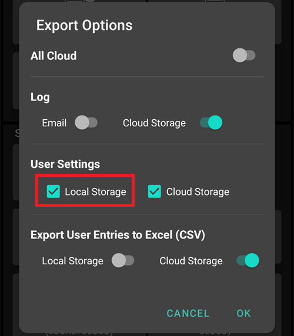

Knappen hedder nu **Eksporter indstillinger (lokal)**. Tryk på den.

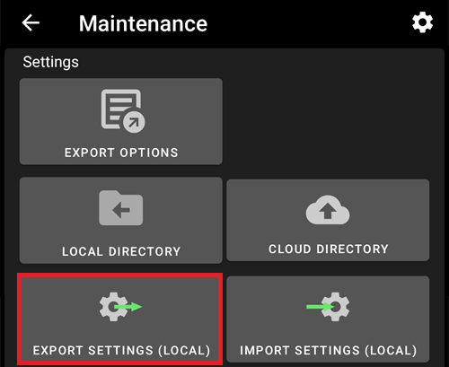

**AAPS** viser navnet på den fil, den vil oprette. Tryk på **OK**, indtast din hovedadgangskode, og tryk på **OK**.

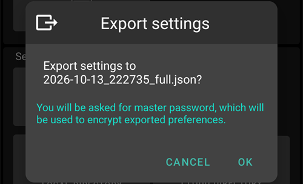

I **AAPS** 4: åbn **Vedligeholdelse**, vælg knappen **Lokal** ved siden af **Eksporter indstillinger**, og tryk på **Eksporter indstillinger**.

(reinstall-aaps-copy)=
### 2. Kopier indstillingsfilen væk fra din telefon

Filen ligger i mappen **preferences** i din [**AAPS**-mappe](#SetupWizard-StoragePermission) og hedder noget i stil med `2026-10-13_222735_full.json`. Kopier eller upload den til et sted uden for telefonen (f.eks. din computer, en skytjeneste...). Filen bliver normalt på din telefon efter afinstallationen, men gem en kopi et andet sted for en sikkerheds skyld.

(reinstall-aaps-nightscout-before)=
### 3. Synkroniser med Nightscout

Dette trin er ikke påkrævet, men anbefales, hvis du bruger [DynISF](#Open-APS-features-DynamicISF): så kan du fortsætte direkte med de nuværende indstillinger i stedet for at vente 5 dage på, at pluginet har de nødvendige data. NSClient V3 skal være [aktiveret og konfigureret](../SettingUpAaps/SettingUpTheReportingServer.md).

Sørg for, at Nightscout har alle dine data, før du afinstallerer.

Åbn **NSClient**, tryk på knappen **Fuld synkronisering** nederst på skærmen og derefter på **OK**.

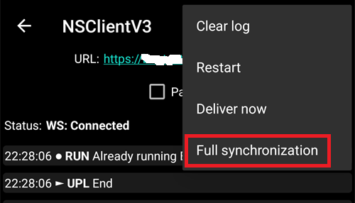

*Bemærk: den nødvendige tid afhænger af den tjeneste, der hoster din Nightscout.*

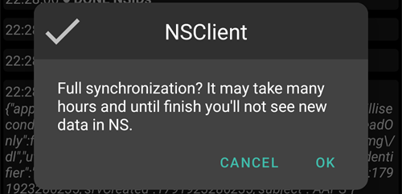

**AAPS** tilbyder derefter at rydde op i sin database. **OK** sletter data, der er ældre end 3 måneder, fra telefonen. Det gør synkroniseringen meget hurtigere. **Annuller** synkroniserer uden at rydde op. Databasen på telefonen bliver alligevel slettet, når du afinstallerer, så begge dele er i orden.

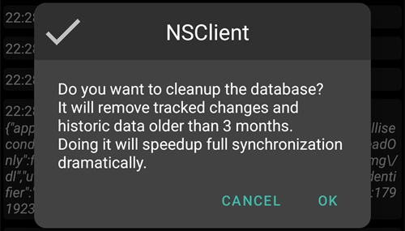

Lad **AAPS** køre, indtil synkroniseringen er færdig.

(reinstall-aaps-build)=
### 4. Byg den nye apk

[Byg](../SettingUpAaps/BuildingAaps.md) en ny signeret apk med dit nye keystore, og overfør den til din telefon.

(reinstall-aaps-uninstall)=
### 5. Afinstaller AAPS

Gå på telefonen til **Indstillinger** > **Apps** > **AAPS**, tryk på **Afinstaller**, og bekræft med **OK**.

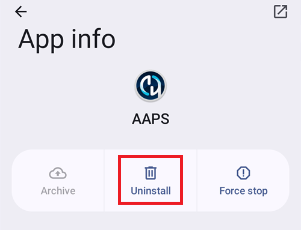

(reinstall-aaps-install)=
### 6. Installer og start den nye AAPS

[Installer](../SettingUpAaps/TransferringAndInstallingAaps.md) den nye apk, og start **AAPS**. [Opsætningsguiden](../SettingUpAaps/SetupWizard.md) spørger om de tilladelser, **AAPS** har brug for: tryk på **Tillad** for hver af dem. Det slår også [batterioptimering](#setup-wizard-bluetooth-battery-optimisation) fra igen.

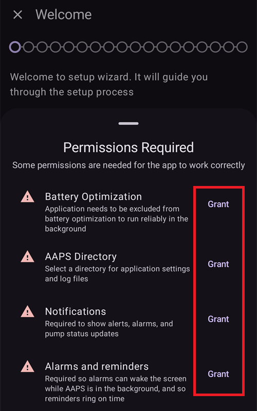

Ved **AAPS-mappe** skal du vælge den samme **AAPS**-mappe som før (den med mappen **preferences** i), trykke på **Brug denne mappe** og **Tillad**.

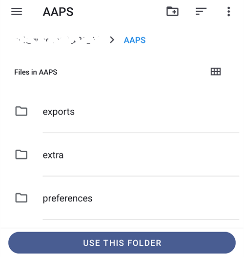

Når **AAPS** finder dine eksporterede indstillinger, viser opsætningsguiden skærmen [Gemte indstillinger fundet](#setup-wizard-import-settings), hvor du kan importere dem. Du kan også lukke guiden og importere fra **Vedligeholdelse** som beskrevet nedenfor.

(reinstall-aaps-import)=
### 7. Importer dine indstillinger

Hvis indstillingsfilen ikke længere er på din telefon, skal du kopiere den tilbage til mappen **preferences** i din **AAPS**-mappe.

Åbn menuen (☰) > **Vedligeholdelse**, vælg knappen **Lokal** ved siden af **Importer indstillinger**, og tryk på **Importer indstillinger**.

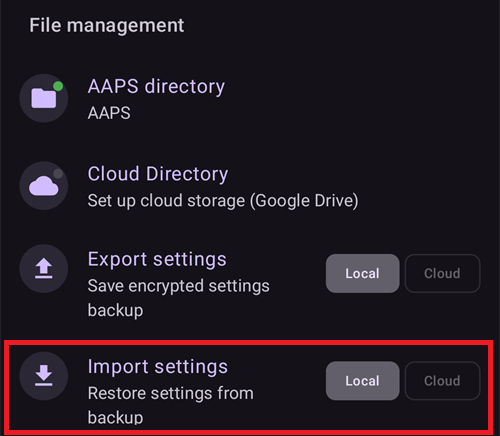

Listen viser hver fil med dens **AAPS**-version og hvor gammel den er. Vælg den fil, du eksporterede i trin 1.

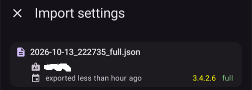

Du behøver ikke først at indstille en hovedadgangskode i den nye **AAPS**. Indtast den hovedadgangskode, du brugte til eksporten, i **Adgangskode til dekryptering**, og tryk på **Dekrypter**. **Filen blev krypteret med en anden adgangskode** er forventet: den nye **AAPS** kender ikke din adgangskode endnu. Importen gendanner den sammen med dine andre indstillinger.

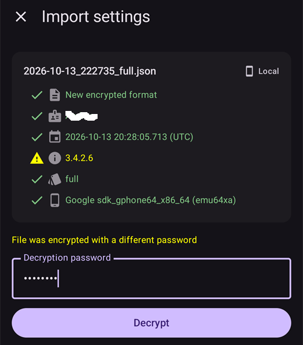

Sæt flueben ved **Erstat også pumpeindstillinger**: uden det bliver din pumpe og dens indstillinger ikke gendannet. Brugere af Omnipod og Medtrum: sæt kun flueben, hvis filen blev eksporteret under din nuværende pod eller patch (se [Slangeløse pumper](#ExportImportSettings-tubeless-pumps)).

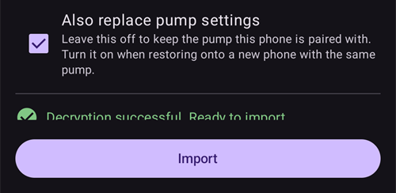

Tryk på **Importer**, derefter på **OK** for at anvende indstillingerne og på **OK** igen ved **Indstillinger anvendt**.

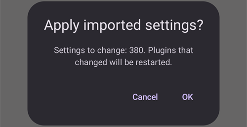

(reinstall-aaps-nightscout-after)=
### 8. Hent din historik tilbage fra Nightscout

Åbn menuen (☰) > [**Konfiguration**](../SettingUpAaps/ChangeAapsConfiguration.md) > **Kommunikation**, og tryk på **Åbn plugin** under **NSClientV3**. Kontroller, at status viser **Tilsluttet**. Hvis den ikke gør det, se [Fejlfinding af NSClient](TroubleshootingNsClient.md).

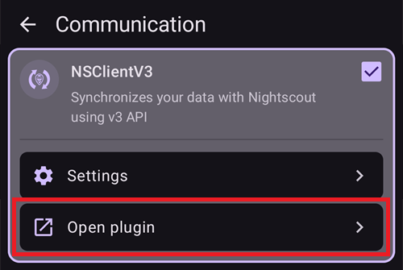

Tryk på knappen **Fuld synkronisering** nederst på skærmen og på **OK**. Databasen er ny, så du kan svare på spørgsmålet om oprydning, som du vil.

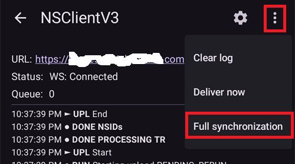

**AAPS** henter dine data fra Nightscout. Loggen viser **Full sync finished**, når den er færdig.

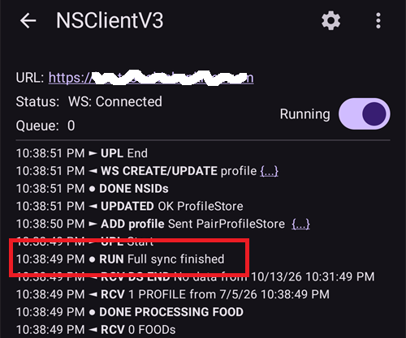

(reinstall-aaps-check)=
### 9. Kontroller, og fortsæt med at loope

Kontroller, at din pumpe er forbundet, og at dine CGM-værdier kommer ind, og fortsæt så med at loope.

(reinstall-aaps-afterwards)=
## Bagefter

Brug altid dit nye keystore fra nu af, og opbevar det sammen med adgangskoden et sikkert sted uden for din telefon. Se [Oprettelse og gendannelse af sikkerhedskopier](../Maintenance/ExportImportSettings.md).
