(troubleshooting_androidstudio-troubleshooting-android-studio)=

# Fejlfinding i Android Studio

```{contents} List of common issues
:depth: 2
:local: true
```

(troubleshooting_androidstudio-lost-keystore)=
## Mistet keystore
Hvis du har mistet dit keystore eller dets adgangskode, kan en apk, der er signeret med et nyt keystore, ikke opdatere din nuværende **AAPS**: du skal afinstallere og geninstallere den. Se [Geninstallation af AAPS med et nyt keystore](#reinstall-aaps).

## Gradle Sync mislykkedes
Gradle Sync kan mislykkes af forskellige grunde. Når du får en meddelelse om, at »gradle sync failed«, så åbn fanen »Build« (1) nederst i Android Studio, og se, hvilken fejlmeddelelse (2) der vises.

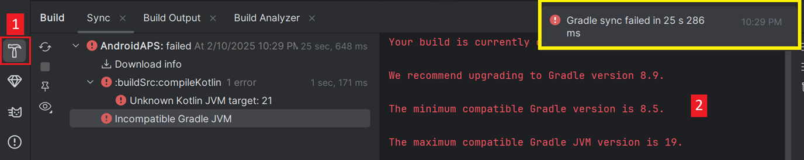

```{contents} Likely reasons for gradle sync failures are:
:depth: 1
:local: true
```

*Vigtigt*: Når du har fulgt vejledningen til dit specifikke problem, skal du starte [Gradle Sync](#gradle-resync) igen.

(troubleshooting_androidstudio-uncommitted-changes)=
### Ændringer, der ikke er committet

Hvis du får en fejlmeddelelse som denne:

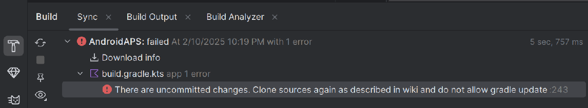

```
Build file 'C:\Data\50-Android\AndroidAPS\app\build.gradle.kts' line: 243

There are uncommitted changes.
Klon kildekoden igen som beskrevet i wikien, og tillad ikke opdatering af Gradle
```

#### Trin 1 – Kontroller installationen af Git
  * Åbn fanen Terminal (1) nederst i Android Studio, og kopier den følgende tekst og indsæt eller skriv den i terminalen (2).
    ```
    git --version
    ```

    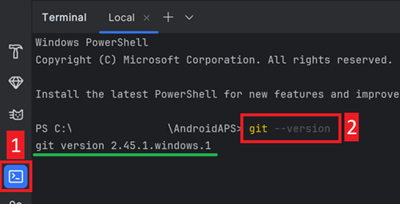

    Bemærk: Der er et mellemrum og to bindestreger mellem git og version!

  * Du skal få en meddelelse om, hvilken Git-version der er installeret, som du kan se på skærmbilledet ovenfor. Gå i så fald til [Trin 2](#troubleshooting-android-studio-check-for-uncommitted-changes).

  * Hvis du får en meddelelse, der siger
    ```
    Git: command not found
    ```
    er din Git-installation ikke korrekt.

  * [Kontroller installationen af Git](#BuildingAaps-steps-for-installing-git)

  * Hvis du bruger Windows, og Git lige er blevet installeret, skal du genstarte computeren, så Git bliver tilgængelig overalt efter installationen

  * Hvis Git er installeret, du har genstartet (på Windows), og Git stadig ikke kan findes:

  * Søg på din computer efter en fil med navnet »git.exe«.

    Skriv ned, hvilken mappe den er gemt i.

  * Gå til miljøvariablerne i Windows, vælg variablen »PATH«, og klik på Rediger. Tilføj den mappe, hvor du har fundet din Git-installation.

  * Gem og luk.

  * Genstart Android Studio.

(troubleshooting-android-studio-check-for-uncommitted-changes)=
#### Trin 2: Kontroller, om der er ændringer, der ikke er committet.

  * Åbn fanen »Commit« (1) i venstre side i Android Studio. 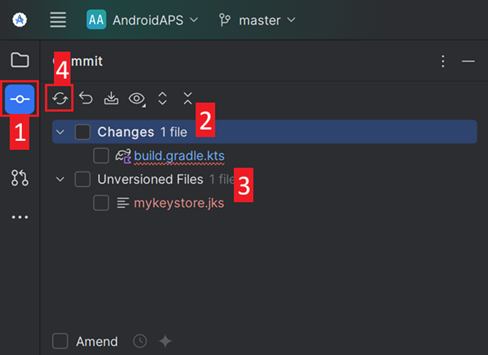
  * Du kan se enten »Changes« (kaldet »Default changeset« i ældre versioner af Android Studio) (2) eller »Unversioned Files« (3):

    * Ved »Changes« har du sandsynligvis opdateret Gradle eller ændret indholdet af nogle filer ved en fejl.

    * Højreklik på »Changes«, og vælg »Rollback…« (1)

      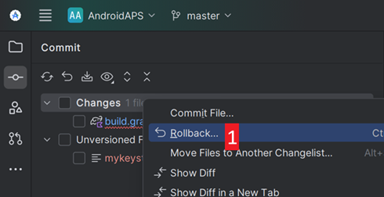

    * Filerne hentes igen fra Git-serveren. Hvis der ikke er andre ændringer i fanen Commit, så gå til [Trin 3](#gradle-resync).

  * Hvis du kan se »Unversioned Files«, har du måske ved en fejl gemt filer i mappen med kildekoden. Det kan være vigtige filer, f.eks. din keystore-fil, som skal flyttes et andet sted hen. Hvis du ikke ved, hvad det er for filer, og du ikke selv har oprettet dem, kan du slette dem.

    * Brug din almindelige stifinder på computeren til at flytte filen (eller klippe og indsætte den) til et sikkert sted.

    * Gå tilbage til Android Studio, og klik på knappen Refresh (4) i fanen Commit for at sikre, at filen ikke længere ligger i **AAPS**-mappen.

      Hvis der ikke er andre ændringer i fanen Commit, så gå til [Trin 3](#gradle-resync).


#### Trin 3: Synkroniser Gradle (igen)

Følg vejledningen under [Gradle Resync](#gradle-resync).

### Git Pull Failed - Please tell me who you are

Hvis du ser denne meddelelse, skal du identificere dig over for Git.

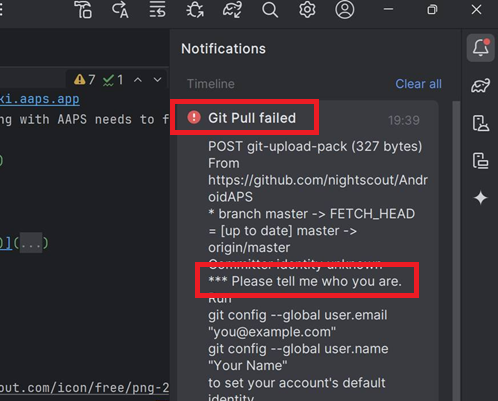

Åbn terminalen, og skriv de følgende to kommandoer, den ene efter den anden.

```
git config --global user.name "Your name here"
git config --global user.email your.email@here.com
```

Dit navn skal skrives mellem anførselstegn.

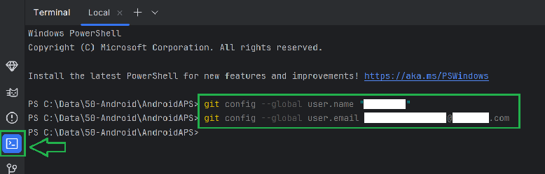

(troubleshooting_androidstudio-android-gradle-plugin-requires-java-11-to-run)=

(incompatible-gradle-jvm)=
### Inkompatibel Gradle JVM

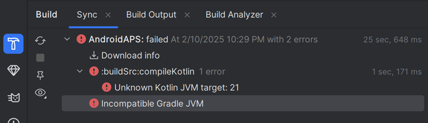

```
Your build is currently configured to use incompatible Java 21.0.3 and Gradle 8.2.
Cannot sync the project.

We recommend upgrading to Gradle version 8.9.

The minimum compatible Gradle version is 8.5.

The maximum compatible Gradle JVM version is 19.
```

Eller:

```
Cause: error: invalid source release: 21
```

Hvis du får fejlmeddelelsen ovenfor, skal du downloade den rigtige JVM-version, før du kan prøve at bygge igen:

1.  Se i [tabellen med krav](#Building-APK-recommended-specification-of-computer-for-building-apk-file), hvilken JVM-version du skal bruge til den **AAPS**-version, du bygger, og skriv den ned.

2. Åbn Gradle-visningen ved at klikke på elefanten (1) i højre side af Android Studio, åbn indstillingerne (2), og vælg **Gradle Settings** (3):


3.  Se i feltet **Gradle JDK**, om den rigtige version er valgt (1). Hvis ikke, så klik på feltet, og se, om den allerede findes på listen. Eksemplet nedenfor viser, at JVM 21 hedder »jbr-21«. Hvis du finder den, så vælg den bare, og så er du færdig. Hvis den ikke findes, så vælg **Download JDK** (2).


4. Vælg under Version (1) den JDK, som din **AAPS**-version kræver (den, du skrev ned, da du så i tabellen med krav). Vælg en hvilken som helst leverandør under Vendor (2). Location (3): skal ikke ændres. Klik på **Download** (4).

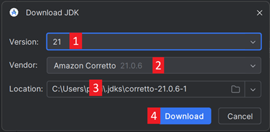

5.  Luk dialogen **Settings** med **OK**.
6. Nu skal du starte Gradle Sync igen. Følg vejledningen under [Gradle Resync](#gradle-resync).

(incompatible-version-of-android-gradle-plugin)=
### Inkompatibel version af Android Gradle plugin

  Hvis du får følgende fejlmeddelelse

`The project is using an incompatible version (AGP x.x.x) of the Android Gradle plugin. Latest supported version is AGP x.x.x`

  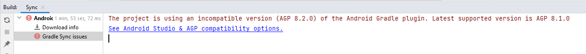

  Du bruger en forældet version af Android Studio. Gå i menuen til Help > Check for updates, og installer alle opdateringer til Android Studio og dets plugins, der bliver fundet.

(troubleshooting_androidstudio-could-not-resolve-no-cached-version)=
### Could not resolve/No cached version

  Du får måske denne fejlmeddelelse:

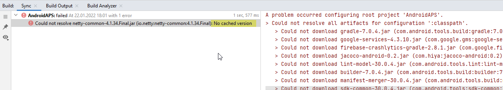

  * Åbn fanen Gradle (1) i højre side.

    Sørg for, at knappen ved (2) *IKKE* er valgt.

    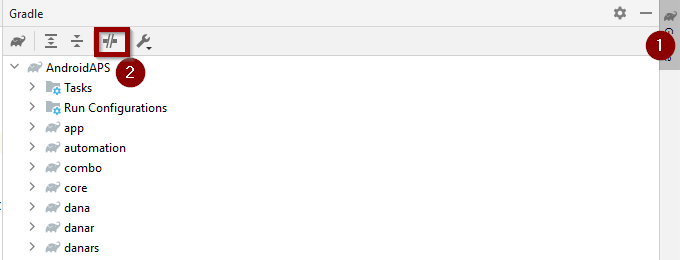

  * Nu skal du starte en [Gradle Resync](#gradle-resync)

(troubleshooting_androidstudio-unable-to-start-daemon-process)=
### Unable to start daemon process

  Hvis du ser en fejlmeddelelse som den nedenfor, bruger du sandsynligvis et 32-bit Windows 10-system. Dette understøttes ikke af Android Studio 3.5.1 og nyere, og desværre kan **AAPS**-udviklerne ikke gøre noget ved det!

  Der findes information på internettet om, hvordan du finder ud af, om du har et 32-bit eller 64-bit styresystem – f.eks. [denne side](https://support.microsoft.com/en-us/windows/32-bit-and-64-bit-windows-frequently-asked-questions-c6ca9541-8dce-4d48-0415-94a3faa2e13d).

  

(gradle-resync)=
### Gradle Resync

  Hvis du stadig kan se meddelelsen om, at Gradle Sync mislykkedes, så vælg nu linket **Try again** (1). 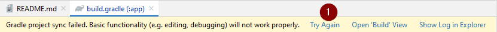


  Hvis du ikke længere ser meddelelsen, kan du stadig starte det manuelt:

  * Åbn fanen Gradle (1) i højre kant af Android Studio.

    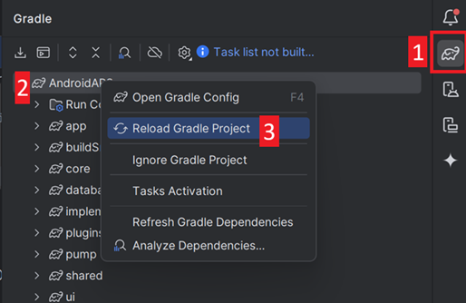

  * Højreklik på AAPS (2)

  * Klik på »Reload Gradle Project« (3)

## Generate Signed APK generated successfully with 0 build variants

Når du bygger den signerede apk, får du måske en notifikation om, at det lykkedes, men at der blev bygget »0 build variants«:

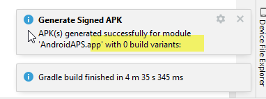

Det er en falsk advarsel. Se i den mappe, du valgte som »Destination folder« (trinnet [Generate Signed APK](#Building-APK-generate-signed-apk)), så finder du den byggede apk der!


## Appen blev bygget med compiler-/kotlin-advarsler

Hvis dit build blev gennemført, men du får compiler- eller kotlin-advarsler (vist med et gult eller blåt udråbstegn), kan du bare ignorere disse advarsler.

 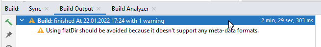

Din apk blev bygget, og den kan nu overføres til din telefon!


## AAPS modtager ingen CGM-data

* Hvis du bruger den patchede Dexcom G6-app: den app er forældet. Brug i stedet appen [BYODA](#DexcomG6-if-using-g6-with-build-your-own-dexcom-app).

* Hvis du bruger xDrip: identificer modtageren som beskrevet på siden [xDrip-indstillinger](#xdrip-identify-receiver).


## Apk ikke installeret

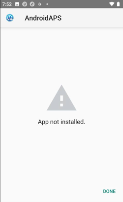

* Sørg for, at du har overført filen »app-full-release.apk« til din telefon.
* Denne fejl betyder normalt, at den nye apk er signeret med et andet keystore end din installerede **AAPS**. Hvis du stadig har dit tidligere keystore, så vælg det, og byg igen. Ellers se [Geninstallation af AAPS med et nyt keystore](#reinstall-aaps).
* Hvis din telefon viser »Appen blev ikke installeret«, skal du følge disse trin:

1. [Eksporter indstillinger](../Maintenance/ExportImportSettings.md) (i den AAPS-version, der allerede er installeret på din telefon)
2. Afinstaller **AAPS** på din telefon.
3. Slå flytilstand til, og slå Bluetooth fra.
4. Installer den nye version (»app-full-release.apk«)
5. [Importer indstillinger](../Maintenance/ExportImportSettings.md)
6. Slå Bluetooth til igen, og slå flytilstand fra

## Apk installeret, men gammel version

Hvis du har bygget appen, overført den til din telefon og installeret den, men versionsnummeret er det samme, har du måske glemt at [opdatere din lokale kopi](#Update-to-new-version-update-your-local-copy)

## Intet af ovenstående virkede

Hvis ingen af tipsene ovenfor hjalp, kan du overveje at bygge apk'en helt forfra:

1. [Eksporter indstillinger](../Maintenance/ExportImportSettings.md) (i den AAPS-version, der allerede er installeret på din telefon)

2. Hav din nøgleadgangskode og din keystore-adgangskode klar.

    Eller brug bare et nyt keystore.

3. Byg apk'en helt forfra som beskrevet [her](#Building-APK-download-AAPS-code).

4. Når du har bygget apk'en, så slet den eksisterende apk på din telefon, overfør den nye apk til telefonen, og installer den.
5. [Importer indstillinger](../Maintenance/ExportImportSettings.md) igen for at gendanne dine læringsmål og indstillinger.
6. Kontroller dine indstillinger for batterioptimering, og deaktiver dem igen.

## Det værst tænkelige tilfælde

Hvis ovenstående ikke løser dit byggeproblem, kan du prøve at afinstallere Android Studio helt og bygge forfra.  Nogle brugere oplever, at det kan løse deres byggeproblem.  Når du sletter Android Studio, så slet ikke Android-brugerindstillingerne, og **sørg for at afinstallere alle filer, der hører til Android Studio.** Hvis du ikke fjerner Android Studio helt med alle skjulte filer, kan afinstallationen skabe nye problemer i stedet for at løse dem, du har. Vejledninger til fuldstændig afinstallation kan findes online, f.eks.

[https://stackoverflow.com/questions/39953495/how-to-completely-uninstall-android-studio-from-windowsv10](https://stackoverflow.com/questions/39953495/how-to-completely-uninstall-android-studio-from-windowsv10).

Installer Android Studio helt forfra som beskrevet [her](#Building-APK-install-android-studio).
