# Oprettelse og gendannelse af sikkerhedskopier

Når du installerer AAPS på din telefon, bliver den til et »medicinsk udstyr«, som du er afhængig af hver dag. Det anbefales stærkt at have en nødplan for sikkerhedskopiering, hvis din telefon går i stykker, bliver stjålet eller bliver væk. Derfor er det vigtigt at forberede sig ved at spørge sig selv: »Hvad nu hvis?«

For at kunne gendanne din AAPS-opsætning på en eksisterende eller ny telefon er det vigtigt at opbevare følgende ting et sikkert sted (dvs. ikke på din telefon). Det er bedst at have mindst to adskilte sikkerhedskopier: på en lokal harddisk, et USB-stik og (helst) i en skytjeneste som Google Drive eller Microsoft 365 OneDrive. Når du gemmer dine sikkerhedskopier i skyen, kan du altid nå alt, hvad du skal bruge, fra din telefon og gendanne din opsætning hvor og når som helst.

Overvej at anskaffe en ekstra reservetelefon og at øve dig i at gendanne AAPS, så du ved, at reservetelefonen virker som forventet. Dette trin giver dig sikkerhed for, at din nødplan virker, og at du kan fortsætte med AAPS uden problemer, hvis din primære telefon ikke længere kan bruges.

```{admonition} Android backups and phone-transfer tools do not carry your AAPS settings
:class: warning
Siden **AAPS** 4.0 gemmes indstillingerne krypteret på telefonen, og de kommer ikke med i Googles sikkerhedskopi eller i overførslen fra telefon til telefon, når du får en ny telefon. En eksport af indstillingerne, som beskrevet på denne side, er den eneste måde at flytte dem på.
```

For at kunne gendanne er det vigtigt at have følgende ting ved hånden:

- Din **Android Studio keystore-fil** og den tilhørende **adgangskode**: Skal bruges til at bygge AAPS-installationsfilen (.APK) (igen).
- En nylig kopi af **AAPS-installationsfilen (.APK)**
- En nylig fil med **eksporterede indstillinger**: Til at gendanne vigtige indstillinger (som også omfatter dine læringsmål!).
- Din **AAPS-hovedadgangskode**
- Sikkerhedskopier af andre hjælpeapps: f.eks. BYODA og/eller xDrip.
- Dine egne notater om din opsætning.

Nedenfor er de ting, som det anbefales at have sikkerhedskopier af.

## Oprettelse af sikkerhedskopier

### Keystore-fil fra den computer, du brugte til at bygge APK'en
Når du bygger din installationsfil (.APK) i Android Studio, bruges **keystore-filen og adgangskoden til at signere installationsfilen (.APK)**. For at opdatere din nuværende AAPS-installation skal installationsfilen (.APK) til opdateringen signeres med det samme keystore, som blev brugt til den første installation. Når du opdaterer, beholdes alle indstillinger og AAPS-databasen. Bemærk, at du uden dette først skal afinstallere den nuværende app og derefter [geninstallere](#reinstall-aaps) og konfigurere AAPS igen.

Hvis du gemmer dit keystore og den tilhørende adgangskode, bliver det meget lettere at opdatere APK'en senere, især hvis du skal bygge appen på en ny computer. Se afsnittet [Opdatering til en ny version eller gren](../Maintenance/UpdateToNewVersion.md) for at få flere oplysninger om, hvordan du bruger dit keystore, når du bygger en ny APK.

**Hvornår skal du sikkerhedskopiere:** Dit keystore skal sikkerhedskopieres, når du har bygget installationsfilen (.APK) til **AAPS** første gang.

**Sådan sikkerhedskopierer du:** Find stien til dit keystore. Hvis du ikke kan huske den, kan du finde den i Android Studio ved at vælge **Build > APK > Next**. Stien står under »Key store path«. Gå til denne sti med din filhåndtering, og lav en kopi af din keystore-fil (med filtypen `.jks`). Gem den et sikkert sted i skyen, hvis din computer ikke længere kan bruges. Husk også at skrive din keystore-adgangskode, dit nøglealias og din nøgleadgangskode ned.

### Kopier af den nyeste APK
Hvis din primære **AAPS**-telefon bliver væk eller går i stykker, kan du med en kopi af APK'en hurtigt komme i gang med **AAPS** igen på en ny telefon. Bemærk: Du skal også have sikkerhedskopieret dine indstillinger som beskrevet nedenfor.

**Hvornår skal du sikkerhedskopiere:** Du bør have en sikkerhedskopi af den nyeste APK, som du har installeret på din primære **AAPS**-telefon. Du kan også gemme en tidligere version, hvis du af en eller anden grund får brug for at gå tilbage til den.

**Sådan sikkerhedskopierer du:** Gem en kopi på den computer, du brugte til at bygge APK'en med Android Studio. Det anbefales også at bruge en skytjeneste til at gemme en kopi af installationsfilen (APK). Sørg for, at du ved, hvor du finder begge sikkerhedskopier, når du får brug for dem. Overvej at oprette særlige mapper til disse sikkerhedskopier.

### AAPS-indstillingsfil (også kaldet »Preferences«)

```{admonition} Where are preferences stored on my phone?
:class: tip
Du finder dine indstillinger i den **AAPS-mappe**, som du valgte i [AAPS-opsætningsguiden](#SetupWizard-StoragePermission).</br>
Du kan også ændre **AAPS-mappen** på skærmen **Vedligeholdelse** (**menu** (☰) > **Vedligeholdelse**), se [Indstilling af den lokale AAPS-mappe](#preferences-maintenance-logdirectory).
```

Med en kopi af installationsfilen (APK) (se ovenfor) og din **Indstillinger**-fil kan du hurtigt komme i gang på en eksisterende eller ny telefon.

Filen **Indstillinger** bruges til at tilpasse AAPS-appen til netop din opsætning. De omfatter f.eks. dine indstillinger i **Konfiguration**, status for læringsmål, indstillinger for kommunikation med andre tjenester (f.eks. Nightscout, Tidepool), automatiseringer og profiler.

Når du eksporterer AAPS-indstillingerne til en fil, kan du gendanne konfigurationen, som den var på et bestemt tidspunkt. Som nævnt indeholder eksportfilen ud over alle konfigurationsindstillinger også status for dine læringsmål, som du skal gendanne, når du **(gen)installerer** AAPS. Uden den skal du gennemføre alle læringsmål forfra for at kunne aktivere lukket loop. Med indstillingsfiler kan du også gendanne de »sidst kendte gode« indstillinger for at fortryde ændringer i konfigurationen.

**Hvornår skal du sikkerhedskopiere AAPS-indstillingerne:**
* Hver gang du gennemfører et læringsmål, så du ikke mister dine fremskridt. _Uden en kopi af dine **Indstillinger** skal du gennemføre alle læringsmål igen, hvis du får brug for at geninstallere AAPS eller skifte telefon._

* Hver gang du har tænkt dig at lave større ændringer i din konfiguration (ændre SMB-indstillinger, skifte insulintype, skifte pumpe, ændre automatiseringer), bør du sikkerhedskopiere dine **Indstillinger** før og efter ændringerne. På den måde har du både dine nyeste indstillinger og en kopi af dem fra før ændringerne, hvis du får brug for at gå tilbage til dem.

* Kun for brugere af slangeløse pumper (f.eks. Omnipod og Medtrum): Filen **Indstillinger** indeholder forbindelsesoplysninger om din nuværende pod og kan bruges til at genoprette forbindelsen til den pod med en ny telefon. Hvis du ikke har en kopi af dine indstillinger, som er eksporteret efter at du startede din nuværende pod, skal du starte en ny pod, hvis du får brug for at skifte din nuværende telefon ud.

**Sådan sikkerhedskopierer du manuelt:**

1. Hvis det er første gang, du importerer eller eksporterer **Indstillinger**, skal du vælge en hovedadgangskode i [Indstillinger > Beskyttelse](#Preferences-master-password). Vælg en adgangskode, og skriv den ned et sikkert sted. _Du kan ikke få adgang til sikkerhedskopierne af dine **Indstillinger** uden denne adgangskode._

2. Åbn **menuen** (☰) > **Vedligeholdelse** fra hovedskærmen i **AAPS**. Vælg, hvor filen skal gemmes, med knapperne **Lokal** og **Sky** ved siden af **Eksporter indstillinger** (se **Eksport eller import af indstillinger** nedenfor), og tryk derefter på **Eksporter indstillinger**. **AAPS** viser, hvor filen bliver gemt: filnavnet for **Lokal**, **Google Drive** for **Sky**. Tryk på **OK**.

   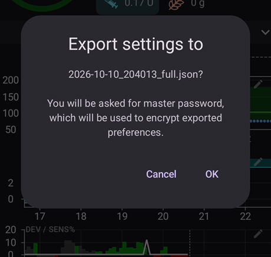

   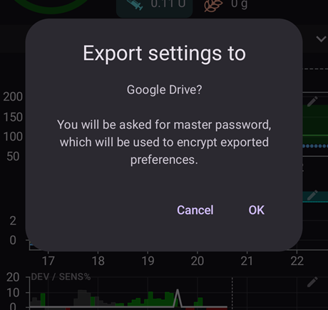

   Skriv den hovedadgangskode, du valgte ovenfor, og tryk på **OK**.

   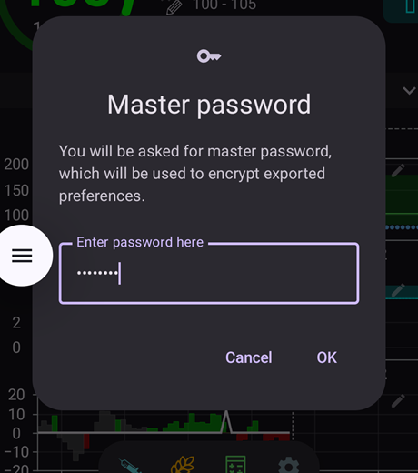

   **Indstillinger eksporteret** (lokal) eller **Eksport til skyen lykkedes** (sky) bekræfter eksporten.

   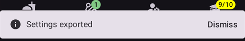

   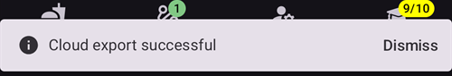

3. Gå med filhåndteringen på din telefon (som regel kaldet »Filer« eller »Mine filer«) til Intern lagerplads > AAPS > preferences. Her ser du en kopi af alle eksporterede indstillingsfiler. Filnavnet skal være `YYYY-MM-DD_Time_appname.json`. Upload denne fil til den skytjeneste, du har valgt. Download derefter også en kopi fra skytjenesten til din computer.

(ExportImportSettings-Settings-Export)=

## Eksport af indstillinger

```{admonition} Where are preferences stored on my phone?
:class: tip
Du finder dine indstillinger i den **AAPS-mappe**, som du valgte i [AAPS-opsætningsguiden](#SetupWizard-StoragePermission).</br>
Du kan også ændre **AAPS-mappen** på skærmen **Vedligeholdelse** (**menu** (☰) > **Vedligeholdelse**), se [Indstilling af den lokale AAPS-mappe](#preferences-maintenance-logdirectory).
```

Det anbefales at eksportere indstillingerne jævnligt, især før og efter ændringer i konfigurationen. Du kan vælge at eksportere **manuelt eller (helst) via automatisering**. Sørg for at skrive din AAPS-hovedadgangskode ned og for at sikkerhedskopiere dine indstillingsfiler ved at kopiere dem fra din telefon til f.eks. en skytjeneste.

**Bemærk**: _De eksporterede indstillinger krypteres med din AAPS-hovedadgangskode: uden den hovedadgangskode, der blev brugt ved eksporten, kan du ikke importere indstillingsfilen!_

Hvis du har glemt din hovedadgangskode, kan du [nulstille den](#FAQ-reset-master-password), men indstillingsfiler, der er eksporteret med den gamle adgangskode, kræver stadig den gamle.

### Eksport eller import af indstillinger
For at eksportere eller importere indstillinger skal du åbne **menuen** (☰) og vælge **Vedligeholdelse**. Under **Filhåndtering** vælger du med knapperne **Lokal** og **Sky** ved siden af **Eksporter indstillinger** og **Importer indstillinger**, hvor indstillingsfilen gemmes eller læses fra: **Lokal** er AAPS-mappen på din telefon, **Sky** kan bruges, når en [Skymappe](#preferences-maintenance-cloud) er sat op. Et tryk på en knap slår den til eller fra; mindst én er altid valgt, og begge rækker bruger det samme valg. Tryk derefter på selve **Eksporter indstillinger** eller **Importer indstillinger** for at starte.

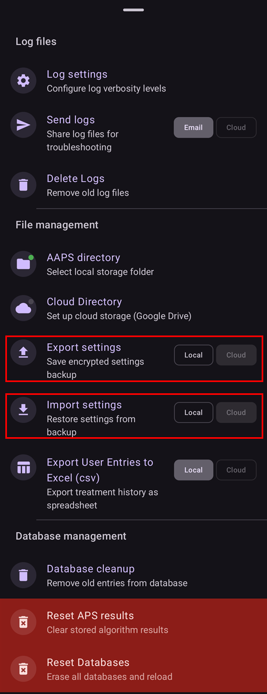

(ExportImportSettings-Automating-Settings-Export)=
### Automatisk eksport af indstillinger

For at automatisere eksporten af indstillinger [(**se Automatisering**)](../DailyLifeWithAaps/Automations.md#automating-preference-settings-export) skal du åbne [**Indstillinger** > **Vedligeholdelse**](#preferences-maintenance-settings), udvide **Automatisk eksport af indstillinger** og slå **Aktiver automatisk eksport af indstillinger** til.

Du kan nu sætte [Automatisering](../DailyLifeWithAaps/Automations.md#automating-preference-settings-export) op til at eksportere indstillinger, enten jævnligt (_f.eks._ hver uge) eller efter et podskift.

_**Bemærk:** Når du importerer indstillinger, skal du altid indtaste AAPS-hovedadgangskoden!_

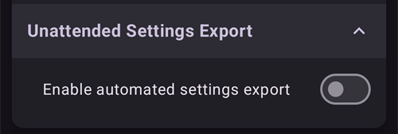

(ExportImportSettings-restoring-from-your-backups-on-a-new-phone-or-fresh-installation-of-aaps)=
## Gendannelse fra dine sikkerhedskopier på en ny telefon eller en ny installation af AAPS

```{admonition} Where are preferences stored on my phone?
:class: tip
Du finder dine indstillinger i den **AAPS-mappe**, som du valgte i [AAPS-opsætningsguiden](#SetupWizard-StoragePermission).</br>
Du kan også ændre **AAPS-mappen** på skærmen **Vedligeholdelse** (**menu** (☰) > **Vedligeholdelse**), se [Indstilling af den lokale AAPS-mappe](#preferences-maintenance-logdirectory).</br>
Hvis **AAPS** mister adgangen til mappen (det kan ske efter en geninstallation, eller når appens lager er ryddet), viser den notifikationen **Adgangen til AAPS-mappen er mistet** og holder op med at gemme indstillinger på telefonen, indtil du [vælger mappen igen](#preferences-maintenance-logdirectory).
```

Brug denne vejledning, hvis du har en sikkerhedskopi af din APK og dine **Indstillinger**, som du vil indlæse på en ny telefon, eller hvis du af en eller anden grund har måttet slette og geninstallere APK'en på din nuværende telefon.

_Hvis du opdaterer **AAPS** med en APK, der er bygget med det samme keystore, behøver du ikke at følge denne fremgangsmåde. Det anbefales dog stadig at lave en sikkerhedskopi, før du installerer opdateringen._

Hvis du opdaterer **AAPS**, efter at du har mistet eller udskiftet dit oprindelige keystore (f.eks. fordi du bruger en ny computer til at bygge uden at have flyttet dit keystore), skal du først sikkerhedskopiere alle indstillinger som beskrevet ovenfor og derefter afinstallere den nuværende version af **AAPS** på din telefon. Se [Geninstallation af AAPS med et nyt keystore](#reinstall-aaps) for hele fremgangsmåden.

Hvis det er nødvendigt, så [sæt din CGM-/BS-kilde-modtager op](../Getting-Started/CompatiblesCgms.md), før du følger trinene nedenfor

(ExportImportSettings-tubeless-pumps)=
```{admonition} Tubeless pumps (Omnipod and Medtrum) users
:class: warning
Filen **Indstillinger** indeholder sessionen for den pod eller patch, der var aktiv, da du eksporterede den.
- **Eksporter lige efter hver aktivering af en pod eller patch**, og kopier filen væk fra din telefon.
- **Samme telefon, poden kører stadig:** Lad **Erstat også pumpeindstillinger** være uden flueben. Din nuværende pod beholdes, og kun de andre indstillinger importeres.
- **Ny telefon overtager poden:** Sæt flueben ved **Erstat også pumpeindstillinger**, og brug kun en fil, der er eksporteret under den pod, du har på nu. En fil fra en tidligere pod erstatter din nuværende pod-session, og så skal du starte en ny pod.
- **En gammel pod-session blev importeret ved en fejl:** **AAPS** bliver ved med at prøve at nå den pod, og du kan ikke aktivere en ny. Deaktiver den; hvis det ikke lykkes, så kasser den (se f.eks. [Kassering af en pod](#omnipod-dash-discard-pod) for Omnipod DASH).
```

```{admonition} Pump settings are kept unless you say otherwise
:class: note
Som standard lader en import dine pumpeindstillinger være: den pumpe, der er valgt i **Konfiguration**, dens parring og alle dens andre indstillinger forbliver, som de er på denne telefon. Sæt kun flueben ved **Erstat også pumpeindstillinger** på importskærmen, når du gendanner på en ny telefon, der skal overtage den samme pumpe. Indstillinger, som ikke er i filen, bliver aldrig slettet af en import.
```

1. Brug sikkerhedskopien af din APK fra ovenfor, og følg vejledningen til en [ny installation](../SettingUpAaps/TransferringAndInstallingAaps.md)

2. Start **AAPS**, og giv alle de tilladelser, appen beder om

3. Afslut opsætningsguiden. Vi importerer alle de nødvendige indstillinger fra sikkerhedskopien af **Indstillinger**

4. Tryk på **Tillad** på hovedskærmen i **AAPS**, og giv alle de tilladelser, der står i panelet **Tilladelser påkrævet** øverst

5. Sæt hovedadgangskoden fra hovedskærmen i **AAPS** i [Indstillinger > Beskyttelse](#Preferences-master-password) til den samme adgangskode, som du brugte til dine sikkerhedskopier.

6. Hvis du ikke har gjort det endnu, så [vælg **AAPS-mappe**](#preferences-maintenance-logdirectory): Åbn **menuen** (☰) > **Vedligeholdelse** > **AAPS-mappe** fra hovedskærmen i **AAPS**.

7. Åbn **menuen** (☰) > **Vedligeholdelse** > **Eksporter indstillinger** > skriv den hovedadgangskode, du valgte ovenfor > **OK** fra hovedskærmen i **AAPS**. Dette opretter mappen preferences, hvis den ikke allerede findes på din telefon.

8. Download sikkerhedskopien af din **Indstillinger**-fil fra din skytjeneste.

9. Brug din filhåndtering (som regel kaldet »Filer« eller »Mine filer«) til at flytte filen fra dine downloads til `/internal storage/AAPS/preferences`, hvis din **AAPS-mappe** er sat til `/internal storage/AAPS`

10. Åbn **menuen** (☰) > **Vedligeholdelse** fra hovedskærmen i **AAPS**, og tryk på **Importer indstillinger**. Vælg den indstillingsfil, du vil gendanne fra (den nyeste står øverst). Sørg for at vælge den rigtige indstillingsfil: alle .json-filer fra mappen preferences (eller fra skymappen, med **Sky**) vises.

    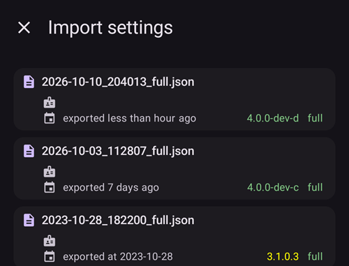

    **AAPS** viser oplysninger om filen. Skriv den hovedadgangskode, du valgte ovenfor, og tryk på **Dekrypter og gennemse**.

11. Når filen er dekrypteret, skal du beslutte, hvad der skal ske med pumpeindstillingerne. På en ny telefon, der overtager den samme pumpe, sætter du flueben ved **Erstat også pumpeindstillinger**, så parringen og pumpeindstillingerne kommer fra filen. Lad feltet være uden flueben for at beholde den pumpe, som denne telefon allerede er parret med. Tryk derefter på **Importer**.

    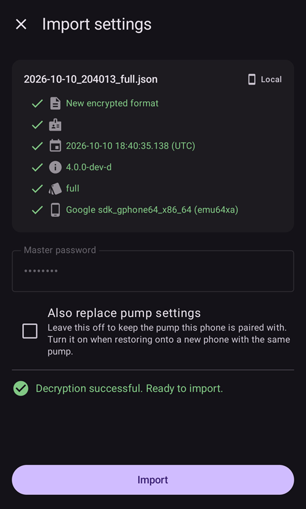

12. **AAPS** spørger **Anvend importerede indstillinger?** og fortæller dig, hvor mange indstillinger der ændres, og, hvis du lod feltet være uden flueben, hvor mange pumpeindstillinger der beholdes. Der er ikke skrevet noget endnu, så **Annuller** lader din telefon være præcis, som den var. Tryk på **OK** for at anvende dem.

    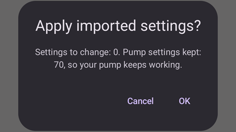

13. **AAPS** anvender de importerede indstillinger med det samme, uden genstart. Kun de plugins, hvis indstillinger er ændret, bliver genstartet. Mens det sker, viser **AAPS** **Anvender indstillinger…**; hvis pumpen er optaget, viser den **Venter på pumpen…** og anvender indstillingerne, når pumpen er ledig. Hvis pumpen stadig er optaget efter et minut, tilbyder **AAPS** at prøve igen. Meddelelsen **Indstillinger anvendt** bekræfter, at de importerede indstillinger er i brug. En behandling, som du havde sat i kø, mens importen kørte, bliver droppet, og **AAPS** fortæller dig, at den blev annulleret, så intet sendes to gange til pumpen.

    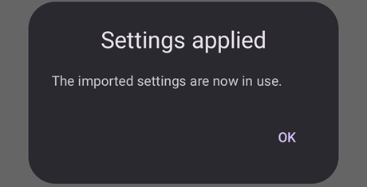

Hvis filen valgte en pumpe, som denne version af **AAPS** ikke har, skifter **AAPS** til **Virtuel pumpe** og fortæller dig det. Vælg din pumpe igen i **Konfiguration**, og kontroller dens indstillinger.

14. Kun for brugere af slangeløse pumper (Omnipod og Medtrum) - hvis du satte flueben ved **Erstat også pumpeindstillinger**, og dine **Indstillinger** ikke blev sikkerhedskopieret fra den samme pod, som du bruger nu, skal du starte en ny pod for at begynde insulintilførslen.

**Fejlfinding:** Hvis du ikke kan få en aktiv profil fra hovedskærmen i **AAPS**, så åbn **menuen** (☰) øverst til venstre > **Konfiguration** > **Pumpe** > skift til **Virtuel pumpe** > skift derefter tilbage til din pumpetype

### Bemærkning til brugere af Dana RS

- Hvis du satte flueben ved **Erstat også pumpeindstillinger**, importeres pumpens forbindelsesindstillinger også: **AAPS** på din nye telefon »kender« allerede pumpen og starter derfor ikke en Bluetooth-søgning.
- Par den nye telefon og pumpen manuelt.