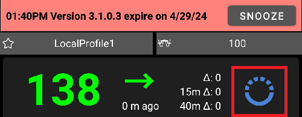
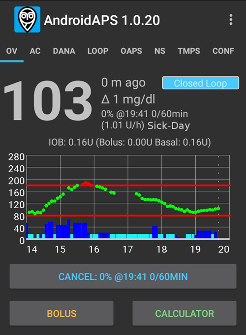

# Udgivelsesnoter

```{toctree}
:hidden:

Update2_7.md
Update3_0.md
UpdateAaps3204.md
```

Følg instruktionerne i [opdateringsvejledningen](UpdateToNewVersion.md) for at opdatere til en ny version. Afsnittet om fejlfinding på siden med opdateringsvejledningen beskriver også de mest almindelige problemer, når du opdaterer **AAPS**.

```{admonition} Upgrading from AAPS v3?
:class: tip
Se [Hvad er ændret i AAPS v4](V4Changes.md) for de vigtige ændringer i adfærd – funktioner, der er flyttet, omdøbt eller fjernet.
```

Du får en notifikation som denne, når en ny opdatering er tilgængelig:



Hvis du ikke opdaterer inden udløbsdatoen, skifter **AAPS** til åbent loop.

Se [Ophør af support](EndOfLife.md) for slutdatoer for AAPS-versioner.

**Ignorer ikke notifikationen.** Nye versioner af **AAPS** indeholder vigtige sikkerhedsrettelser. Derfor skal alle brugere af **AAPS** opdatere til den nyeste version så hurtigt som muligt. Dette er et forsøg på at forbedre sikkerheden for hver **AAPS**-bruger og for DIY-fællesskabet. Tak for din forståelse.

(maintenance-android-version-aaps-version)=

## Android-version og AAPS-version

Hvis din smartphone bruger en Android-version, der er ældre end Android 12, kan du ikke bruge AAPS v3.4 og nyere, da den kræver mindst Android 12.

For at brugere med ældre Android kan bruge ældre versioner af AAPS, er der udgivet nye versioner, som kun ændrer kontrollen af versionen. Der er ingen andre forbedringer med.

Find din Android-version i tabellen nedenfor, og brug den tilsvarende version af **AAPS**. Koden downloades fra <https://github.com/nightscout/AndroidAPS> med den viste gren.

| Din Android-version | AAPS-version, du skal bruge | Gren, du skal downloade                                          |
| ------------------- | --------------------------- | ---------------------------------------------------------------- |
| Android 12 og nyere | Nyeste version              | [master](https://github.com/nightscout/AndroidAPS) (standard)    |
| Android 11          | **3.3.2.1**                 | [3.3.2.1](https://github.com/nightscout/AndroidAPS/tree/3.3.2.1) |
| Android 9, 10       | **3.2.0.4**                 | [3.2.0.4](https://github.com/nightscout/AndroidAPS/tree/3.2.0.4) |
| Android 8           | **2.8.2.1**                 | [2.8.2.1](https://github.com/nightscout/AndroidAPS/tree/2.8.2.1) |
| Android 7           | **2.6.2**                   | [2.6.2](https://github.com/nightscout/AndroidAPS/tree/2.6.2)     |

## WearOS-version

- AAPS kræver WearOS 3.0, 3.2 eller 3.5 (Android 11, API-niveau 30) eller nyere. Ure med WearOS 2 understøttes ikke.

```{tip}
WearOS 5, API-niveau 34 (Android 14) har [begrænsninger](#BuildingAapsWearOs-WearOS5).
```

Versioner med en overskrift er den nyeste udgivelse for hver Android-version (se tabellen ovenfor). De andre udgivelser følger imellem, med deres noter eller et link til dem på GitHub.

(latestrelease)=

(version400)=

## Version 4.0.0

Udgivelsesdato: 31-10-2026

**Nye funktioner**

- Ny brugerflade: telefonappen er bygget om i Jetpack Compose @MilosKozak
- [Global søgning](../DailyLifeWithAaps/GlobalSearch.md) @MilosKozak
- Overgang til Kotlin Multiplatform, klient til Windows, Mac, Linux desktop og iOS @MilosKozak
- [Scener](../DailyLifeWithAaps/Scenes.md): gem et sæt handlinger, og kør dem sammen @MilosKozak
- [Styring mellem hovedenhed ↔ klient](../RemoteFeatures/ClientMasterControl.md): send kommandoer fra en klienttelefon til hovedenheden @MilosKozak
  - [Klientroller](#client-master-control-roles): Skrivebeskyttet, Måltider, Omsorgsperson eller Admin for hver klient @MilosKozak
  - [Hærdet tilstand](#client-master-control-hardened-mode): når klientstyring er slået til, tager hovedenheden kun imod ændringer fra parrede klienter @MilosKozak
  - Parring med en QR-kode, der også opsætter Nightscout på klienten, eller med en PIN; parringshemmeligheden udskiftes lige efter parringen @MilosKozak
  - [Eget Nightscout-token](#client-master-control-own-token) for hver klient, med kun de rettigheder, en klient har brug for @MilosKozak
- Understøttelse af [insulinkoncentration](../AdvancedOptions/InsulinConcentration.md) (U200, U500) i pumper, beregner og profiler @Philoul @MilosKozak
- Håndtering af insulin: insulinkatalog, kaldenavne, valg i profil og beregner @Philoul
- Kalibrerings-plugin @MilosKozak
- [Udjævning](../CompatibleCgms/SmoothingBloodGlucoseData.md): Unscented Kalman Filter (UKF) @piecycle
- Nye [automatiseringshandlinger](#automations-automation-action): **Skift udjævning** @olorinmaia, og **Kør scene**, **Aktiver scene** eller **Deaktiver scene** @MilosKozak
- [Rotation af indstikssteder](#Aapsscreens-site-rotation): hold styr på og skift mellem indstikssteder @Philoul @MilosKozak
- [Autotune](../AdvancedOptions/Autotune.md) lavet om @Philoul
- Nye [widgets](../DailyLifeWithAaps/Widgets.md) @MilosKozak @t1dude
- Tilgængelighed: telefonappen virker med en skærmlæser – navngivne knapper, oplæst status, beskrivelser af grafer og overskrifter, så du hurtigt kan skimme @MilosKozak
- [Import af indstillinger](../Maintenance/ExportImportSettings.md): kan beholde pumpeindstillingerne @MilosKozak
- Den faste notifikation bruger Android live-opdateringer, med understøttelse af Samsung Now bar og delta @premnirmal
- BS-graf: [tryk og hold](#aaps-screens-graph-press-and-hold) for at se værdierne ved en måling, på alle grafer i oversigten @t1dude @olorinmaia
- Forbedret ydeevne @MilosKozak
- Automatiske e-kulhydrater i bolusberegneren @MilosKozak

**Nye enheder**

- **CareLevo**: ny [pumpedriver](../CompatiblePumps/CareLevo.md) @Kisu-Choi @MilosKozak
- **Dana-i2**: understøttelse @MilosKozak
- **Instara**: ny CGM-kilde @leohunt

**Forbedringer af pumpedrivere**

- Pumpernes oversigtsskærme er bygget om til Insight, Medtronic, Medtrum, Omnipod, Dana, Diaconn og Equil @MilosKozak
- **Omnipod DASH**: referencekoder som på PDM og læsbare fejlbeskrivelser, kompensation for tidsafvigelse altid slået til, bedre rapportering af bolustype @nl-ruud
- **Omnipod**: fast slutdato for Dash & Eros @mcnelson
- **DanaR, RS**: pumpeemulator til test @MilosKozak
- **Equil**: pumpeemulator til test @MilosKozak
- Mange rettelser til pumper og loop @MilosKozak og andre

**Wear OS**

- [Ur-appen](../WearOS/WearOsSmartwatch.md) er bygget om i Compose, nye felter og komplikationer, automatisk installation af urskive (Watch Face Push) på Wear OS 6+ @olorinmaia @Philoul
- CustomWatchface er tilgængelig til WearOS 6.0 (GW7, GW8, GW9...) med en særlig WFF-urskive @Philoul @olorinmaia
- CustomWatchface kan nu have 5 pladser til komplikationer, som du kan tilpasse (ny funktion, kun tilgængelig til ældre ure) @Philoul
- Ny [WFF-urskive baseret på AAPS-komplikationer](#wearos-complications-watchface-setup) @olorinmaia
- Rettelser i resultatet af bolusberegner og hurtigbolus @olorinmaia
- Ny BS-graf og aktivitet for loop-tilstand i hovedmenuen @olorinmaia
- Bolusberegner: side for [måltidstype](#WearOsSmartwatch-wizard-meal-type), der deler kulhydraterne op som beregneren på telefonen, og [kulhydrattid](#WearOsSmartwatch-wizard-carb-time) med påmindelsen *Tid til at spise* på uret @olorinmaia
- [Telefonens alarmer på uret](#WearOsSmartwatch-phone-alarms): uret viser alarmen og tilbyder Slå lyd fra og Lydløs 5 min @olorinmaia

**Build**

- CI-workflows til builds af tags/grene, tilknytning af JDK-versioner @Angus-repo

**Bidragydere**

@MilosKozak @Philoul @olorinmaia @Kisu-Choi @leohunt @piecycle @Angus-repo @mcnelson @t1dude @premnirmal @nl-ruud

Fuld ændringslog: <https://github.com/nightscout/AndroidAPS/compare/3.4.2.6...4.0.0>

---

(version3426)=

## Version 3.4.2.6

- Equil: bedre stabilitet @MilosKozak

---

(version3425)=

**Version 3.4.2.5**

- Equil: rettelse af race condition @MilosKozak

---

(version3424)=

**Version 3.4.2.4**

- Rettelser til Equil @MilosKozak
- Rettelse af synkronisering af profiler med NS @MilosKozak

---

(version3423)=

**Version 3.4.2.3**

- Dash: løsning af tidsafvigelse (drift) @nl-ruud
- NSClientV3: rettelse af hul efter genforbindelse @MilosKozak
- Automatisering: rettelse af deserialisering @MilosKozak
- Equil: rettelse af batterirapport @MilosKozak
- Oprydning i workflow @vanelsberg
- Equil: bedre gendannelse efter fejl @MilosKozak
- DanaRS: rettelse af kommunikation med indenlandske pumper @MilosKozak
- Insight: rettelse af TBR-synkronisering @MilosKozak
- Dash: rettelse af fejl ved aktivering @nl-ruud

---

(version3422)=

**Version 3.4.2.2**

- Rettelse af problemer med Equil og Medtronic
- Bedre sikkerhed for Medtrum

---

(version3421)=

**Version 3.4.2.1**

- Equil: rettelse af parring og statusdialog @MilosKozak

---

(version3420)=

**Version 3.4.2.0**

Udgivelsesdato: 02-04-2026

- Equil: rettelse af modstand for forskellige modeller @hhfcvmars
- Tidepool: rettelse af session @MilosKozak
- Medtrum: rettelse af aktiveringen ved at forhindre dobbelt påfyldning @MilosKozak
- COB: rettelse af COB-beregning (dækker et farligt grænsetilfælde) @MilosKozak

---

(version3410)=

**Version 3.4.1.0**

Udgivelsesdato: 08-03-2026

**Kerne**

- Rettelse af håndtering af sommertid @MilosKozak
- Bedre og ens genkendelse af normalt mål (mgdl > 99, mmol > 5,5) @MilosKozak
- SMS: beskyt RESTART med PIN @MilosKozak
- Vedligeholdelse: advarsel, hvis der er valgt en forkert mappe @MilosKozak

**Forbedringer af pumpedrivere**

- **Omnipod DASH**: BLE-driverkoden er flyttet til modulet omnipod/common @jwoglom
- **Omnipod DASH**: forsøg på at rette forbindelsestilstanden @MilosKozak
- **Omnipod**: kontrol af profil før aktivering af pod, så pods ikke spildes (#4534) @brianV
- **Medtronic**: rettelse af samme kodningstype vist i dialogen for indstillinger @mifi100
- **Medtronic**: forberedelse af fælles pumpeklasser (forberedelse til Tandem) @andy-rozman
- **RileyLink**: rettelse af kodning (#4519) @mifi100
- **Equil**: flere kompatible insulinpumper efter præfiks i serienummeret (#4510) @hhfcvmars
- **Equil**: tilføjet logning @MilosKozak
- **Diaconn G8**: rettelse af fejl i synkronisering af log og understøttelse af firmware 3.58+ @miyeongkim
- **Diaconn**: rettelse af omregning af enhed for TBR-varighed @miyeongkim
- **Diaconn**: brug commandQueue.loadEvents() til synkronisering af historik @miyeongkim
- Tillad insulintilførsel, når loopet er suspenderet, men pumpen er tilgængelig @cschuijt

**Sky / sikkerhedskopi**

- Tilføjet sikkerhedskopi til Google Drive @Angus-repo
- Giv besked i brugerfladen, når fejltilstanden for skylager ændres @Angus-repo
- Tillad både lokalt lager og skylager på samme tid @Angus-repo

**Tidepool**

- Bedre overgang til Tidepool OAuth2 @MilosKozak
- Rettelse af Tidepool-tilstanden BLOCKED, der ikke ophørte, rettelse af afvisning af tomme SSID'er @michaeln-synapse

**NSClient**

- NSCv3: bedre genforbindelse @MilosKozak

**Wear OS**

- Vis ny IOB i resultatet af beregneren, hvis IOB bruges i beregningerne @olorinmaia
- Rettelse af Wear BolusProgress med samlet mængde @Philoul

**Brugerflade**

- Bedre ikon ic_none til rotation af indstikssteder @Philoul
- Rettelse af, at pumpeindstillingen for rotation af indstikssteder ikke blev brugt @samfundev

**Bidragydere**

@MilosKozak @Philoul @olorinmaia @jwoglom @mifi100 @andy-rozman @Angus-repo @brianV @cschuijt @hhfcvmars @miyeongkim @samfundev @michaeln-synapse

---

(version3400)=

**Version 3.4.0.0**

Udgivelsesdato: 31-12-2025

**Før du opgraderer:**

* Denne version kræver Google Android 12.0 eller nyere. Kontroller din telefons version, før du forsøger at opdatere.
* Opdater til den nyeste Android Studio, eller endnu bedre: brug build i browseren.

**Nye funktioner**

* Loop-tilstand @MilosKozak
  * Vis [historik for loop-status](#AapsScreens-running-mode) i fanerne for behandlinger
  * Vis og tillad ændring af [loop-status fra AAPSClient](#RemoteControl_aapsclient).<br>NB: kræver indstillingen [NSClient > Synkronisering > Modtag loop-tilstand fra NS](#Preferences-nsclient-synchronization)
* [Nye CGM'er](../Getting-Started/CompatiblesCgms.md): Glunovo, Intelligo, Sinocare
* Understøttelse af [rotation af indstikssteder](#Aapsscreens-site-rotation) @Philoul
* Ny [automatiseringshandling](#automations-automation-action): aktiver eller deaktiver SMB @MilosKozak
* Syai CGM er en [pålidelig kilde](#GettingStarted-TrustedBGSource) og understøtter avanceret filtrering @MilosKozak

**Forbedringer til Wear OS**

* markant lavere batteriforbrug @MilosKozak
* forbedringer og rettelser i brugerfladen @olorinmaia
* næsten helt omskrevet kode, så den passer til de nuværende biblioteker (før WearOS 2) @MilosKozak
* 2 nye komplikationer til udvidede data @Philoul
* Overgang til moderne komplikationsudbyder med DataStore @MilosKozak

**Rettelser af hukommelseslæk**

* Rettet hukommelseslæk i koden @MilosKozak
* Tilføjet rapportering af hukommelseslæk med LeakCanary til Firebase Crashlytics @MilosKozak

**Forbedringer af pumpedrivere**

* **DanaI**: rettet problemer med afbrudt forbindelse @MilosKozak
* **RileyLink**: hurtigere kommunikation ved at gøre forsinkelser så korte som muligt @mifi100
* **Medtrum**: tilføjet visning af patchens aktiveringstid og alder @vanelsberg, rettelse af store bogstaver i adgangskode @MilosKozak
* **Combo**: rettet race conditions i test @MilosKozak @dv1
* **Equil**: optimeret forbindelse, lavere batteriforbrug @MilosKozak

**Nightscout-synkronisering**

* Bedre fjernelse af dubletter ved fejl i NS @MilosKozak

**Forbedringer af brugerflade og brugeroplevelse**

* forskellige forbedringer @MilosKozak @Philoul @olorinmaia

**Automatisering**

* Ny handling til styring af SMB - aktiver/deaktiver SMB via automatisering @MilosKozak

**Test**

* Tilføjet grundige enhedstest for pumperne Equil, Eopatch, Dana og Medtronic @MilosKozak
* Bedre stabilitet og dækning af test i flere moduler @MilosKozak

**Tidepool**

* Tidepool OAUTH2 (understøttelse af ny godkendelse i Tidepool) @MilosKozak

---

(version3321)=

## Version 3.3.2.1

Udgivelsesdato: 13-08-2025

- Rettet Bluetooth-forbindelse til Omnipod på Android 16
- CI-proces (build i browseren)
- Rettelse af omregning mellem mmol og mg/dl
- Rettelse af forkert valg af tid i dialoger i nogle tidszoner
- Rettelse af læsning af nøgler i simpel tilstand
- Rettelse af manglende forudsigelser på uret
- Forbedret Konfiguration (ConfigBuilder)
- Forbedret fuld synkronisering med NSCv3

---

(version3300)=

**Version 3.3.2.0**

Udgivelsesdato: 27-03-2025

**Sådan opgraderer du**

* [Android Studio-versionen »Meerkat«](#Building-APK-recommended-specification-of-computer-for-building-apk-file) eller nyere er nødvendig for at bygge denne version. Hvis du allerede har bygget en 3.3.x-version, skal du opgradere Android Studio igen.

(version-enforcement)=

**Fra og med denne version er notifikationer og tvungen opdatering blevet gjort enklere og mildere og virker på følgende måde:**

*  Ingen udløb, når enheden er offline (hvis der ikke er forbindelse til internettet). Det betyder, at der ikke længere er nogen frist på 60 og 90 dage.
*  Efter udløb er LGS-tilstand tvunget
*  Du vil få advarsler/notifikationer sjældnere:
   - 28+ dage tilbage: hver 7. dag
   - 27-14 dage tilbage: hver 3. dag
   - derefter en gang om dagen
   - Notifikationen kommer efter middag, så den ikke forstyrrer dig om natten
* Der er kun 2 slags notifikationer
   - Ny version tilgængelig (har ingen virkning på AAPS)
   - Appen udløber på en dato i fremtiden (stadig ingen virkning på AAPS) / er udløbet (AAPS skifter til LGS-tilstand)

**Nyheder**

* SMS-kommandoen RESTART @MilosKozak
* Parametre til profilskift på uret @olorinmaia
* Mørk tilstand i urskiven AAPS V2 @olorinmaia
* Forbedret dataudveksling med G7 @olorinmaia
* Konfiguration af widget @MilosKozak
* Forbedringer af radioknapper i brugerfladen @olorinmaia
* Automatisering: valg af position på kort @MilosKozak
* Versionen er synlig på hovedskærmene @MilosKozak
* Kompilering med et eksisterende git-system er tvunget (ingen download af zip)
* Vis version på hovedskærmen @MilosKozak
* Forbedringer af upload til Tidepool @ConstantinMatheis

**Fejlrettelser**

* Rettelse af ophævet binding med Dash @Andreas
* Rettelser til Garmin @robertbuessow @suside
* Rettelse af visning af IOB i dialoger @olorinmaia
* Forbedret stavning og validering i læringsmål @MilosKozak
* Rettet visning af emulerede TBR'er @MilosKozak
* Rettet omgåelse af sikkerhed @tdrkDev

---

**Version 3.3.1.3**

Udgivelsesdato: 21-01-2025

**Fejlrettelser**

* Dash: binding (bonding) er valgfri (standard: fra) @MilosKozak
* Equil: rettet bolus på 10+ IE, forbedrede alarmer @EquilHack
* Garmin: forbedringer af uret @swissalpine
* Forbedringer af uret @olorinmaia
* Styr loop-status fra uret @tdrkDev
* Forbedret stabilitet

*  **Det kan være nødvendigt med en ny [opsætning af godkendelsesappen](#sms-commands-authenticator-setup).**

---

**Version 3.3.1.2**

Udgivelsesdato: 15-01-2025

**Sådan opgraderer du**

* [Android Studio-versionen »Ladybug Feature Drop«](#Building-APK-recommended-specification-of-computer-for-building-apk-file) eller nyere er nødvendig for at bygge denne version. **Det er ikke det samme som almindelig »Ladybug«.** Hvis du allerede har bygget en 3.3.x-version, skal du opgradere Android Studio igen.

**Fejlrettelser**

* Dash: brug binding (bonding) på Android 15+
* Dexcom-knappen i Oversigt er tilbage
* Equil: tilladt at fjerne en pumpe, der ikke virker
* Advarsel, når justeringsfaktoren for DynISF er nul
* NSCv3: løst kommunikation via websocket på telefoner med en lidt anden tid
* SMS-kommandoer: rettelse af OneTimePassword. **Det kan være nødvendigt med en ny [opsætning af godkendelsesappen](#sms-commands-authenticator-setup).**
* Rettelse af problem, hvor nogle indstillinger ikke længere kunne redigeres.
* Rettelse af nulstilling af hovedadgangskode med virtuel pumpe.
* Rettet import af store sikkerhedskopier af indstillinger.

---

**Version 3.3.1.0**

Udgivelsesdato: 06-01-2025

**Ændringer i brugerfladen**

* [Tilføjet farver til at skelne mellem AAPSClient og AAPSClient2](#RemoteControl_aapsclient) @MilosKozak
* Forbedret layout og ikoner for brugerhandlinger

**Andre funktioner**

* Ny udløser i automatisering: [antal skridt](#screen-heart-rate-steps) @Roman Rihter
* Tillad at modtage alt ved fuld synkronisering med NSCv3 (også data, der før ikke blev synkroniseret, f.eks. TBR) @MilosKozak
* NSClient v3: Meddelelse virker nu (_dvs._ fra AAPSClient til AAPS) @MilosKozak

**Tekniske ændringer & fejlrettelser**

* Rettelse af nedbrud i Insight @philoul
* Rettelse af oprettelse af alt for mange deviceStatus-poster i Nightscout @MilosKozak
* Rettelse af kulhydratabsorption @MilosKozak
* Rettet farve på radioknapper & afkrydsningsfelter @MilosKozak
* Rettet fejl i overgangen af DynISF-procent @MilosKozak
* Løst fejlplaceret DynISF-notifikation @MilosKozak
* Rettet fejl i urskiver @philoul

---

**Version 3.3.0.0**

Udgivelsesdato: 29-12-2024

**Vigtigste funktioner**

* Funktionen **[Dynamisk ISF](../DailyLifeWithAaps/DynamicISF.md)** er ikke længere et separat plugin, men er nu med som en mulighed i pluginet [OpenAPS SMB](#Config-Builder-aps), med nogle ændringer i adfærden:
  * **Profilskift** og **profilprocent** tages nu med i betragtning for **Dynamisk ISF**, når det gælder styrken af den dynamiske følsomhed
  * Den gennemsnitlige **ISF** for de sidste 24 timer beregnes, og denne værdi bruges til bolusberegneren og til beregning af **COB**. Værdien **ISF i profilen** bruges slet ikke (undtagen som reserve, når der ikke er historikdata)
  * Dokumentationssiden om DynamicISF er skrevet om. Læs det vigtige afsnit [Ting, du skal overveje, når du aktiverer Dynamisk ISF](#dyn-isf-things-to-consider-when-activating-dynamicisf).
* [Aktiver »SMB altid« og »SMB efter kulhydrater«](#Open-APS-features-enable-smb-always) for brugere af FreeStyle Libre 2 og Libre 3
  * Bemærk: Kræver den nyeste version af xDrip+ eller Juggluco.
* Nye udløsere i **Automatisering**
* Automatisk eksport af indstillinger

**Sådan opgraderer du**

* Før du opgraderer:
  * **<span style="color:red">Denne version kræver Google Android 11.0 eller nyere</span>**. Kontroller din telefons version, før du forsøger at opdatere.
  * Hvis du bruger den »gamle« Combo-driver med ruffy-enheden, skal du skifte til den [indbyggede Combo-driver](../CompatiblePumps/Accu-Chek-Combo-Pump-v2.md) før opdateringen
  * Du mister dine [ekstra grafer](#AapsScreens-section-g-additional-graphs) på startskærmen under opgraderingen: skriv om nødvendigt din nuværende opsætning ned, så du kan oprette dem igen efter opgraderingen.
  * De [problemer med Bluetooth-forbindelsen, som nogle oplever på Android 15](../Getting-Started/Phones.md), bliver **IKKE** løst af denne udgivelse (det er et problem i Android, ikke i **AAPS**). En rettelse er tilgængelig i 3.3.1.2.
  * BYODA-knappen på startskærmen er ikke længere tilgængelig på grund af begrænsninger i Android. Dette er rettet i 3.3.1.2.
* Instruktioner til opdatering: følg vejledningen [Opdatering til en ny version eller gren](../Maintenance/UpdateToNewVersion.md).
  * [Android Studio-versionen »Ladybug«](#Building-APK-recommended-specification-of-computer-for-building-apk-file) eller nyere er nødvendig for at bygge denne version. Hvis du allerede har en ældre version af Android Studio installeret, skal du måske <span style="color:red">indstille JVM-versionen til 21</span>. Se [Fejlfinding i Android Studio > Incompatible Gradle JVM](#incompatible-gradle-jvm).
  * Tip – hvis du ikke vil miste din **AAPS**-historik, skal du ALTID lave en OPDATERING og IKKE en AFINSTALLATION/INSTALLATION. Tag for en sikkerheds skyld en sikkerhedskopi af dine nuværende **AAPS**-indstillinger og den gamle APK, så du kan gå tilbage til den gamle version, hvis noget går galt.
* Efter opgraderingen:
  * Indstil den nye [indstilling »AAPS-mappe«](#preferences-maintenance-logdirectory) på fanen Vedligeholdelse.

**Detaljerede ændringer**

**CGM'er og pumper**

* [Aktiver »SMB altid« og »SMB efter kulhydrater«](#Open-APS-features-enable-smb-always) for brugere af FreeStyle Libre 2 og Libre 3 @MilosKozak
* Forbedringer af [Medtrum-driveren](../CompatiblePumps/MedtrumNano.md) @jbr77rr
  * Forbedret kommunikation, bl.a. en ny indstilling til at omgå problemer på nogle smartphones
  * Vis reservoirniveau ved start af aktivering
  * Rettelse af fejl, hvor aktiveringen går tilbage til start, og brugeren ikke kan gøre aktiveringen færdig
  * Tilbagemelding om synkroniseringsstatus og andre præciseringer
* Ny understøttet pumpe: [Equil 5.3](../CompatiblePumps/Equil5.3.md) @EquilHack
* Nye understøttede CGM'er: [Ottai](../CompatibleCgms/OttaiM8.md) @ottai-developer og [Syai Tag](../CompatibleCgms/SyaiTagX1.md) @syai-dev
* Insight-driveren er skrevet om i kotlin @Philoul
* Fjernet den gamle Combo-driver, der afhang af ruffy

**Ændringer i brugerfladen**

* [Simpel tilstand](#preferences-simple-mode) er slået til som standard ved en ny installation @MilosKozak
* Nye muligheder for [Hurtigbolus](#Preferences-quick-wizard) @radicalb
  * Hurtigbolus bruger nu samme logik til beregning og visning af bolus som beregneren. Du kan nu bruge feltet »Kulhydrattid« i Hurtigbolus til at give bolus før måltidet.
* Ny [menu til grafens skala](#aaps-screens-main-graph); forbedringer af brugerfladen i [menuen for ekstra grafer](#AapsScreens-activate-optional-information) @Philoul
* [Forbedret layout af Konfiguration](../SettingUpAaps/ConfigBuilder.md) @MilosKozak
  * Afsnittene er nu foldet sammen som standard. Brug pilen for at folde ud.
* Variabel følsomhed er synlig i AAPSClient
* Forbedringer af brugerfladen i bolusberegneren @kenzo44
* Rettelse af tekstvisning i pumpefaner med lyst tema @jbr77rr

**Andre funktioner**

* [Automatisk eksport af indstillinger](#ExportImportSettings-Automating-Settings-Export) @vanelsberg
* Ny [udløser i automatisering](#automations-automation-triggers) @vanelsberg
  * Pod-aktivering (kun patchpumpe)
* Nye [udløsere i automatisering](#automations-automation-triggers) @jbr77rr
  * Kanylealder, Insulinalder, Batterialder, Sensoralder, Reservoirniveau, Pumpebatteriniveau
* Tillad indtastning af negative kulhydrater @MilosKozak
* Ny parameter [»AAPS-mappe«](#preferences-maintenance-settings) til at vælge en anden mappe til lagring end standardmappen.
* Tillad [registrering af insulin, når pumpen er sat på pause](#aaps-screens-buttons-insulin) @jbr77rr
* Opdateret [læringsmål 2](#objectives-objective2) @MilosKozak
  * Kontrol af, at hovedadgangskoden er indstillet og kendt
* Tilfældige kulhydrater i testtilstand @MilosKozak
* Rettet fejl i beregning af TDD @MilosKozak
* SMS-kommandoer: tillad at [**ikke** sende SMS ved profilskift](#sms-commands-too-many-messages), der kommer fra NS @MilosKozak

**Smarture**

* forbedringer af ur og urskiver @Philoul @MilosKozak @olorinmaia
* Felter på uret fra handlinger i automatisering @Philoul
* Kombinerede urskiver fra AAPS, AAPSClient og AAPSClient2 til at overvåge flere patienter @Philoul @MilosKozak
* EXTRA: show\_user\_actions\_on\_watch\_only @MilosKozak

**Tekniske ændringer**

* [ændret placering af logfiler](#Accessing-logfiles-accessing-logfiles)
* ny struktur for interne moduler @MilosKozak
* persistenslaget er skilt fra hovedkoden @MilosKozak
* build-filer omskrevet til kts @MilosKozak
* algoritmer omskrevet til kotlin for bedre ydeevne @MilosKozak
* masser af nye enhedstest @MilosKozak og andre
* mere kode konverteret til kotlin @MilosKozak
* ny håndtering af indstillinger, xml \-\> kotlin @MilosKozak
* ny CI-konfiguration, CI kører på egne servere @MilosKozak
* biblioteker opdateret til nyeste version, toml @MilosKozak
* overgang til kotlin 2.0, java 21 @MilosKozak

---

(version3204)=

## [Version 3.2.0.4](https://github.com/nightscout/AndroidAPS/releases/tag/3.2.0.4)

Udgivelsesdato: 27-02-2024

Denne version er den sidste, der understøtter Android 10. Hvis du ikke kan opgradere til Android 11, skal du [opdatere AAPS til 3.2.0.4](#update-aaps-3204).

**Ændringer**

- Understøttelse af xDrip G7
- Rettelser til Medtrum
- Rettelse af ikon for automatisering
- Rettelse til at bestå læringsmål 1

---

(version3200)=

**Version 3.2.0.0 tilegnet @Philoul**

Udgivelsesdato: 23-10-2023

**Vigtige tips**

- NS 15 er påkrævet
- Når du bruger websockets i pluginet NS v3, bliver behandlinger, der er indtastet via NS-brugerfladen (plus-knappen) og andre programmer, der bruger v1 API, ikke sendt til AAPS. Dette bliver rettet i en fremtidig udgivelse af NS. Brug altid den samme klient (v1 eller v3) i AAPS og AAPSClient, indtil NS helt skifter til v3 internt. Det samme gælder for AAPS og AAPSClient selv.
- Websockets i pluginet v3 virker på samme måde som pluginet v1. Uden websockets aktiveret planlægger AAPS regelmæssige downloads fra NS, hvilket bør give lavere strømforbrug, fordi NS ikke er forbundet hele tiden. Til gengæld betyder det forsinkelser i udvekslingen af data. Læs [her](#Important-comments-on-using-v3-versus-v1-API-for-Nightscout-with-AAPS) de vigtige kommentarer fra udviklerteamet, før du bruger det!
- Hvis du bruger xdrip som CGM-kilde, skal du vælge den igen efter opdateringen på grund af interne ændringer
- Tidepool kan bruges i stedet for NS til at bestå det første læringsmål
- Hvis du sender til xDrip+, skal du konfigurere pluginet til xDrip-synkronisering. For at modtage BS-værdier fra AAPS i xDrip skal »xDrip+ Sync Follower« vælges som kilde
- Hvis du vil skifte til driveren ComboV2, skal Ruffy afinstalleres, og pumpen skal parres med AAPS igen
- For at bruge pluginet DynISF skal du starte læringsmål 11 (alle tidligere læringsmål skal være gennemført, før du kan starte 11)

**Ændringer**

- Pumpedriver til EOPatch2 / GlucomenDay @jungsomyeonggithub @MilosKozak
- Pumpedriver til ComboV2 (Ruffy er ikke nødvendig) @dv1
- Driver til Medtrum Nano @jbr7rr
- Understøttelse af koreansk DanaI @MilosKozak
- Understøttelse af Glunovo CGM @christinadamianou
- Understøttelse af G7 @MilosKozak @rICTx-T1D @khskekec
- Pluginet NSClient v3 @MilosKozak
- Understøttelse af Tidepool @MilosKozak
- Plugin til udjævning @MilosKozak, @justmara, eksponentiel udjævning @nichi (Tsunami), gennemsnitlig udjævning @jbr7rr
- Pluginet DynamicISF @Chris Wilson, @tim2000s
- Garmin-urskive & understøttelse af puls @buessow
- Nyt logo @thiagomsoares
- Ny urskive @Philoul
- rettet masser af problemer fra version 3.1
- tillad at tilføje notater flere steder @Sergey Zorchenko
- Rettelser i brugerfladen @MilosKozak @osodebailar @Andries-Smit @yodax @Philoul @dv1 @paravoid
- nye SMS-kommandoer LOOP LGS/CLOSED @pzadroga
- oversættelser til uret @Andries-Smit
- kommunikation med xdrip flyttet til et separat modul @MilosKozak
- interne ændringer: opdaterede versioner af biblioteker, overgang til rx3, ny struktur for moduler @MilosKozak
- Rettelser til Diaconn-driveren @miyeongkim
- flere muligheder for vedligeholdelse af databasen @MilosKozak
- AAPSClient viser, om hovedenheden (AAPS-telefonen) er sat til strøm @MilosKozak
- Ændring i bolusberegneren. Hvis CGM ikke er tilgængelig, ignoreres procenten (dvs. 100% bruges)
- overgang til build-systemet kts @MilosKozak
- forbedret CI-integration @MilosKozak @buessow
- oprydning i test @ryanhaining @MilosKozak
- 110k+ nye linjer kode, 240k ændrede linjer, 6884 ændrede filer

(Important-comments-on-using-v3-versus-v1-API-for-Nightscout-with-AAPS)= **Vigtige kommentarer om brug af API v3 i forhold til v1 for Nightscout med AAPS**

v1 er den gamle protokol, der bruges til at udveksle data mellem NS-webstedet og NS-serveren. Den har mange begrænsninger
- v1 sender kun 2 dages data
- v1 sender alle 2 dages data ved hver genforbindelse
- brug af websockets er påkrævet = konstant forbindelse, højere batteriforbrug
- ved hyppige afbrydelser sættes forbindelsen til NS på pause i 15 minutter for at undgå et højt dataforbrug

v3 er en ny protokol. Mere sikker og effektiv
- med tokens kan du bedre bestemme adgangsrettigheder
- protokollen er mere effektiv i begge ender (AAPS & NS)
- Den kan læse op til 3 måneders data fra NS
- du kan vælge at bruge eller ikke bruge websockets på hver enhed (brug betyder hurtigere opdateringer, ingen brug betyder lavere strømforbrug, men langsommere opdateringer, dvs. minutter)
- NSClient sættes ikke på pause ved afbrydelser

BEGRÆNSNINGER
- NS 15 skal bruges med AAPS 3.2
- v3 ser ikke opdateringer, der er lavet med protokollen v1 (det bliver sandsynligvis løst i en fremtidig version af NS)
- i den modsatte retning ser v1 ændringer, der er lavet af v3, på grund af den gamle, ineffektive metode til at følge ændringer
- husk, at NS indtil videre stadig bruger v1 internt, så det er ikke muligt at indtaste data via NS-webbrugerfladen, hvis du bruger v3. Du skal bruge AAPSClient eller SMS, hvis du vil indtaste data på afstand

ANBEFALET INDSTILLING
- på grund af alt ovenstående bør du kun vælge én metode og bruge den på alle enheder (husk, at alle andre uploadere på det tidspunkt, hvor dette blev skrevet, bruger v1). Hvis du beslutter dig for v3, skal du vælge v3 i AAPS og i alle AAPSClients
- v3 foretrækkes, fordi den er mere effektiv
- om du bruger websockets med v3 eller ej, afhænger af hvad du foretrækker
- det anbefales STÆRKT at lade AAPS samle alle data og derefter uploade dem til NS som den eneste uploader. Alle andre enheder/programmer bør kun læse fra NS. På den måde undgår du konflikter og fejl i synkroniseringen. Dette gælder også, når du sender BS-data til NS med Dexcom Share connector osv.

---

(version3100)=

**Version 3.1.0**

Udgivelsesdato: 19-07-2022

[Udgivelsesnoter](https://github.com/nightscout/AndroidAPS/releases/tag/3.1.0)

---

**Version 3.0.0**

Udgivelsesdato: 31-01-2022

[Udgivelsesnoter](https://github.com/nightscout/AndroidAPS/releases/tag/3.0.0)

---

(version2821)=

## Version 2.8.2.1

Udgivelsesdato: 05-10-2021

Denne version er den sidste, der understøtter Android 8. [Udgivelsesnoter](https://github.com/nightscout/AndroidAPS/releases/tag/2.8.2.1)

---

**Version 2.8.2**

Udgivelsesdato: 23-01-2021

[Udgivelsesnoter](https://github.com/nightscout/AndroidAPS/releases/tag/2.8.2)

---

(version-2811)= (important-hints-2-8-1-1)=

**Version 2.8.1.1**

Udgivelsesdato: 12-01-2021

[Udgivelsesnoter](https://github.com/nightscout/AndroidAPS/releases/tag/2.8.1.1)

---

(Releasenotes-version-2-8-0)=

**Version 2.8.0**

Udgivelsesdato: 01-01-2021

[Udgivelsesnoter](https://github.com/nightscout/AndroidAPS/releases/tag/2.8.0)

---

(Releasenotes-version-2-7-0)=

**Version 2.7.0**

Udgivelsesdato: 24-09-2020

[Udgivelsesnoter](https://github.com/nightscout/AndroidAPS/releases/tag/2.7.0)

---

(Releasenotes-version-2-6-1-4)=

**Version 2.6.1.4**

Udgivelsesdato: 04-05-2020

[Udgivelsesnoter](https://github.com/openaps/AndroidAPSdocs/blob/e7e2e73cae3dd16af3391ce770fb48b3b3388c1b/docs/EN/Maintenance/ReleaseNotes.md#version-2614)

---

**Version 2.6.1.3**

Udgivelsesdato: 03-05-2020

[Udgivelsesnoter](https://github.com/openaps/AndroidAPSdocs/blob/e7e2e73cae3dd16af3391ce770fb48b3b3388c1b/docs/EN/Maintenance/ReleaseNotes.md#version-2613)

---

**Version 2.6.1.2**

Udgivelsesdato: 19-04-2020

[Udgivelsesnoter](https://github.com/openaps/AndroidAPSdocs/blob/e7e2e73cae3dd16af3391ce770fb48b3b3388c1b/docs/EN/Maintenance/ReleaseNotes.md#version-2612)

---

**Version 2.6.1.1**

Udgivelsesdato: 06-04-2020

[Udgivelsesnoter](https://github.com/openaps/AndroidAPSdocs/blob/e7e2e73cae3dd16af3391ce770fb48b3b3388c1b/docs/EN/Maintenance/ReleaseNotes.md#version-2611)

---

**Version 2.6.1**

Udgivelsesdato: 21-03-2020

[Udgivelsesnoter](https://github.com/openaps/AndroidAPSdocs/blob/e7e2e73cae3dd16af3391ce770fb48b3b3388c1b/docs/EN/Maintenance/ReleaseNotes.md#version-261)

---

(Releasenotes-version-2-6-0)=

**Version 2.6.0**

Udgivelsesdato: 29-02-2020

[Udgivelsesnoter](https://github.com/openaps/AndroidAPSdocs/blob/e7e2e73cae3dd16af3391ce770fb48b3b3388c1b/docs/EN/Maintenance/ReleaseNotes.md#version-260)

---

**Version 2.5.1**

Udgivelsesdato: 31-10-2019

[Udgivelsesnoter](https://github.com/openaps/AndroidAPSdocs/blob/e7e2e73cae3dd16af3391ce770fb48b3b3388c1b/docs/EN/Maintenance/ReleaseNotes.md#version-251)

---

(Releasenotes-version-2-5-0)=

**Version 2.5.0**

Udgivelsesdato: 26-10-2019

[Udgivelsesnoter](https://github.com/openaps/AndroidAPSdocs/blob/e7e2e73cae3dd16af3391ce770fb48b3b3388c1b/docs/EN/Maintenance/ReleaseNotes.md#version-250)

---

**Version 2.3**

Udgivelsesdato: 25-04-2019

[Udgivelsesnoter](https://github.com/openaps/AndroidAPSdocs/blob/e7e2e73cae3dd16af3391ce770fb48b3b3388c1b/docs/EN/Maintenance/ReleaseNotes.md#version-23)

---

**Version 2.2.2**

Udgivelsesdato: 07-04-2019

[Udgivelsesnoter](https://github.com/openaps/AndroidAPSdocs/blob/e7e2e73cae3dd16af3391ce770fb48b3b3388c1b/docs/EN/Maintenance/ReleaseNotes.md#version-222)

---

**Version 2.2**

Udgivelsesdato: 29-03-2019

[Udgivelsesnoter](https://github.com/openaps/AndroidAPSdocs/blob/e7e2e73cae3dd16af3391ce770fb48b3b3388c1b/docs/EN/Maintenance/ReleaseNotes.md#version-22)

---

**Version 2.1**

Udgivelsesdato: 03-03-2019

[Udgivelsesnoter](https://github.com/openaps/AndroidAPSdocs/blob/e7e2e73cae3dd16af3391ce770fb48b3b3388c1b/docs/EN/Maintenance/ReleaseNotes.md#version-21)

---

**Version 2.0**

Udgivelsesdato: 03-11-2018

[Udgivelsesnoter](https://github.com/openaps/AndroidAPSdocs/blob/e7e2e73cae3dd16af3391ce770fb48b3b3388c1b/docs/EN/Maintenance/ReleaseNotes.md#version-20)

---

**Version 1.0**

```{admonition} First version of **AAPS**
:class: note

Den første testversion startede i 2015, og den første udgivelse var i 2016.

Den præcise tidslinje for disse udgivelser er ikke tilgængelig i øjeblikket, men da spørgsmålet er blevet stillet flere gange, dokumenterer vi det her.

```

