# Gennemgang af dine data

## AAPS Historikbrowser

**AAPS** gemmer hele din historik (**BS**, behandlinger, basal, mål, **Profilskift**, …) i en lokal database på telefonen. Denne database er ikke en del af [eksporten af indstillinger](../Maintenance/ExportImportSettings.md). Du kan gennemgå den i selve **AAPS** med **Historikbrowser** og skærmen **Statistik**, som er beskrevet nedenfor. Til langsigtede gennemgange og rapporter skal du uploade dine data til [Nightscout](../SettingUpAaps/Nightscout.md) eller [Tidepool](../SettingUpAaps/Tidepool.md).

Du kan gennemgå **AAPS**-historikken i **Historikbrowser**: åbn **menuen** (☰), og vælg **Historikbrowser**.

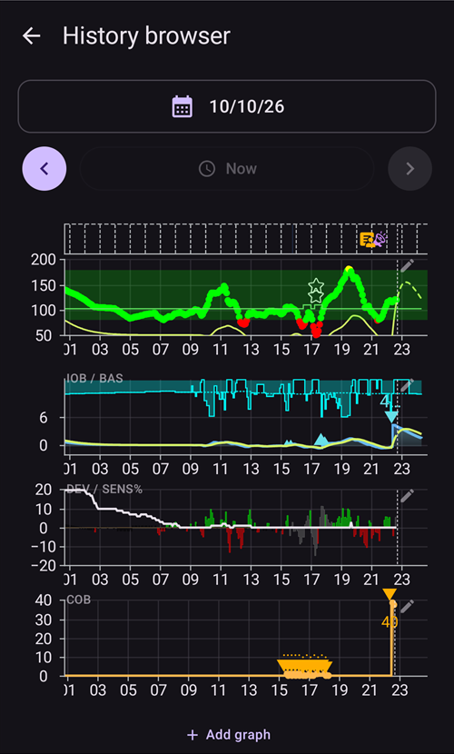

- Tryk på **datokortet** for at vælge den dag, du vil gennemgå.
- Graferne åbner zoomet ud, så de viser **hele den valgte dag**. Knib fingrene for at zoome ind på en del af den.
- Brug pilene **<** og **>** til at gå en dag tilbage eller frem, og **Nu** for at vende tilbage til i dag.
- Graferne viser de samme data som graferne på hovedskærmen (BS, behandlinger, basal, IOB, COB, aktivitet, afvigelser ...).

(reviewing-statistics)=
## AAPS-statistik

**AAPS** giver dig enkel statistik til overvågning.

De fleste værdier bygger på ADA 2023 [anbefalinger](https://diabetesjournals.org/care/article/46/Supplement_1/S97/148053/6-Glycemic-Targets-Standards-of-Care-in-Diabetes).

For at åbne dem skal du åbne **menuen** (☰) og vælge **Statistik**.

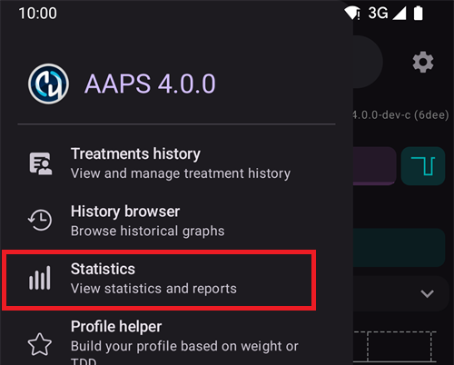

Skærmen **Statistik** har fire faner: **Insulin**, **Tid i målområde**, **Glukose** og **Cyklus**. Tryk på en fane, eller stryg til venstre eller højre for at skifte mellem dem.

(reviewing-tdd)=
### Fanen Insulin: Samlet daglig dosis

Kortet **Samlet daglig dosis** viser én linje pr. dag for de foregående dage (op til en uge), hvor **AAPS** har insulindata, derefter deres **Gennemsnit** og så **I dag** indtil nu. Lige efter du har installeret **AAPS**, vises kun **I dag**. Kolonnerne er:

- **Basal**: kun basal.
- **Bolus**: summen af bolusbehandlinger og SMB'er.
- **TDD Total**: den samlede daglige insulindosis (**TDD**), summen af bolus- og basalinsulin, der er leveret i løbet af dagen.
- **Kulhydrater**: indtastede kulhydrater og e-kulhydrat-behandlinger.

**TDD**-delen beregnes, når du åbner siden, og beregningen tager nogle sekunder. Tryk på **Genberegn** for at beregne den igen.

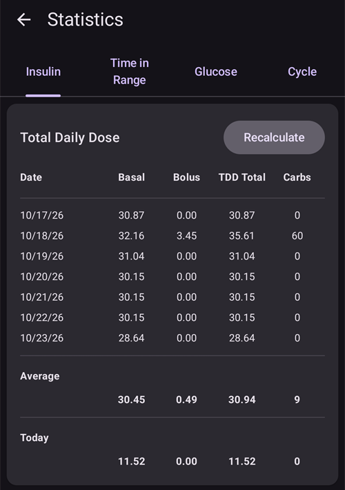

**TDD** er din bolus- plus basalinsulin pr. dag. Nogle læger bruger - især til nye pumpebrugere - et basal-bolus-forhold på 50:50: den samlede basisbasal (**TBB**, summen af dine basalrater over 24 timer) skal så være cirka halvdelen af TDD. Andre foretrækker en TBB på 32 % til 37 % af TDD.

Som de fleste tommelfingerregler har den kun begrænset gyldighed i virkeligheden. Din diabetes kan være anderledes!

### Fanen Tid i målområde

Tid i målområde (**TIR**): 70-180 mg/dl eller 3,9-10 mmol/l.

**TIR**-information findes for 7 og 30 dage, afhængigt af hvor mange data der er i **AAPS**-databasen.

Statistik for tid i snævert målområde (TITR) 70-140 mg/dl eller 3,9-7,8 mmol/l findes nedenfor (skærmen viser dette område som 70-141).

**Tal med din diabeteslæge om mål**

Din diabetes kan være anderledes. Alle foreslåede mål skal du tale med din diabeteslæge eller dit behandlerteam om. Når AAPS-statistikken bruges rigtigt, kan den være et effektivt værktøj til at følge __BS__-tendenser og overvåge fremskridt.

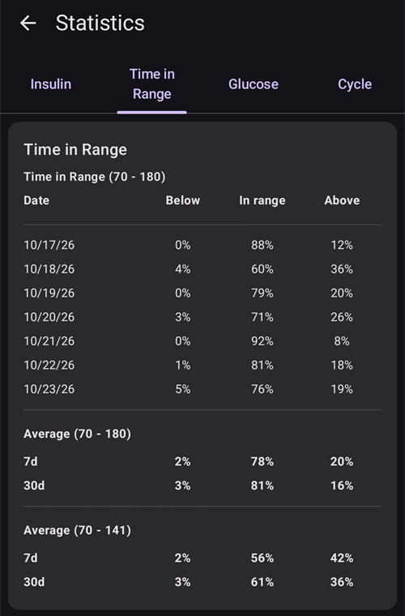

Nedenfor viser kortet **Dexcom TIR** detaljeret **TIR**-statistik for 14 dage.

**SD**: standardafvigelse, en [indikator](https://www.ncbi.nlm.nih.gov/pmc/articles/PMC3125941/) for udsving i blodsukkeret (højest = værst).

HbA1c: et skøn over det resulterende glykerede hæmoglobin, baseret på gennemsnittet af CGM-målingerne. Det er en vejledende værdi, som måske ikke passer med HbA1c-blodprøver.

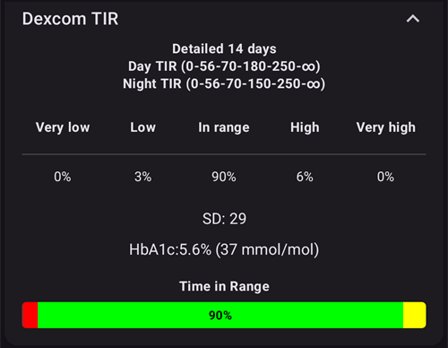

(reviewing-statistics-agp)=
### Fanen Glukose: Ambulant glukoseprofil (AGP)

**Ambulant glukoseprofil** (**AGP**) viser, hvordan dit blodsukker normalt bevæger sig i løbet af dagen. Vælg perioden med knapperne øverst: **I dag**, **24t**, **7d**, **30d** eller **90d**.

- **Grafen**: én dag fra midnat til midnat. Linjen er **Median** (halvdelen af dine målinger på det tidspunkt var lavere, halvdelen var højere). Omkring den viser ét bånd den midterste halvdel af dine målinger (**25–75%**), og et bredere bånd viser de fleste af dem (**10–90%**). Et smalt bånd betyder, at dit blodsukker ligner sig fra dag til dag på det tidspunkt. Stiplede linjer markerer din **LAV værdi**, 140 mg/dl (7,8 mmol/l) og din **HØJ værdi**.
- **Glykæmisk oversigt**: tiden i dit område, i det snævre område (70–140 mg/dl eller 3,9–7,8 mmol/l), over dit område og under det, derefter dit **Gennemsnit** og **Median** for blodsukkeret. Dit område er den **LAV værdi** og **HØJ værdi**, som er sat i [Område for visualisering](#Preferences-range-for-visualization).
- **eA1c** and **GMI**: two estimates of HbA1c calculated from your CGM readings, shown in % with the same value in mmol/mol below it. Ligesom HbA1c ovenfor passer de måske ikke med dine HbA1c-blodprøver.
- **SD** (standardafvigelse) og **CV** (variationskoefficient): hvor meget dit blodsukker svinger. En lavere værdi betyder et mere stabilt blodsukker.
- **Dage**: hvor mange dage med CGM-data der blev brugt.

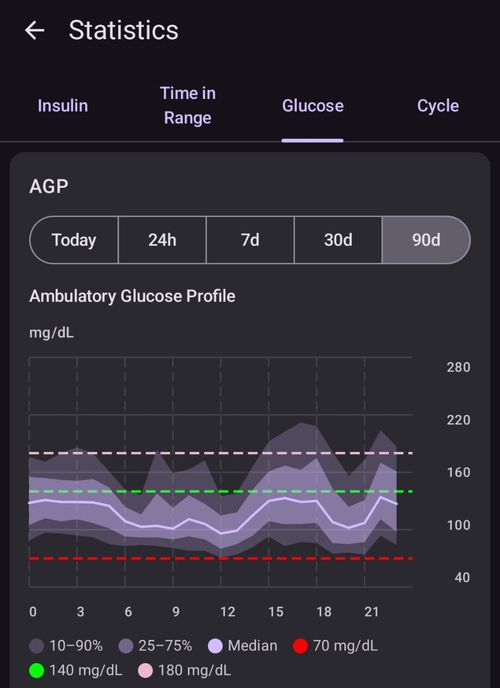 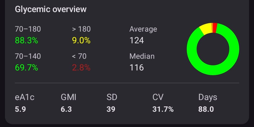

Under AGP tegner kortet **Glukose-pentagon (CGP)** fem mål for dit blodsukker i de sidste 14 dage som en femkant. En mindre femkant betyder bedre kontrol af blodsukkeret.

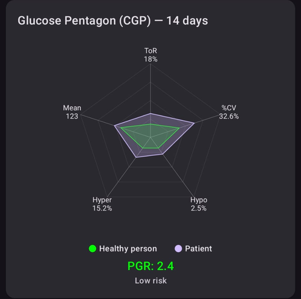

### Fanen Cyklus: TDD-cyklusmønster

**TDD-cyklusmønster** lægger dine daglige insulintotaler oven på hinanden i cyklusser på 28 dage, så du lettere kan se mønstre, der gentager sig. Hver cyklus tegnes som en linje (**Enkelte cyklusser**), sammen med deres gennemsnit.

- **Rå TDD** / **Renset TDD**: vælg den samlede daglige dosis, som den blev leveret, eller TDD minus insulin til kulhydrater.
- **Cyklusforskydning**: flytter starten af cyklussen (0 til 27 dage).

Der skal bruges data fra mindst 56 dage (2 cyklusser). Med færre data viser kortet **Ikke nok data (kræver mindst 56 dage for 2 cyklusser)**. Mønsteret beregnes kun, når du åbner fanen **Cyklus**, fordi det læser data fra 168 dage.

(aaps-screens-treatments)=
## Behandlingshistorik

Åbn **menuen** (☰) i øverste venstre hjørne af hovedskærmen, og vælg **Behandlingshistorik**. I denne visning kan du se og ændre historikken for følgende behandlinger, hver på sin egen fane (stryg over rækken med faner for at se dem alle):

* Kulhydrater og bolus
* [Forlænget bolus](#Extended-Carbs-extended-bolus-and-switch-to-open-loop-dana-and-insight-pump-only)
* Midlertidig basal
* [Midlertidigt mål](../DailyLifeWithAaps/TempTargets.md)
* [Profilskift](../DailyLifeWithAaps/ProfileSwitch-ProfilePercentage.md)
* Careportal: notater og careportal-registreringer
* Loop-tilstand: historik over loop-status
* Brugerindtastning: andre notater, som ikke sendes til Nightscout

I slutningen af hver linje viser små ikoner, hvor dataene kommer fra, eller hvor de er sendt hen:
* Ikonet **Nightscout** (Nightscout-logoet): dataene kommer fra Nightscout eller er gemt i Nightscout
* Ikonet **Pumpe**: dataene kommer fra pumpehistorikken (de er behandlet af pumpen)
* Ikonet **Skraldespand**: registreringen er slettet (den vises kun, når du viser slettede registreringer med ikonet **øje** øverst til højre)

(screens-bolus-carbs)=
### Kulhydrater og bolus

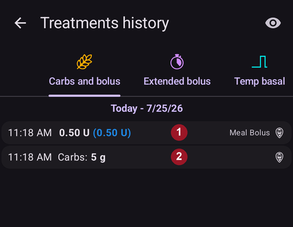

På denne fane kan du se loggen over bolus og kulhydrater. Hver bolus (linje **1**) viser den tilhørende resterende IOB ved siden af insulinmængden. Bolussen kan komme fra:
* Måltid (indtastet manuelt med knapperne Insulin, Hurtigbolus eller Beregner)
* SMB, når du bruger SMB-funktionen

Kulhydratregistreringerne (linje **2**) vises med deres mængde i gram.

Hvis du har brugt [bolusberegneren](#aaps-screens-bolus-wizard) til at beregne insulindosen, kan du trykke på teksten »Beregn« på boluslinjen for at se detaljerne om, hvordan bolussen blev beregnet.

Afhængigt af hvilken pumpe du bruger, kan insulin og kulhydrater vises på én linje eller på flere linjer: én for beregningsdetaljerne, én for kulhydraterne og én for selve bolussen.

Behandlingshistorikken kan bruges til at rette forkerte kulhydratregistreringer (_f.eks._ hvis du har over- eller undervurderet kulhydraterne). Bemærk, at du ikke kan redigere en eksisterende registrering. Du skal følge denne fremgangsmåde:

1. Tjek og husk de aktuelle COB og IOB på hovedskærmen.
2. Afhængigt af pumpen kan kulhydrater vises sammen med insulin på én linje eller som en separat registrering (f.eks. med Dana RS).
3. Fjern registreringen med den forkerte kulhydratmængde: tryk på skraldespandsikonet, vælg de linjer, der skal fjernes, og tryk så på skraldespandsikonet igen for at afslutte.
4. Tjek COB på hovedskærmen igen for at sikre dig, at kulhydraterne er fjernet.
5. Gør det samme for IOB, hvis der kun er én linje med både kulhydrater og insulin.

   → Hvis kulhydraterne ikke er fjernet som tilsigtet, og du tilføjer flere kulhydrater som forklaret her (6.), bliver COB for høj, og det kan føre til for høj insulintilførsel.

6. Indtast den korrekte kulhydratmængde igen (**Behandlinger → Kulhydrater** i den nederste navigation eller en [Hurtigstart](#quicklaunch)-knap **Kulhydrater**), og sørg for at sætte det korrekte tidspunkt for hændelsen.
7. Hvis der kun er én linje med både kulhydrater og insulin, skal du også tilføje insulinmængden. Sørg for at sætte det korrekte tidspunkt for hændelsen, og tjek IOB på hovedskærmen, når du har bekræftet den nye registrering.

### Midlertidig basal

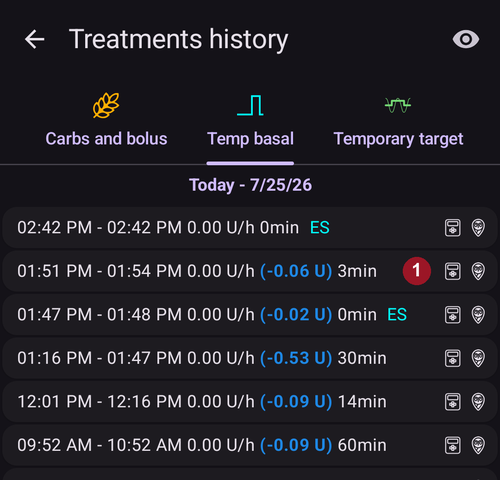

De **midlertidige basaler**, som loopet har sat, vises her. Når en registrering stadig påvirker IOB, vises informationen ved siden af raten (linje **1**). Den kan være:
* Positiv IOB, hvis den midlertidige basal var højere end den, der er sat i profilen
* Negativ IOB for en nul-basal (som på linje **1**), eller hvis den midlertidige basal var lavere end den, der er sat i profilen

Hvis du sletter registreringerne, påvirker det kun dine rapporter i Nightscout, og det vil sandsynligvis forvrænge din reelle IOB - det anbefales ikke.

Til venstre på en linje betyder et rødt S »Suspend« (suspenderet): det sker, når basal ikke leveres lige nu. Det er normalt, f.eks. mens du skifter en pod.

### Midlertidigt mål

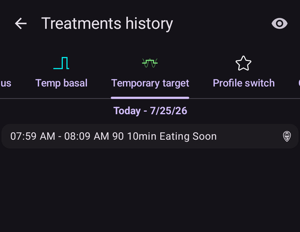

Historikken for midlertidige mål kan ses her.

### Profilskift

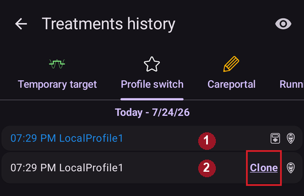

Historikken for profilskift kan ses her. Du kan se flere registreringer, hver gang du skifter profil: linje **1**, som er gemt både i NS og i pumpehistorikken, svarer til selve skiftet. Linje **2**, som er gemt i Nightscout, men ikke i pumpehistorikken, svarer til brugerens anmodning om et profilskift.

Hvis du sletter registreringerne, påvirker det kun dine rapporter i Nightscout, og det ændrer aldrig den aktuelle profil.

Du kan bruge knappen **Klon** på linje **2** til at lave en kopi af et **Profilskift**. Se [Din AAPS-profil > Administrer dine profiler](#your-aaps-profile-clone-profile-switch) for mere information.

### Careportal

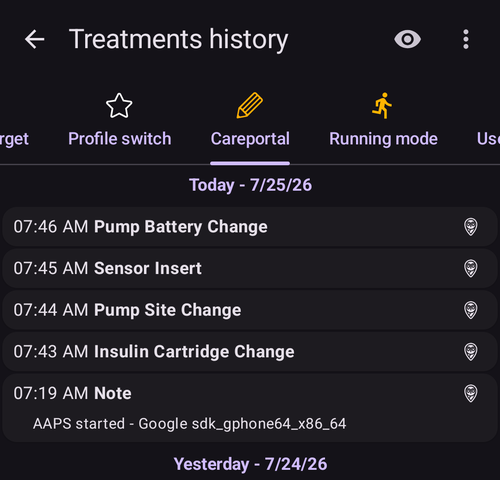

Denne fane viser alle notater og careportal-registreringer, der er gemt i Nightscout.

(AapsScreens-running-mode)= (aaps-screens-running-mode)=
### Loop-tilstand

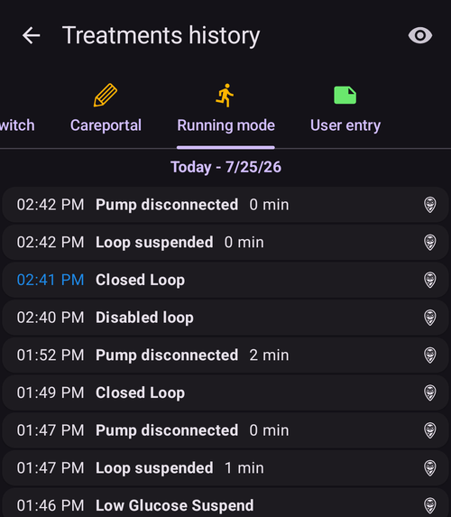

Denne fane viser historikken for ændringer af [loop-status](#AapsScreens-loop-status): åben, lukket, LGS, suspenderet, afbrudt.

### Brugerindtastning

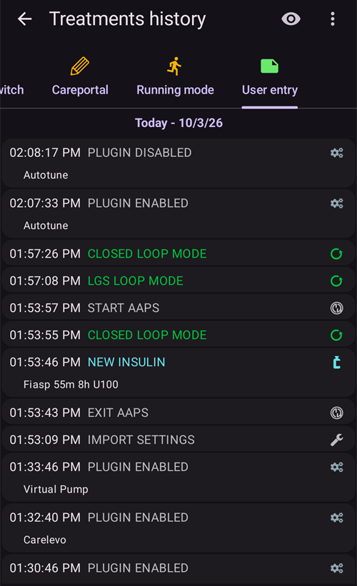

Denne fane viser de handlinger, som brugeren eller en **Automatisering** har udført i **AAPS** (ændringer af loop-tilstand, profilskift, behandlinger, eksport af indstillinger ...). Disse registreringer sendes ikke til Nightscout.

------

## Hvad er forskellen på Nightscout og Tidepool?

Nightscout kan gemme brugerens **AAPS**-data og har mange [rapportværktøjer](https://nightscout.github.io/nightscout/reports/).

Tidepool lader derimod brugeren [gennemgå sine data](https://www.tidepool.org/viewing-your-data) og giver [enkel deling med dit behandlerteam](https://www.tidepool.org/providers/how-it-works#tidepool-data-platform).