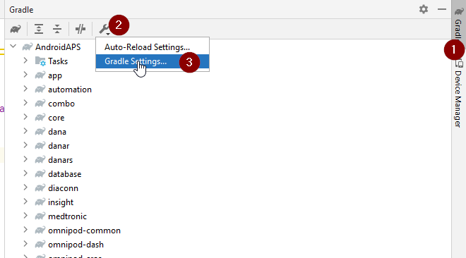
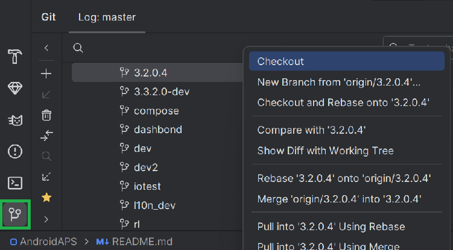
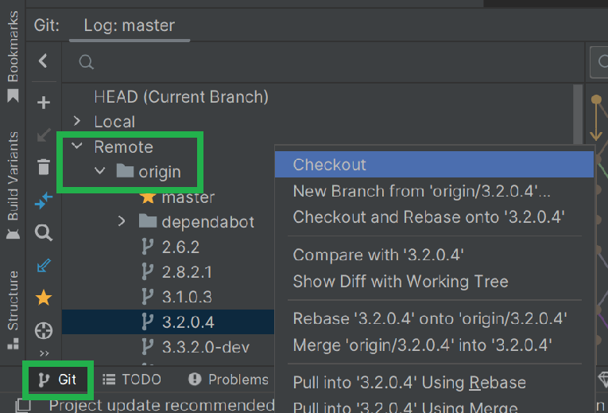
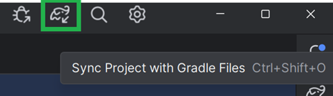
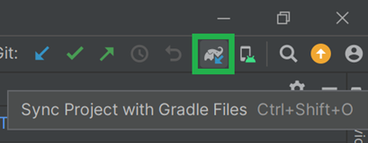

# Opdatering til AAPS 3.2.0.4

(update-aaps-3204)=

## Byg selv i stedet for at downloade

**AAPS-appen (en apk-fil) kan ikke downloades på grund af reglerne for medicinsk udstyr. Det er lovligt at bygge appen til eget brug, men du må ikke give en kopi til andre!**

Se [Ofte stillede spørgsmål for loopere](../UsefulLinks/FAQ.md) for detaljer.

## Krav til computer og software for at bygge AAPS 3.2.0.4

* Der kan være brug for en bestemt version af **[Android Studio](https://developer.android.com/studio/)** for at bygge apk'en.

| AAPS-version            | Foretrukken<br/>Android Studio-<br/>version | Alternativ<br/>Android Studio-<br/>version | Gradle | JVM |
| ----------------------- | ------------------------------------------------------- | ------------------------------------------------------ | ------ |:--- |
| [3.2.0.4](#version3204) | Hedgehog (2023.1.1)                                     | op til Meerkat                                         | 8.2    | 17  |

Den »foretrukne version« leveres med den rigtige JVM-version. Den foretrukne version er også den laveste version, du kan bruge til at bygge **AAPS**. Du kan **IKKE** bygge med en version, der er ældre end den »foretrukne«. Hvis du bruger en anden version, kan du få problemer med JVM-versionen. Se siden [Fejlfinding i Android Studio](#incompatible-gradle-jvm) for hjælp til at løse disse problemer. Hvis din nuværende version af Android Studio ikke står i tabellen, skal du først opdatere den.

Gradle-versionen hænger sammen med kildekoden. Du får altid den rigtige Gradle-version, når du downloader eller opdaterer kildekoden. Den står her kun til orientering. Du behøver ikke gøre noget ved den.

* [32-bit Windows-systemer](#troubleshooting_androidstudio-unable-to-start-daemon-process) understøttes ikke af Android Studio. Husk, at både **64-bit CPU og 64-bit styresystem er et krav.** Hvis dit system IKKE opfylder dette krav, skal du skifte den berørte hardware eller software eller hele systemet.

<table class="tg">
<tbody>
  <tr>
    <th class="tg-baqh">Styresystem (kun 64 bit)</th>
    <td class="tg-baqh">Windows 8 eller nyere</td>
    <td class="tg-baqh">Mac OS 10.14 eller nyere</td>
    <td class="tg-baqh">Enhver Linux, der understøtter Gnome, KDE eller Unity DE;&nbsp;&nbsp;GNU C Library 2.31 eller nyere</td>
  </tr>
  <tr>
    <th class="tg-baqh"><p align="center">CPU (kun 64 bit)</th>
    <td class="tg-baqh">x86_64 CPU-arkitektur; Intel Core 2. generation eller nyere, eller AMD CPU med understøttelse af <br><a href="https://developer.android.com/studio/run/emulator-acceleration#vm-windows" target="_blank" rel="noopener noreferrer"><span style="text-decoration:var(--devsite-link-text-decoration,none)">Windows Hypervisor</span></a></td>
    <td class="tg-baqh">ARM-baserede chips, eller Intel Core 2. generation eller nyere med understøttelse af <br><a href="https://developer.android.com/studio/run/emulator-acceleration#vm-mac" target="_blank" rel="noopener noreferrer"><span style="text-decoration:var(--devsite-link-text-decoration,none)">Hypervisor.Framework</span></a></td>
    <td class="tg-baqh">x86_64 CPU-arkitektur; Intel Core 2. generation eller nyere, eller AMD-processor med understøttelse af AMD Virtualization (AMD-V) og SSSE3</td>
  </tr>
  <tr>
    <th class="tg-baqh"><p align="center">RAM</th>
    <td class="tg-baqh" colspan="3"><p align="center">8 GB eller mere</td>
  </tr>
  <tr>
    <th class="tg-baqh"><p align="center">Disk</th>
    <td class="tg-baqh" colspan="3"><p align="center">Mindst 30 GB ledig plads. SSD anbefales.</td>
  </tr>
  <tr>
    <th class="tg-baqh"><p align="center">Opløsning</th>
    <td class="tg-baqh" colspan="3"><p align="center">Mindst 1280 x 800<br></td>
  </tr>
  <tr>
    <th class="tg-baqh"><p align="center">Internet</th>
    <td class="tg-baqh" colspan="3"><p align="center">Bredbånd</td>
  </tr>
</tbody>
</table>

**Det anbefales stærkt (men er ikke et krav) at bruge en SSD (Solid State Disk) i stedet for en HDD (harddisk), fordi det tager kortere tid at bygge AAPS-apk-filen.**  Du kan stadig bruge en HDD, når du bygger **AAPS**-apk-filen. Hvis du gør det, kan byggeprocessen tage lang tid. Men når den først er startet, kan du lade den køre uden opsyn.

## Hjælp og support til build af 3.2.0.4

Hvis du får problemer med at bygge **AAPS**-appen, findes der et særligt afsnit om [**fejlfinding i Android Studio**](https://androidaps.readthedocs.io/en/3.2/GettingHelp/TroubleshootingAndroidStudio.html). Læs det først.

Hvis du synes, at noget i byggevejledningen er forkert, mangler eller er forvirrende, eller hvis du stadig har problemer, så kontakt andre **AAPS**-brugere i gruppen på [Facebook](https://www.facebook.com/groups/AndroidAPSUsers) eller [Discord](https://discord.gg/4fQUWHZ4Mw). Hvis du selv vil ændre noget (opdatere skærmbilleder _osv._), så indsend en [pull request (PR)](../SupportingAaps/HowToEditTheDocs.md).

```{note}
Denne side viser eksempelbilleder for både den **nye** og den gamle (**klassiske**) brugerflade i Android Studio.
```

## Oversigt over opdatering fra 3.2.0.x til 3.2.0.4

```{contents} Steps for updating to 3.2.0.4
:depth: 1
:local: true
```

### Eksporter dine nuværende indstillinger

Eksporter dine indstillinger fra den **AAPS**-version, der er på din telefon nu. Du får måske ikke brug for dem, men det er bedre at være på den sikre side.

Se siden [Oprettelse og gendannelse af sikkerhedskopier](ExportImportSettings.md), hvis du ikke kan huske, hvordan du gør.

### Opdater din lokale kopi af AAPS

* Åbn dit eksisterende AAPS-projekt i Android Studio. Du skal måske vælge dit projekt. (Dobbelt)klik på AAPS-projektet.


<br>


* Vælg Git -> Fetch i menulinjen i Android Studio


<br>


* Du ser en meddelelse i nederste højre hjørne om, at Fetch lykkedes.


<br>


* Vælg nu Git -> Pull i menulinjen


<br>


* Lad alle valg være, som de er (origin/master), og vælg Pull


<br>


* Vent, mens download er i gang. Du kan se det som information i den nederste linje. Når den er færdig, ser du en meddelelse om, at det lykkedes.

  ```{note}
  De filer, der blev opdateret, kan være forskellige! Det er ikke et tegn på et problem.
  ```


<br>


* Gradle Sync kører for at downloade nogle afhængigheder. Vent, til den er færdig.


<br>


### Vælg JVM-version 17

- Åbn Gradle-visningen ved at klikke på elefanten (1) i højre side af Android Studio, åbn indstillingerne (2), og vælg **Gradle Settings** (3):


<br>



- Kontroller i feltet **Gradle JDK** (1), at den rigtige version er valgt: **jbr-17**. Hvis ikke, så klik på feltet, og se, om den allerede findes på listen. Hvis den ikke er på listen (skærmbilledet nedenfor viser en computer, hvor kun **jbr-21** findes), så vælg **Download JDK...** (2).


- Vælg **17** i Version (1). Vælg JetBrains Runtime eller en anden leverandør i Vendor (2). Location (3): skal ikke ændres.


- Luk dialogen **Settings** med **OK**.

### Vælg grenen AAPS 3.2.0.4

- Vælg Git-symbolet nederst til venstre, højreklik på 3.2.0.4, og vælg Checkout.



<br>



### Synkroniser projektet med Gradle

```{admonition} WARNING!
:class: warning
**Opdater aldrig Gradle.** Synkroniser den altid med projektet.
```

Brug elefantikonet og Sync Project with Gradle Files (eller følg [dette](#gradle-resync)) i den nye brugerflade.



Eller ([dette](https://androidaps.readthedocs.io/en/3.2/GettingHelp/TroubleshootingAndroidStudio.html#gradle-resync)) i den klassiske brugerflade.



### Byg den signerede 3.2.0.4-APK

Din kildekode er nu den aktuelle udgivne version, og alle forudsætninger er kontrolleret. Nu skal du bygge den signerede apk som beskrevet i [afsnittet om at bygge en signeret apk](#Building-APK-generate-signed-apk).

### Overfør og installer 3.2.0.4-APK'en

Du skal overføre apk'en til din telefon, så du kan installere den.

```{note}
Hvis du byggede med det samme eksisterende keystore i Android Studio, behøver du ikke fjerne den eksisterende app fra din telefon. Når du installerer apk'en, skal du følge vejledningen på skærmen for at installere opdateringer.
I andre tilfælde, f.eks. hvis du opretter et nyt keystore i Android Studio til din signerede apk, skal du slette den gamle app, før du installerer apk'en. **Husk at eksportere dine indstillinger!**
```

Se vejledningen til [Overførsel og installation af AAPS på din telefon](../SettingUpAaps/TransferringAndInstallingAaps.md)

### Kontroller AAPS-version 3.2.0.4 på telefonen

Når du har installeret den nye apk, kan du se AAPS-versionen på din telefon ved at trykke på menuen med de tre prikker øverst til højre og derefter på Om. Du bør se den aktuelle version.

