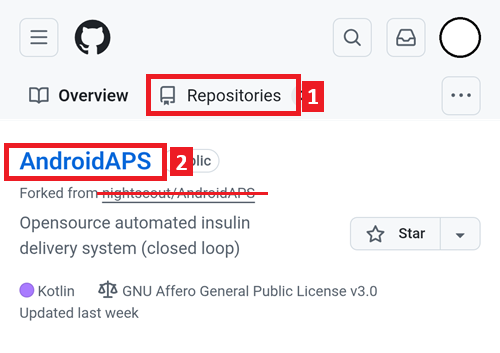
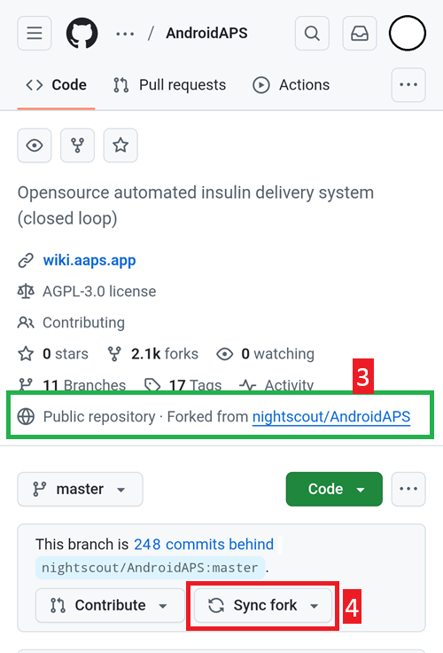
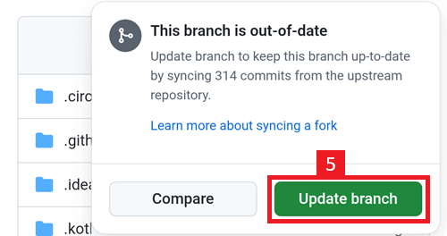
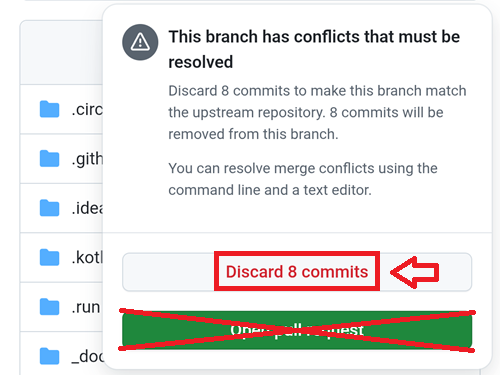
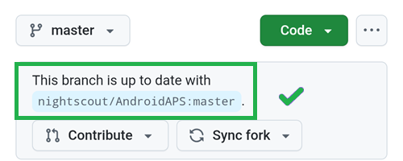
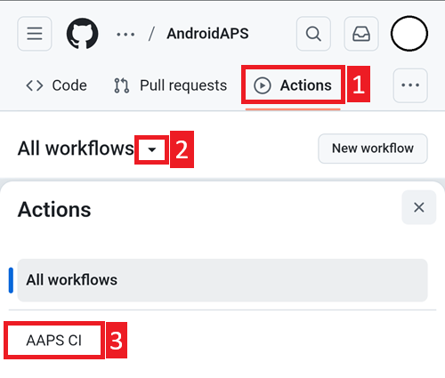

# Opdatering med en browser (fork)

```{tip}
Har du bygget AAPS med **AAPS Builder**? Du har ikke brug for denne side: se [Opdatering af AAPS med AAPS Builder](#aaps-builder-updates).
```

## Byg selv i stedet for at downloade

**AAPS** kan ikke downloades, på grund af regler for medicinsk udstyr. Det er lovligt at bygge appen til eget brug, men du må ikke give en kopi til andre! Se [Ofte stillede spørgsmål for loopere](../UsefulLinks/FAQ.md) for detaljer.

```{note}
Hvis du vil opgradere **AAPS** med en browser for første gang: kopier din sikkerhedskopi af keystore-filen til dit Google Drive. Følg så [vejledningen Build i browseren for **AAPS**](../SettingUpAaps/BrowserBuild.md) i stedet for denne vejledning. I stedet for at oprette et nyt keystore skal du vælge det, som du har kopieret fra din computer.
Det skal du kun gøre første gang. Ved de næste opdateringer kan du følge denne vejledning.
```

```{tip}
**Skifter du til AAPS Builder?** [AAPS Builder](../SettingUpAaps/BrowserBuildAapsBuilder.md) er det enklere build i browseren: ingen fork at synkronisere, og du downloader appen direkte fra GitHub. Du behøver ikke at skifte: denne vejledning virker stadig. Hvis du skifter, så hent først en kopi af dit keystore fra din fork, som forklaret i [Hvis du kommer fra det tidligere build i browseren](#aaps-builder-from-fork). Ellers kan det nye build ikke opdatere AAPS på din telefon.
```

## Oversigt over opdatering til en ny version af AAPS med en browser

```{contents} Steps for updating to a new version of AAPS
:depth: 1
:local: true
```

Hvis du får problemer, så se den separate side [Build i browseren: fejlfinding](../GettingHelp/BrowserBuildTroubleshooting.md).

### Eksporter dine indstillinger

Eksporter dine indstillinger fra den **AAPS**-version, der er på din telefon nu. Du får måske ikke brug for dem, men det er bedre at være på den sikre side.

Se siden [Oprettelse og gendannelse af sikkerhedskopier](ExportImportSettings.md), hvis du ikke kan huske, hvordan du gør.

(Update-to-new-version-update-your-repo)=
### Opdater dit GitHub-repository

[Log ind på GitHub](https://github.com/login).

1. Vælg Repositories.
2. Rul ned, og vælg dit eget AndroidAPS-repository.



3. Kontroller, at du bruger din egen kopi af AndroidAPS (Forked from nightscout/AndroidAPS)
4. Tryk på Sync Fork for at opdatere den (antallet af commits, som du er bagud, kan være anderledes end på billedet)




5. Tryk på Update Branch



Bemærk: Hvis du ved en fejl har ændret din kopi af AndroidAPS, vil du se denne skærm. Kassér alle ændringer (commits) for at komme tilbage til den udgivne version.



Du har nu synkroniseret (opdateret) din egen kopi med den nyeste udgivelse af **AAPS**. Godt klaret.



### Kør workflowet for at bygge den signerede APK

1. Vælg Actions i din GitHub-kopi af AndroidAPS.
2. Fold All Workflows ud.
3. Vælg AAPS-CI



4. Rul ned, og tryk på Run Workflow.


5. Lad grenen stå på master. Kontroller i **Select AAPS Version**, at **4.0.0**, den nyeste version øverst på listen, er valgt. Hvis din fork ikke er opdateret, er den forvalgte version en ældre version: Hvis du kører workflowet med formularen, som den åbner, bygger du den ældre version igen, og din app bliver ikke opdateret. Vælg [variant](#browserbuild-variant) (fullRelease), og tryk derefter på Run workflow.

   ```{note}
   Listen over versioner er en del af workflowet i din fork. Hvis **4.0.0** mangler, er din fork ikke synkroniseret endnu: gå tilbage til [Opdater dit GitHub-repository](#Update-to-new-version-update-your-repo).
   ```


6. Du vil se beskeden Workflow run was successfully requested. Opdater siden i din browser, så kan du følge, hvordan buildet skrider frem. Når handlingen er færdig, viser AAPS CI-handlingen et grønt flueben. Du har bygget den opdaterede version af **AAPS**. Det betyder, at APK'en til hovedenheden og Wear-APK'en nu gemmes direkte i dit Google Drive (som vist nedenfor). APK'en til AAPSClient kan downloades fra Github > nightscout > AndroidAPS [her](https://github.com/nightscout/AndroidAPS/releases)


### Installer AAPS-APK'en

1. Åbn dit Google Drive
2. Gå ind i mappen AAPS, og vælg mappen med den nye version. Der finder du både telefonversionen og Android Wear-versionen.


```{note}
Fra september 2026 kan Googles [verifikation af Android-udviklere](#android-developer-verification) blokere installation af APK'en ved tryk på filen, afhængigt af dit land. Gratis løsninger er forklaret på den side.
```

Fortsæt [her](#Update-to-new-version-check-aaps-version-on-phone)

(update-browser-build-troubleshooting)=

## Fejlfinding

Hvis noget går galt, så gå ikke i panik.

Træk vejret dybt!

Kontroller derefter, om dit problem allerede er beskrevet: se [Fejlfinding for AAPS Builder](#aaps-builder-troubleshooting), hvis du bygger med **AAPS Builder**, ellers [Build i browseren: fejlfinding](#aaps-ci-troubleshooting).

Hvis du har brug for mere hjælp, så kontakt andre **AAPS**-brugere på [Facebook](https://www.facebook.com/groups/AndroidAPSUsers) eller [Discord](https://discord.gg/4fQUWHZ4Mw).
