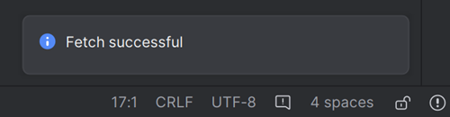

# Opdatering med Android Studio

## Byg selv i stedet for at downloade

**AAPS** kan ikke downloades, på grund af regler for medicinsk udstyr. Det er lovligt at bygge appen til eget brug, men du må ikke give en kopi til andre! Se [Ofte stillede spørgsmål for loopere](../UsefulLinks/FAQ.md) for detaljer.

```{note}
Hvis du vil bygge **AAPS** på en ny computer: kopier din sikkerhedskopi af keystore-filen til den nye computer. Følg derefter [vejledningen til første build af **AAPS**](../SettingUpAaps/BuildingAaps.md) i stedet for denne vejledning. Den eneste forskel er, at du ikke opretter et nyt keystore. Du kan i stedet vælge det keystore, du har kopieret til den nye computer.
```

## Oversigt over opdatering til en ny version af AAPS med Android Studio

```{contents} Steps for updating to a new version of AAPS
:depth: 1
:local: true
```

Hvis du får problemer, så se den separate side [Fejlfinding i Android Studio](../GettingHelp/TroubleshootingAndroidStudio.md).

### Eksporter dine indstillinger

Eksporter dine indstillinger fra den **AAPS**-version, der er på din telefon nu. Du får måske ikke brug for dem, men det er bedre at være på den sikre side.

Se siden [Oprettelse og gendannelse af sikkerhedskopier](ExportImportSettings.md), hvis du ikke kan huske, hvordan du gør.

### Kontroller din version af Android Studio

Den mindste krævede version står i [byggevejledningen](#Building-APK-recommended-specification-of-computer-for-building-apk-file). Hvis din version er ældre, skal du [opdatere Android Studio først](#Building-APK-install-android-studio)!

(Update-to-new-version-update-your-local-copy)=
### Opdater din lokale kopi

* Åbn dit eksisterende AAPS-projekt i Android Studio. Du skal måske vælge dit projekt. (Dobbelt)klik på AAPS-projektet.

  

* Vælg Git -> Fetch i menulinjen i Android Studio

   

* Du ser en meddelelse i nederste højre hjørne om, at Fetch lykkedes.

   

* Vælg nu Git -> Pull i menulinjen

   

* Lad alle valg være, som de er (origin/master), og vælg Pull

   

* Vent, mens download er i gang. Du kan se det som information i den nederste linje. Når den er færdig, ser du en meddelelse om, at det lykkedes.

  ```{note}
  De filer, der blev opdateret, kan være forskellige! Det er ikke et tegn på et problem.
  ```

   

* Gradle Sync kører for at downloade nogle afhængigheder. Vent, til den er færdig.

  

### Kontroller JVM-versionen

Denne kontrol er især vigtig, hvis du allerede har bygget en tidligere version af **AAPS** på den samme computer.

Se i [byggevejledningen](#Building-APK-recommended-specification-of-computer-for-building-apk-file), hvilken JVM-version der kræves til den version af **AAPS**, som du nu bygger. Følg derefter trinene i [Inkompatibel Gradle JVM](#incompatible-gradle-jvm) for at sikre, at du bruger den rigtige version.

(Update-to-new-version-build-the-signed-apk)=
### Byg den signerede APK

Din kildekode er nu den aktuelle udgivne version, og alle forudsætninger er kontrolleret. Nu skal du bygge den signerede apk som beskrevet i [afsnittet om at bygge en signeret apk](#Building-APK-generate-signed-apk).

(Update-to-new-version-transfer-and-install)=

### Overfør og installer APK'en
Du skal overføre apk'en til din telefon, så du kan installere den.

```{note}
Hvis du byggede med det samme eksisterende keystore i Android Studio, behøver du ikke fjerne den eksisterende app fra din telefon. Når du installerer apk'en, skal du følge vejledningen på skærmen for at installere opdateringer.
I andre tilfælde, f.eks. hvis du opretter et nyt keystore i Android Studio til din signerede apk, skal du slette den gamle app, før du installerer apk'en. **Husk at eksportere dine indstillinger!**
```

Se vejledningen til [overførsel og installation af AAPS](../SettingUpAaps/TransferringAndInstallingAaps.md). Hvor Googles [verificering af Android-udviklere](#android-developer-verification) håndhæves (fra september 2026, afhængigt af dit land), skal du installere med [ADB](#android-developer-verification-adb) i stedet for at trykke på APK-filen.

Fortsæt [her](#Update-to-new-version-check-aaps-version-on-phone).

(update-computer-build-troubleshooting)=

## Fejlfinding

Hvis noget går galt, så gå ikke i panik.

Træk vejret dybt!

Kontroller derefter, om dit problem allerede er beskrevet på den separate side [Fejlfinding i Android Studio](../GettingHelp/TroubleshootingAndroidStudio.md).

Hvis du har brug for mere hjælp, så kontakt andre **AAPS**-brugere på [Facebook](https://www.facebook.com/groups/AndroidAPSUsers) eller [Discord](https://discord.gg/4fQUWHZ4Mw).