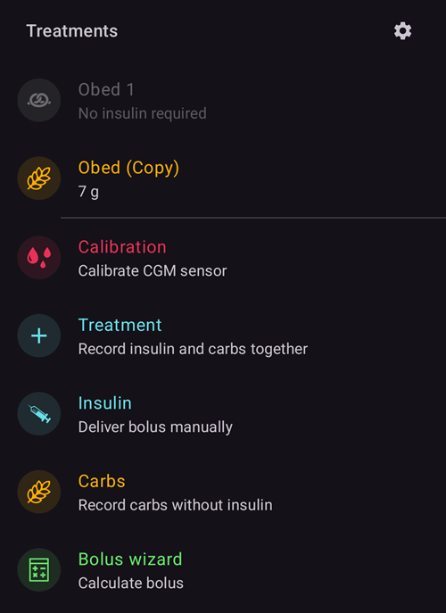
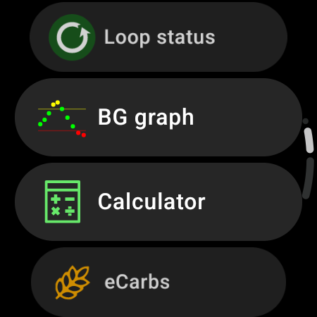
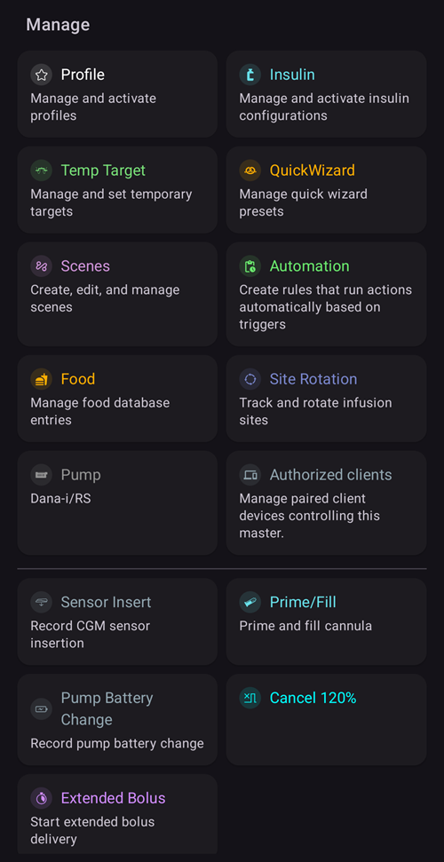
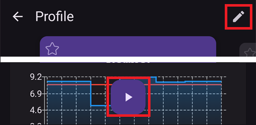

(v4-changes)=
# Hvad er ændret i AAPS v4

Denne side samler de vigtige **ændringer i adfærd** mellem **AAPS** v3 og v4 – ting, der virker anderledes, er flyttet eller er fjernet – så nuværende brugere ved, hvad de kan forvente, når de opdaterer. Se også [Udgivelsesnoter](ReleaseNotes.md) og [opdateringsvejledningen](UpdateToNewVersion.md).

```{contents} Table of contents
:depth: 2
:local: true
```

---

## NSClient v1 er fjernet

**AAPS** v3 havde **to** plugins til synkronisering med Nightscout:

- **NSClient** – den gamle klient (den gamle Nightscout REST / socket.io API, også kaldet *»v1«*), og
- **NSClientV3** – klienten til den nyere Nightscout **API v3**.

I **AAPS** v4 er det gamle **NSClient (v1)**-plugin **fjernet**. Kun **NSClientV3** er tilbage til synkronisering med Nightscout.

```{admonition} What you need to do
:class: important
Hvis du (eller din **AAPSClient**-følger) stadig synkroniserede med det gamle **NSClient (v1)**-plugin, så skift til **NSClientV3** før/efter opdateringen:

- Åbn **[Konfiguration](../SettingUpAaps/ConfigBuilder.md) → Kommunikation → NSClientV3**.
- Indtast din **Nightscout URL** og et **adgangstoken** (NSClientV3 bruger et adgangstoken, *ikke* den gamle API secret – se [oprettelse af et token](https://nightscout.github.io/nightscout/security/#create-a-token)).
- Din Nightscout-side skal understøtte **API v3** (Nightscout 15 eller nyere).
- Hvis du bruger **websockets**, så slå dem til eller fra på **både** hovedenheden og følgeren – aldrig kun på den ene.
- Websockets er **påkrævet** for fjernstyring fra **AAPSClient**, på begge telefoner.
```

Dette ændrer kun, hvordan appen taler med Nightscout; dine data i Nightscout er uændrede.

---

## Den nederste navigation: Behandlinger, Scener og Administrer

I **AAPS** v3 gik du rundt i appen med en række **faner** (Oversigt, Handlinger, Behandlinger, …), og flere funktioner var **plugins**, som du aktiverede i Config Builder (**Handlinger**, **Automatisering**, **Mad**, …).

I **AAPS** v4 er fanerne væk, og det samme er afkrydsningsfeltet med øjet i Config Builder, som viste et plugin som en fane. Hovedskærmen er **Oversigt**, og en **nederste navigation** giver dig tre ark. **Handlinger, Automatisering og Mad er ikke længere plugins** – der er intet at aktivere i [Konfiguration](../SettingUpAaps/ConfigBuilder.md) (den omdøbte Config Builder); deres funktioner findes nu i disse ark.

(v4changes-treatments)=
### Behandlinger – registrer og giv

Arket **Behandlinger** er stedet, hvor du registrerer eller giver en behandling: **Bolusberegner**, **Insulin** (manuel bolus), **Kulhydrater**, **Behandling** (insulin og kulhydrater sammen), **Kalibrering**, **CGM** (åbner din CGM-app, når en er sat op) og dine **[Hurtigboluser](../DailyLifeWithAaps/QuickWizards.md)**.



På et **Wear OS-ur** indtaster du de samme behandlinger fra urets **AAPS-menu** (Bolusberegner / Beregner, Forlængede kulhydrater, Behandling, …):



### Scener

Dine forindstillinger til situationer – se [Scener](../DailyLifeWithAaps/Scenes.md).

(v4changes-manage)=
### Administrer – administrer og aktiver

Arket **Administrer** er stedet, hvor du administrerer og aktiverer alt det andet: **[Profil](../DailyLifeWithAaps/ProfileSwitch-ProfilePercentage.md)**, **Insulinindstillinger** (dine insulinkonfigurationer), **[Midlertidigt mål](../DailyLifeWithAaps/TempTargets.md)**, forvalg til **[Hurtigbolus](../DailyLifeWithAaps/QuickWizards.md)**, **[Scener](../DailyLifeWithAaps/Scenes.md)**, **Automatisering**, **Mad**, **Rotation af indstikssteder**, **Pumpe**, **[Godkendte klienter](../RemoteFeatures/ClientMasterControl.md)** – og desuden de pumpehandlinger, der før lå på fanen *Handlinger* (**Forlænget bolus**, **Annuller midlertidig basal**, **Klargør/Fyld**, **Sensorindstik**, **Skift af pumpebatteri**).



Alle dine eksisterende automatiseringsregler og madposter bevares; kun vejen til disse funktioner er ændret.

(screens-action-tab)=
#### Hvor blev fanen Handlinger af?

**AAPS** 3.x havde en fane »Handlinger«. I **AAPS** 4 findes dens funktioner andre steder:

* **Profilskift** og **profilprocent**: tryk på [profilnavnet](#aaps-screens-profile--target) på hovedskærmen, eller vælg **Administrer → Profil**. Se [Skift profilprocent](#ProfileSwitch-change-percentage).
* **Midlertidigt mål**: tryk på [målet](#aaps-screens-profile--target) på hovedskærmen, eller vælg **Administrer → Midlertidigt mål**.
* **Klargør/Fyld**, **Sensorindstik**, **BS-kontrol** og de andre careportal-registreringer: i det udvidede [statuspanel](#aaps-screens-careportal), i **Administrer** eller som knapper i [Hurtigstart](../DailyLifeWithAaps/QuickLaunch.md).
* **Historikbrowser**, **Statistik** (TDD): i **menuen** (☰).

```{admonition} Profile switch and profile percentage
:class: note
I **AAPS** v3 åbnede et langt tryk på profilnavnet dialogen til profilskift (procent, varighed, midlertidigt mål for aktivitet). I **AAPS** v4 skal du **trykke** på profilnavnet (eller vælge **Administrer → Profil**) og derefter trykke på den runde **▶**-knap nederst til højre for at åbne de samme indstillinger. Se [Skift profilprocenten](#ProfileSwitch-change-percentage).
```

---

(v4changes-read-only-management)=
## Beskyttelse af indstillinger låser nu også administrationsskærmene

I **AAPS** v3 bad [beskyttelse af indstillinger](#Preferences-settings-protection) kun om din adgangskode, når du åbnede indstillingerne. Du kunne stadig tilføje eller redigere profiler på fanen **Lokal profil** uden den.

I **AAPS** v4 dækker beskyttelse af indstillinger også redigering på administrationsskærmene: **Profil**, **Insulinindstillinger**, **Midlertidigt mål** og **Hurtigbolus**. Hvis dine indstillinger er låst, åbner disse skærme som **skrivebeskyttede**:

- Du kan se posterne og **▶ Aktiver** eller bruge dem.
- Knapperne **Tilføj / Rediger / Klon / Slet** er **skjult**. Kun **✏️ blyanten** i topbjælken viser, at du kan låse redigering op.



```{admonition} What you need to do
:class: important
For at tilføje, redigere, klone eller slette en post skal du trykke på **✏️ blyanten** i topbjælken og indtaste adgangskoden til dine indstillinger (eller bruge biometri). Knapperne vises.

Hvis du ikke behøver at beskytte dine indstillinger, kan du slå beskyttelse af indstillinger fra i **Indstillinger → Beskyttelse**.
```

---

(v4changes-active-insulin)=
## Den insulin, der er i brug, kan ikke redigeres

I **AAPS** v3 kunne du til enhver tid ændre DIA for den insulin, du brugte.

I **AAPS** v4 er den insulin, der er markeret **AKTIV** i **Administrer → Insulinindstillinger**, nedtonet: du kan ikke redigere eller slette den.

Når du opgraderer, beholder **AAPS** den insulin og DIA, som dine profilskift i v3 allerede har gemt. Hvis den finder ældre registreringer, hvor insulinen er kendt, men DIA ikke er, bruger den en standard-DIA til dem og viser én gang en besked, for eksempel *Ældre registreringer havde ingen insulinvarighed, så 9,0 timer blev brugt for Lyumjev. Tjek dine insulinindstillinger — allerede migrerede registreringer bliver ikke opdateret bagefter.* Tjek dine insulinindstillinger, når du ser den.

When you [import settings](../Maintenance/ExportImportSettings.md) exported from **AAPS** 3.x, **AAPS** adds the insulin of that backup to your insulin list and tells you which one, for example *Added to your insulin list from the backup: Free-Peak Oref 38m 6h U100.* This insulin is not in use yet: select the right insulin when you activate your profile, and do this before Nightscout downloads your older treatments.

```{admonition} What you need to do
:class: important
For at ændre DIA eller spids skal du tilføje en ny insulin med **+**, justere den, gemme den og **▶ Aktivere** den. Se [Skift af den insulin, der er i brug](#Config-Builder-insulin-change-active).
```

---

(v4changes-remote-control)=
## Fjernstyring fra AAPSClient kræver parring

I **AAPS** v3 styrede **AAPSClient** **AAPS** ved at skrive careportal-behandlinger til Nightscout, og den kunne ikke give en bolus.

I **AAPS** v4 bliver klienten og den primære telefon **parret** én gang, og hver kommando er signeret. Den primære telefon tjekker og bekræfter hver kommando, og en klient kan nu også give en bolus.

- Hver klient har en **[rolle](#client-master-control-roles)**, der begrænser, hvad den må gøre.
- Mens klientstyring er slået til, er den primære telefon i **[hærdet tilstand](#client-master-control-hardened-mode)**: behandlinger og ændringer, der er skrevet direkte i Nightscout (hjemmesiden, andre apps), bliver ikke længere brugt.
- Hver klient får sit **[eget Nightscout-token](#client-master-control-own-token)** med kun de rettigheder, den har brug for.

```{admonition} What you need to do
:class: important
Par hver **AAPSClient** med den primære telefon: se [Styring mellem hovedenhed ↔ klient](#client-master-control). Med et admin-token på den primære telefon viser den primære telefon en QR-kode, der sætter klienten op og parrer den med én scanning. Hvis du før indtastede behandlinger på Nightscout-hjemmesiden, så indtast dem på en parret klient i stedet.
```

---

## Dobbelte BS-data skifter nu loopet til Stop ved lavt BS

Når **AAPS** modtager den samme BS-måling to gange (et rødt advarselsmærke på genvejen til BS-kilden i den nederste bjælke), kan den ikke beregne din tendens pålideligt, så den stopper med at give korrektionsinsulin.

I **AAPS** v3 skete det stille i baggrunden: dit loop blev stadig vist som **Lukket loop**, selv om det ikke længere kunne korrigere.

I **AAPS** v4 kan du se ændringen. Et lukket loop skiftes til tilstanden **Stop ved lavt BS**, og loop-dialogen fortæller dig hvorfor: *»LGS-tilstand på grund af dobbelte værdier i BS-kilden«*. **AAPS** kan stadig sænke eller stoppe din basal for at beskytte dig mod lave værdier.

```{admonition} What you need to do
:class: important
Find og fjern de dobbelte målinger – se [BS-advarselstegn](#aaps-screens-bg-warning-sign).

Når de er væk, bliver **AAPS** i **Stop ved lavt BS**. Den går ikke selv tilbage til **Lukket loop**: tryk og hold på loop-ikonet, og vælg **Lukket loop** igen.
```

---

(v4changes-tidepool)=
## Tidepool: data vises nu under enhedsnavnet AAPS

I **AAPS** v3 blev de data, der blev uploadet til [Tidepool](../SettingUpAaps/Tidepool.md), vist i Tidepool under et andet enhedsnavn.

I **AAPS** v4 vises dataene under enhedsnavnet **AAPS**. Efter opdateringen starter **AAPS** et nyt datasæt i Tidepool. Dine ældre data bliver i Tidepool under det gamle enhedsnavn.

```{admonition} What you need to do
:class: important
Normalt ingenting: nye data vises ganske enkelt under **AAPS**.

Kør **ikke** »**Fuld synkronisering**«, mens de gamle data stadig er i Tidepool: de samme data ville så være der to gange. Hvis du vil have alle dine data under det nye navn, så brug først knappen »**Slet alle data**« på [Tidepool-skærmen](#tidepool-menu) (den sletter også de gamle data, som **AAPS** har uploadet), og kør derefter »**Fuld synkronisering**«. Kun de data, der stadig er gemt i **AAPS** på din telefon, kan uploades igen.
```

---


<!-- =====================================================================
     This page is a growing list of v4 behavioral changes.
     Add new changes as their own "## " section, newest grouping as agreed.
     Maintainers: relocate page + images and fix cross-links as needed.
     ===================================================================== -->
