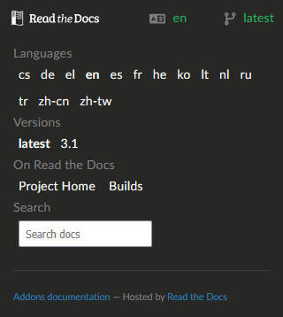

# Skift sprog og version

Den dokumentation, du læser nu, findes på flere sprog og hører til en bestemt version af **AAPS**. Både sproget og versionen kan skiftes i menuen nederst til højre på skærmen.

```{note}
Klik på bjælken nederst til højre på skærmen for at åbne menuen, hvor du vælger sprog og version.
```



## Skift sprog

Vælg i menuen det sprog, du vil læse dokumentationen på.

Du er velkommen til at blive en af oversætterne og korrekturlæserne på [Crowdin](https://crowdin.com/project/androidapsdocs) og hjælpe med at oversætte dokumentationen til dit sprog.

## Skift version

Den aktuelle version vises nederst til højre på skærmen. For at skifte til en anden version skal du klikke på den aktuelle version og vælge den version, du har brug for.

```{warning}
Når du skifter sprog og/eller version, kan du få fejlen »404 – Siden blev ikke fundet«, hvis siden ikke findes på det sprog eller i den version. Det sker ofte, når du skifter version, men bør ikke ske, når du skifter sprog: siden vises på engelsk, hvis den ikke er oversat endnu.
```
