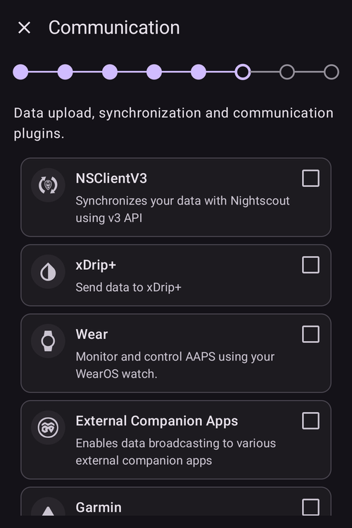
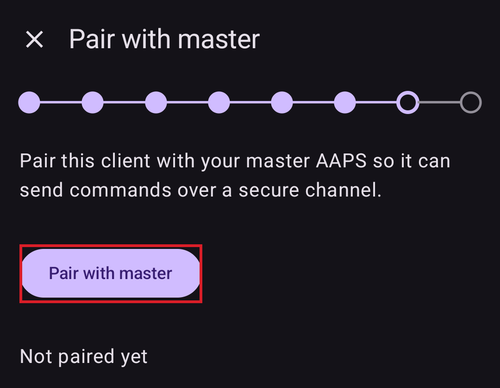
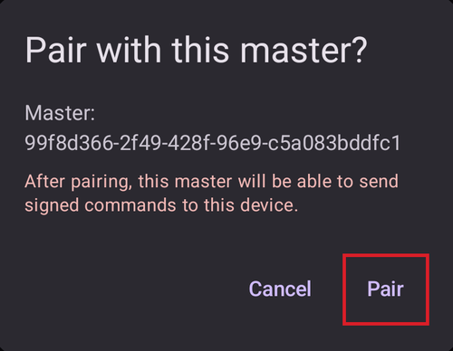
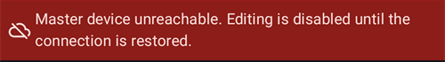
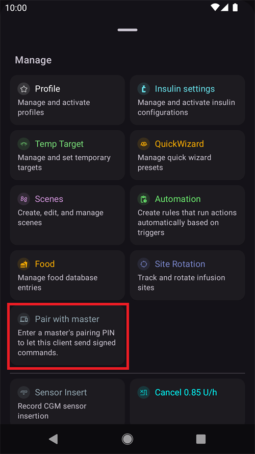
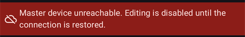

(aapsclient-app)=
# AAPSClient-appen

**AAPSClient** er en tilhørende app til **AAPS**: en app til en anden telefon — som regel en omsorgspersons — der **følger** den person, der bruger **AAPS**. Fra **AAPS** version 4 kan omsorgspersonen også **styre** loopet på afstand med signerede kommandoer. De to telefoner kommunikerer via din **Nightscout**-side; der er ikke brug for en direkte forbindelse mellem telefonerne.

```{admonition} Wording used on this page
:class: note
- **Klient** = en telefon, der kører **AAPSClient**.
- **Hovedenhed** = den primære **AAPS**-telefon, der har pumpen og kører loopet.
```

```{admonition} Which devices can run AAPSClient?
:class: note
Fra **AAPS** version 4 kører **AAPSClient** på Android-telefoner og -tablets, på Wear OS-ure og på computere (Windows, Mac og Linux). Til en iPhone er der ingen færdig fil at downloade: du bygger selv appen. Se [tabellen med downloads for hver enhed](#aapsclient-platforms).
```

```{contents} Table of contents
:depth: 2
:local: true
```

## Hvad AAPSClient er (og ikke er)

**AAPSClient** ser ud og føles som **AAPS**, men den har **intet eget loop**:

- Den indeholder **ingen APS-algoritme**, ingen **Mål** og **ingen pumpedrivere** — den doserer aldrig selv.
- De plugins, som kun hovedappen bruger (**SMS-kommunikator**, **Tidepool**, **Open Humans**), er heller ikke med.
- Det, den *har*: synkronisering med **NSClientV3**, plugins til BS-kilde, udsendelse til **xDrip+** og forbindelserne til **Wear OS** / **Garmin** — alt, hvad der skal til for at følge og videresende kommandoer. Et **Garmin**-ur, der er forbundet til en klient, kan vise data, men kulhydrater, som det sender, bliver ikke registreret, og det kan ikke afbryde eller genforbinde pumpen: klienten viser en besked, og du indtaster dem i stedet i **AAPS**.

Alt, hvad du starter fra **AAPSClient**, bliver kontrolleret, begrænset, bekræftet og **udført af hovedenheden** (telefonen med pumpen). Siden [Styring mellem hovedenhed ↔ klient (signeret fjernstyring)](ClientMasterControl.md) forklarer, hvordan det virker: hvordan du parrer de to telefoner, hvordan hovedenheden skriver den bekræftelsestekst, du ser, hvordan en bolus, der startes på klienten, bliver leveret, og hvad der sker, når hovedenheden er offline.

## Versioner: AAPSClient, AAPSClient2 og AAPSClient3

Op til tre klient-apps kan installeres side om side på den samme følgertelefon, og hver af dem følger en **anden** person: **AAPSClient** (gult ugle-ikon), **AAPSClient2** (blå ugle) og — nyt i **AAPS** version 4 — **AAPSClient3** (grøn ugle). De virker på samme måde. Kun navnet og farven er forskellige (app-ikon, widgettens baggrund og statusområdet på hovedskærmen), så du kan kende dem fra hinanden. Hver app er parret med sin egen hovedenhed. Se [Om AAPSClient, AAPSClient2 og AAPSClient3](#remotecontrol-aapsclient-versions) for flere detaljer.

(aapsclient-platforms)=
## Sådan får du appen

Alle de færdige filer ligger på listen *Assets* i den nyeste udgivelse på [GitHub](https://github.com/nightscout/AndroidAPS/releases/) (klik på *Assets* nederst i udgivelsen for at folde listen ud). I tabellen står *x.y.z* for versionsnummeret. Vælg den fil, der passer til din enhed:

| Device                        | Fil, der skal downloades            | Noter                                                                                                                                                                                                           |
| ----------------------------- | ----------------------------------- | --------------------------------------------------------------------------------------------------------------------------------------------------------------------------------------------------------------- |
| Android-telefon eller -tablet | `app-aapsclient-release_x.y.z.apk`  | Installer den som hovedappen: se [Download og installation af AAPSClient](#RemoteControl_aapsclient) og [Overførsel og installation af AAPS på din telefon](../SettingUpAaps/TransferringAndInstallingAaps.md). |
| Wear OS-ur                    | `wear-aapsclient-release_x.y.z.apk` | Hører sammen med AAPSClient-appen på telefonen. Se [Opsæt AAPS på dit Wear OS-ur](../WearOS/WearOsSmartwatch.md).                                                                                               |
| Windows-computer              | `AAPSClient-x.y.z.msi`              | Åbn filen for at installere.                                                                                                                                                                                    |
| Mac                           | `AAPSClient-x.y.z.dmg`              | Se bemærkningen om macOS under tabellen.                                                                                                                                                                        |
| Linux (Debian, Ubuntu)        | `aapsclient_x.y.z_amd64.deb`        | Installer den med din pakkehåndtering.                                                                                                                                                                          |
| iPhone                        | ingen                               | Der er ingen version i App Store og ingen fil at downloade. Du bygger selv appen, se [AAPSClient på en iPhone](#aapsclient-iphone).                                                                             |

**Følger du to personer?** Hver fil ovenfor findes også som *aapsclient2* / *AAPSClient2*. Det er en anden klient-app, der installeres ved siden af den første, så én enhed kan følge to personer (se [Om AAPSClient, AAPSClient2 og AAPSClient3](#remotecontrol-aapsclient-versions)). **AAPSClient3** er ikke med i udgivelsens filer: byg den selv ([build-varianter](#browserbuild-variant)).

**Filer, du skal se bort fra:** *pumpcontrol*-filerne (`app-pumpcontrol-release_…`, `wear-pumpcontrol-release_…`) er ikke en klient. Spring dem over.

**Mac: første start.** Appen er ikke notariseret af Apple, så macOS blokerer den, første gang du åbner den. Klik på *Udført* (Done), åbn derefter *Systemindstillinger → Anonymitet og sikkerhed* (Privacy & Security), rul ned, og klik på *Åbn alligevel*.

**Computer: sådan forbinder du.** En computer har intet kamera, så QR-koden kan ikke scannes. Opsæt **Nightscout** i klienten, tilføj derefter klienten med en **PIN** på hovedenheden, og skriv den 8-cifrede PIN i klienten (**Par med hovedenhed**). Se [Parring med hovedenheden](#aapsclient-pairing-with-the-master).

**Samme version overalt.** Hovedenheden og alle dens klienter skal køre den samme **AAPS**-version. Når du opdaterer hovedenheden, skal du også opdatere klienterne.

(aapsclient-iphone)=
### AAPSClient på en iPhone

Der er ingen **AAPSClient** i App Store og ingen færdig fil at downloade, så du bygger selv appen:

- Du skal bruge en Mac med **Xcode** og en Apple-udviklerkonto.
- Projektet er mappen `ios` i [AndroidAPS-repository på GitHub](https://github.com/nightscout/AndroidAPS/tree/master/ios).
- Et build til en rigtig iPhone signeres med dit eget Apple-udviklerteam. Et build til iPhone-simulatoren behøver det ikke.
- Der er endnu ingen trin-for-trin-vejledning. Denne side bliver opdateret, når der kommer en.

iPhone-versionen parres med hovedenheden ligesom de andre. I modsætning til computerversionerne kan iPhonen scanne hovedenhedens QR-kode med sit kamera.

## Første start: en kortere opsætningsguide

Ved første start kører **AAPSClient** den samme **Opsætningsguide**, som du kender fra **AAPS**, men med langt færre trin — en følger skal ikke have opsat profil, insulin, pumpe, APS eller mål:

1. **Velkommen**, **licensaftale**, **tilladelser** og **hovedadgangskode** — det samme som i hovedappen, se [AAPS-opsætningsguide](../SettingUpAaps/SetupWizard.md).
2. Klienten spørger **ikke** om **enheder** eller **nedre/øvre grænse**: den henter dem fra den primære telefon, så snart den er forbundet til Nightscout. Du kan se dem senere under **Indstillinger**, hvor et lille **telefonikon** viser, at de er [synkroniseret med den primære telefon](#client-master-config-prefs). De kan kun redigeres, mens hovedenheden kan nås.
3. **Opsæt fra hovedenheden** — åbn **Administrer → Godkendte klienter** på hovedenheden, tilføj denne telefon med en **QR-kode**, og tryk på **Scan QR-koden** her. Én scanning opsætter Nightscout med et eget token til denne telefon, og med en kode, der parrer, bliver telefonen også parret. Telefonen får også det navn, den blev tilføjet med på hovedenheden, som sit instansnavn (bogstaver med accent bliver til almindelige bogstaver, »Miloš« bliver til »Milos«). **Efter scanningen er opsætningen færdig**: guiden lukker, fordi de næste trin kun ville vise, hvad koden har gjort. Uden en QR-kode springer du dette trin over. (Ikke på en computer: den har intet kamera, se [Sådan får du appen](#aapsclient-platforms).)

   

4. **Kommunikation** — listen over plugins viser kun det, som en følger har brug for (NSClientV3, xDrip+, Wear, External Companion Apps, Garmin). Hvis du ikke har scannet en QR-kode, så aktiver **NSClientV3**, og indtast **den samme Nightscout-URL** som på den primære telefon og et adgangstoken, med **websockets** slået til — præcis som beskrevet under [Synkronisering](#RemoteControl_aapsclient). Websockets er **påkrævet** for fjernstyring fra **AAPSClient** på begge telefoner.

   

5. **Par med hovedenhed** — dette trin findes **kun** på klienten. Det forbinder denne enhed med hovedenheden via den sikre kommandokanal med PIN, og det henter det navn, telefonen blev tilføjet med på hovedenheden, ligesom QR-koden. **Efter parringen er opsætningen færdig.** Du kan også springe trinnet over og parre når som helst senere fra **Administrer → Par med hovedenhed**.

   

6. **Hvem bruger denne telefon?** — kun hvis du ikke har parret i guiden: navnet på den person, der bruger denne telefon. Det gør det muligt at skelne denne instans fra andre i rapporter og ved synkronisering.

(aapsclient-pairing-with-the-master)=

## Parring med hovedenheden

Åbn **Administrer → Godkendte klienter** på **hovedenheden**, og tilføj en klient. Der er to måder at parre på:

- **Med en QR-kode** (den hurtigste, hvis telefonen har et kamera): scan koden i guidens trin »**Opsæt fra hovedenheden**« eller fra **Administrer → Par med hovedenhed → Scan QR-kode**, og bekræft med »**Brug**«. Den opsætter også Nightscout.
- **Med PIN**: åbn guidens trin ovenfor (eller **Administrer → Par med hovedenhed**) på **klienten**, skriv den engangs-PIN, der vises på hovedenheden, og tryk på »**Par**«. Klienten viser derefter, hvem den er ved at stole på — bekræft med »**Par**«:



Fra guiden afslutter en vellykket parring opsætningen og åbner hovedskærmen. På hovedenheden vises klienten som **Aktiv** på listen [Godkendte klienter](#client_master_master_setup). Bagefter viser **Administrer → Par med hovedenhed** »*Allerede parret*«, telefonens rolle, og om hærdet tilstand er slået til:

 Hele parringsproceduren, sikkerhedsdetaljer og fejlfinding står på [Styring mellem hovedenhed ↔ klient (signeret fjernstyring)](#client_master_client_setup).

Efter parringen får klienten sit eget Nightscout-token fra hovedenheden (hvis hovedenheden har et admin-token) med kun de rettigheder, som en klient har brug for, og den holder op med at bruge det token, du måske har indtastet. **AAPSClient** skriver aldrig selv behandlinger eller BS til Nightscout: alt, hvad den gør, bliver sendt til hovedenheden, som skriver det. Se [Klientens egen Nightscout-token](#client-master-control-own-token).

Hovedenheden bestemmer med telefonens **[rolle](#client-master-control-roles)**, hvad den må (Skrivebeskyttet, Måltider, Omsorgsperson eller Admin). **Administrer → Par med hovedenhed** viser telefonens rolle.

## Hovedskærmen

Klientens hovedskærm viser det loop, den følger:


- **BS, grafer, IOB/COB og profil** kommer fra Nightscout, præcis som hovedenheden har uploadet dem.
- Den **loop-status**, der vises, er **hovedenhedens** (en klient har intet eget loop). Indtil klienten har modtaget hovedenhedens loop-tilstand fra Nightscout, viser feltet med loop-tilstanden et **spørgsmålstegn** (ukendt).
- **Statuskortet** viser reservoir og batteri for **den fulgte pumpe** og uploaderens batteri, hentet fra enhedsstatus i Nightscout — en klient har ingen pumpe, så der er ingen lokal pumpestatus og ingen pumpeadministration nogen steder i appen.
- Bjælken nederst viser **Behandlinger**, **Scener** og **Administrer**, når klienten er parret (kun **Administrer** før parring) — der er ingen faneblade for pumpe eller mål.

## Behandlinger og handlinger

Alt under **Administrer** virker som i hovedappen, med én vigtig forskel: på en klient er handlinger, der ville ændre behandlingen (bolus, kulhydrater, midlertidige mål, scener …), **skjult, indtil enheden er parret**, og når den er parret, bliver de **sendt videre til hovedenheden**, som bekræfter og udfører dem — se [Brug af fjernstyring](#client-master-control).

Punktet **Profil** er undtagelsen: det vises også på en klient, der **ikke er parret**, men åbner **kun til visning** — klienten viser de profiler, den modtager via Nightscout (den har brug for dem til sine egne beregninger), uden knapper til at redigere eller aktivere. Når klienten er **parret**, bliver profillisten synkroniseret med hovedenheden, og du kan redigere og aktivere profiler fra klienten som enhver anden fjernhandling.

På en klient, der **ikke er parret**, viser **Administrer** kun **Profil** og **Par med hovedenhed**:



Det røde banner »*Hovedenheden kan ikke nås. Redigering er deaktiveret, indtil forbindelsen er genoprettet.*« vises også på en klient, der ikke er parret. Det er forventet: der er endnu ingen hovedenhed at nå. Banneret forsvinder, når klienten er parret, og hovedenheden er online.

Når klienten er parret, vises handlingerne til behandling:



Der er **intet punkt Pumpe** — en klient har ingen pumpe.

Hvis hovedenheden ikke kan nås, vises det samme banner på en parret klient: handlingerne til behandling er grå, og alt, hvad du prøver, bliver blokeret, før det sendes. Klienten opdager, at hovedenheden er offline, når du prøver en handling, og aktiverer handlingerne igen, når hovedenheden er online igen.



## Indstillinger, der synkroniseres med hovedenheden

Den aktive plugin-**konfiguration** og mange **indstillinger** holdes synkroniseret mellem hovedenheden og dens parrede klienter; synkroniserede punkter er markeret med et lille **telefonikon** og er deaktiveret (med banneret »*Hovedenheden kan ikke nås*«), mens hovedenheden ikke kan nås. Det er beskrevet i [Ændring af konfiguration og indstillinger](#client-master-config-prefs).

## AAPSClient på et smartur

Et Wear OS-ur kan parres med **klient**-telefonen; urets handlinger sendes via klienten videre til hovedenheden. Se [Opsæt AAPS på dit Wear OS-ur](../WearOS/WearOsSmartwatch.md) og [smartur-mulighederne under Fjernstyring](#RemoteControl_smartwatches).
