# Android Auto

**AAPS** kan sende dig oplysninger om din aktuelle status som en besked direkte til Android Auto i din bil.

## Krav

**AAPS** bruger en funktion i Android Auto, der sender beskeder fra apps på telefonen videre til skærmen i bilens lydanlæg.

Det betyder, at:

* Android skal tillade **AAPS** at vise notifikationer, og
* Da **AAPS** er en uofficiel app, skal du tillade brugen af »ukendte kilder« i Android Auto.

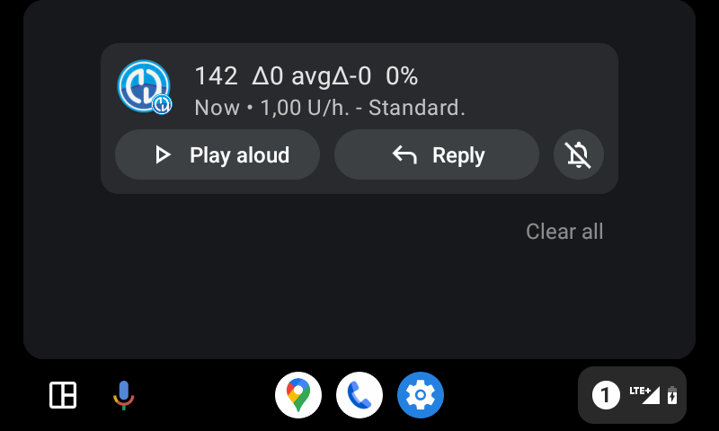

(androidauto-check-that-aaps-can-show-notifications)=

## Kontroller, at AAPS kan vise notifikationer

**AAPS** viser altid en statusnotifikation med dit aktuelle glukoseniveau, IOB og COB. Det er denne notifikation, som Android Auto viser i bilen. Der er intet at slå til i **AAPS**, men Android skal tillade **AAPS** at vise notifikationer.

Åbn på din telefon **Indstillinger** > **Apps** > **AAPS** > **Notifikationer**, og sørg for, at **Alle AAPS-notifikationer** er slået til.

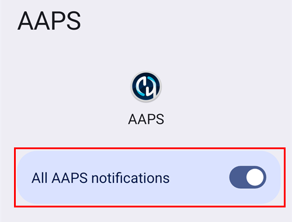

Rul ned, og sørg for, at **Løbende status** er slået til: det er kanalen for statusnotifikationen.

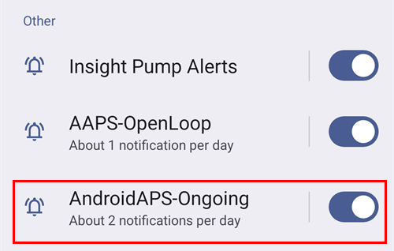

Kontroller nu, at du kan se statusnotifikationen fra **AAPS** på telefonen, før du går hen til din bil!

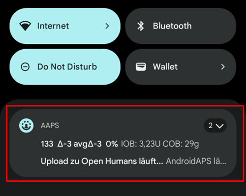

(androidauto-allow-the-use-of-unknown-sources-with-android-auto)=

## Tillad brugen af »ukendte kilder« i Android Auto.

Da **AAPS** ikke er en officiel Android Auto-app, skal notifikationer aktiveres for »ukendte kilder« i Android Auto. Det gøres med udviklertilstanden, som vi viser dig her.

Gå hen til din bil, og forbind din telefon med bilens lydanlæg.

Du bør nu se en skærm, der ligner denne.

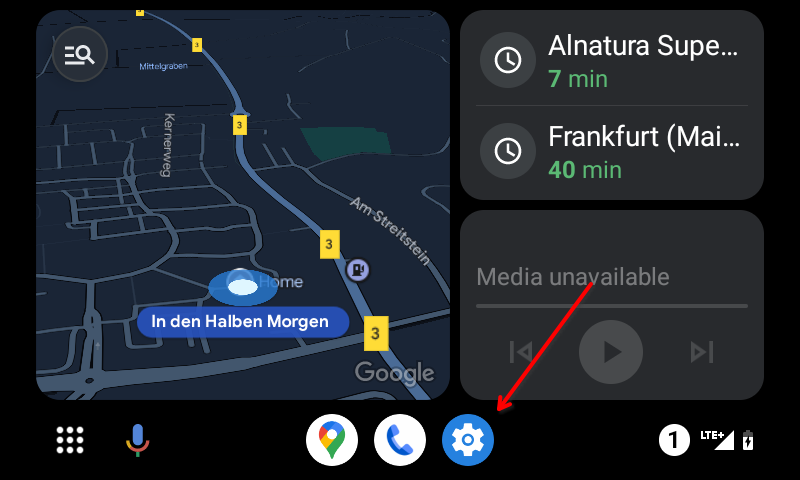

Tryk på ikonet **Indstillinger** for at starte konfigurationen.

Rul ned til bunden af siden, og vælg **Se mere på telefonen** (see more in the phone).

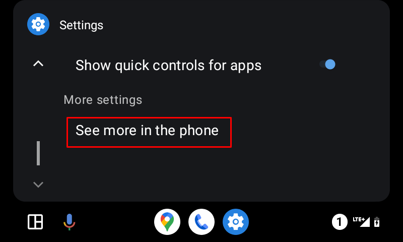

Nu aktiverer vi udviklertilstanden på telefonen.

Den første skærm ser sådan ud. Rul ned til bunden af siden.

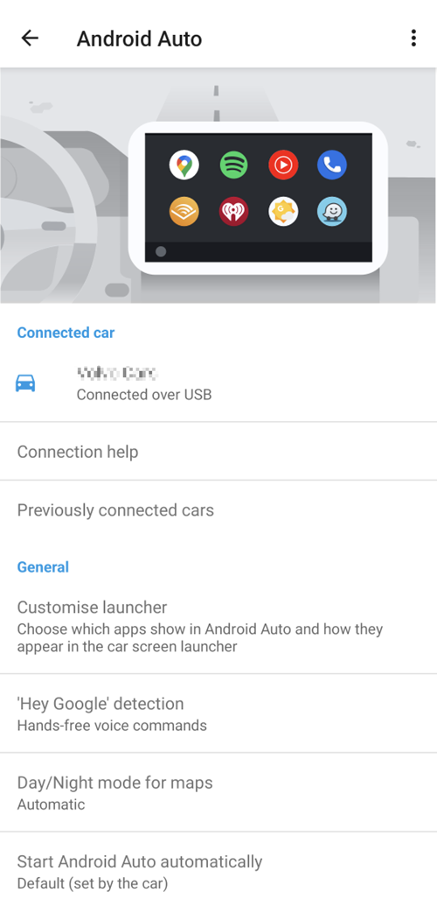

Der kan du se versionen af Android Auto. Tryk 10 gange (med bogstaver: ti) på versionen af Android Auto. Med denne skjulte kombination har du nu aktiveret udviklertilstanden.

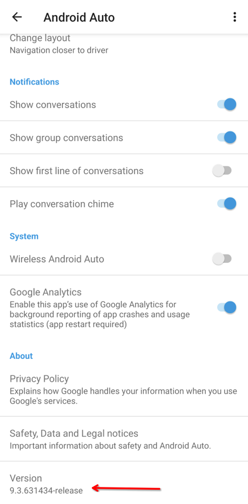

Bekræft i dialogboksen »Vil du tillade udviklerindstillinger?« (Allow development settings?), at du vil aktivere udviklertilstanden.

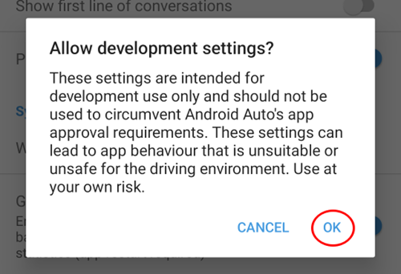

Aktiver »Ukendte kilder« (Unknown sources) i **Udviklerindstillinger**.

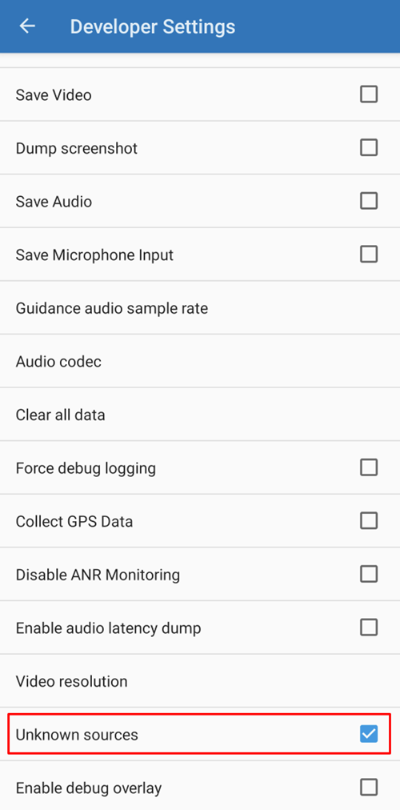

Nu kan du forlade udviklertilstanden, hvis du vil. Tryk på menuen med tre prikker øverst til højre for at gøre det.

## Vis notifikationer i bilen

Tryk på **talikonet** nederst til højre i Android Auto i din bil.

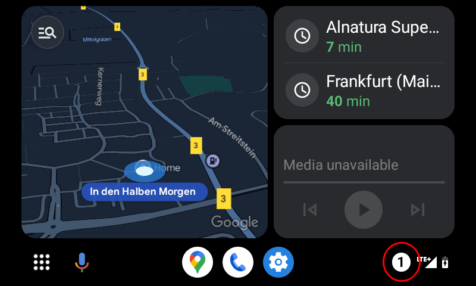

Dine CGM-data vises sådan:

(android-auto-troubleshooting)=

## Fejlfinding:

* Hvis du ikke kan se notifikationen, så kontroller, om du har [tilladt AAPS at vise notifikationer](#androidauto-check-that-aaps-can-show-notifications) i Android, og om [Android Auto har adgang til notifikationer](#androidauto-allow-the-use-of-unknown-sources-with-android-auto).