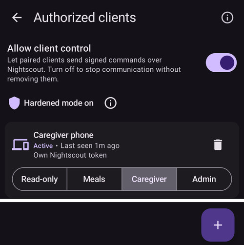
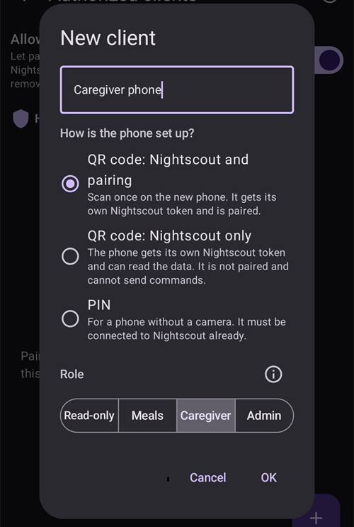
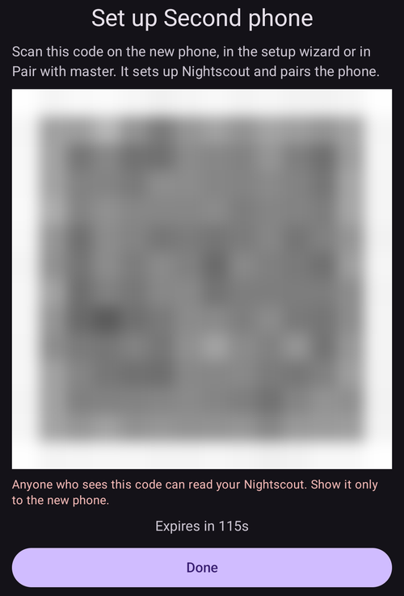
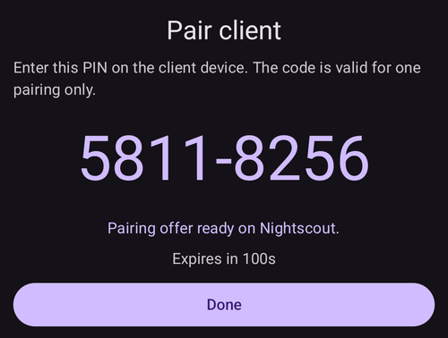
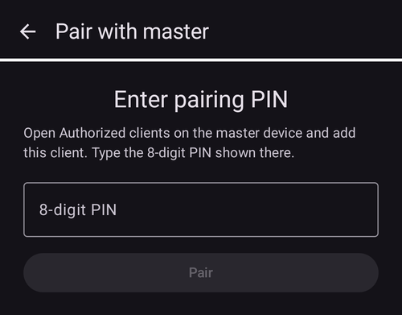
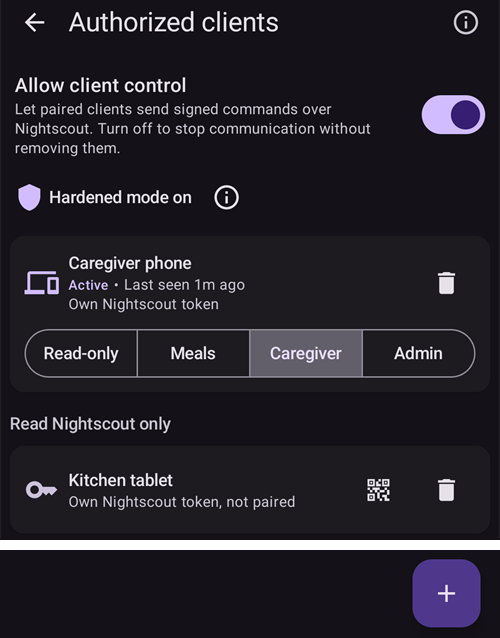
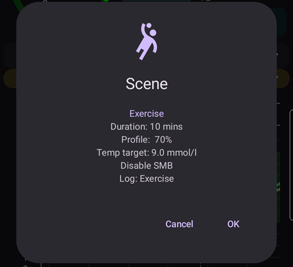
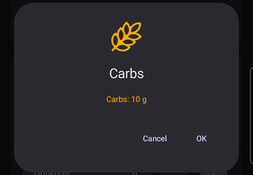
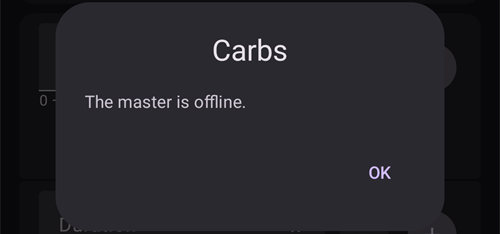
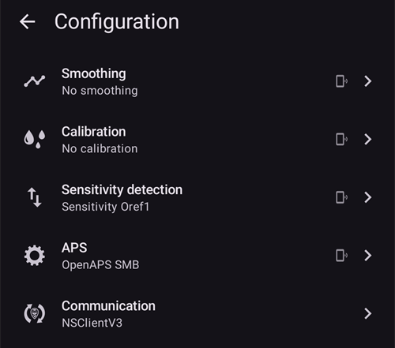

(client-master-control)=
# Styring mellem hovedenhed ↔ klient (signeret fjernstyring)

Fra **AAPS** version 4 kan en følgertelefon med **AAPSClient** meget mere end bare at *meddele* behandlinger via Nightscout: når den er **parret** med den primære telefon, kan den sende **signerede kommandoer**, som den primære telefon (**hovedenheden**) kontrollerer, bekræfter og udfører — også levering af en **insulinbolus** på hovedenhedens pumpe.

Denne side forklarer, hvordan det virker, og hvordan du sætter det op og bruger det.

```{contents} Table of contents
:depth: 2
:local: true
```

```{admonition} Wording used on this page
:class: note
- **Hovedenhed** = den primære **AAPS**-telefon, som har pumpen og kører loopet (appen `full`).
- **Klient** = en **AAPSClient**-telefon uden pumpe, som følger og nu også *styrer* hovedenheden.
- Begge telefoner skal være forbundet til **den samme Nightscout**-side. Al kommunikation går stadig via Nightscout — der er ikke brug for en direkte forbindelse mellem telefonerne.
```

---

## Sådan virker det

```{admonition} Coming from AAPS v3?
:class: note
I **AAPS** v3 kunne **AAPSClient** kun skrive usignerede careportal-behandlinger til Nightscout og kunne ikke levere en bolus. Fjernstyring kræver nu en [parring](#client_master_master_setup), som kun skal laves én gang. Se også [Hvad er ændret i AAPS v4](#v4changes-remote-control).
```

**AAPS** v4 bruger en særskilt **Client-Control**-kanal. Den kører stadig via din Nightscout-side (i samlingen `settings`), men hver besked er **kryptografisk signeret** med en hemmelig nøgle, som kun de to telefoner kender. Nøglen bliver overdraget én gang, under **parringen**, og lige efter erstattet af en ny, så den aldrig sendes i klartekst.

Grundprincippet er: **hovedenheden bestemmer**:

1. Klienten sender en *hensigt* (»bolus 2 IE«, »start scenen Motion«, »sæt dette midlertidige mål«…).
2. **Hovedenheden** beregner handlingen igen og **begrænser** den ud fra sine **egne** aktuelle data (profil, IOB, COB, aktuelt midlertidigt mål, pumpe), og **skriver selv den præcise bekræftelse**, som brugeren ser.
3. Klienten (eller uret) viser **hovedenhedens** bekræftelsestekst — den laver aldrig sin egen.
4. Når du bekræfter, **udfører hovedenheden handlingen én gang** og melder resultatet tilbage til klienten.

Hvad det betyder for dig:

- **Signerede kommandoer**: kun de klienter, du har parret, kan sende kommandoer (egen parringsnøgle og signatur for hver klient). Gamle eller gentagne kommandoer bliver afvist.
- **En rolle for hver klient**: du bestemmer, hvad hver klient må, fra *Skrivebeskyttet* til *Admin* — se [Klientroller](#client-master-control-roles).
- **Insulinbolus fra en klient**: hovedenheden leverer den på sin pumpe, og klienten viser, hvor langt leveringen er nået.
- **Hovedenheden bestemmer**: den begrænser hver handling ud fra sine egne grænser og skriver den bekræftelse, der vises på klienten.
- **Kun parrede klienter ændrer behandlingen**: når styring fra klienter er slået til, tager hovedenheden ikke længere imod behandlinger eller ændringer, der er skrevet direkte i Nightscout — se [Hærdet tilstand](#client-master-control-hardened-mode).
- **Hver klient får sit eget Nightscout-token** med kun de rettigheder, en klient har brug for — se [Klientens eget Nightscout-token](#client-master-control-own-token).
- **Hovedenhed offline**: handlinger bliver blokeret med en klar besked.
- **At tilbagekalde en klient** kræver kun ét tryk (for hver klient), eller du kan bruge hovedenhedens kontakt til at stoppe alle klienter.

Handlinger, der kan startes fra en klient: **bolus**, **kulhydrater / e-kulhydrater**, **midlertidigt mål** (sæt og annuller), **profilskift**, ændring af **loop / loop-tilstand**, **midlertidig basal** (sæt og annuller), **forlænget bolus** (sæt og annuller), **valg af insulin** og **[scener](../DailyLifeWithAaps/Scenes.md)**. En del af **indstillingerne** bliver også holdt synkroniseret i begge retninger mellem hovedenhed og klienter.

---

## Roller og forudsætninger

```{admonition} Before you start
:class: important
- **Hovedenheden** kører det normale **AAPS**-build `full` og er forbundet til din pumpe.
- **Hovedenheden** bruger **NSClientV3** med din Nightscout og viser *forbundet*. Giv den et **admin-token** til din Nightscout: med det kan hovedenheden lave et eget token til hver klient og vise det for klienten som en QR-kode.
- **Klienten** kører **[AAPSClient](AapsClient.md)** (eller **AAPSClient2** / **AAPSClient3** til flere patienter — se [Om AAPSClient, AAPSClient2 og AAPSClient3](#remotecontrol-aapsclient-versions)). Den skal bruge **samme** Nightscout. Hvis du sætter den op med hovedenhedens QR-kode, får klienten sin Nightscout-adresse og sit token fra hovedenheden; ellers skal du selv sætte **NSClientV3** op på den først.
- Websockets er **påkrævet** for fjernstyring fra **AAPSClient**, på begge telefoner. En kommando gælder kun i få sekunder: uden websockets mislykkes den i stedet for at komme frem for sent. Mens styring fra klienter er slået til, holder **AAPS** websockets slået til på hovedenheden og på parrede klienter. Din Nightscout-host skal understøtte websockets.
```

Parring og synkronisering er to forskellige ting:

- **Synkronisering** (data: BS, behandlinger, profil) sættes op som før — se [Synkronisering](#RemoteControl_aapsclient). Hovedenhedens QR-kode kan gøre det for dig på klienten.
- **Parring** (styring: den signerede kommandokanal, som beskrives her) er det nye trin nedenfor.

---

## Opsætning

(client_master_master_setup)=
### 1. På hovedenheden — aktiver styring og tilføj en klient

På hovedenheden åbner du skærmen **Administrer** og vælger **Godkendte klienter**.

Slå **Tillad styring fra klienter** til (den er **slået fra** som standard). Dette er hovedafbryderen: når den er slået fra, kan ingen klient sende kommandoer, men dine parrede klienter bliver gemt, så du kan slå den til igen senere. Når du slår den til, slås [Hærdet tilstand](#client-master-control-hardened-mode) også til. Det vises som »*Hærdet tilstand til*« med et **(i)**, der forklarer det. I [Simpel tilstand](#preferences-simple-mode) er styring fra klienter altid slået til, så kontakten vises ikke.



Tryk på knappen **+** (nederst til højre) for at tilføje en klient. I dialogen **Ny klient**:

1. Skriv et **enhedsnavn**, så du kan genkende den på listen.
2. Vælg **hvordan telefonen sættes op** (se tabellen nedenfor).
3. Vælg dens **[rolle](#client-master-control-roles)**. Intet er valgt på forhånd: den rigtige rolle afhænger af, hvem der bruger telefonen.



| Måde                               | Hvad den nye telefon får                                                     | Brug den, når                                                                                                              |
| ---------------------------------- | ---------------------------------------------------------------------------- | -------------------------------------------------------------------------------------------------------------------------- |
| **QR-kode: Nightscout og parring** | Nightscout-adressen, sit eget Nightscout-token og parringen, med én scanning | den nye telefon har et kamera: den hurtigste måde, du skal ikke skrive noget                                               |
| **QR-kode: kun Nightscout**        | Nightscout-adressen og sit eget Nightscout-token, ingen parring              | telefonen kun skal **vise** data og aldrig sende kommandoer                                                                |
| **PIN**                            | kun parringen; den beholder de Nightscout-indstillinger, den har             | telefonen har ikke noget kamera (eller hovedenheden kan ikke lave tokens); den skal allerede være forbundet til Nightscout |

De to måder med QR-kode kræver et **admin-token** i hovedenhedens **NSClientV3**-indstillinger, fordi hovedenheden laver klientens token i Nightscout. Uden et sådant token vises mulighederne med QR-kode, men de kan ikke vælges, og dialogen forklarer hvorfor; **PIN** virker altid.

#### Med en QR-kode

Tryk på **OK**: hovedenheden laver klientens Nightscout-token og viser en **QR-kode**. En kode, der også parrer, virker i ca. **to minutter**; skærmen tæller ned og lukker af sig selv, når klienten er parret. Scan den på den nye telefon som beskrevet i [På klienten](#client_master_client_setup).

```{admonition} The QR code is a secret
:class: warning
Alle, der ser QR-koden, kan læse din Nightscout, og en kode, der parrer, indeholder også parringen. Vis den kun til den nye telefon. **AAPS** blokerer skærmbilleder, mens koden vises på skærmen.
```



#### Med en PIN

Tryk på **OK**: hovedenheden viser en 8-cifret **parrings-PIN** i to grupper med fire cifre (for eksempel `1234 5678`). Denne PIN kan kun bruges **én gang** og **udløber efter ca. to minutter**. Som med QR-koden afviser hovedenheden et klientnavn, der allerede er på listen: hver klient får sit eget Nightscout-token under sit navn.



```{admonition} The pairing PIN is a secret
:class: warning
PIN beskytter parringsnøglen, der udveksles via Nightscout. Del den kun med den enhed, du parrer, slå den ikke op offentligt, og lad den udløbe, hvis du ikke bruger den. Du kan altid lave en ny PIN ved at trykke på **+** igen.
```

(client_master_client_setup)=
### 2. På klienten — par med hovedenheden

#### Scan QR-koden

Du kan scanne hovedenhedens QR-kode to steder:

- i klientens **Opsætningsguide**, på trinnet »**Opsæt fra hovedenheden**«, som kommer før Nightscout-trinnet. Én scanning sætter så Nightscout op og, med en kode der parrer, også parringen, så opsætningen er færdig: guiden lukker, og startskærmen åbner;
- når som helst senere fra **Administrer → Par med hovedenhed → Scan QR-kode**.

Første gang beder **AAPSClient** om tilladelse til at bruge **kameraet**. Hvis du afviser det, siger skærmen, at kameraet er nødvendigt, og du kan tillade det med **Prøv igen** eller parre med PIN i stedet.

Ret kameraet mod koden. Klienten viser, hvad koden gør — Nightscout-adressen og, for en kode der parrer, den hovedenhed, den parrer med — og spørger »**Brug denne kode?**«. Tryk på **Brug**: klienten slår **NSClientV3** til, erstatter sin Nightscout-adresse og sit token med dem fra koden og slår websockets til. En kode, der parrer, parrer også telefonen; den siger goddag til hovedenheden, så snart den har forbindelse til Nightscout.


```{admonition} Scanning is available on Android
:class: note
En computer uden kamera: brug PIN der.
```

#### Indtast PIN

På klienten åbner du **Administrer → Par med hovedenhed** (eller trinnet **Par med hovedenhed** i guiden, efter Nightscout-trinnet), **indtaster den 8-cifrede PIN**, der vises på hovedenheden, og trykker på **Par**. Klienten bruger PIN til sikkert at hente parringstilbuddet via Nightscout, spørger derefter »**Par med denne hovedenhed?**« og viser hovedenhedens identifikation. Tryk på **Par** for at bekræfte (se [Parring med hovedenheden](#aapsclient-pairing-with-the-master) for et skærmbillede).



#### Efter parring

Når en klient er parret, sender den et **Hello** til hovedenheden og vises på hovedenhedens liste **Godkendte klienter** som **Aktiv**, med et tidspunkt for *»sidst set«*. Klienten kender sin [rolle](#client-master-control-roles) fra parringen, så den viser de rigtige knapper med det samme. En parring, der laves i opsætningsguiden, afslutter guiden. I samme trin erstatter de to telefoner parringsnøglen med en ny, som aldrig er blevet sendt (se [Om sikkerhed](#client-master-control-security)), og en klient, der blev sat op med PIN, får sit eget Nightscout-token (se [Klientens eget Nightscout-token](#client-master-control-own-token)). En klient kan være parret med **én** hovedenhed ad gangen; for at parre med en anden hovedenhed skal du først vælge **Ophæv parring**.


### 3. Administrer klienter

Fra hovedenhedens skærm **Godkendte klienter** kan du når som helst:

- **Skifte rollen** for en klient med rækken med fire knapper under dens navn. Den nye rolle gælder med det samme, uden at du skal parre igen.
- **Se, hvilket Nightscout-token** en klient skriver med: »*Eget Nightscout-token*« er det, du vil have. En rød linje »*Bruger Nightscout-tokenet …, som har flere rettigheder, end en klient har brug for*« betyder, at klienten stadig bruger et token med flere rettigheder, som regel dit admin-token — se [Klientens eget Nightscout-token](#client-master-control-own-token).
- **Tilbagekalde** en enkelt klient — tryk på ikonet **skraldespand** ved siden af den. Klienten kan ikke længere sende kommandoer, før den bliver parret igen. Dens eget Nightscout-token bliver også slettet, så den heller ikke længere kan læse din Nightscout.
- **Stoppe al styring** uden at miste parringerne — slå **Tillad styring fra klienter** fra.

Telefoner, der er sat op med **QR-kode: kun Nightscout**, vises under klienterne, under »**Læser kun Nightscout**«. For hver af dem kan du vise QR-koden igen (for at sætte den samme telefon op igen) eller slette dens token, hvilket stopper dens adgang til din Nightscout.



---

(client-master-control-roles)=
## Klientroller

Hver parret klient har en **rolle**. Hovedenheden kontrollerer den for hver kommando, og klienten viser kun det, som dens rolle tillader. En ny rolle gælder med det samme, uden at du skal parre igen. Rollerne bygger på hinanden: hver rolle kan alt det, som rollen før den kan.

| Rolle               | Klienten må                                                                                                                                                                                                                                                                     |
| ------------------- | ------------------------------------------------------------------------------------------------------------------------------------------------------------------------------------------------------------------------------------------------------------------------------- |
| **Skrivebeskyttet** | kun vise data. Den forbliver parret, så den er klar, når du giver den en højere rolle.                                                                                                                                                                                          |
| **Måltider**        | give en bolus, bruge bolusberegneren og hurtigbolus, indtaste kulhydrater og stoppe en igangværende bolus. Kulhydrater, der indtastes her, kan få loopet til at give mere insulin.                                                                                              |
| **Omsorgsperson**   | gøre alt, hvad en bruger gør i **AAPS**: midlertidige mål, skift af profil og insulin, loop-tilstand, midlertidig basal, forlænget bolus, scener, careportal-hændelser, kalibreringer og sletning af registreringer. Den kan ikke ændre indstillinger eller forudindstillinger. |
| **Admin**           | gøre alt, også indstillinger og forudindstillinger (hurtigbolus, forudindstillinger for midlertidige mål, scener, profiler, automatisering, insulin).                                                                                                                           |

**(i)** øverst på skærmen **Godkendte klienter** viser den samme forklaring. På klienten viser **Administrer → Par med hovedenhed** telefonens egen rolle.

---

(client-master-control-hardened-mode)=
## Hærdet tilstand

Når **Tillad styring fra klienter** er slået til, er hovedenheden i **hærdet tilstand**: den tager kun imod ændringer fra parrede klienter. Den tager **ikke** imod behandlinger, midlertidige mål, profilændringer, ændringer af loop-tilstand eller sletninger, der er lavet direkte i Nightscout, for eksempel på Nightscout-hjemmesiden eller i andre apps.

- Indstillingerne for at tage imod data fra Nightscout (**NSClientV3 → Synkronisering**) er skjult, mens hærdet tilstand er slået til; **AAPS** bruger dem, som om de var slået fra.
- Hovedenheden **uploader** stadig alle sine data til Nightscout, også BS, og holder **websockets** slået til.
- Hvis hovedenheden får sit **BS fra Nightscout**, tager den stadig BS derfra.
- For at hente historikken på en **ny** hovedenhed skal du bruge **Fuld synkronisering** i **NSClientV3**: den tager alt, hvad der er i Nightscout, også profiler.
- [SMS-kommandoer](SMSCommands.md) påvirkes ikke.

En parret klient følger hovedenhedens hærdede tilstand: den holder websockets slået til, og de samme Nightscout-indstillinger er skjult på den. En klient, der ikke er parret, beholder sine egne indstillinger.

[Simpel tilstand](#preferences-simple-mode) slår altid hærdet tilstand til. For at slå den fra skal du forlade simpel tilstand og slå **Tillad styring fra klienter** fra på hovedenheden.

```{admonition} Why hardened mode
:class: note
Alt, hvad en parret klient sender, er signeret, kontrolleret og bekræftet af hovedenheden. En behandling, der er skrevet på Nightscout-hjemmesiden, er ikke: alle med skriveadgang til din Nightscout kunne have tilføjet den. I hærdet tilstand kan kun signerede kommandoer ændre, hvad hovedenheden gør.
```

---

(client-master-control-own-token)=
## Klientens eget Nightscout-token

En klient har ikke brug for et admin-token. Den læser kun din Nightscout og sender sine kommandoer til hovedenheden via den; den uploader ikke selv noget. Derfor giver hovedenheden hver klient sit eget Nightscout-token med kun disse rettigheder:

- læse alt,
- skrive til samlingen `settings`, kanalen til hovedenheden,
- udsætte (snooze) Nightscout-alarmer.

Tokenet hører til en Nightscout-rolle med navnet **`aaps-client`**, som hovedenheden opretter første gang, den har brug for den. Du kan se rollen og tokens (med navnet `aaps-` og klientens navn) i **Admin tools** (administrationsværktøjer) på din Nightscout-side. Hvis rollen bliver ændret der, sætter hovedenheden den tilbage, næste gang den laver et token, eller når du åbner **Godkendte klienter**.

Sådan får en klient sit token:

- **Sat op med en QR-kode**: tokenet er i koden.
- **Parret med PIN** (eller parret, før denne funktion fandtes): efter parringen sender hovedenheden klientens eget token til den via den parrede kanal, krypteret. Klienten kontrollerer først, at et login med det virker, og bruger det derefter i stedet for det token, den havde. Det kræver et admin-token på hovedenheden; uden et sådant beholder klienten sit token, og dens kort på hovedenheden viser den røde linje.

**En klient beholder sit eget token.** Når hovedenheden har set en klient skrive med sit eget token, tager den kun imod den klients kommandoer med det token. En kommando, der er skrevet med et andet token (for eksempel et admin-token, der senere er skrevet ind i klienten, eller en anden klients token), bliver afvist, selv om klienten er parret, og klienten siger »*Hovedenheden afviste det: denne telefon skriver til Nightscout med et andet token end sit eget*«. Dens kort på hovedenheden siger det samme med rødt. Klienten vises stadig som online, så du kan se, hvad der er galt. For at rette det skal du fjerne klienten på hovedenheden og tilføje den igen.

Hovedenheden sletter eller ændrer aldrig et Nightscout-token, som den ikke selv har lavet (et med andre roller end `aaps-client`): de er dine. Den sletter en klients eget token, når du fjerner klienten.

---

## Brug af fjernstyring

### Start en handling fra klienten

Brug klienten præcis som du ville bruge selve telefonen: åbn **Kulhydrater**, **Insulin**, **Midlertidigt mål**, **Profil**, **Scener**, arket **Administrer** osv., og udfyld værdierne.

Når du bekræfter, viser klienten kort **»Kontakter hovedenhed…«**, **hovedenheden** beregner og begrænser handlingen, og klienten viser derefter **hovedenhedens egen bekræftelse** — præcis de linjer, værdier og farver, som hovedenheden ville vise på sin egen skærm. Gennemgå dem, og tryk på **OK** for at fortsætte.



Det samme gælder for en simpel indtastning af kulhydrater — mængden, der vises til bekræftelse, er den, som hovedenheden har beregnet:



Når du har bekræftet, udfører hovedenheden handlingen én gang, og resultatet vises tilbage på klienten.

### Insulinbolus fra en klient

Dette er den vigtigste nye funktion i v4. En bolus, der startes på en klient, **leveres af hovedenheden på dens pumpe**; hovedenheden begrænser den ud fra sine egne grænser, og klienten viser **leveringen live**, mens den kører (og en alarm, hvis pumpen melder en fejl).

```{admonition} Boluses are always confirmed and capped on the master
:class: note
En klient bestemmer aldrig selv den leverede mængde. Hovedenheden beregner og begrænser den igen, du bekræfter den mængde, som hovedenheden har skrevet, og først derefter bliver den leveret.
```

(clientmastercontrol-when-the-master-is-offline)=
### Når hovedenheden er offline

Hvis hovedenheden ikke kan nås (telefonen er slukket/i dvale, ikke forbundet til Nightscout, eller websockets er nede), bliver styringshandlinger på klienten **blokeret, før noget bliver sendt**, og du får en klar besked. Intet bliver udført halvt.



Klienten kontrollerer automatisk igen, om hovedenheden kan nås, og aktiverer styringen igen, når hovedenheden er online igen.

(clientmastercontrol-wear-os-on-a-client)=

### Wear OS (ur) på en klient

Et ur, der er parret med en **klient**-telefon, sender sine handlinger via klienten videre til hovedenheden (ur → klient → hovedenhed). Uret viser **hovedenhedens** bekræftelseslinjer og det rigtige resultat, præcis som telefonen. Opsætningen af uret er uændret — se [Wear OS](../WearOS/WearOsSmartwatch.md).


<!-- 📷 SCREENSHOT NEEDED (optional): watch confirmation screen relayed from the master,
     and/or the "Contacting master" state on the watch. Requires a paired Wear OS device. -->

---

(client-master-config-prefs)=
## Ændring af konfiguration og indstillinger

Parring gør mere end at videresende enkelte handlinger — den holder også **konfigurationen** og mange **indstillinger** ens mellem hovedenheden og dens klienter.

### Konfiguration (hvilke plugins der er aktive)

De aktive **plugins** (APS-algoritme, følsomhed, udjævning, …) vælges på **hovedenheden** og **spejles** til alle parrede klienter. På en klient er disse valg markeret med et lille **mobilikon** på skærmen [Konfiguration](#configuration_sync_icon) — ændr dem på hovedenheden, så følger klienterne automatisk med, og omvendt.

På en klient vises mobilikonet ved *Udjævning*, *Kalibrering*, *Detektering af følsomhed* og *APS* (synkroniseret fra hovedenheden), men ikke ved *Kommunikation*:



Forbindelsesoplysninger, som er unikke for hver enhed — især **NSClient Nightscout-URL / adgangstoken** — bliver *ikke* synkroniseret. Hver telefon har sine egne; på en klient kommer de fra hovedenhedens QR-kode, eller du indstiller dem selv.

### Profiler

Din **profilliste** bliver også holdt synkroniseret mellem hovedenheden og dens parrede klienter. På en parret klient viser **Administrer → Profil** de samme profiler som hovedenheden; du kan **redigere** en profil eller **aktivere** en, og — som alle andre kommandoer — sendes ændringen til **hovedenheden**, udføres der og synkroniseres tilbage.

Første gang du aktiverer en profil på en nyinstalleret klient, kan klienten vise »*Ingen insulin er i brug endnu*« og bede dig om at **vælge insulinen**. Vælg den insulin, der er aktiv på hovedenheden (**Administrer → Insulinindstillinger** på hovedenheden viser den).

På en klient, der **ikke er parret**, er skærmen Profil stadig tilgængelig, men **kun til visning**: klienten viser de profiler, den modtager via Nightscout (den har brug for dem til sine egne beregninger), men der er ingen knap til at redigere eller aktivere — der er ingen hovedenhed at sende ændringen til.

### Indstillinger

En del af **indstillingerne** er **tovejs**: du kan ændre dem på **hovedenheden eller på en parret klient**, og ændringen bliver synkroniseret til den anden side. Når du ændrer sådan en indstilling på en klient, bliver den sendt til hovedenheden via den signerede kanal, udført der, og den gældende værdi bliver sendt tilbage — så det, du ser på klienten, er altid det, som hovedenheden har gemt. Hvis den samme indstilling bliver ændret på to enheder næsten samtidig, er det **den seneste ændring, der gælder**. For en indstilling med en skyder bliver den nye værdi sendt, når du løfter fingeren.

Inde i indstillingerne markerer det samme lille **mobilikon** de enkelte indstillinger, der bliver synkroniseret. I eksemplet nedenfor bliver *Absorptionsgrænse* synkroniseret (mobilikon), mens indstillinger uden ikonet kun gælder på enheden selv:


```{admonition} The master must be online to change synced settings from a client
:class: note
Fordi hovedenheden bestemmer den gemte værdi, skal hovedenheden kunne **nås**, når du ændrer et konfigurationspunkt, som hovedenheden styrer, eller en tovejs-indstilling fra en klient. Når hovedenheden er offline, er disse knapper deaktiveret på klienten (se [Når hovedenheden er offline](#clientmastercontrol-when-the-master-is-offline)).
```

---

(client-master-control-security)=
## Om sikkerhed

```{admonition} How the channel is protected
:class: tip
- **Parringsnøgle**: hovedenheden giver den til klienten én gang — beskyttet af PIN i et Nightscout-dokument eller inde i QR-koden — og begge gemmer den krypteret.
- **En ny nøgle lige efter parringen**: klientens første besked efter parringen starter en udveksling af nøgler, og fra da af bruger begge telefoner en nøgle, som aldrig er blevet sendt. En nøgle, som nogen måske har set (en fotograferet QR-kode, et PIN-tilbud læst fra Nightscout), kan ikke bruges til noget bagefter. Telefoner, der blev parret, før denne funktion fandtes, gør det samme én gang efter opdateringen.
- **Hver kommando er signeret** (HMAC). Hovedenheden afviser alt, hvis signatur ikke passer til en parret klient.
- **Gentagelse forhindres** med en tæller for hver klient, som kun går opad, og hver kommando **udløber** efter kort tid.
- **Færrest mulige rettigheder i Nightscout**: hver klient har sit [eget Nightscout-token](#client-master-control-own-token), som kun kan læse og skrive til kanalen for klientstyring. Når klienten har brugt det, tager hovedenheden kun imod dens kommandoer med det token. Når du fjerner klienten, slettes tokenet.
- **Kun signerede ændringer**: i [hærdet tilstand](#client-master-control-hardened-mode) ignorerer hovedenheden ændringer af behandlingen, der er skrevet direkte i Nightscout.
- **Hovedenheden signerer det, den deler**: indstillingerne, klientlisten og tegnet »hovedenheden er i live«, som hovedenheden lægger i Nightscout til sine klienter, har hovedenhedens signatur. En klient tager kun imod dem, når signaturen er hovedenhedens, så en anden klients token kan ikke ændre dem. Klienten lærer hovedenhedens nøgle, når den parres, eller fra QR-koden for en telefon, der kun læser Nightscout. Et afvist dokument vises i NSClient-loggen som »*✕ SETTINGS … refused*«.
- **Du har stadig kontrollen**: giv hver klient den [rolle](#client-master-control-roles), den har brug for, tilbagekald en klient med ét tryk, eller slå alt fra med **Tillad styring fra klienter**.
```

```{admonition} After restoring a backup
:class: warning
Hvis en klient bliver gendannet fra en sikkerhedskopi, som sætter dens kommandotæller tilbage, vil hovedenheden afvise dens næste kommandoer som gentagelser. **Ophæv parringen, og par igen** for at rette det.
```

---

(client-master-control-troubleshooting)=

## Fejlfinding

Ved problemer med Nightscout / synkronisering skal du først se [Fejlfinding af NSClient](../GettingHelp/TroubleshootingNsClient.md).

### Pairing

**QR-kode-mulighederne kan ikke vælges i dialogen Ny klient**

Dialogen siger hvorfor:

- *Ikke et admin-token*: giv hovedenheden et admin-token til din Nightscout, eller tilføj klienten med **PIN**.
- *Ikke forbundet*: vent, til hovedenheden viser *forbundet* i **NSClientV3**.

**»Nightscout har et token med dette navn og andre rettigheder«**

Et af dine egne Nightscout-tokens hedder `aaps-` og dette navn. Vælg et andet navn til klienten.

**»En klient med dette navn er allerede på listen«**

Vælg et andet navn, eller fjern den klient først.

**Klienten siger »Denne kode er fra en anden AAPS-version«**

Hovedenhed og klient skal køre **samme** version af **AAPS**. Opdater den ældre af dem.

**Klienten siger »Denne kode er udløbet«**

En kode, der parrer, virker i ca. to minutter. Tilføj klienten igen på hovedenheden for at få en ny kode.

**Klienten siger »Denne telefon er allerede parret«**

Ophæv parringen først (**Administrer → Par med hovedenhed → Ophæv parring**), og scan derefter igen. En kode med **kun Nightscout** virker også på en parret telefon.

**Parringen bliver annulleret med »Parringsnøglen kunne ikke gemmes«**

Intet blev ændret. Start parringen igen. Hvis det bliver ved med at fejle, så genstart **AAPSClient** og prøv én gang til.

**Klienten siger, at den ikke er parret**

Par igen fra **Administrer → Par med hovedenhed**. Kontroller, at klienten er **Aktiv** på hovedenhedens liste **Godkendte klienter**.

**Der sker ikke noget efter parringen**

Sørg for, at **Tillad styring fra klienter** er slået TIL på hovedenheden, og at hovedenheden er forbundet til Nightscout.

### Kommandoer

**Klienten siger, at hovedenheden er offline, eller kommandoer mislykkes**

Kontroller, at:

- hovedenheden er vågen, og **AAPS** kører,
- begge telefoner er forbundet i **NSClientV3** til den samme Nightscout-side,
- **websockets** er slået til på begge telefoner.

Websockets er **påkrævet** for fjernstyring fra **AAPSClient**. Hvis websocket-forbindelsen bliver ved med at falde ud, virker fjernstyring ikke. Se [Fejlfinding af NSClient](../GettingHelp/TroubleshootingNsClient.md).

**En kommando bliver afvist af hovedenheden**

Hovedenheden kontrollerer hver kommando igen ud fra sin aktuelle tilstand: for eksempel findes den valgte profil ikke længere, eller pumpetypen passer ikke. Kontroller på hovedenheden.

**Behandlinger, der indtastes på Nightscout-hjemmesiden, bliver ikke udført**

Det er forventet i [hærdet tilstand](#client-master-control-hardened-mode). Indtast dem på en parret klient i stedet.

### Nightscout-tokens og indstillinger

**Klienten siger »Hovedenheden afviste det: denne telefon skriver til Nightscout med et andet token end sit eget«**

Klienten brugte før sit eget Nightscout-token og skriver nu med et andet, for eksempel efter at et token blev skrevet ind i dens Nightscout-indstillinger. Fjern klienten på hovedenheden, og tilføj den igen (se [Klientens eget Nightscout-token](#client-master-control-own-token)).

**Klientens kort viser »Bruger Nightscout-tokenet …« med rødt**

Klienten skriver stadig med et token, der har flere rettigheder, end den har brug for. Hovedenheden sender klienten sit eget token efter parringen, men kun hvis hovedenheden har et admin-token. Kontroller hovedenhedens token, eller sæt klienten op igen med en QR-kode.

**NSClient-loggen på klienten viser »✕ SETTINGS … refused«, og dens indstillinger følger ikke længere hovedenheden**

En anden har skrevet hovedenhedens indstillingsdokument, eller hovedenheden har en ny nøgle (for eksempel efter at dens data blev slettet). En parret klient tager selv imod den nye nøgle, næste gang den forbinder til Nightscout. En telefon, der kun læser Nightscout, skal have hovedenhedens QR-kode igen (**Læser kun Nightscout → Vis QR-kode**).

**En klient kan ikke længere læse Nightscout**

Dens token blev slettet, for eksempel fordi klienten blev fjernet på hovedenheden. Tilføj den igen.

---


<!-- =====================================================================
     SCREENSHOTS STILL TO ADD:
       1. (optional) Wear OS confirmation relayed from the master
     Already included:
       - authorized_clients_master.png       (master: Allow client control, hardened mode, client card, + button)
       - authorized_clients_roles.png        (master: client card with roles, Read Nightscout only section)
       - new_client_master.png               (master: New client dialog, three ways and role row)
       - qr_code_master.png                  (master: pairing QR code with countdown, code blurred; console screenshot)
       - aapsclient_wizard_from_master.png   (client: Set up from the master wizard step)
       - pair_with_master_unpaired.png       (client: pairing screen, unpaired PIN entry)
       - pairing_pin_master.png              (master: one-time pairing PIN — expired demo PIN)
       - pair_with_master_client.png         (client: pairing screen, paired state)
       - confirmation_master_authored.png    (client: master-authored scene confirmation)
       - carbs_confirmation_client.png       (client: master-authored carbs confirmation)
       - master_offline_error.png            (client: master-offline message)
     Maintainers: relocate page + images and fix cross-links as needed.
     ===================================================================== -->
