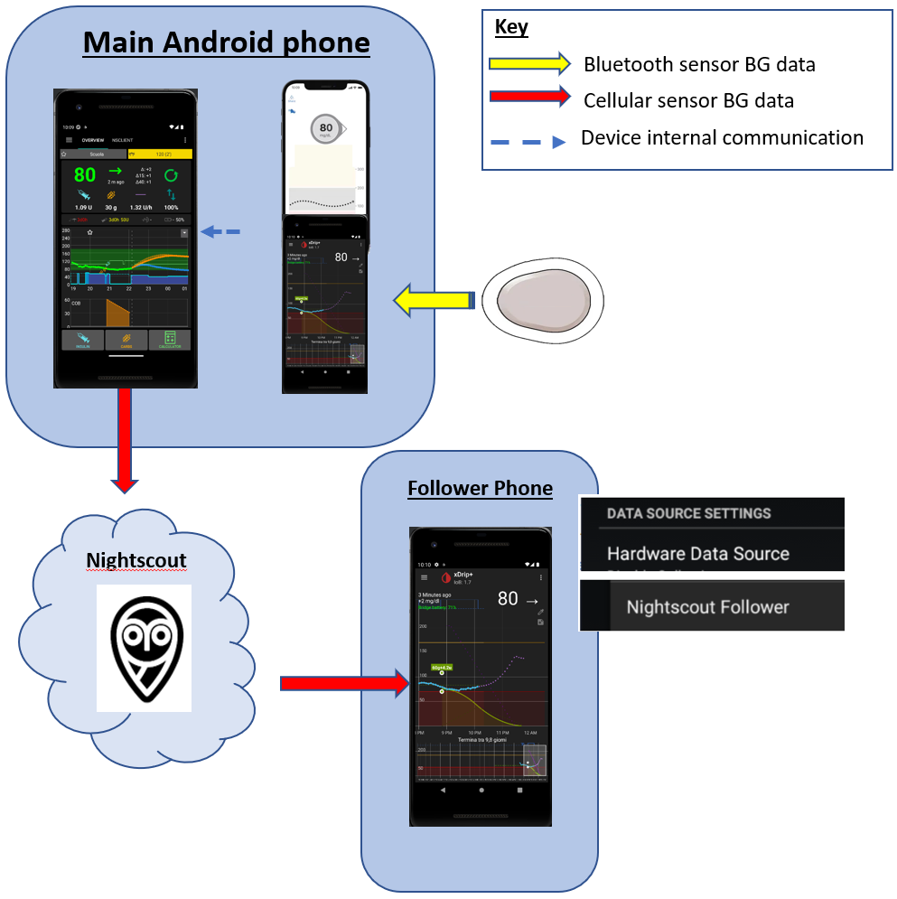
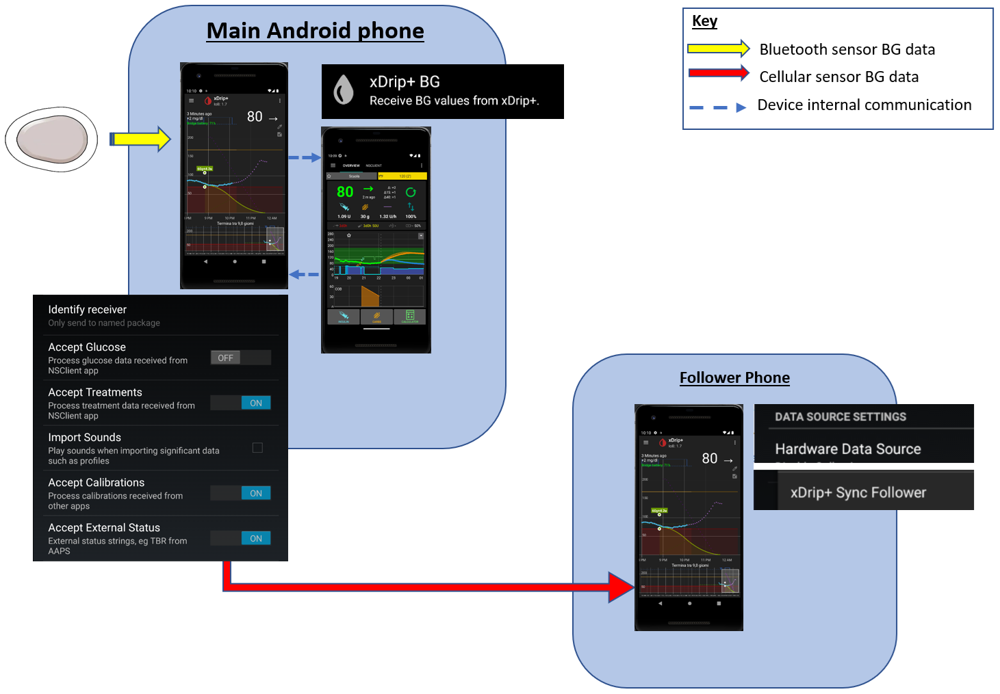
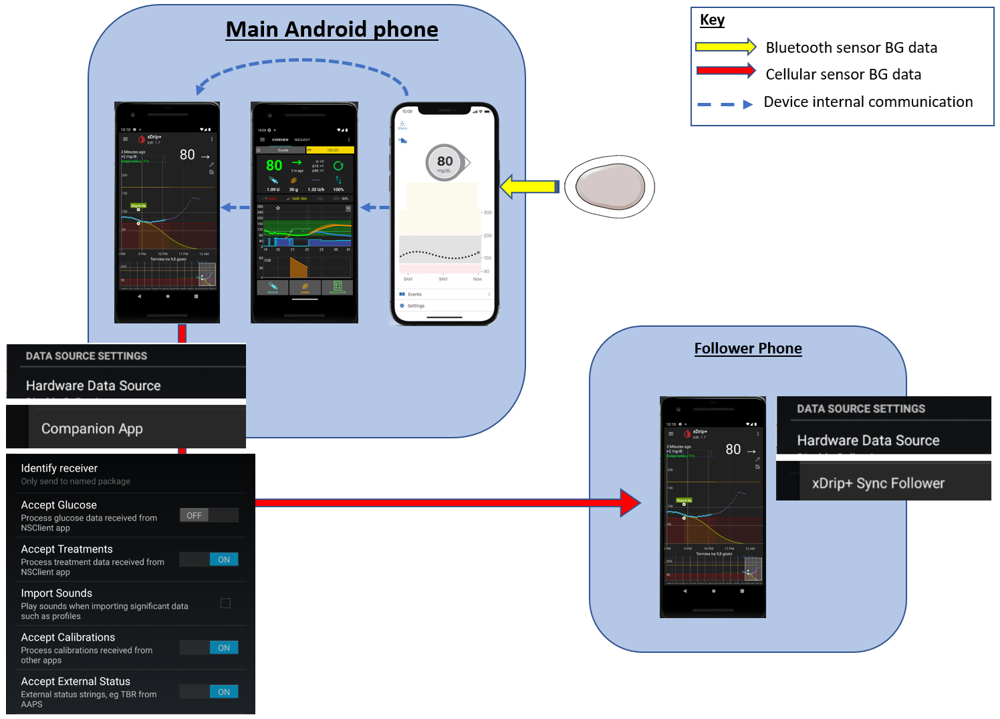
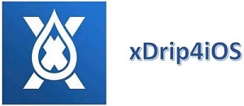
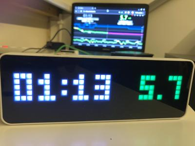

# Følg AAPS (uden interaktion med AAPS-systemet)

Ud over de mange muligheder for at fjernstyre _og_ følge **AAPS**, som er beskrevet under [Fjernstyring af AAPS](../RemoteFeatures/RemoteControl.md), findes der flere andre apps og enheder, som fællesskabet har udviklet. Med dem kan du blot følge tallene (glukoseværdier og anden information) uden at interagere med **AAPS**.

Du finder en god oversigt over de mange muligheder for at følge **AAPS** på websiden [Nightscout follower](https://nightscout.github.io/nightscout/downloaders/#).

```{contents} Table of contents
:depth: 1
:local: true
```

De mest almindelige metoder, der bruges sammen med **AAPS**, bliver forklaret mere detaljeret nedenfor.

## Apps til smartphones

```{contents} These are some of the main “follower” apps used by **AAPS** users. All of these apps are “free”: 
:depth: 1
:local: true
```

### Dexcom Follow ([Android](https://play.google.com/store/apps/details?id=com.dexcom.follow.region2.mgdl) og [iOS](https://apps.apple.com/fr/app/dexcom-follow-mg-dl-dxcm2/id1032203080))


* Dexcom Follow virker på mange forskellige telefoner (både Android og iPhone). Dexcom Follow kan bruges, selvom du ikke bruger den officielle Dexcom-app til at modtage sensordata.

* Mange omsorgspersoner kender Dexcom Follow og foretrækker dens enkle skærm frem for noget mere kompliceret.

* Dexcom Follow er meget god til lærere, bedsteforældre og personer, som ved meget lidt om diabetes og blodsukkerniveauer. Den har alarmer, som kan tilpasses (BS-niveau, hvilken lyd der skal afspilles osv.). Alarmer kan slås helt fra, hvis det er nødvendigt. Det er meget nyttigt, hvis du har en sensor, som stadig er ved at falde til ro og giver mange falske lave værdier.

#### Opsætning af Dexcom Follow: vejledning

Hvis du bruger den uofficielle Dexcom-app BYODA til at modtage sensordata, kan du måske sende invitationer til følgere direkte fra BYODA-appen.

Du kan ikke længere sende invitationer på e-mail til Dexcom-følgere fra tredjepartsapps. I xDrip giver anmodningen om invitation kun beskeden »invite not sent« (invitation ikke sendt).

Du skal installere den officielle Dexcom-app, sende invitationen og derefter afinstallere den officielle app.

Sådan gør du:

1)  Installer den officielle »Dexcom«-app på _en hvilken som helst_ smartphone (Android/iPhone). Det kan være følgerens telefon, hvis det er nemmere. 2)  Log ind med dit Dexcom-brugernavn og din adgangskode. Det er de samme login-oplysninger, som du bruger til Dexcom Clarity, hvis du allerede er Dexcom/Clarity-kunde. Hvis du ikke har et Dexcom-login, kan du oprette et nyt login her.   
3)  Swipe igennem introduktionsmenuerne. 4)  Vælg »no code« (ingen kode) som sensorkode. 5)  Under »Transmitter SN« (senderens serienummer) vælger du »enter manually« (indtast manuelt) og indtaster en gyldig senderkode (brug en af dine udløbne senderkoder, hvis du kender en, så den ikke forstyrrer din nuværende sender. Koderne følger et bestemt format af tal og bogstaver: »NLNNNL«, og kun visse kombinationer er gyldige, så det er nemmest at bruge en, som du allerede ved er gyldig). 6)  Når appen prøver at finde senderen og sensoren, kan du invitere følgere: tryk på de tre små prikker øverst til venstre i appen, og tilføj en ny følger. Du kan også bruge dette, hvis en af dine følgere har fået en ny telefon og har brug for en ny invitation. Her kan du slette følgeren fra listen og sende en ny invitation på e-mail, som følgeren kan bruge på sin nye telefon. 7)  På følgerens telefon installerer du Dexcom Follow fra App Store (iPhone) eller Play Butik (Android). Sæt Dexcom Follow-appen op. Du bliver bedt om at åbne din e-mail og finde invitationen til at blive følger.    
8)  Nu kan du slette den officielle Dexcom G6-app.

Til Dexcom Follow bliver sensordata derefter eksporteret fra **AAPS**-telefonen, enten direkte fra BYODA eller fra xDrip, afhængigt af hvilken app du bruger.


### [Nightguard](https://apps.apple.com/fr/app/nightguard/id1116430352) (iOS)


Fordele (som brugerne fortæller):

* Findes i [App Store](https://apps.apple.com/us/app/nightguard/id1116430352). Enkel og brugervenlig skærm.

* Swipe på knappen eller ryst telefonen for at udsætte alarmer i forskellige tidsrum fra 5 min til 24 timer

* Tilpas alarmer (advarsler ved høj og lav værdi, manglende målinger, når der ikke er data i 15-45 minutter).

* Hurtig stigning/fald over 2-5 målinger i træk (du vælger selv). Du kan også vælge delta mellem to enkelte målinger

* Smart udsættelse, så der ikke kommer en advarsel, hvis værdierne bevæger sig i den rigtige retning

* Der er en »Care«-fane, som ser ud til at lade dig sætte et nyt midlertidigt mål i en bestemt periode, slette det midlertidige mål eller indtaste kulhydrater.

Ulemper (som brugerne fortæller)

* Kun til iOS

* Det midlertidige mål vises som 5 mmol, uanset hvilket niveau der er sat

* Viser aldrig den midlertidige basalrate, selvom den viser TB

### [Nightwatch](https://play.google.com/store/apps/details?id=se.cornixit.nightwatch) (Android)


* Nightwatch beskriver sig selv som en Nightscout-klient og overvåger brugerens glukoseværdier fra Nightscout på en Android-telefon eller -tablet.

* Appen kan downloades fra [Google Play](https://play.google.com/store/apps/details?id=se.cornixit.nightwatch) og viser BS-data i realtid.

* Brugeren kan få besked med tilpassede, høje alarmer for lav og høj værdi.

* BS-data kan vises i enten mmol/l eller mg/dl.

* Den kræver Android 5.0 eller nyere.

* Den har en mørk brugerflade og store tal og knapper, lavet til brug om natten.

### xDrip (Android)

Du kan bruge xDrip som følger.

#### Med Nightscout

Sæt xDrip op som Nightscout-følger. Du modtager BS og behandlinger, men ikke basal.



#### Uden Nightscout - xDrip som BS-datakilde

Hvis din **AAPS**-datakilde er xDrip (eller hvis xDrip også kan modtage BS fra en anden app som BYODA, Juggluco, ...), kan du bruge den på hovedenheden til at dele data med xDrip-følgere. De ser BS, behandlinger og basalrater.



#### Uden Nightscout - xDrip med BS fra en companion-app

Hvis din **AAPS**-datakilde ikke er xDrip, men du kan vise BS-data fra datakilden »Companion App«, kan du bruge den på hovedenheden til at dele data med xDrip-følgere. De ser BS, behandlinger og basalrater.



### xDrip4iOS (iOS)



xDripSwift blev lavet ved at overføre den oprindelige xDrip-app til iOS og udviklede sig til »xDrip for iOS«, skrevet som **xDrip4iOS**.

```{admonition} Further detail about how to attempt to obtain the original **xDrip4iOS** app
:class: dropdown
[xDrip4iOS-gruppen på Facebook](https://www.facebook.com/groups/853994615056838/announcements) er det vigtigste sted for hjælp fra fællesskabet til xDrip4iOS og Shuggah. **xDrip4iOS** kan forbinde til mange forskellige CGM-systemer og sendere og vise blodsukkerværdier, grafer og statistik samt give alarmer. Den kan også uploade til Nightscout eller fungere som en [følger-app til Nightscout](https://xdrip4ios.readthedocs.io/en/latest/connect/follower/). 

»Hvordan får jeg **xDrip4iOS** på min iPhone?«
Der er to muligheder:

1. Hvis du har en Mac og en Apple Developer-konto (99 EUR/USD om året), kan du bygge din egen xDrip4iOS ved at [følge vejledningen](https://xdrip4ios.readthedocs.io/en/latest/install/build/).

Hvis du vil, kan du derefter blive »releaser« (udgiver) og [dele en personlig TestFlight-udgave af xDrip4iOS](https://xdrip4ios.readthedocs.io/en/latest/install/personal_testflight/) med op til 100 andre personer for at hjælpe dem.

2. Meld dig ind i [xDrip4iOS-gruppen på Facebook](https://www.facebook.com/groups/853994615056838/announcements), og læs de fastgjorte opslag for at se, hvordan du får appen lige nu. **Du må ikke bede om en invitation til appen** (læs gruppens regler).
```


»Hvad er **Shuggah**?« En gruppe ukrainske udviklere kopierede kildekoden til xDrip4iOS (som er offentligt delt på GitHub) og udgav den i App Store under en firmakonto. Udgivelsen Shuggah bliver på ingen måde styret af udviklerne af xDrip4iOS.

[xDrip4iOS-gruppen på Facebook](https://www.facebook.com/groups/853994615056838/announcements) giver hjælp til xDrip4iOS og de tilhørende Apple Watch-apps.

### [Sugarmate](https://apps.apple.com/fr/app/sugarmate/id1111093108) (iOS)


[Sugarmate](https://sugarmate.io/) kan downloades til iPhone fra App Store. Sugarmate virker med:
* Apple iPhone (kræver softwareversion 13.0 eller nyere)
* Apple iPad (kræver softwareversion 13.0 eller nyere)
* Google Android (gem webappen på din startskærm)

Brugere af Sugarmate fortæller, at appen kan bruges med Apple CarPlay i USA til at vise glukoseværdier, mens man kører bil. Det er endnu ikke kendt, om det er muligt i lande uden for USA. Hvis du ved mere om dette, så tilføj gerne detaljer her i dokumentationen ved at lave en [pull request](../SupportingAaps/HowToEditTheDocs.md). Det er hurtigt og nemt.


### [Spike](https://spike-app.com/) (iOS)


Spike kan bruges som primær modtager eller som følger-app og viser BS, alarmer, IOB og mere.

Hjemmesiden og appen bliver ikke længere udviklet. Du kan få hjælp på [Facebook](https://www.facebook.com/groups/1973791946274873) og [Gitter](https://gitter.im/SpikeiOS/Lobby).

## Smarture til **fjernovervågning af AAPS** (alle profildata eller kun glukose), hvor **AAPS** kører på en telefon.

Se [her](../Getting-Started/Watches.md).


## Enheder til at følge AAPS

```{contents} Devices include:
:depth: 1
:local: true
```

### M5Stack


M5Stack er en lille boks, som kan programmeres til mange formål. Martins projekt [M5Stack NightscoutMon](https://github.com/mlukasek/M5_NightscoutMon/wiki) viser sensorens glukoseværdier og tendenser, IOB og COB. Den sidder i en plastikboks og har en farveskærm, en holder til micro SD-kort, 3 knapper, en højttaler og et indbygget batteri. Det er en rigtig god blodsukkermonitor og forholdsvis nem at sætte op, hvis du har en Nightscout-konto. Brugere kører den normalt på deres Wi-Fi derhjemme, men nogle brugere fortæller, at de bruger den som skærm, når de kører motorcykel, ved at bruge et Wi-Fi-hotspot fra telefonen.

### SugarPixel

SugarPixel er en enhed til sekundær visning af glukose og et alarmsystem til kontinuerlig glukosemåling. Den forbinder til Dexcom-appen eller Nightscout-appen på brugerens smartphone. Enheden viser blodsukkerværdier i realtid. Denne CGM-skærm har lydalarmer med tilfældige toner (som er utroligt høje), vibrationsalarmer til hørehæmmede, visninger som kan tilpasses, og indbygget mulighed for at flere brugere kan følge.


* SugarPixel har flere visninger i mg/dl og mmol/l, så den passer til brugerens behov, med glukoseværdier i farvekoder.
* Standardvisningen viser BS, tendenspil og delta. Delta er ændringen + eller - fra den seneste måling.
* SugarPixel kan tilpasses til brug med lav lysstyrke med visningen »BG and Time« (BS og tid), så brugeren kan se sin BS-værdi og klokkeslættet på natbordet.
* SugarPixels farvevisning bruger hele skærmen til at vise én farve, som står for BS-værdien. Så kan brugeren se BS-værdier på afstand gennem vinduet, mens brugeren leger udenfor i haven, på terrassen eller i poolen.
* Visningen »Big BG« (stort BS) er nyttig ved natbordet for brugere, som bruger briller eller kontaktlinser.

### Nightscout Clock på Ulanzi TC001

**Nightscout Clock** er open source-software, som kører på enheden **Ulanzi TC001**. Den forbinder til Dexcoms servere eller Nightscout og viser blodsukkerværdier i realtid.



* Uret understøtter både mmol/l og mg/dl og har lydalarmer.
* Der findes flere visninger. Se [Github nightscout-clock](https://github.com/ktomy/nightscout-clock?tab=readme-ov-file#more-information-for-people-who-needs-it) for en oversigt.
* Opsætning og konfiguration af enheden kræver kun nogle få enkle trin. Når den er sat op, behøver den kun strøm og Wi-Fi for at virke.
* Enheden Ulanzi TC001 er meget billigere at købe end SugarPixel.
* Softwaren og installationsvejledningen findes på [Github nightscout-clock](https://github.com/ktomy/nightscout-clock?tab=readme-ov-file).
* Den bliver udviklet og vedligeholdt af Artiom Kenibasov, som giver hjælp i [Facebook-gruppen AAPS Users](https://www.facebook.com/groups/cgminthecloud/posts/8776932509094594/).

### PC (TeamViewer)
Nogle brugere synes, at et værktøj til fuld fjernadgang som [TeamViewer](https://www.teamviewer.com/) er nyttigt til avanceret fejlfinding på afstand.
