# Fjernstyring af AAPS

```{contents} In this page
:backlinks: entry
:depth: 2
```

Der er fire meget effektive værktøjer til at styre **AAPS** på afstand:

1) [SMS-kommandoer](#RemoteControl_SMS-Commands) (følgertelefonen kan være enten Android eller iOS), 2) [AAPSClient](#RemoteControl_aapsclient) (følgerenheden er en Android-telefon eller -tablet eller en computer med Windows, Mac eller Linux; på en iPhone skal du [bygge appen selv](#aapsclient-iphone)) 3) [Nightscout](#RemoteControl_nightscout) (Android, iOS eller anden computer/enhed), mest til at følge med: se bemærkningen om [styring fra klienter](#client-master-control) i det afsnit.  
4) [Smarture](#RemoteControl_smartwatches) (Android)

De tre første passer mest til omsorgspersoner/forældre, men smarture er meget nyttige for omsorgspersoner/forældre **og** for voksne med diabetes selv.

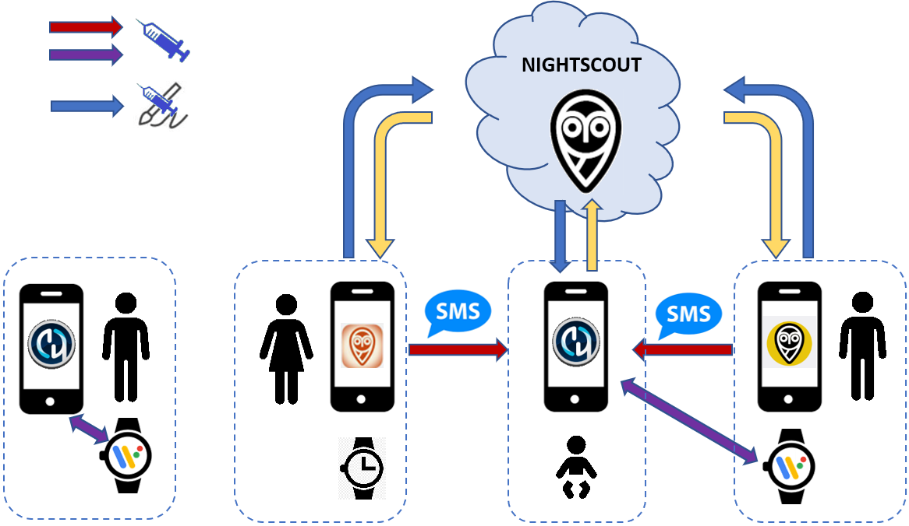

(RemoteControl_SMS-Commands)=

## 1) SMS-kommandoer

Se den særlige side [SMS-kommandoer](../RemoteFeatures/SMSCommands.md).

(RemoteControl_aapsclient)=
## 2) AAPSClient

**AAPSClient** ligner **AAPS** meget. Den giver omsorgspersonen de samme skærme og knapper til at sende kommandoer på afstand til **AAPS**:


(remotecontrol-aapsclient-versions)=
### Om AAPSClient, AAPSClient2 og AAPSClient3

Der er 3 versioner af klient-appen: **AAPSClient**, **AAPSClient2** og **AAPSClient3**. De virker på samme måde. Den eneste forskel er, at de kan installeres side om side på den samme følgertelefon.

En omsorgsperson, der følger én person, har kun brug for **AAPSClient**. For at følge og fjernstyre en person mere (med sin egen **Nightscout**-side og sin egen **AAPS**-telefon) skal du også installere **AAPSClient2**, og **AAPSClient3** til en tredje person. Hver app sættes op og [parres](#aapsclient-pairing-with-the-master) for sig, med **Nightscout**-siden og **AAPS**-telefonen hos den person, den følger.

For at kunne skelne apps fra hinanden har nogle elementer forskellig farve: gul for **AAPSClient**, blå for **AAPSClient2** og grøn for **AAPSClient3**. Disse elementer er app-ikonet, widgetens baggrund og **AAPS**-statusområdet på appens startskærm. <br/> Bemærk: gennemsigtigheden af widgetens baggrund kan indstilles i widgetens konfiguration. Hvis baggrunden er meget gennemsigtig, er farven svær at se.

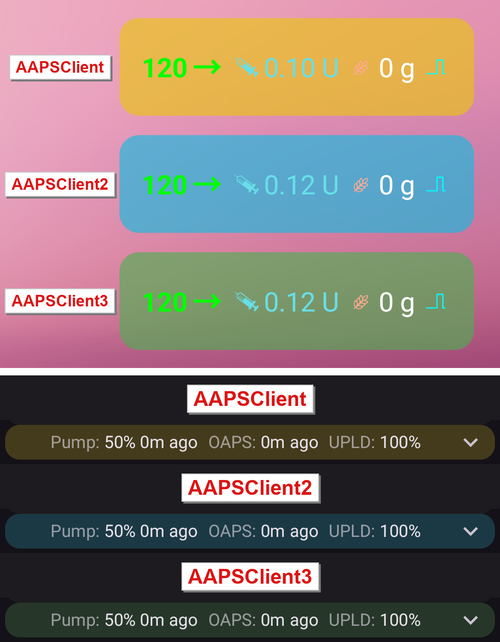

### Download og installation

**AAPSClient** kan installeres på én telefon eller på flere følgertelefoner (f.eks. forælder 1's følgertelefon og forælder 2's følgertelefon), så begge omsorgspersoner får adgang og kan fjernstyre patientens **AAPS**-telefon.

For at downloade **AAPSClient** skal du gå til [GitHub-repositoryet](https://github.com/nightscout/AndroidAPS/releases/) og klikke på filen **“app-AAPSClient-release_x.x.x.x”** (det kan være en nyere version end den, der vises på skærmbilledet nedenfor):

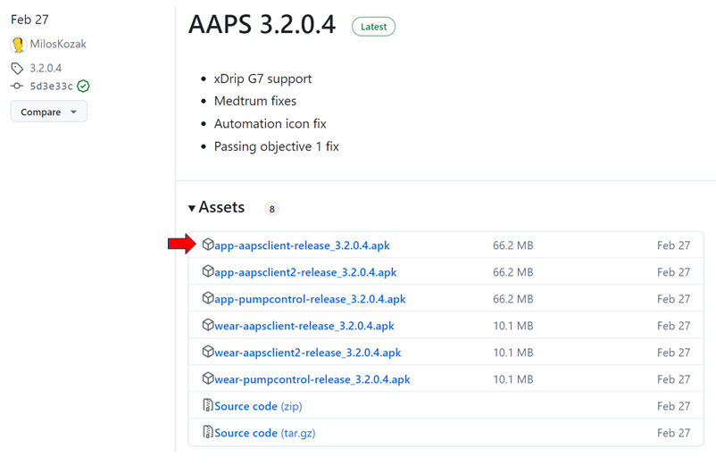

Gå derefter til _downloads_ på din computer. På Windows vises _downloads_ i båndet i højre side:

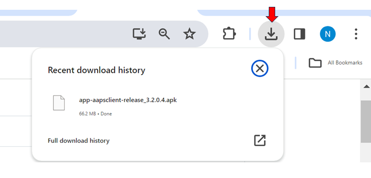

Når filen er downloadet, så klik på _show in folder_ (vis i mappe) for at finde filen.

**AAPSClient**-apk'en kan nu enten blive:

Overført med et USB-kabel til følgertelefonen; eller Trukket ind i en Google Drive-mappe og derefter lagt på følgertelefonen ved at trykke på filen "app-AAPSClient-release".

Hvis du har brug for **AAPS** til dig selv og **AAPSClient** til at følge en anden person, skal du selv bygge **AAPSClient** i stedet for at downloade den fra GitHub-repositoryet som beskrevet ovenfor. Grunden er, at du ikke kan installere både **AAPS** og **AAPSClient** på den samme telefon, hvis de er signeret med forskellige nøgler. <br/> For at bygge **AAPSClient** selv skal du følge samme fremgangsmåde som ved [almindelig build af AAPS](../SettingUpAaps/BuildingAaps.md). På siden **Generate signed App Bundle or APK** skal du vælge **aapsclientRelease** i stedet for **fullRelease**.

Den samme regel gælder, når du installerer flere klient-apps (**AAPSClient**, **AAPSClient2**, **AAPSClient3**) på én følgertelefon: de skal alle være signeret med den **samme nøgle**. Ellers nægter Android at installere den anden (fejl `INSTALL_FAILED_DUPLICATE_PERMISSION`).

### Synkronisering: opsætning af AAPSClient og AAPS

Når __AAPSClient__-apk'en er installeret på følgertelefonen, så sørg for, at **NSClientV3** er sat op på samme måde på begge telefoner til Nightscout 15 (se [opdateringsnoterne](../Maintenance/UpdateToNewVersion.md)). Eksemplet nedenfor viser opsætningen af synkronisering med NSClientV3 og Nightscout 15; andre datakilder findes i __AAPS__ (f.eks. xDrip).

I **Konfiguration** > **Kommunikation** synkroniserer brugeren sine data med Nightscout via __NSClientV3__ (med v3 API'et), sat op på samme måde for både __AAPS__ og følgertelefonen.


Brugeren skal sikre, at __både__ AAPS- og AAPSClient-telefonen er synkroniseret med hinanden ved at sætte NSClientV3 op på hver af dem. På følgertelefonen kan det i stedet gøres ved at scanne en QR-kode, som **AAPS** viser, se [Parring af AAPSClient med AAPS](#remotecontrol-pairing) nedenfor:

- Indtast din **Nightscout URL** i NSClientV3-**Indstillinger**

- Indtast dit **Nightscout-adgangstoken** i de samme indstillinger. Følg vejledningen [her](https://nightscout.github.io/nightscout/security/#create-a-token). Brug et **admin-token** på **AAPS**-telefonen: med det laver **AAPS** et eget token til hver følgertelefon.

- Aktiver **Brug websockets** på **begge** telefoner. Websockets er **påkrævet** for fjernstyring fra **AAPSClient** på begge telefoner. Uden dem kan **AAPSClient** følge **AAPS**, men ikke styre den. På begge telefoner gør de også synkroniseringen hurtigere, men bruger lidt mere batteri.

  Din Nightscout-host skal understøtte websockets. Hvis websocket-forbindelsen bliver ved med at falde ud, virker fjernstyring ikke. Se [Fejlfinding af NSClient](../GettingHelp/TroubleshootingNsClient.md).

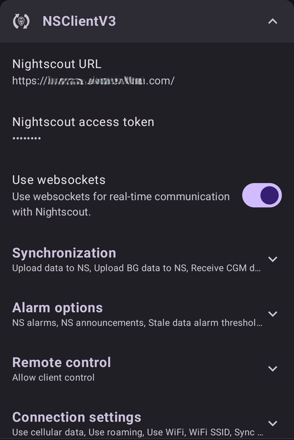


Brugeren skal sikre, at både __AAPSClient__ og __AAPS__ viser »Tilsluttet« på **NSClientV3**-skærmen på hver telefon. Nu følger **AAPSClient** **AAPS** (BS, behandlinger, profil), men den kan endnu ikke styre den: par de to telefoner som beskrevet nedenfor.

(remotecontrol-pairing)=
### Parring af AAPSClient med AAPS (fjernstyring)

Fra **AAPS** version 4 styrer **AAPSClient** **AAPS** via en sikker, **parret** forbindelse. Synkronisering alene er ikke nok: indtil telefonerne er parret, viser **AAPSClient** kun **Administrer** med en **Profil**, der kun kan ses, og **Par med hovedenhed**.

1. Åbn **Administrer → Godkendte klienter** på **AAPS**-telefonen, og slå **Tillad styring fra klienter** til (den er slået fra som standard og altid slået til i Simpel tilstand).
2. Tryk på **+**, indtast et navn til følgertelefonen, vælg hvordan den sættes op, og vælg dens **rolle**:
   - **QR-kode: Nightscout og parring** — **AAPS** viser en QR-kode, som sætter Nightscout op på følgertelefonen og parrer den med én scanning. Det kræver et admin-token i NSClientV3-indstillingerne på **AAPS**-telefonen.
   - **PIN** — til en følgertelefon uden kamera, der allerede er forbundet til Nightscout: skriv engangs-**PIN**-koden ned (den gælder i cirka to minutter).
3. Scan koden på **AAPSClient**-telefonen (i opsætningsguiden eller via **Administrer → Par med hovedenhed → Scan QR-kode**), eller åbn **Administrer → Par med hovedenhed** og indtast PIN-koden. Bekræft.

Følgertelefonen vises så som **Aktiv** i listen **Godkendte klienter**, og **AAPSClient** viser **Behandlinger**, **Scener** og **Administrer**. Følgertelefonen får sit eget Nightscout-token med kun de rettigheder, den har brug for. Hele fremgangsmåden, med skærmbilleder og fejlfinding, står på [Styring mellem hovedenhed ↔ klient](#client_master_master_setup).

Tjek, at opsætningen virker: indtast kulhydrater på **AAPSClient**, bekræft den viste mængde, og tjek, at registreringen vises i **Behandlinger** på begge telefoner.

(remotecontrol-nightscout-access-token)=

### Fejlfinding af problemer med konfiguration af »Nightscout-adgangstoken«

Den præcise konfiguration af »Nightscout-adgangstoken« kan være forskellig, afhængigt af om din Nightscout-udbyder er en betalt hostet side eller ej.

Hvis du har svært ved at få **AAPS** til at acceptere »Nightscout-adgangstoken« og bruger en betalt hostet Nightscout-side, kan det være en god idé først at kontakte din Nightscout-udbyder om, hvordan problemerne med »Nightscout-adgangstoken« kan løses. Ellers kan du kontakte **AAPS**-gruppen, men tjek først, at du har fulgt vejledningen korrekt [her](https://nightscout.github.io/nightscout/security/#create-a-token).

### Hvad AAPSClient tilbyder

Når den er parret, giver **AAPSClient** omsorgspersonen næsten de samme skærme som **AAPS** selv:

- **Behandlinger**: insulinbolus, kulhydrater og bolusberegneren.
- **Scener**: start og stop [scener](../DailyLifeWithAaps/Scenes.md).
- **Administrer**: profiler, insulinindstillinger, midlertidige mål, Hurtigbolus, automatisering, mad, rotation af indstikssteder, parring og den kørende midlertidige basal.
- **Hovedmenu**: behandlingshistorik, historikbrowser, statistik, vedligeholdelse, konfiguration.

Der er ingen pumpe og ingen læringsmål på **AAPSClient**. Se [AAPSClient-appen](AapsClient.md) for en detaljeret beskrivelse.

**AAPSClient** lader omsorgspersonen lave de fleste af de justeringer, der er tilladt direkte i **AAPS**, **også insulinboluser**, på afstand via mobilnettet eller internettet. Hver kommando bliver signeret og sendt via Nightscout til **AAPS**-telefonen. Telefonen tjekker den mod sine egne data, begrænser den, viser dig sin egen bekræftelse og udfører den først derefter. **AAPSClient** _kan_ være meget hurtigere end [SMS-kommandoer](../RemoteFeatures/SMSCommands.md), især for kommandoer, der kræver godkendelse.

Behandlinger, der er indtastet i Nightscout på andre måder (f.eks. på Nightscout-hjemmesiden), bliver ikke udført, mens styring fra klienter er slået til: **AAPS** er så i [hærdet tilstand](#client-master-control-hardened-mode) og tager kun imod ændringer fra parrede klienter. Når styring fra klienter er slået fra, bliver de kun udført, hvis de tilsvarende **Modtag**-indstillinger er aktiveret i [afsnittet Synkronisering i NSClient-indstillingerne](#Preferences-nsclient-synchronization).

Fjernstyring via **AAPSClient** anbefales kun, hvis din synkronisering virker godt (_dvs._ du ser ikke uønskede ændringer i data, som at midlertidige mål, TBR osv. ændrer sig af sig selv).

### AAPSClient med smartur-muligheder

Et smartur kan være et meget nyttigt værktøj til at styre **AAPS** hos børn. Der er nogle forskellige mulige konfigurationer. Hvis **AAPSClient** er installeret på omsorgspersonens telefon, kan [**AAPSClient WearOS**-appen](https://github.com/nightscout/AndroidAPS/releases/) downloades og installeres på et kompatibelt smartur, som er forbundet til forælderens telefon. Det viser aktuelt BS og loop-status. Når **AAPSClient** er parret med **AAPS**, bliver handlingerne på uret (også boluser, kulhydrater, midlertidige mål og profilskift) sendt videre via **AAPSClient** til **AAPS**, som bekræfter og udfører dem: se [Wear OS på en klient](#clientmastercontrol-wear-os-on-a-client). Du kan læse mere om smarture [her](#remotecontrol-smartwatches).

(RemoteControl_nightscout)=
## 3) Nightscout

Ud over at Nightscout er en server i »skyen«, findes der også en særlig **Nightscout**-app, som du kan downloade direkte fra App Store på din iPhone. Hvis du har en Android-følgertelefon, findes der ingen særlig Nightscout-app, og det er bedre at bruge [**AAPSClient**](#RemoteControl_aapsclient). Hvis du kun vil følge med og ikke sende behandlinger, kan du downloade og installere appen [Nightwatch](https://play.google.com/store/apps/details?id=se.cornixit.nightwatch) fra Play Butik.

Når du har installeret **Nightscout**-appen på din iPhone, så åbn appen og følg vejledningen til opsætning. Indtast din Nightscout-adresse (se nedenfor, til venstre). Formen på adressen kan variere, afhængigt af hvor din Nightscout er hostet. (_f.eks._ http://youraddresshere.herokuapp.com). Indtast derefter din Nightscout API secret (se nedenfor, til højre). Hvis du ikke bliver bedt om din API-adgangskode, skal du indtaste den ved at trykke på hængelåsen øverst i appen:

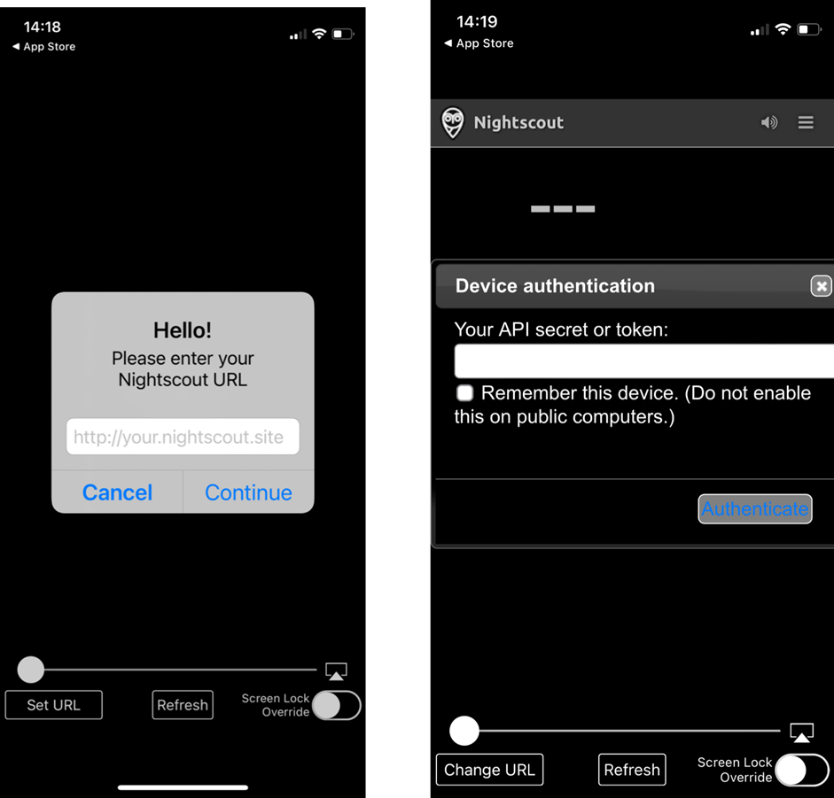

Mere information om opsætningen findes direkte hos [Nightscout](https://nightscout.github.io/nightscout/discover/)

Når du logger ind første gang, har du en meget enkel visning. Tilpas visningen ved at vælge »hamburger«-menuen øverst til højre og rulle ned:

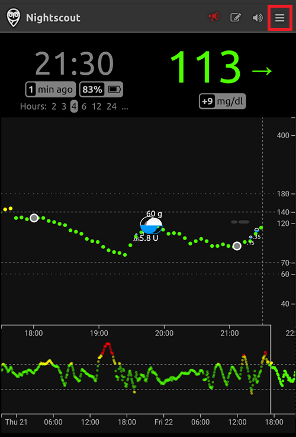

Rul ned til »Settings« (indstillinger). Du vil måske ændre »scale« til »linear«, da BS-visningen som standard er logaritmisk, og under »render basal« vælge »default«, så pumpens basal bliver vist.

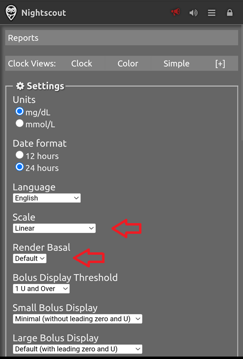

Vælg de muligheder, du ønsker. Fjern fluebenet ved alarmer, hvis du bruger en anden app til alarmer.

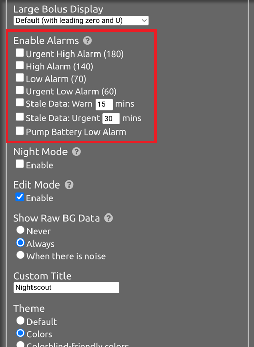

Fortsæt med at rulle ned, indtil du kommer til »show plugins«.

Du skal sikre dig, at »careportal« er markeret. Du kan også vælge forskellige andre værdier (de mest nyttige er: IOB, care portal, pump, cannula age, insulin age, basal profile og OpenAPS).

Det er vigtigt, at du nu trykker på »save« nederst, for at ændringerne træder i kraft.

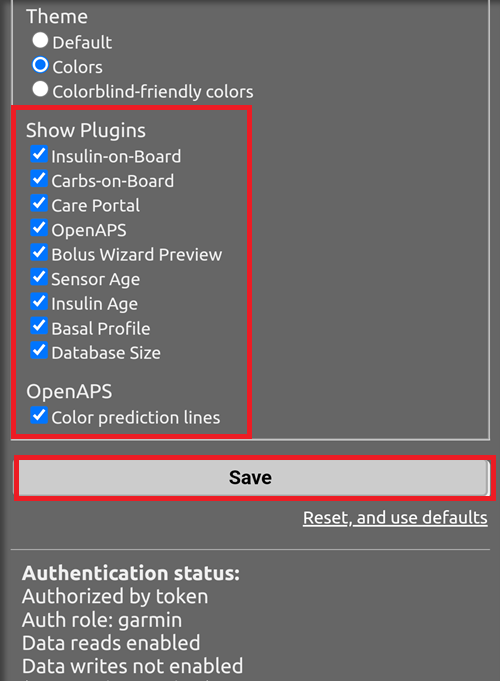

Når du har trykket på »save«, vender appen tilbage til din Nightscout-hovedskærm, som vil se nogenlunde sådan ud:

1. Aktuel glukoseværdi
2. Information om AAPS-systemets status - tryk på de enkelte faner på skærmen for at se flere detaljer. Tilføj eller fjern disse visningsmuligheder med hamburger-menuen.
3. Seneste glukosekurve med behandlinger (kulhydrater, boluser) vist
4. Glukosekurve over længere tid
5. »Hamburger«-menu til at vælge visningsmuligheder, lave rapporter, redigere profiler og Nightscout-administrationsværktøjer
6. "**+**"-menu til at indtaste behandlinger (se [nedenfor](#RemoteControl_nightscout-treatments), hvornår **AAPS** udfører dem).
7. Vælg en anden tidsperiode, der skal vises
8. Basalinsulinprofil
9. Grøn linje = tidligere glukose Blå linjer = forudsagt glukose

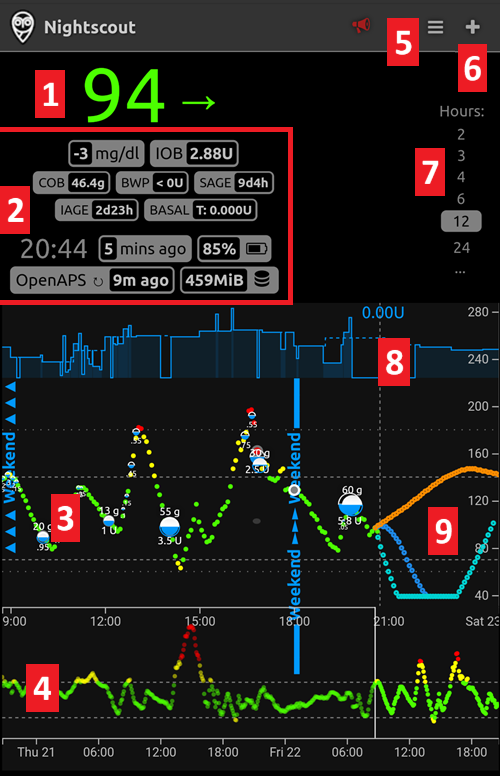

Et nærmere kig på menuen øverst til venstre i Nightscout-appen:

1. Careportal - redigering bagud i tid
2. Slå alarmer til/fra
3. Hamburger - til indstillinger
4. Careportal - Registrer behandling (se [nedenfor](#RemoteControl_nightscout-treatments), hvornår **AAPS** udfører dem)

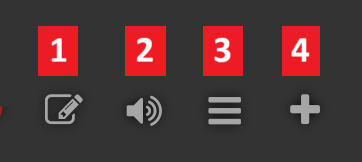

Der er rigtig meget information om status for **AAPS**-systemet i de grå faner på denne skærm (og der vises endnu mere, hvis du trykker på fanen):

1. Glukosetendens over 5 min
2. Forhåndsvisning af bolusberegner
3. Tryk på Basal for at se din aktuelle profil og information om basal
4. Tid siden seneste CGM-måling i AAPS
5. **Pumpe**: insulin, batteri i % og hvornår AAPS sidst var forbundet til den
6. Seneste opdatering fra AAPS - hvis det er mere end 5 min siden, kan det betyde et forbindelsesproblem mellem AAPS-telefonen og pumpen/CGM'en
7. Tryk på IOB for at se fordelingen af basal- og bolusinsulin
8. Insulinens alder i reservoiret
9. Kanylealder
10. Batteristatus for AAPS-telefonen
11. Størrelsen på din database. Hvis den bliver for fuld (kun DIY Nightscout - ignorer det ved hostede tjenester), kan du begynde at få forbindelsesproblemer. Du kan slette data for at gøre tallet mindre i menuen Admin tools (via hamburger-menuen).

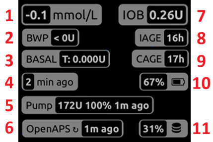

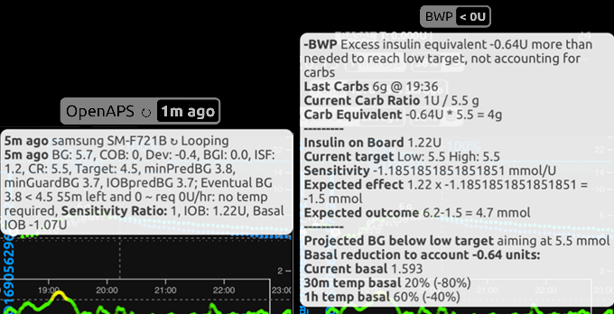

Tryk på »refresh« nederst på siden for at lukke pop op-vinduet.

(RemoteControl_nightscout-treatments)=
### Send behandlinger gennem Nightscout-appen til AAPS

I **AAPS** 4 er den understøttede måde at fjernstyre **AAPS** på en **parret AAPSClient**, se [Styring mellem hovedenhed ↔ klient](#client-master-control): hver klient har en [rolle](#client-master-control-roles), der begrænser, hvad den må, og hver kommando bliver signeret af klienten og derefter tjekket og bekræftet af **AAPS**-telefonen. Mens styring fra klienter er slået til, er **AAPS**-telefonen i [hærdet tilstand](#client-master-control-hardened-mode): behandlinger, midlertidige mål og profilskift, der indtastes på Nightscout-hjemmesiden eller i Nightscout-appen, bliver **ikke** udført. Nightscout-appen er så kun et værktøj til at følge med.

```{admonition} Only when client control is off
:class: warning
Hvis **Tillad styring fra klienter** er slået fra i **Administrer → Godkendte klienter** (og Simpel tilstand er slået fra), udfører **AAPS** kun careportal-registreringer fra Nightscout for de datatyper, du har slået til under **Modtag** i [afsnittet Synkronisering i NSClientV3-indstillingerne](#Preferences-nsclient-synchronization): kulhydrater, midlertidige mål, profilskift og de andre careportal-registreringer. Insulin bliver aldrig leveret på denne måde: en »Korrektionsbolus«, der er indtastet i Nightscout, bliver kun *registreret*, og **AAPS** medregner den som insulin om bord uden at levere den. Denne opsætning anbefales ikke til fjernstyring; brug i stedet en parret **AAPSClient**.
```

Læs mere om **Nightscout**-muligheder [her](https://nightscout.github.io/)

### Tips til at få mest muligt ud af Nightscout-appen

1). Hvis du »sidder fast« på en side og vil se hovedskærmen igen, så tryk bare på »refresh« (nederst i midten). Så kommer du tilbage til **Nightscout**-startsiden med BS-grafen.

For at se den aktuelle profil, der kører på telefonen, skal du trykke på de forskellige ikoner på skærmen over grafen. Mere information (aktuelt kulhydratforhold, følsomhed, tidszone osv.) kan ses ved at trykke på »basal«, og »OpenAPS« giver information om profilen, det aktuelle mål osv. Både telefonens batteri i % og pumpens batteri i % kan også overvåges. BWP viser, hvad algoritmen tror, der vil ske fremover, ud fra IOB og COB.

#### Andre ikoner i menuen: hvad betyder blyanten (rediger)?

Du kan (teknisk set) bruge redigeringsblyanten til at flytte eller slette bolus- eller korrektionsbehandlinger fra de sidste 48 timer.

Mere om dette [her](https://nightscout.github.io/nightscout/discover/#edit-mode-edit)

Det kunne måske være nyttigt til at slette registrerede kulhydrater (som der ikke er givet bolus for), men i praksis virker det i øjeblikket ikke godt med **AAPS**. Vi anbefaler at lave den slags ændringer direkte i **AAPS**-appen.

(RemoteControl_smartwatches)= (remotecontrol-smartwatches)=

## 4) Smarture

### Mulighed 1) Styr AAPS fra et Wear OS-ur

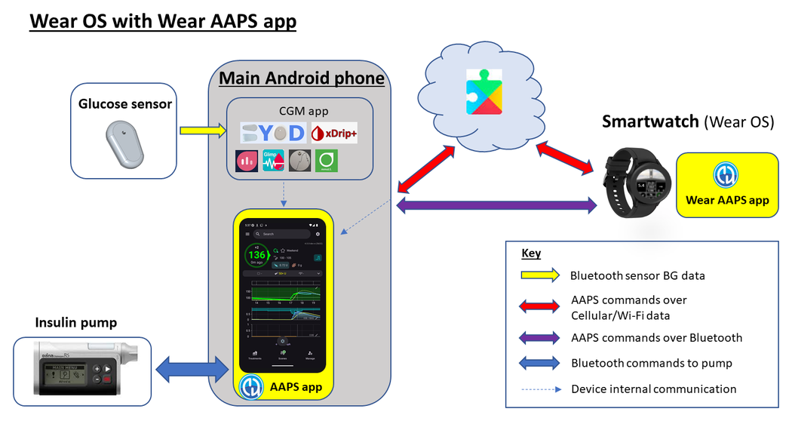

Når du har [sat **AAPS** op på dit ur](../WearOS/BuildingAapsWearOS.md), kan du finde mange detaljer om urskiverne og deres funktioner i [Opsæt AAPS på dit Wear OS-ur](../WearOS/WearOsSmartwatch.md).

Kort fortalt kan følgende funktioner startes fra smarturet:

* sætte et midlertidigt mål

* bruge bolusberegneren (beregningsvariablerne kan angives i indstillingerne på telefonen)

* give e-kulhydrater

* give en bolus (insulin + kulhydrater)

* urets indstillinger

* status

* tjekke pumpestatus

* tjekke loop-status

* tjekke og ændre profil, CPP (Circadian Percentage Profile = tidsforskydning + procent)

* vise TDD (samlet daglig dosis = bolus + basal pr. dag)

* Fjernbolus, hvor omsorgspersonen og barnet med type 1-diabetes er forskellige steder (det er muligt for **AAPS**-uret og **AAPS**-telefonen, så længe begge enheder er forbundet til netværket)

#### Kommunikation fra omsorgspersoner til uret med andre apps (som WhatsApp)

Det er muligt at tilføje flere apps til uret, som WhatsApp, f.eks. til beskeder mellem omsorgspersoner og børn. Det er vigtigt, at der kun er ÉN Google-konto knyttet til telefonen, ellers overfører uret ikke disse data. Du skal være 13 år eller ældre for at have en Samsung-konto, og den skal oprettes med den samme e-mailadresse, som bruges på Android-telefonen.

En video, der forklarer, hvordan du sætter WhatsApp op til beskeder på Galaxy 4-uret (du kan ikke få alle WhatsApp-funktioner), kan ses [her](https://gorilla-fitnesswatches.com/how-to-get-whatsapp-on-galaxy-watch-4/)

Med justeringer i både **Galaxy wearable**-appen på **AAPS**-telefonen og på uret kan WhatsApp-beskeder give besked med en let vibration, og WhatsApp-beskeden kan også vises oven på den nuværende urskive.

### Mulighed 2) **AAPS** på uret til fjernstyring af **AAPS** på en telefon

Ligesom med en følgertelefon med **AAPSClient** eller SMS-kommandoer (se afsnittene ovenfor) kan et smartur bruges til at fjernstyre **AAPS** og vise alle profildata. En vigtig forskel fra en følgertelefon er, at forbindelsen mellem smarturet og **AAPS**-telefonen går via Bluetooth og hverken kræver Nightscout eller en godkendelseskode. Hvis både smarturet og **AAPS**-telefonen, der er forbundet via Bluetooth, også er på et Wi-Fi- eller mobildatanetværk, vil uret også kommunikere med **AAPS**-telefonen over netværket. Det giver en længere rækkevidde. Det omfatter levering af en bolus på afstand, hvor omsorgspersonen med **AAPS**-uret og barnet med type 1-diabetes (med **AAPS**-telefonen) er forskellige steder. Det kan være nyttigt, f.eks. når barnet er i skole.

Et smartur til fjernstyring er derfor ofte nyttigt i alle situationer, hvor:

a)  **AAPSClient**- eller **SMS**-kommandoer ikke kan virke; eller

b)  Brugeren vil undgå at skrive en godkendelseskode (som det kræves ved SMS-kommandoer).

Et smartur skal have **Wear OS 3 eller nyere** for at kunne styre **AAPS**. Tjek urets tekniske specifikationer, og se siden [Smarture og AAPS](../Getting-Started/Watches.md). Søg, eller spørg i **AAPS**-grupperne på Facebook/Discord, hvis du er i tvivl.

Nedenfor er der specifikke vejledninger til at sætte **AAPS** op på det populære Samsung Galaxy Watch 4 (40 mm). [Garmin](https://apps.garmin.com/en-US/apps/a2eebcac-d18a-4227-a143-cd333cf89b55?fbclid=IwAR0k3w3oes-OHgFdPO-cGCuTSIpqFJejHG-klBTm_rmyEJo6gdArw8Nl4Zc#0)-uret er også et populært valg. Hvis du har erfaring med at sætte et andet smartur op, som du tror kan være nyttig for andre, så tilføj det til disse sider (se [Sådan redigerer du dokumentationen](../SupportingAaps/HowToEditTheDocs.md)) og del din viden med hele **AAPS**-fællesskabet.

### Mulighed 3) AAPSClient på et ur til fjernstyring af **AAPS** på en telefon

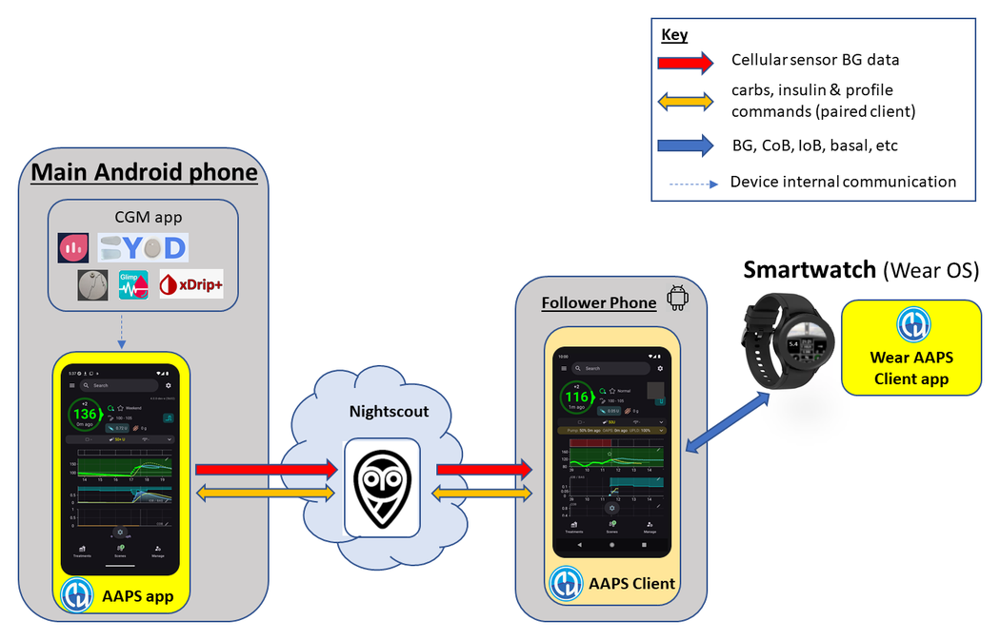

Softwaren til uret, **AAPSClient** Wear-apk'en, kan downloades direkte fra [GitHub](https://github.com/nightscout/AndroidAPS/releases/).

For at downloade softwaren skal du klikke på den ur-app, der passer til klient-appen på telefonen: **wear-aapsclient-release_**_version_ hører til **AAPSClient**, **wear-aapsclient2-release_**_version_ hører til **AAPSClient2** (se [Om AAPSClient, AAPSClient2 og AAPSClient3](#remotecontrol-aapsclient-versions)):


Vælg derefter »save as« (gem som), og gem filen et praktisk sted på din computer:


**AAPSClient** wear-apk'en kan overføres til din telefon og installeres manuelt (side-load) på uret på samme måde som **AAPS** Wear-appen, som beskrevet i [Overfør Wear-appen til din AAPS-telefon](#remote-control-transferring-the-aaps-wear-app-onto-your-aaps-phone)  


