# Betjening af AAPS med dit Wear OS-smartur

(Watchfaces-aaps-watchfaces)=

## AAPS-urskiver

```{warning}
De klassiske **AAPS**-urskiver virker kun på Wear OS 5 og ældre, og Wear OS 5 begrænser dem allerede. På **Wear OS 6 og nyere** installerer ur-appen i stedet én urskive i Googles Watch Face Format: din brugerdefinerede urskive som et billede eller **Urskive med komplikationer**. Se [Ændringer i urskiver på Wear OS](#wearos-watchface-changes) for, hvad der holder op med at virke på hver Wear OS-version, og [urskiven, som AAPS installerer](#wearos-aaps-v4-watchface) for Wear OS 6.
```

På Wear OS 5 og ældre er flere klassiske urskiver bygget ind i **AAPS**-ur-appen. De viser glukoseværdien med delta, IOB, den aktive basalrate og en graf over målingerne. To tryk virker på dem:

* Dobbelttryk på glukoseværdien for at åbne **AAPS**' hovedmenu
* Dobbelttryk på grafen for at ændre dens tidsinterval

På alle Wear OS-versioner virker de [komplikationer](#Watchfaces-complications) og [felter](#WearOsSmartwatch-wear-os-tiles), der er beskrevet på denne side, med enhver urskive, der har plads til dem.

## Konfiguration

Aktiver **Ur** i [**Konfiguration** > **Kommunikation**](#Config-Builder-wear).

For at give bolus eller udføre andre handlinger fra uret skal du slå **Styring fra ur** til. Indstillingerne for bolusberegneren på uret findes samme sted: se [Indstillinger > Ur](#preferences-wear). Mens **Styring fra ur** er slået fra, afviser telefonen alle behandlinger og ændringer af tilstand, der sendes fra uret, og uret viser *»Styring fra uret er slået fra i Ur-indstillingerne på telefonen.«*

Med **Åbn plugin** på kortet **Ur** åbner du skærmen Ur:

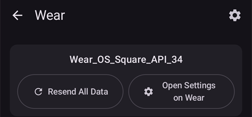

Øverste linje viser navnet på det forbundne ur eller **(Intet ur forbundet)**. Fra denne skærm kan du

* Send alle data igen. Kan være nyttigt, hvis uret ikke har været forbundet i et stykke tid, og du vil sende informationen til uret.
* Åbn indstillingerne på dit ur direkte fra din telefon.
* Vælge, hvilken urskive **AAPS** installerer på uret (**Urskive installeret på uret**: din brugerdefinerede urskive eller urskiven med komplikationer). Dette kort vises kun, mens et ur med **Wear OS 6** eller nyere er forbundet. Se [urskiven, som AAPS installerer](#wearos-aaps-v4-watchface).
* Administrere **Brugerdefineret urskive** (kortet vises, mens et ur er forbundet): **Indlæs urskive** sender en brugerdefineret urskive til uret, **Info om urskive** viser detaljerne om den indlæste urskive og de felter, den indeholder, **Flere urskiver** åbner [udvekslingssiden](../ExchangeSiteCustomWatchfaces/index.md) i din browser, og **Eksporter skabelon** gemmer en skabelon, som du kan redigere. En forhåndsvisning af den indlæste urskive vises under knapperne. Se [Skift til en AAPS-urskive](#WearOS_changing-to-AAPS-watchface).

Sørg for, at notifikationer fra AAPS ikke er blokeret på uret. Bekræftelse af en handling (f.eks. bolus, midlertidigt mål) kommer som en notifikation, som du skal stryge og sætte flueben i.

## Adgang til AAPS' hovedmenu

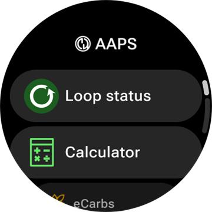

For at åbne **AAPS**' hovedmenu skal du bruge en af disse:

* åbn **AAPS** fra urets liste over apps
* tryk på en **AAPS**-komplikation, der åbner menuen, se [Indstillinger for komplikationer](#WearOsSmartwatch-complication-settings)
* tryk på feltet **BS-graf**, når dets **Handling ved tryk** er sat til **Hovedmenu**, se [Indstillinger for felter](#WearOsSmartwatch-wear-os-tiles)
* på en klassisk **AAPS**-urskive: dobbelttryk på glukoseværdien

(WearOsSmartwatch-loop-status)=

## Skærmen Loop-status

Skærmen **Loop-status** giver et overblik over, hvad loopet gør, uden at du skal tage telefonen frem. Åbn den fra AAPS' hovedmenu (**Loop-status** eller **Status → Loop**) eller ved at trykke på komplikationen **Blodsukker**. Menuen **Status** har også en side **Pumpe** og en side **TDD** med de samlede daglige doser.

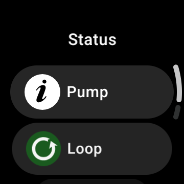

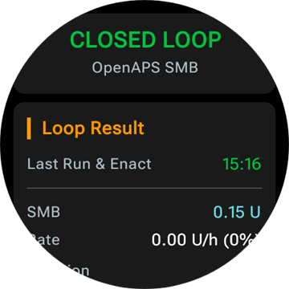

Skærmen er en liste af kort. Rul ned for at se dem alle:

* **Loop-tilstand** — den aktuelle tilstand (lukket loop, åbent loop, LGS, suspenderet, forbindelse afbrudt…) og, for en midlertidig tilstand, hvor længe den stadig kører.
* **Loop-resultat** — hvornår loopet sidst kørte, og den midlertidige basal eller SMB, det bad om.
* **Scene** — kun mens en [scene](#scenes-from-watch) er aktiv: dens navn, den resterende tid (eller **Indtil den afsluttes** for en scene uden sluttid) og den scene under **Derefter**, der starter, når den slutter.
* **Mål** — din målværdi og det midlertidige mål, hvis et kører.
* **Profil** — navnet på den aktive profil med dens **Procent** og **Tidsforskydning**, når de ikke har standardværdierne. Et midlertidigt profilskift er fremhævet og viser, hvor længe det stadig kører, og hvilken profil det **Vender tilbage til**, når det slutter.
* **Følsomhed** — de samme linjer som følsomhedsfeltet på telefonens hovedskærm: autosens-værdien og profilens, den variable og den effektive ISF.

Et lille sceneikon ved siden af en loop-tilstand, et midlertidigt mål eller et profilskift betyder, at det blev **Sat af den aktive scene**. Det samme ikon vises i vælgeren for **Loop-tilstand**.

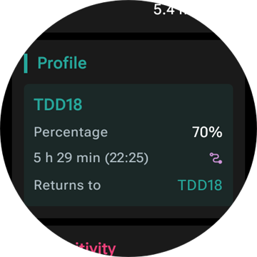

(WearOsSmartwatch-bolus-calculator)=

## Bolusberegneren på uret

Åbn **Beregner** fra **AAPS**' hovedmenu, fra [feltet Handlinger](#WearOsSmartwatch-wear-os-tiles) eller fra en komplikation, der er sat til at åbne beregneren. Den går gennem nogle få sider; stryg fra højre mod venstre for at gå videre:

| Kulhydrater                                                            | Anmod                                                              | Resultat                                                             | Beregning                                                                             | Bekræft                                                              |
| ---------------------------------------------------------------------- | ------------------------------------------------------------------ | -------------------------------------------------------------------- | ------------------------------------------------------------------------------------- | -------------------------------------------------------------------- |
| 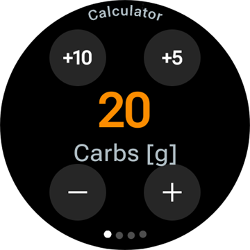 | 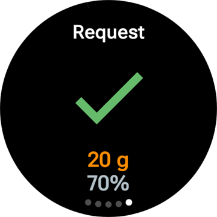 | 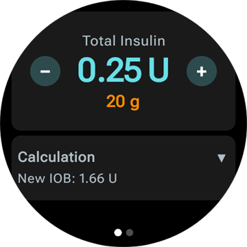 | 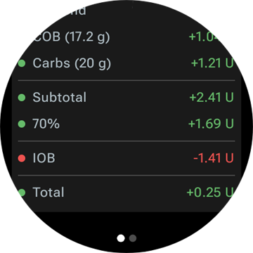 | 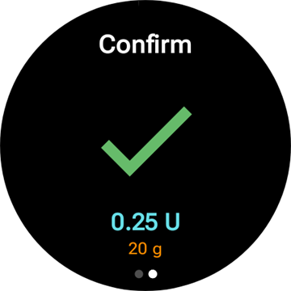 |

1. **Kulhydrater**: indtast kulhydraterne med knapperne **+10**, **+5**, **−** og **+**.
2. **Anmod**: den sidste side, før telefonen tager over. Den viser, hvad du har indtastet: kulhydraterne og måltidstype, kulhydrattid og procent, når du bruger dem, se [Valgfrie sider](#WearOsSmartwatch-calculator-optional-pages). Tryk på fluebenet for at sende det til telefonen, som laver beregningen.
3. **Resultat**: den bolus, som **AAPS** foreslår, med kulhydraterne under den: kulhydraterne nu og e-kulhydraterne senere, kulhydrattiden og klokken for påmindelsen om at spise. Juster dosis med **−** og **+**, se nedenfor. Rul ned til kortet **Beregning**: tryk på det for at se hver linje i beregningen, det samme som på telefonen.
4. **Bekræft**: stryg til den anden side, og tryk på fluebenet. Telefonen giver bolussen og registrerer kulhydraterne.

(WearOsSmartwatch-calculator-optional-pages)=

### Valgfrie sider

Tre indstillinger på uret tilføjer hver en side efter **Kulhydrater**. De er slået fra som standard. Åbn **AAPS**' hovedmenu, derefter **Indstillinger** > **Interface**, og slå dem til, du vil bruge; når mere end én er slået til, kommer siderne i rækkefølgen **Måltidstype**, **Kulhydrattid**, **Procent**. Prikkerne nederst i beregneren viser, hvor mange sider den har.

| Indstillinger                                                                                | Måltidstype                                                                | Kulhydrattid                                                                | Procent                                                                 |
| -------------------------------------------------------------------------------------------- | -------------------------------------------------------------------------- | --------------------------------------------------------------------------- | ----------------------------------------------------------------------- |
| 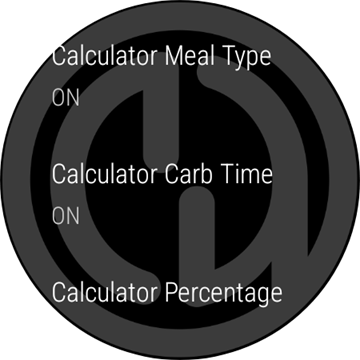 | 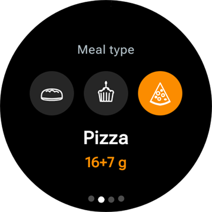 | 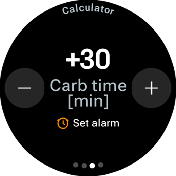 | 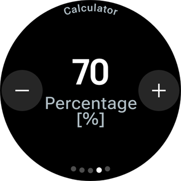 |

* **Måltidstype i beregner**: **Brød**, **Kage** eller **Pizza**, som deler kulhydraterne i et langsomt måltid op i kulhydrater nu og e-kulhydrater senere, se [Valg af måltidstype](#WearOsSmartwatch-wizard-meal-type).
* **Kulhydrattid i beregner**: minutterne, til du spiser, med en klokke **Indstil alarm** til påmindelsen om at spise, se [Kulhydrattid og påmindelsen om at spise](#WearOsSmartwatch-wizard-carb-time).
* **Beregnerprocent**: en procentdel af den beregnede bolus, for eksempel 70%, når du vil have en mindre dosis. Den starter ved **Bolusprocent** fra telefonens [indstillinger for bolusberegner](#Preferences-deliver-this-part-of-bolus-wizard-result), 100%, medmindre du har ændret den. Se også bemærkningen under [Justering af bolus på resultatsiden](#WearOsSmartwatch-wizard-result).

(WearOsSmartwatch-wizard-result)=

### Justering af bolus på resultatsiden

Resultatsiden viser den bolus, som **AAPS** foreslår, sammen med en knap **−** og en knap **+**. Brug dem til at justere dosis, før du bekræfter den, uden at gå tilbage til telefonen.

| Foreslået                                                                           | Mere                                                                                | Mindre                                                                                 |
| ----------------------------------------------------------------------------------- | ----------------------------------------------------------------------------------- | -------------------------------------------------------------------------------------- |
| 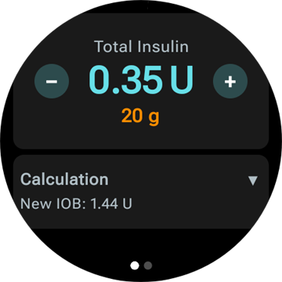 | 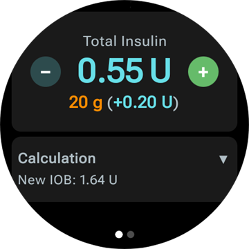 | 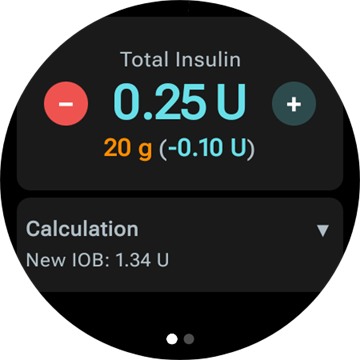 |

* Hvert tryk ændrer bolussen med **ét trin på din pumpe**, så de tilbudte mængder altid passer til det, din pumpe faktisk kan give.
* **Tryk og hold** en knap nede for at blive ved med at ændre værdien. Jo længere du holder, jo hurtigere går det.
* Du kan ikke gå under **0 IE** og heller ikke over din indstilling for **maks. bolus**.

Den samlede mængde vises på resultatsiden, så du altid kan se den mængde, du er ved at bekræfte. Ændringen vises efter kulhydraterne, for eksempel *(+0,20 IE)*, og den knap, du brugte, bliver grøn for mere eller rød for mindre.

Hvis **AAPS** har måttet begrænse dosis, for eksempel fordi den beregnede bolus er over din indstilling for **maks. bolus**, står der en ravgul advarselslinje under totalen (for eksempel *»Bolus-begrænsning anvendt«*). Det samme gælder for en begrænset mængde kulhydrater.

```{admonition} Dette er ikke det samme som Beregnerprocent :class: note Indstillingen **Beregnerprocent** lader dig indtaste en *procentdel* af den beregnede bolus, **før** resultatsiden vises. Knapperne **−** og **+** justerer den *endelige mængde* **på** resultatsiden. Du kan bruge begge.

    <br />(WearOsSmartwatch-wizard-meal-type)=
    
    ### Valg af måltidstype
    
    Beregneren på uret kan dele kulhydraterne i et langsomt måltid op i kulhydrater nu og e-kulhydrater senere, ligesom [kulhydrattypen](#AapsScreens-carbs-type) i telefonens beregner. Slå **Måltidstype i beregner** til under urets **Indstillinger** > **Interface**. Indstillingen er slået fra som standard, og så springes siden **Måltidstype** over.
    
    * Når du har indtastet kulhydraterne, viser siden **Måltidstype** tre ikoner: **Brød**, **Kage** og **Pizza**. Tryk på et ikon: dets navn og de kulhydrater, det giver, vises under ikonerne, for eksempel *65 g* for brød eller *52+22 g* for pizza (52 g nu og 22 g e-kulhydrater senere). **Brød** er standard og beholder alle kulhydraterne nu.
    * Siderne Anmod og Bekræft viser kulhydraterne på samme måde (*52+22 g*). Resultatsiden viser også, hvornår e-kulhydraterne starter, og hvor længe de varer.
    * Bolussen beregnes kun for de kulhydrater, der spises nu. Opdelingen bruger de samme tal som telefonens beregner.
    
    (WearOsSmartwatch-wizard-carb-time)=
    
    ### Kulhydrattid og påmindelsen om at spise
    
    Når **Kulhydrattid i beregner** er slået til under urets **Indstillinger** > **Interface**, kommer siden **Kulhydrattid** efter kulhydraterne: minutterne, til du spiser, ligesom [kulhydrattiden](#aaps-screens-bolus-wizard) i telefonens beregner. **Nu** er standard. **−** og **+** flytter den i trin på 5 minutter, op til en time før eller efter nu. Et tidspunkt i fortiden er til kulhydrater, som du allerede har spist.
    
    Med et tidspunkt i fremtiden vises en klokke **Indstil alarm** under værdien. Den er slået til som standard; tryk på den for at slå den fra. Siderne Anmod og Resultat viser kulhydrattiden, for eksempel *+30 min*, og klokken. Telefonen registrerer kulhydraterne på det tidspunkt, flytter måltidstypens e-kulhydrater med og starter sin påmindelse **Tid til at spise**.
    
    | Resultat | BS-graf | Kører | Tid til at spise |
    | --- | --- | --- | --- |
    | 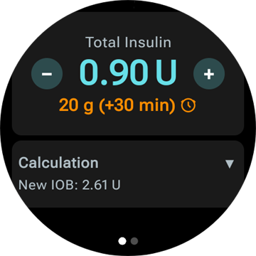 | 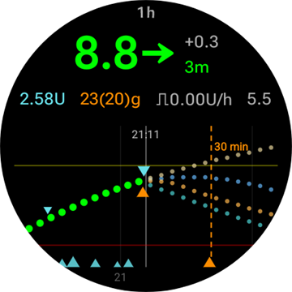 | 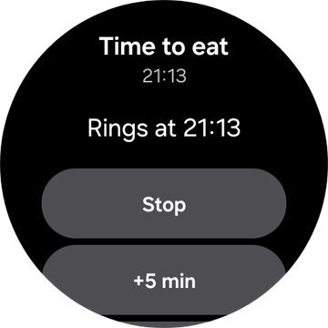 | 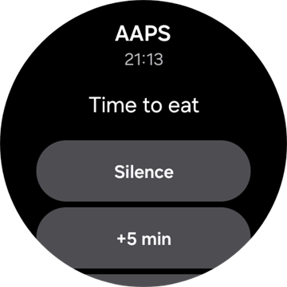 |
    
    Påmindelsen findes også på uret, så den ringer, også når telefonen er uden for rækkevidde:
    
    * Skærmen **BS-graf**, feltet **BS-graf** og grafen på **Urskive med komplikationer** tegner en stiplet orange linje, hvor påmindelsen ringer, med de resterende minutter ved siden af.
    * Mens den kører, ligger en lydløs notifikation **Tid til at spise** med **Stop** og **+5 min** i notifikationslisten. Den kommer tilbage, når du stryger den væk, indtil påmindelsen er slut.
    * Når tiden er kommet, vibrerer uret, og igen hvert halve minut i fem minutter, indtil du svarer. Notifikationen tilbyder **Lydløs** og **+5 min**, og når du stryger den væk, bliver den også lydløs.
    
    **Stop**, **Lydløs** og **+5 min** gør det samme på uret, på telefonen og på en **AAPSClient**, og de viser alle den samme påmindelse.
    
    (Watchfaces-complications)=
    
    ## Komplikationer
    
    _Komplikation_ er et udtryk fra traditionel urmagerkunst, hvor det betyder en tilføjelse til hovedurskiven – som et ekstra lille vindue eller en lille urskive (med dato, ugedag, månefase osv.). Wear OS 2.0 bruger denne idé til at lade brugerdefinerede datakilder, som vejr, notifikationer, skridttællere og mere, blive tilføjet til alle urskiver, der understøtter komplikationer.
    
    AAPS' Wear OS-app understøtter komplikationer siden build `2.6`, og den gør det muligt at konfigurere enhver tredjeparts-urskive, der understøtter komplikationer, til at vise AAPS-data (BS med tendens, IOB, COB osv.).
    
    Komplikationer fungerer også som **genvej** til AAPS-funktioner. Når du trykker på dem, kan du åbne AAPS-menuer og -dialoger (afhængigt af komplikationstype og konfiguration).
    
    
    
    ### Typer af komplikationer
    
    AAPS' Wear OS-app leverer kun rå data i foruddefinerede formater. Det er tredjeparts-urskiven, der bestemmer, hvor og hvordan komplikationer vises, inklusive layout, kant, farve og skrifttype. Af de mange typer komplikationer i Wear OS bruger AAPS:
    
    * `SHORT TEXT` – Indeholder to linjer tekst på hver 7 tegn, nogle gange kaldet værdi og etiket. Vises normalt i en cirkel eller en lille aflang boks – den ene under den anden eller side om side. Det er en komplikation med meget lidt plads. AAPS prøver at fjerne unødvendige tegn, så teksten kan være der: ved at afrunde værdier, fjerne nuller foran og bagved i værdier osv.
    * `LONG TEXT` – Indeholder to linjer tekst på hver ca. 20 tegn. Vises normalt i et rektangel eller en lang aflang boks – den ene under den anden. Den bruges til flere detaljer og status som tekst.
    * `RANGED VALUE` – Bruges til værdier fra et foruddefineret område, som en procent. Den indeholder et ikon og en etiket og vises normalt som en rund fremskridtsskive.
    * `LARGE IMAGE` – Brugerdefineret baggrundsbillede, der kan bruges som baggrund (når urskiven understøtter det).
    * `SMALL IMAGE` / `MONOCHROMATIC IMAGE` – Et lille ikon. På en `SMALL IMAGE`-plads tegner AAPS det i sin egen farve; på en `MONOCHROMATIC IMAGE`-plads farver urskiven det.
    
    ### Opsætning af komplikationer
    
    For at tilføje en komplikation til urskiven skal du konfigurere den ved at trykke længe og trykke på tandhjulsikonet nedenunder. Afhængigt af hvordan den enkelte urskive konfigurerer dem: tryk enten på pladsholderne, eller åbn urskivens opsætningsmenu for komplikationer. AAPS-komplikationer er samlet under menupunktet AAPS.
    
    Når du konfigurerer komplikationer på urskiven, viser og filtrerer Wear OS listen over komplikationer, der passer til den valgte plads på urskiven. Hvis en bestemt komplikation ikke kan findes på listen, skyldes det sandsynligvis, at dens type ikke kan bruges på den valgte plads.
    
    ### Komplikationer fra AAPS
    
    AAPS leverer komplikationerne nedenfor. »Åbner« er det, et tryk gør, når **Komplikation: handling ved tryk** står på **Standard**, se [Indstillinger for komplikationer](#WearOsSmartwatch-complication-settings).
    
    **Glukose**
    
    * **Blodsukker** (`SHORT TEXT`, åbner _Loop-status_): glukoseværdien med tendenspilen på første linje, målingens alder og delta på anden linje.
    * **Blodsukker (stor)** (`SHORT TEXT`, åbner _BS-graf_): glukoseværdien alene på første linje, så urskiven kan vise den stort. Alderen og tendenspilen står på anden linje.
    * **BS-graf** (`SMALL IMAGE` / `LARGE IMAGE`, åbner _BS-graf_): BS-grafen som et billede, til urskiver med en billedplads. Det er grafen på **Urskive med komplikationer**.
    * **Fuld status** (`LONG TEXT`, åbner _Menu_): de fleste data på én linje: glukoseværdien med tendenspilen, delta og målingens alder, derefter kulhydrater om bord, insulin om bord og basalraten.
    * **Fuld status (vendt)** (`LONG TEXT`, åbner _Menu_): det samme, med de to linjer byttet om, til urskiver, der kun viser én af de to linjer på en `LONG TEXT`-plads.
    
    **Insulin og kulhydrater**
    
    * **IoB-ikon** (`SHORT TEXT`, åbner _Bolus_): insulin om bord med et sprøjteikon.
    * **IoB detaljeret** (`SHORT TEXT`, åbner _Bolus_): samlet insulin om bord på første linje, bolus- og basaldelen på anden linje.
    * **CoB-ikon** (`SHORT TEXT`, åbner _Beregner_): kulhydrater om bord med et kulhydratikon.
    * **CoB detaljeret** (`SHORT TEXT`, åbner _Beregner_): kulhydraterne om bord nu på første linje, de kulhydrater, der stadig kommer (e-kulhydrater), på anden linje.
    * **CoB & IoB** (`SHORT TEXT`, åbner _Beregner_): insulin om bord på første linje, kulhydrater om bord på anden linje.
    
    **Basal og målværdi**
    
    * **Basalrate** (`SHORT TEXT`, åbner _Menu_): den aktuelle basalrate.
    * **BR & IoB** (`SHORT TEXT`, åbner _Menu_): insulin om bord på første linje, basalraten på anden linje.
    * **BR & mål** (`SHORT TEXT`, åbner _Midlertidigt mål_): målværdien på første linje, med den resterende tid, når et midlertidigt mål kører, og basalraten på anden linje.
    * **Målværdi** (`SHORT TEXT`, åbner _Midlertidigt mål_): målværdien på første linje og, mens et midlertidigt mål kører, dets resterende tid på anden linje.
    * **BR, CoB & IoB** (`SHORT TEXT`, åbner _Menu_): basalraten på første linje, kulhydrater om bord og insulin om bord på anden linje.
    
    **Loop og telefon**
    
    * **Loop-tilstand** (`SMALL IMAGE` / `ICON`, åbner _vælgeren for loop-tilstand_): den aktuelle loop-tilstand som et ikon: lukket loop, åbent loop, stop ved lavt BS, suspenderet, forbindelse afbrudt eller deaktiveret. Et tryk åbner en vælger med de ændringer af tilstand, der er tilladt lige nu, for eksempel **Suspender loop**, **Afbryd pumpe**, **Genoptag loop** eller **Genforbind pumpe**. Den samme vælger findes i **AAPS**' hovedmenu under **Loop-tilstand**.
    * **Uploader-/telefonbatteri** (`RANGED VALUE` / `SHORT TEXT` / `ICON`, åbner _Status_): batteriet i **AAPS**-telefonen som en måler med et batteriikon, som et tal eller kun som ikonet. Den opdateres sammen med de andre **AAPS**-data, normalt hvert 5. minut med en ny måling.
    
    Vælgeren **Loop-tilstand**, som den åbnes fra komplikationen, hovedmenuen eller feltet Loop-tilstand:
    
    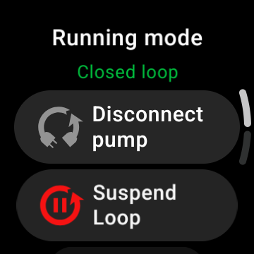
    
    (WearOsSmartwatch-complication-settings)=
    
    ### Indstillinger for komplikationer
    
    I **AAPS**' hovedmenu på uret skal du åbne **Indstillinger** > **Komplikation**:
    
    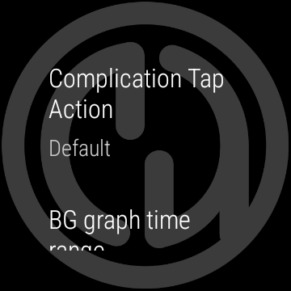
    
    * **Komplikation: handling ved tryk** (standard `Standard`): hvad et tryk på en **AAPS**-komplikation åbner, for alle komplikationer på én gang:
      * _Standard_: det, som komplikationen selv åbner, se listen ovenfor
      * _Menu_: **AAPS**' hovedmenu
      * _Beregner_: bolusberegneren
      * _Behandling_: dialogen for behandling, insulin og kulhydrater
      * _Forlængede kulhydrater_: dialogen for e-kulhydrater
      * _Status_: menuen Status
      * _Loop-tilstand_: vælgeren for loop-tilstand. Kræver, at **Styring fra ur** er slået til i telefonens Ur-indstillinger, ellers åbnes hovedmenuen i stedet.
      * _Ingen_: et tryk gør ingenting
    * **Tidsinterval for BS-graf** (standard `3 timer`): hvor mange timer komplikationen **BS-graf** viser, 1, 3 eller 6. Feltet BS-graf har sin egen indstilling.
    * **Unicode i komplikationer** (standard `Til`): komplikationerne bruger Unicode-symboler som `Δ` for delta, `⁞` som skilletegn og `⎍` for basalraten. Hvordan de ser ud, afhænger af urskivens skrifttype. Slå dette `Fra`, når en urskive viser dem som firkanter eller tomme felter.
    
    (WearOsSmartwatch-wear-os-tiles)=
    
    ## Wear OS-felter
    
    Felter er de sider, du kommer til ved at stryge fra urskiven. **AAPS** har syv af dem, hver med op til fire knapper. Et tryk på en knap åbner den tilhørende dialog på uret eller beder dig bekræfte, og så udfører telefonen arbejdet. Et felt er en genvej, ikke en statusvisning: det kender ikke telefonappens tilstand.
    
    Før du bruger felterne, skal du slå **Styring fra ur** til i [Indstillinger > Ur](#preferences-wear).
    
    ### Tilføj et felt
    
    Der er to måder, afhængigt af dit ur og din telefon:
    
    1. På uret: stryg fra urskiven forbi det sidste felt til **Tilføj felt** (Add tile), og vælg et **AAPS**-felt. På de fleste ure åbner et langt tryk på et felt også visningen til at tilføje og fjerne felter.
    2. På telefonen, i ledsagerappen til dit ur (**Galaxy Wearable** for Samsung, **Wear OS** for andre mærker): åbn **Felter** (Tiles), tryk på **Tilføj** (Add), og vælg de **AAPS**-felter, du vil have. Felternes rækkefølge kan ændres ved at trække dem.
    
    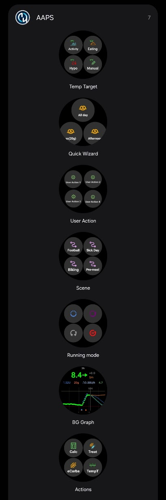
    
    ### Indstillinger for felter
    
    Felterne **Handlinger**, **Midlertidigt mål**, **BS-graf** og **Scene** har indstillinger på uret. Åbn **AAPS**' hovedmenu, derefter **Indstillinger** > **Felter**, og vælg feltet. Et langt tryk på feltet åbner også dets indstillinger, undtagen på Pixel-ure. De tre andre felter udfyldes fra telefonen og har intet at indstille på uret.
    
    | Hovedmenu | Indstillinger | Felter |
    | --- | --- | --- |
    | 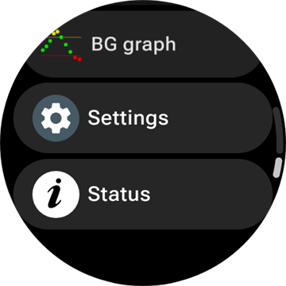 | 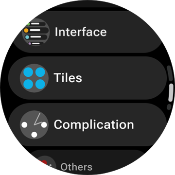 | 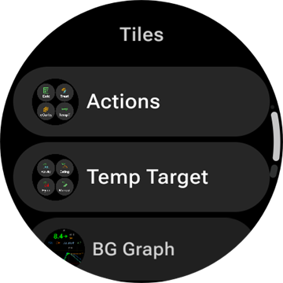 |
    
    Et felts indstillinger er en liste over dets fire pladser. Tryk på en plads for at vælge, hvad den viser, eller **Ingen** for at lade den være tom.
    
    | Langt tryk på feltet | Indstillinger for feltet Midlertidigt mål |
    | --- | --- |
    | 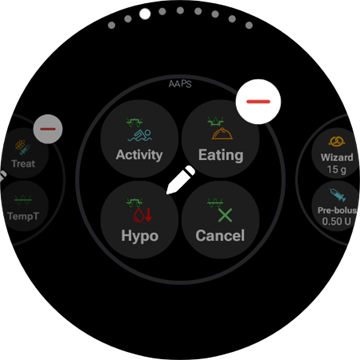 | 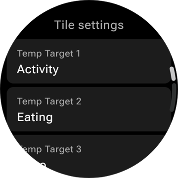 |
    
    Hvert felt har fire pladser. Et felt med flere poster end det viser de første fire.
    
    ### Feltet Handlinger
    
    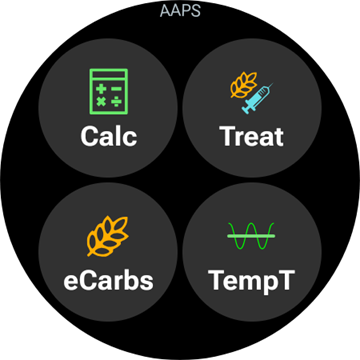
    
    Genveje til dialogerne i **AAPS**-ur-appen. Vælg op til fire af disse i feltets indstillinger:
    
    * **Beregn**: bolusberegneren med indtastning af kulhydrater, en valgfri procent [1] og en valgfri måltidstype [2]
    * **Behandl**: insulin og kulhydrater på én gang
    * **Insulin**: en bolus, indtastet i enheder
    * **Kulhydrater**: kulhydrater, også forlængede kulhydrater. En **negativ** mængde accepteres, ned til dine aktuelle COB, for at rette kulhydrater, du har indtastet tidligere. Fjernede kulhydrater vises på urets BS-graf.
    * **Forlængede kulhydrater**: forlængede kulhydrater
    * **Midl. mål**: et midlertidigt mål med selvvalgt målværdi og varighed
    * **Profilskift**: et profilskift med procent, tidsforskydning og varighed
    
    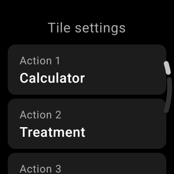
    
    Dialogerne, som knapperne åbner. Stryg fra højre mod venstre for at komme til næste side i en dialog, og tryk på fluebenet på sidste side for at sende anmodningen til telefonen:
    
    | Behandl | Insulin | Kulhydrater | Forlængede kulhydrater | Midl. mål | Profilskift |
    | --- | --- | --- | --- | --- | --- |
    | 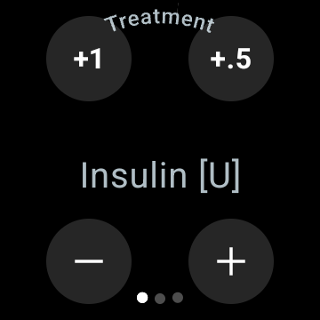 | 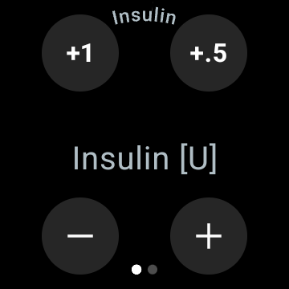 |  | 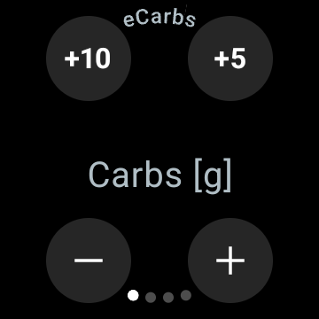 | 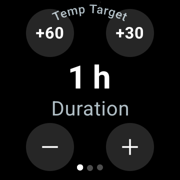 | 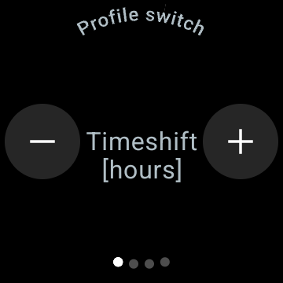 |
    
    [1] Under urets **Indstillinger** > **Interface** skal du slå **Beregnerprocent** til for at vise indtastningen af procent i bolusberegneren. Standardprocenten kommer fra telefonens [»Bolusprocent«](#Preferences-deliver-this-part-of-bolus-wizard-result). De andre indstillinger for beregneren er telefonens under **Indstillinger** > **Indstillinger for bolusberegner**.
    
    [2] Under urets **Indstillinger** > **Interface** skal du slå **Måltidstype i beregner** til for at vise siden **Måltidstype**, hvor du vælger **Brød**, **Kage** eller **Pizza** for at dele kulhydraterne i et langsomt måltid op i kulhydrater nu og e-kulhydrater senere. Se [Valg af måltidstype](#WearOsSmartwatch-wizard-meal-type).
    
    ### Feltet Midlertidigt mål
    
    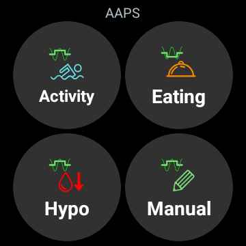
    
    Midlertidige mål fra telefonens forvalg. Indstil varighed og målværdi for hvert forvalg på telefonen under **Indstillinger** > [Standard midlertidige mål](#Preferences-default-temp-targets). Vælg op til fire af disse i feltets indstillinger:
    
    * **Aktivitet**: til sport
    * **Spiser**: spiser snart, en lavere målværdi, så der er mere insulin om bord ved måltidet
    * **Hypo**: en højere målværdi under behandling af en hypo
    * **Manuel**: en selvvalgt målværdi og varighed
    * **Annuller**: stopper det midlertidige mål, der kører. Knappen vises kun, mens et midlertidigt mål kører.
    
    ### Feltet Hurtigbolus
    
    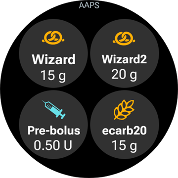
    
    Telefonens [Hurtigbolus](#quickwizards)-poster, der har **Vis på ur** slået til, inden for deres gyldige tidsrum. En post med kulhydrater viser sine kulhydrater i g, en post med insulin sin faste dosis i IE. Et tryk udfører posten efter en bekræftelse på uret. Der er intet at indstille på uret: rediger posterne på telefonen, og slå **Vis på ur** til under **Valg af enhed** for hver post, du vil have på feltet. Uden for det gyldige tidsrum for alle dine poster viser feltet **Ingen konfiguration tilgængelig**.
    
    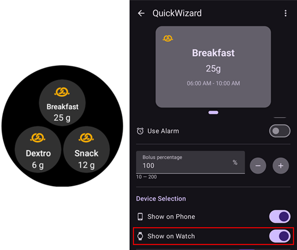
    
    ### Feltet Scene
    
    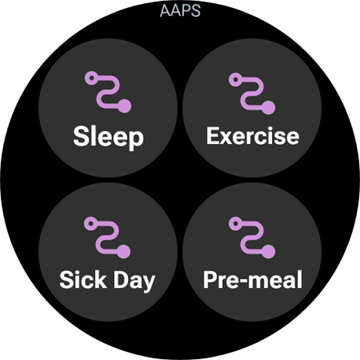
    
    Telefonens [scener](#scenes-from-watch). Hver af de fire pladser sættes til **Automatisk**, **Ingen** eller én scene i feltets indstillinger. En plads med **Automatisk** tager den næste scene fra telefonens liste, som ingen anden plads har taget. En plads, der er sat til en scene, som ikke længere findes på telefonen, viser **Ikke tilgængelig**.
    
    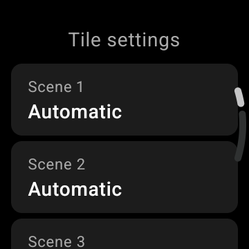
    
    ### Feltet Loop-tilstand
    
    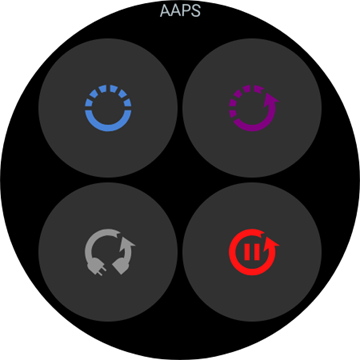
    
    De [loop-tilstande](#aaps-screens-running-mode), du kan skifte til fra den aktuelle, med de samme ikoner som på telefonen: lukket loop, stop ved lavt BS, åbent loop, deaktiver loop, suspender loop og afbryd pumpe, eller genoptag og genforbind, mens en af dem kører. **Suspender loop** og **Afbryd pumpe** spørger først om en varighed. Telefonen bestemmer, hvilke tilstande der tilbydes; uret viser de første fire og udelader **Deaktiver loop**, når **Suspender loop** er på listen.
    
    ### Feltet Brugerhandling
    
    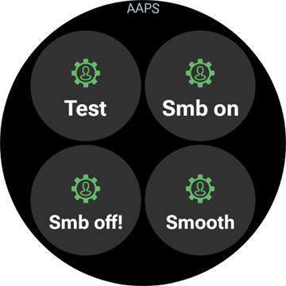
    
    Én knap for hver [automatisering](#automations-automation-triggers) på telefonen, hvis udløser er **Brugerhandling**. Et tryk beder dig bekræfte, og så udfører telefonen automatiseringens handlinger. Knapperne har automatiseringernes navne, så giv dem korte navne. Der er intet at indstille på uret.
    
    ### Feltet BS-graf
    
    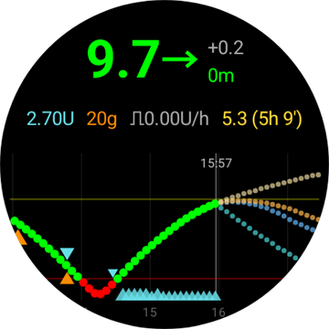
    
    Glukoseværdien med pil, delta og alder, under den IOB, COB, basalrate og målværdi, og BS-grafen med forudsigelser, boluser, kulhydrater og SMB'er. To indstillinger på uret: **Tidsinterval** (1, 3 eller 6 timer) og **Handling ved tryk**, som åbner den fulde **BS-graf**, **Hovedmenu** eller skærmen **Loop-status**.
    
    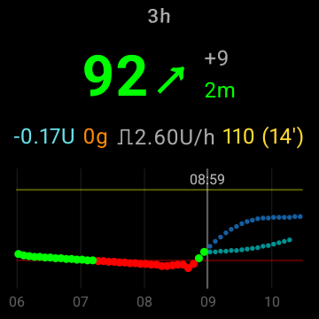
    
    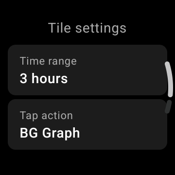
    
    ## Altid tændt
    
    Dette afsnit og det næste gælder de klassiske **AAPS**-urskiver på Wear OS 5 og ældre. På Wear OS 6 har **Urskive med komplikationer** sin egen altid tændt-visning, se [urskiven, som AAPS installerer](#wearos-aaps-v4-watchface).
    
    Lang batteritid er en udfordring for Android Wear OS-smarture. Nogle smarture kan holde op til 30 timer, før de skal oplades. For at spare mest strøm bør skærmen være slukket, når den ikke er i brug. De fleste ure understøtter skærmen »Altid tændt«.
    
    Siden AAPS version 3 kan vi bruge en »Forenklet brugerflade« i altid tændt-tilstand. Denne brugerflade viser kun blodsukker, retning og klokkeslæt. Denne brugerflade er strømoptimeret med sjældnere opdateringer. Den viser mindre information og tænder færre pixels for at spare strøm på OLED-skærme.
    
    Den forenklede brugerflade findes til urskiverne Digital Style og Brugerdefineret. Den forenklede brugerflade er valgfri og konfigureres i urskivens indstillinger (tryk længe på urskiven, og tryk på »rediger« eller tandhjulsikonet). Vælg konfigurationen »Forenklet brugerflade«, og sæt den til »Altid tændt-tilstand« eller »Altid tændt og under opladning«.
    
    ### Nattilstand
    
    Under opladning ville det være nyttigt, hvis skærmen kunne være »altid tændt« og vise dit blodsukker om natten. Standardurskiverne er dog for lyse og viser for meget information, og detaljerne er svære at læse med søvnige øjne. Derfor har vi tilføjet en mulighed for, at urskiven kun viser den forenklede brugerflade under opladning, når det er valgt i konfigurationen.
    
    Den forenklede brugerflade findes til urskiverne Digital Style og Brugerdefineret. Den forenklede brugerflade er valgfri og konfigureres i urskivens indstillinger (tryk længe på urskiven, og tryk på »rediger« eller tandhjulsikonet). Vælg konfigurationen »Forenklet brugerflade«, og sæt den til »Under opladning« eller »Altid tændt og under opladning«.
    
    Med Androids udviklerindstillinger kan dit ur holde sig vågent under opladning. For at gøre udviklerindstillingerne tilgængelige, se den [officielle dokumentation](https://developer.android.com/training/wearables/get-started/debugging). Sæt »Hold skærmen vågen under opladning« (Stay awake when charging) til »til« i udviklerindstillingerne.
    
    Bemærk: ikke alle skærme kan klare altid tændt særlig godt. Det kan give indbrænding på skærmen, især på ældre OLED-skærme. Urene dæmper normalt skærmen for at undgå indbrænding; se din brugervejledning, spørg producenten, eller søg råd på internettet.
    
    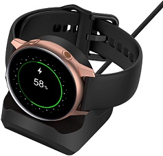
    
    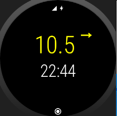
    
    (WearOsSmartwatch-phone-alarms)=
    
    ## Telefonalarmer på uret
    
    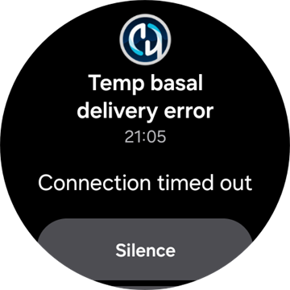
    
    Uret viser telefonens alarmer, så du kan se, hvorfor telefonen giver lyd, og kan svare fra håndleddet. Uret vibrerer, og igen hvert halve minut i fem minutter, indtil du svarer. En notifikation viser alarmens titel og tekst med de samme svar som påmindelsen [Tid til at spise](#WearOsSmartwatch-wizard-carb-time):
    
    * **Slå lyd fra** eller et stryg: alarmen stopper, og alarmskærmen på telefonen lukkes.
    * **Lydløs 5 min**: alarmen stopper og ringer igen efter fem minutter, på telefonen og på uret.
    
    To slags alarmer når frem til uret:
    
    * Telefonens alarmskærm (pumpefejl, alarmer fra automatisering, BS-alarmer): **Slå lyd fra** og **Lydløs 5 min**.
    * Akutte notifikationer med lyd, som *Pumpe utilgængelig* eller en Nightscout-alarm: kun **Slå lyd fra**. Telefonen har kun **Afvis** for dem, og de kommer selv tilbage, så længe årsagen varer.
    
    Påmindelsen *Tid til at spise* sendes ikke på denne måde: uret ringer selv for den.
    
    ## Genvej til at udsætte alarm (snooze)
    
    Uret [viser selv alarmen](#WearOsSmartwatch-phone-alarms); genvejen er en ekstra måde at gøre den lydløs på, med ét tryk. Det er muligt at oprette en genvej til at udsætte (snooze) advarsler/alarmer fra AAPS. Det er praktisk og hurtigere at slå lyden fra via uret, uden at du skal finde din telefon frem. Bemærk: du skal stadig tjekke alarmbeskeden på din telefon og handle på den, men du kan tjekke det senere. Når dit ur har to knapper, kan du tildele en knap til programmet `AAPS Snooze Alert`.
    
    For at tildele knappen på Samsung Watch 4 skal du gå til `Settings > Advanced Features > Customize Buttons > Double press > AAPS Snooze Alert`
    
    På en urskive med komplikationer gør en komplikation **App shortcut** (app-genvej), der er sat til **AAPS Snooze Alarm**, det samme med et tryk. Den [alternative opsætning af urskiven med komplikationer](#wearos-complications-watchface-setup) bruger pladsen øverst til højre til den.
    
    ### Udsæt xDrip (snooze)
    
    Når du bruger xDrip og har xDrip installeret på uret, vil genvejen »AAPS Snooze Alarm« også udsætte alle xDrip-alarmer. 
    
    
    ## Tips om ydelse og batteritid
    
    Wear OS-ure er enheder med meget begrænset strøm. Urkassens størrelse begrænser kapaciteten på det indbyggede batteri. Selv med de seneste fremskridt i både hardware og software skal Wear OS-ure stadig oplades hver dag.
    
    Hvis batteriet holder kortere end en dag (fra morgen til aften), er her nogle tips til fejlfinding.
    
    De vigtigste områder, der bruger meget batteri, er:
    
    * Aktiv skærm med baggrundslys tændt (for LED) eller i fuld styrke (for OLED)
    * Visning på skærmen
    * Radiokommunikation via Bluetooth
    
    Da vi ikke kan gå på kompromis med kommunikationen (vi har brug for opdaterede data) og vil have de nyeste data vist, kan de fleste optimeringer laves i området _skærmtid_:
    
    * Urets egne urskiver er normalt bedre optimeret end brugerdefinerede urskiver hentet fra butikken.
    * Det er bedre at bruge urskiver, der begrænser mængden af viste data i inaktiv/dæmpet tilstand.
    * Vær opmærksom, når du blander andre komplikationer, som tredjeparts vejr-widgets eller andre, der bruger data fra eksterne kilder.
    * Start med enklere urskiver. Tilføj én komplikation ad gangen, og se, hvordan de påvirker batteritiden.
    * Brug et mørkt tema på urskiven. På OLED-skærme betyder færre tændte pixels mindre strømforbrug og mindre indbrænding.
    * Tjek, hvad der virker bedst på dit ur: AAPS' egne urskiver eller andre urskiver med AAPS-komplikationer.
    * Observer over nogle dage med forskellige aktivitetsprofiler. De fleste ure tænder skærmen, når du kigger på uret, ved bevægelse og ved andre former for brug.
    * Tjek dine generelle systemindstillinger, der påvirker ydelsen: notifikationer, timeout for baggrundslys/aktiv skærm, hvornår GPS er aktiveret.
    * Se [listen over testede telefoner og ure](#Phones-list-of-tested-phones), og [spørg fællesskabet](../GettingHelp/WhereCanIGetHelp.md) om andre brugeres erfaringer og batteritid.
    * **Vi kan ikke garantere, at data vist på urskive eller komplikation er opdaterede**. I sidste ende er det Wear OS, der bestemmer, hvornår en urskive eller en komplikation opdateres. Selv når AAPS-appen beder om en opdatering, kan systemet vælge at udsætte eller ignorere opdateringer for at spare batteri. Hvis du er i tvivl, og uret har lavt batteri: tjek altid i AAPS-appen på telefonen.
    
    (Watchfaces-troubleshooting-the-wear-app)=
    
    ## Fejlfinding af ur-appen
    
    Hvis uret ikke viser data eller viser gamle data, så tjek først forbindelsen mellem uret og telefonen, se [Fejlfinding af kommunikationen mellem AAPS-uret og AAPS-telefonen](#wear-os-watch-phone-communication). For et ur med Wear OS 5, se også de [generelle anbefalinger til fejlfinding for Wear OS 5](#wear-os-5-troubleshooting). En komplikation, der ikke opdateres, har de samme årsager som et felt eller en urskive, der ikke opdateres, så tjek dem først.
    
    ## Der findes også flere brugerdefinerede AAPS-urskiver
    
    [Her](../ExchangeSiteCustomWatchfaces/index.md) kan du hente Zip-filer med brugerdefinerede urskiver lavet af andre brugere.
    
    ## Lav din egen urskive
    
    Hvis du vil lave din egen urskive, så følg [vejledningen her](../ExchangeSiteCustomWatchfaces/CustomWatchfaceReference.md).
    
    Når du har lavet en brugerdefineret urskive, kan du dele din egen brugerdefinerede **AAPS**-urskive med andre: Zip-filen kan uploades til mappen "ExchangeSiteCustomWatchfaces" via en Pull Request på GitHub. Når pull requesten bliver merget, vil dokumentationsteamet tage filen CustomWatchface.png ud og sætte Zip-filens filnavn foran.
    
    (WearOsSmartwatch-complications-watchface-download)=
    
    ## Lav din egen version af urskiven med komplikationer
    
    **Urskive med komplikationer**, som **AAPS** installerer på Wear OS 6 (se [urskiven, som AAPS installerer](#wearos-aaps-v4-watchface)), er lavet med Samsungs **Watch Face Studio**. Dens projektfil kan hentes gratis, så du kan ændre den efter din smag eller bruge den på et ur med Wear OS 5 eller ældre, hvor **AAPS** ikke installerer den:
    
    [Urskive med komplikationer (AAPS V4), zip](https://github.com/openaps/AndroidAPSdocs/raw/refs/heads/master/docs/_static/wearos/Complications_watchface_AAPS_V4.zip)
    
    Zip-filen indeholder fire filer:
    
    * `AAPS V4_0_2.wfs`: projektet. Åbn det i [Watch Face Studio](https://developer.samsung.com/watch-face-studio/download.html), ændr det, du vil, og installer det på uret derfra.
    * `com.watchfacestudio.aapsv4.apk`: urskiven, som den er, klar til at installere med [adb](https://developer.android.com/tools/releases/platform-tools): `adb install com.watchfacestudio.aapsv4.apk`, mens uret er forbundet med ADB-fejlfinding.
    * `README.txt`: de to anbefalede opsætninger af komplikationer, de samme som på [Wear OS-siden](#wearos-complications-watchface-setup).
    * `AAPS V4.png`: en forhåndsvisning.
    
    ```{admonition} Dette er ikke en brugerdefineret urskive
    :class: note
    Zip-filen er ikke en brugerdefineret urskive til **Indlæs urskive** i pluginet **Ur**, og telefonen kan ikke installere den. Den skal pakkes ud og installeres på uret med Watch Face Studio eller adb, som beskrevet ovenfor.