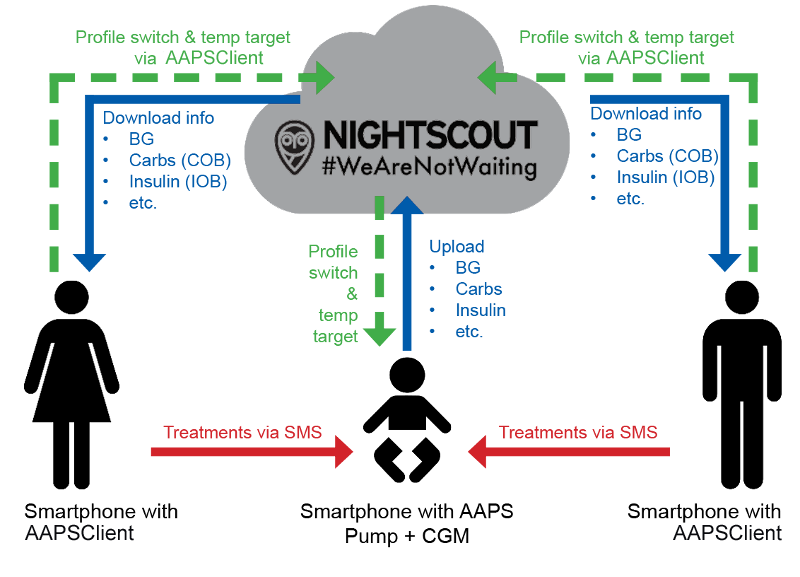

# Fjernovervågning

__AAPS__ har flere funktioner til fjernovervågning af børn med type 1-diabetes og gør det også muligt at sende fjernkommandoer med instruktioner til __AAPS__. På samme måde kan __AAPSClient__ også bruges til fjernovervågning, så du kan følge din partners eller vens __AAPS__.

## Funktioner

- Barnets pumpe styres af barnets telefon med __AAPS__.
- Omsorgspersoner kan følge med på afstand og se alle relevante data som glukoseniveau, kulhydrater om bord, insulin om bord osv. med **AAPSClient-apk'en** på deres Android-telefon (en iPhone-version af **AAPSClient** er under udvikling, se [AAPSClient](AapsClient.md)). Indstillinger, der ændres i __AAPS__, synkroniseres med __AAPSClient__ og omvendt.
- Omsorgspersoner kan få alarmer ved at bruge **xDrip-appen i følgertilstand** på deres Android-telefon, hvis xDrip companion-tilstand er sat op.
- Fjernstyring af __AAPS__ med [SMS-kommandoer](../RemoteFeatures/SMSCommands.md) er sikret med totrinsgodkendelse.
- Fjernstyring via __AAPSClient__ bruger den signerede kommandokanal, som kom med **AAPS** 4: klienten skal først være **parret** med hovedenheden (med en QR-kode eller en PIN), og hver kommando bliver bekræftet og udført af hovedenheden. Hver omsorgspersons telefon kan få sin egen [rolle](#client-master-control-roles), fra skrivebeskyttet til fuld kontrol – se [Styring mellem hovedenhed ↔ klient](#client-master-control).

## Værktøjer og apps til fjernovervågning

- [Nightscout](https://nightscout.github.io/) i en webbrowser (mest visning af data).
- [__AAPSClient__](AapsClient.md) er en forenklet version af __AAPS__, som kan følge __AAPS__ på hovedenheden og, når den er **parret**, sende fjernkommandoer: kulhydrater, __midlertidige mål__, __profilskift__ og endda boluser (se [Styring mellem hovedenhed ↔ klient](#client-master-control)). Der er 3 apps: [AAPSClient, AAPSClient2 og AAPSClient3 til download](https://github.com/nightscout/AndroidAPS/releases/), så en omsorgsperson kan følge op til tre forskellige personer fra den samme telefon (f.eks. to børn med type 1-diabetes, hver med deres egen Nightscout-konto og deres egen __AAPS__-hovedenhed).
- Dexcom Follow, hvis du bruger den originale Dexcom-app (kun BS-værdier).
- [xDrip](../CompatibleCgms/xDrip.md) i følgertilstand (mest BS-værdier og **alarmer**).
- [Sugarmate](https://sugarmate.io/) eller [Spike](https://spike-app.com/) på iOS (mest BS-værdier og **alarmer**).
- Nogle brugere synes, at et værktøj til fuld fjernadgang som [TeamViewer](https://www.teamviewer.com/) er nyttigt til avanceret fejlfinding på afstand.

## Muligheder med smartur

Et smartur kan være et meget nyttigt værktøj til at hjælpe med at styre __AAPS__ hos børn med type 1-diabetes. Der er et par forskellige muligheder:

- Mulighed 1 - Hvis __AAPSClient__ er installeret på omsorgspersonens telefon, kan [AAPSClient-appen til Wear OS](https://github.com/nightscout/AndroidAPS/releases/) installeres på et kompatibelt smartur, der er forbundet til omsorgspersonens telefon. Det viser aktuelt __BS__, loop-status og bolushistorik og gør det muligt at indtaste kulhydrater og ændre __midlertidige mål__ og __profil__. Hvis klienten er **parret** med hovedenheden, kan uret også starte en **bolus**: kommandoen sendes via klienten til hovedenheden, som bekræfter og leverer den (se [Styring mellem hovedenhed ↔ klient](#client-master-control)).
- Mulighed 2 - [AAPS-appen til Wear OS](../WearOS/WearOsSmartwatch.md) kan også bygges og installeres på et kompatibelt smartur, der er forbundet til barnets telefon, men bæres af omsorgspersonen. Det omfatter alle funktionerne ovenfor og desuden muligheden for at give en insulinbolus direkte, uden at skulle tage telefonen fra barnet.
- Mulighed 3 - Kun visning: et ur, som **AAPS** ikke understøtter direkte (Xiaomi, Amazfit eller et Wear OS-ur, der viser en komplikation), kan vise glukose, IOB, COB og loop-status via en ledsagerapp som WatchDrip+ eller GlucoDataHandler. Appen får data fra pluginet **Eksterne ledsagerapps** på den telefon med **AAPS** eller **AAPSClient**, som uret er forbundet til. Se [Eksterne ledsagerapps](#watches-external-companion-apps).

## Ting du skal overveje

- Husk tidsforskellen mellem hovedenhed og følger, fordi upload og download tager tid, og fordi __AAPS__ på hovedenheden først uploader, når loopet har kørt.
- Hvad er din nødplan, hvis fjernstyringen ikke virker (_f.eks._ netværksproblemer eller mistet Bluetooth-forbindelse)? Tænk altid over, hvad der vil ske med **AAPS**, hvis du pludselig ikke kan sende en ny kommando. **AAPS** overskriver pumpens basal, ISF og ICR med værdierne fra den aktuelle profil. Brug kun midlertidige profilskift (_dvs._ med en fast varighed), hvis du skifter til en stærkere insulinprofil, i tilfælde af at fjernforbindelsen bliver afbrudt. Så vender pumpen tilbage til den oprindelige profil, når tiden udløber.
