# SMS-kommandoer

```{contents} Table of contents
:depth: 2
```

De fleste justeringer på afstand (midlertidige mål, kulhydrater, profilskift og, når klienten er parret, boluser) kan laves med [appen **AAPSClient**](../RemoteFeatures/RemoteMonitoring.md) på en Android-telefon med internetforbindelse, se [Styring mellem hovedenhed ↔ klient](#client-master-control) (en iPhone-version af **AAPSClient** er under udvikling, se [AAPSClient-appen](AapsClient.md)). SMS-kommandoer er stadig et alternativ, der virker uden internet, og den eneste mulighed for fjernstyring, hvis du bruger en iPhone som følger og ikke har **AAPSClient** endnu.

**SMS-kommandoer er meget nyttige:**
1. Til almindelig fjernstyring

2. Hvis du vil give en fjernbolus med insulin uden en parret **AAPSClient**

3. I et område med dårlig internetdækning, hvor SMS'er kan komme igennem, men hvor data/internet på telefonen er begrænset. Det er meget nyttigt, når du tager til afsidesliggende områder (f.eks. camping, skiferie).

4. Hvis din anden måde til fjernstyring (**AAPSClient**) midlertidigt ikke virker

## Sikkerhed først

Hvis du aktiverer **SMS-kommunikator** i **AAPS**, skal du tænke på, at den telefon, der er sat op til at sende fjernkommandoer, kan blive stjålet og/eller brugt af en anden. Lås altid din telefon med mindst en PIN. En stærk adgangskode og/eller biometrisk lås anbefales stærkt. Sørg for, at den er forskellig fra din hovedadgangskode til APK'en (den adgangskode, der kræves for at eksportere **AAPS**-indstillinger).

Det anbefales også at tillade et [andet telefonnummer](#SMSCommands-authorized-phone-numbers) til SMS-kommandoer. Så kan du bruge det andet nummer til at [deaktivere](#SMSCommands-other) SMS-kommunikatoren, hvis din vigtigste fjerntelefon bliver kompromitteret.

Den mindste standardtid mellem boluskommandoer er 15 minutter, regnet fra det øjeblik, pumpen accepterer en bolus. Af sikkerhedsgrunde skal du tilføje mindst to godkendte telefonnumre for at ændre dette til en kortere ventetid. Hvis du prøver at give en fjernbolus igen inden for 15 minutter efter den forrige bolus, får du svaret »Fjernbolus er ikke tilgængelig. Prøv igen senere.«

AAPS informerer dig også med en SMS, når dine fjernkommandoer, f.eks. en bolus eller en profilændring, er udført. Det er en god idé at sætte det op, så bekræftelsesbeskeder bliver sendt til mindst to forskellige telefonnumre, hvis en af de modtagende telefoner bliver stjålet.

**Hvis du giver bolus via SMS-kommandoer, skal du indtaste kulhydraterne separat (anden SMS, AAPSClient ...)!** Hvis du ikke gør det, vil IOB være korrekt, men COB vil være for lav. Det kan betyde, at en korrektionsbolus ikke bliver givet, fordi **AAPS** antager, at du har for meget aktiv insulin.

Til de følsomme kommandoer skal der bruges en godkendelsesapp med en tidsbaseret engangsadgangskode for at øge sikkerheden.

Hvis du vil fjerne muligheden for, at en omsorgspersons telefon kan sende SMS-kommandoer, så brug nødknappen »[Nulstil autentificering](#sms-commands-authenticator-setup)« i **AAPS**, eller send SMS-kommandoen »[SMS stop](#SMSCommands-other)«. Når du nulstiller godkendelsesapps, bliver ALLE omsorgspersoners telefoner ugyldige. Du skal sætte dem op igen.

## Opsæt SMS-kommandoer

```{contents} The overall process is as follows
:depth: 1
:local: true
```

(sms-commands-authenticator-setup)=
### Authenticator opsætning

Tofaktorgodkendelse bruges for at øge sikkerheden.

Download (fra App Store eller Google Play) og installer en godkendelsesapp på omsorgspersonens telefon. Populære gratis apps er:
  - [Authy](https://authy.com/download/)
  - Google Authenticator - [Android](https://play.google.com/store/apps/details?id=com.google.android.apps.authenticator2) / [iOS](https://apps.apple.com/de/app/google-authenticator/id388497605)
  - [LastPass Authenticator](https://lastpass.com/auth/)
  - [FreeOTP Authenticator](https://freeotp.github.io/)

Disse godkendelsesapps laver en tidsbegrænset 6-cifret engangsadgangskode, ligesom ved mobilbank eller netbutikker. Du kan bruge en anden godkendelsesapp, så længe den understøtter RFC 6238 TOTP-tokens. Microsoft Authenticator virker ikke.

### Tjek telefonens indstillinger

På din telefon skal du gå til **Apps > AAPS > Tilladelser** (Permissions). Sørg for, at **SMS** og **Telefon** (Phone) er tilladt.

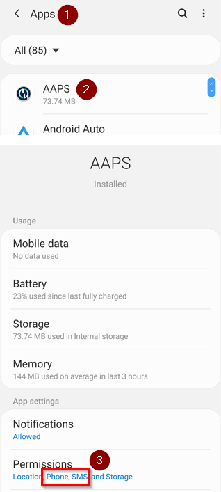

```{admonition} "App was denied access to SMS"
:class: tip
Android kan blokere tilladelsen **SMS** for apps, der ikke er installeret fra en appbutik, f.eks. **AAPS**. Hvis du ser denne besked, når du giver tilladelsen **SMS**, så åbn telefonens **Indstillinger > Apps > AAPS**, tryk på menuen **⋮** (øverst til højre), og vælg **Tillad begrænsede indstillinger** (Allow restricted settings). Giv derefter tilladelsen **SMS** igen.
```

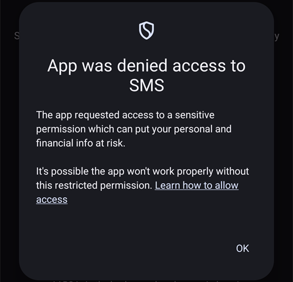

### Synkronisering af dato og tid

Tiden på begge telefoner skal være synkroniseret. Det bedste er at lade tiden blive sat automatisk fra netværket. Forskelle i tiden kan give problemer med godkendelsen.

Tjek på både **AAPS**-telefonen og omsorgspersonens telefon, at dato og tid er synkroniseret. Hvordan du præcis gør det, afhænger af din enhed. Du skal måske prøve forskellige indstillinger.

Eksempel (for Samsung S23): **Indstillinger > Generel administration > Dato og tid**: sørg for, at **Automatisk dato og tid** er slået til.

Nogle muligheder kan være grå, fordi de kræver en administrator via en familiekonto, hvis telefonen er sat op som en børnekonto. Denne indstilling for dato og tid hedder »Indstil automatisk« (set automatically) på en omsorgspersons/forælders iPhone. Hvis du ikke er sikker på, om telefonerne er synkroniseret, så bare rolig. Du kan sætte SMS-kommandoerne op og finde fejlen bagefter, hvis det ser ud til at give problemer (spørg om hjælp, hvis det er nødvendigt).

### AAPS-indstillinger

Nu hvor telefonens indstillinger er tjekket, skal du i selve **AAPS**-appen gå til [**Konfiguration** → **Kommunikation**](../SettingUpAaps/ConfigBuilder.md) og aktivere pluginet **SMS-kommunikator**.

Åbn indstillingerne for **SMS-kommunikator**.

Aktiver **Tillad fjernkommandoer via SMS**. Mulighederne **Yderligere obligatorisk pinkode i slutningen** og **Authenticator opsætning** vises først, når dette er aktiveret:

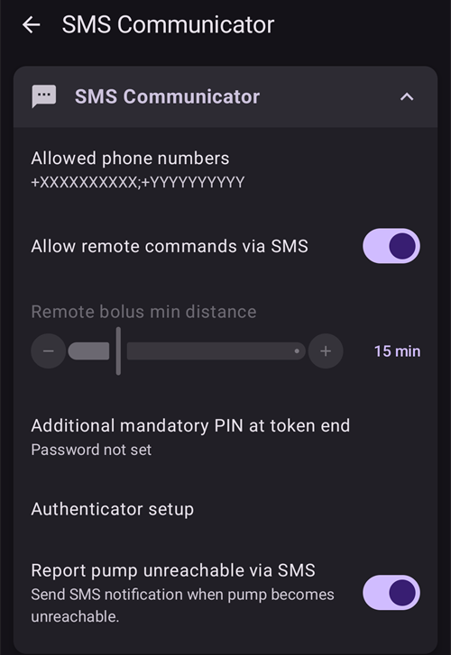

(SMSCommands-authorized-phone-numbers)=
#### Tilladte telefonnumre

Indtast omsorgspersonens telefonnummer/-numre. Tag landekoden med, og udelad det første »0« i telefonnummeret, som vist i disse eksempler:
* Britisk telefonnummer: +447976304596
* Amerikansk telefonnummer: +11234567890
* Fransk telefonnummer:  +33612344567
* _osv._

Bemærk, at »+« foran nummeret måske er nødvendigt, måske ikke, afhængigt af hvor du bor. For at finde ud af det skal du sende en prøvebesked. Den viser det modtagne format på skærmen for pluginet **SMS-kommunikator** (**Konfiguration** → **Kommunikation** → **SMS-kommunikator** → **Åbn plugin**).

Hvis du skal tilføje mere end ét telefonnummer, så adskil dem med semikolon, **UDEN mellemrum mellem numrene** (dette er meget vigtigt!). Vælg **OK**:

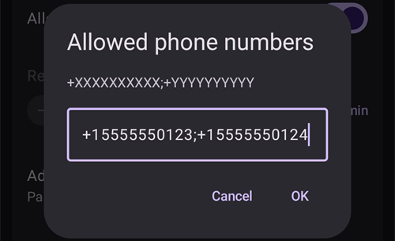

#### Min. tid mellem fjernboluser

- Du kan angive den mindste ventetid (i minutter) mellem to boluser, der gives via SMS.
- Af sikkerhedsgrunde skal du tilføje mindst to godkendte telefonnumre for at ændre denne værdi.

#### Yderligere obligatorisk pinkode i slutningen

Af sikkerhedsgrunde skal svarkoden følges af en PIN. Vælg en PIN, som du (og alle andre omsorgspersoner) skal skrive efter koden fra godkendelsesappen, når SMS-kommandoen sendes.

Krav til PIN:

* mindst 6 cifre
* kun cifre

For en sikrere PIN skal du ikke bruge det samme ciffer mange gange (_f.eks._ 111111) eller en talrække (_f.eks._ 123456).

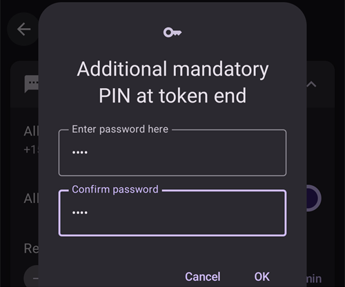

#### Authenticator opsætning

* Tryk på **Authenticator opsætning**, og følg vejledningen trin for trin på skærmen.
* Åbn den installerede godkendelsesapp på _omsorgspersonens telefon_, opsæt en ny forbindelse og
* Brug omsorgspersonens telefon til at scanne QR-koden, der vises under **Scan kode for at opsætte AAPS OTP-koder**.

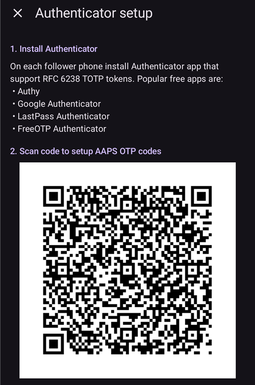

* Under **Test Engangsadgangskode** skal du i **Kode, der skal kontrolleres** indtaste engangskoden fra godkendelsesappen på omsorgspersonens telefon efterfulgt af din PIN:

Eksempel:
* Token fra godkendelsesappen er 457051
* Din obligatoriske PIN er 2401
* Kode, der skal kontrolleres: 4570512401

Hvis indtastningen er korrekt, skifter den røde tekst »FORKERT PIN« automatisk til et grønt »OK«. **Der er ingen knap, du kan trykke på!** Processen er nu færdig. Der er ingen »OK«-knap, du skal trykke på, efter at du har indtastet koden:

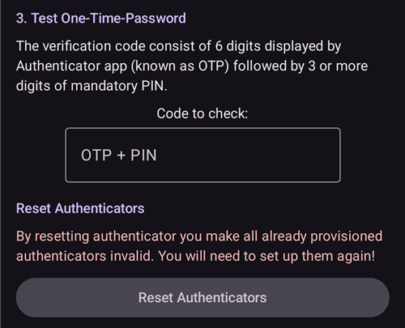

Nu skulle du have SMS-kommandoer sat op.

Brug knappen **Nulstil autentificering** nederst på skærmen **Authenticator opsætning**, hvis du vil fjerne godkendelsesapps, der er sat op. (Når du nulstiller godkendelse, bliver ALLE godkendelsesapps, der allerede er sat op, ugyldige. Du skal sætte dem op igen.)

## Brug af SMS-kommandoer

### De første skridt med SMS-kommandoer

1)  For at tjekke, at du har sat alt korrekt op, så test forbindelsen ved at sende »bg« som SMS fra omsorgspersonens telefon til **AAPS**-telefonen. Du skulle få et svar, der ligner det, der er vist her:

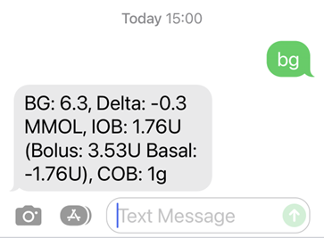

Hvis du ikke får noget svar, så se afsnittet [Fejlfinding](#SMSCommands-troubleshooting) nedenfor.

2)  Prøv nu en SMS-kommando, der kræver godkendelsesappen, _f.eks._ »target hypo«. Omsorgspersonens telefon får en SMS tilbage, som beder dig indtaste den **sekscifrede adgangskode** fra godkendelsesappen efterfulgt af den ekstra hemmelige **PIN**, som kun omsorgspersoner/følgere kender (i alt en række på tolv cifre, hvis din PIN har 6 cifre).

Når du prøver at sende en SMS-kommando første gang, så gør det, mens **AAPS**-telefonen er i nærheden, så du kan se, hvordan det virker:

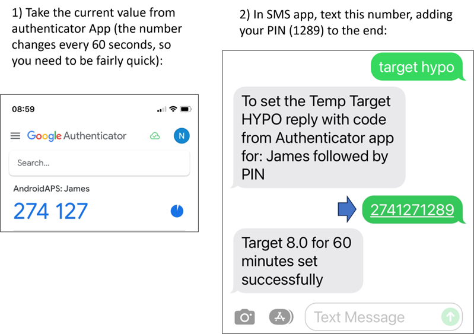

Omsorgspersonens telefon får en SMS som svar fra **AAPS**, der bekræfter, om SMS-fjernkommandoen er udført.

Hvis din kommando lykkes, får du et svar, der bekræfter det. Hvis der er et problem, får du en fejlbesked. Se [Fejlfinding](#SMSCommands-troubleshooting) nedenfor for almindelige fejl.

**Tip**: Det kan være nyttigt at have fri SMS i dit telefonabonnement (for hver telefon, der bruges), hvis der bliver sendt mange SMS'er.

### Måltidsboluser via SMS-kommandoer

Fjernbolus med insulin kan gives via **SMS-kommandoer** eller via en parret **AAPSClient** (se [Styring mellem hovedenhed ↔ klient](#client-master-control)); det kan ikke gøres via Nightscout-hjemmesiden. Kulhydrater kan også meldes via SMS eller **AAPSClient**. Med SMS er det ikke muligt at sende både kulhydrat- og insulinkommandoer i én SMS. Disse kommandoer skal sendes hver for sig sådan her:

1)  Send insulinbolussen (_f.eks._ giver »bolus 2« en bolus på 2 enheder) via SMS-kommandoer. Det svarer til **Behandlinger** → **Insulin** i **AAPS**. 2)  Send kulhydraterne (_f.eks._ melder »carbs 20« 20 g kulhydrater). Det svarer til **Behandlinger** → **Kulhydrater** i **AAPS**.

For at undgå hypoer er det en god idé at starte forsigtigt og give en bolus med **mindre insulin**, end din kulhydratratio siger, fordi du ikke tager højde for det aktuelle glukoseniveau eller glukosetrenden.

**Rækkefølgen, du sender disse kommandoer i, er vigtig**. Hvis du melder mange kulhydrater på nogen måde og har SMB'er aktiveret, kan **AAPS** straks svare ved at give en delvis insulinbolus. Hvis du så prøver at sende en insulinbolus _efter_ at have meldt kulhydraterne, kan du få en irriterende forsinkelse og en besked om »bolus i gang«, og så skal du tjekke, hvad der er givet som SMB. Eller hvis du ikke opdager, at en SMB bliver givet, og din egen bolus bagefter også lykkes, kan der i alt blive givet for meget insulin til måltidet. Når du giver bolus til måltider på afstand, skal du derfor altid sende insulinbolussen _før_ du melder kulhydraterne. Hvis du vil, kan du kombinere **AAPSClient** med SMS-kommandoer: kulhydrater, der indtastes på en parret **AAPSClient**, kræver ingen godkendelseskode og er derfor hurtigere end SMS-kommandoer. Kulhydrater eller andre behandlinger, der indtastes på Nightscout-hjemmesiden, bliver **ikke** brugt, mens klientstyring er slået til; **AAPS** er så i [hærdet tilstand](#client-master-control-hardened-mode).

(SMSCommands-commands)=
## Kommandoer

```{contents} List of command groups
:depth: 1
:local: true
```

Kommandoer skal sendes på engelsk. Svaret kommer på dit eget sprog, hvis svarteksten allerede er [oversat](#translations-translate-strings-for-AAPS-app). Kommandoerne skelner ikke mellem store og små bogstaver. Du kan bruge små eller store bogstaver.

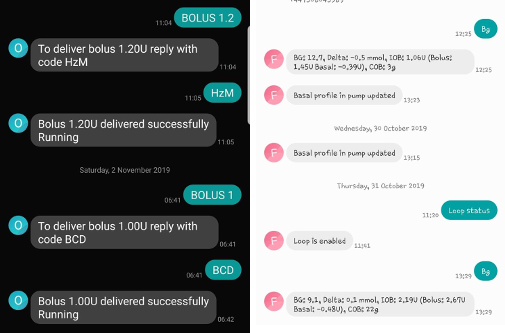

**Tabellerne over SMS-kommandoer** nedenfor viser alle mulige SMS-kommandoer. Der er givet _eksempelværdier_ for at gøre det lettere at forstå. Kommandoerne har det samme område af mulige værdier (mål, profilprocent osv.), som er tilladt i selve **AAPS**-appen.

(authentication-or-not)=
### Godkendelse eller ej?

Nogle SMS-kommandoer giver et svar med det samme, og nogle SMS-kommandoer kræver stærk **godkendelse** via godkendelsesappen. En simpel forespørgsel som »**BG**« (som beder om det aktuelle glukoseniveau) er hurtig at skrive, kræver ingen godkendelse og returnerer den statusinformation fra **AAPS**, der er vist nedenfor:


Kommandoer, der kræver mere sikkerhed, kræver, at der indtastes en kode, for eksempel:

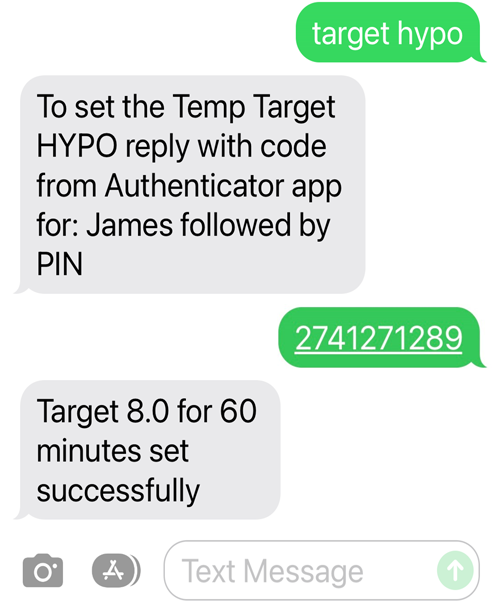

Kolonnen *Godk.* i tabellerne nedenfor viser, om en sådan stærk godkendelse kræves for hver kommando.

### CGM-data

| Kommando   | Godk. | Funktion og *svar*                                                                                                                                                                                                                       |
| ---------- | ----- | ---------------------------------------------------------------------------------------------------------------------------------------------------------------------------------------------------------------------------------------- |
| BG         | Nej   | Returnerer: sidste BS, delta, IOB (bolus og basal), COB<br/>*Sidste BG: 5,6 4min siden, Delta: -0,2 mmol, IOB: 0,20IE (Bolus: 0,10IE Basal: 0,10IE)*                                                                               |
| CAL 5.6/90 | Ja    | Kalibrerer CGM'en med værdien 5.6/90<br/>(brug den værdi, der passer til dine glukoseenheder)<br/>Virker kun, hvis det er sat korrekt op i **AAPS**.<br/>*Kalibrering sendt. Modtagelse skal være aktiveret i xDrip+.* |

### Pumpe

| Kommando             | Godk. | Funktion og *svar*                                                                                   |
| -------------------- | ----- | ---------------------------------------------------------------------------------------------------- |
| PUMP                 | Nej   | LastConn: 1 min ago<br/>Temp: 0.00U/h @11:38 5/30min<br/>IOB: 0.5U Reserv: 34U Batt: 100 |
| PUMP DISCONNECT *30* | Ja    | Afbryder pumpen i *30* minutter                                                                      |
| PUMP CONNECT         | Ja    | Pumpe tilsluttet igen                                                                                |

### Basal

| Kommando          | Godk. | Funktion og *svar*             |
| ----------------- | ----- | ------------------------------ |
| BASAL 0.3         | Ja    | Starter basal 0,3 E/t i 30 min |
| BASAL 0.3 20      | Ja    | Starter basal 0,3 E/t i 20 min |
| BASAL 30%         | Ja    | Starter basal 30% i 30 min     |
| BASAL 30% 50      | Ja    | Starter basal 30% i 50 min     |
| BASAL STOP/CANCEL | Ja    | Stopper midlertidig basal      |

Nogle pumper tager kun midlertidig basal i procent, andre kun i E/t. Hvis du bruger den anden form, svarer **AAPS** *»Denne pumpe tager kun midlertidig basal i procent, ikke i E/t.«* (eller omvendt) og sætter ingenting. Varigheden skal være et multiplum af trinnet for varigheden af midlertidig basal på din pumpe.


### Loop

| Kommando          | Godk. | Funktion og *svar*                                                                                                                                                                                                                                                                                 |
| ----------------- | ----- | -------------------------------------------------------------------------------------------------------------------------------------------------------------------------------------------------------------------------------------------------------------------------------------------------- |
| LOOP STATUS       | Nej   | Svaret afhænger af den aktuelle status:<br/> - *Loop er deaktiveret*, hvis loopet er deaktiveret<br/> - *Loop er aktiveret*, hvis loopet er lukket, åbent eller LGS<br/> - *Pumpe afbrudt*, hvis pumpen er afbrudt<br/> - *Suspenderet (10 m)*, hvis loopet er suspenderet |
| LOOP STOP/DISABLE | Ja    | Pumpen går tilbage til den forprogrammerede basalrate.<br/>*Loop er blevet deaktiveret*                                                                                                                                                                                                      |
| LOOP SUSPEND 20   | Ja    | *Loop suspended*                                                                                                                                                                                                                                                                                   |
| LOOP RESUME       | Ja    | *Loop genoptaget*                                                                                                                                                                                                                                                                                  |
| LOOP CLOSED       | Ja    | *Aktuel loop-tilstand: Lukket loop*                                                                                                                                                                                                                                                                |
| LOOP LGS          | Ja    | *Aktuel loop-tilstand: Stop ved lavt BS*                                                                                                                                                                                                                                                           |

### Bolus

Fjernbolus er ikke tilladt inden for 15 min (denne værdi kan kun ændres, hvis der er tilføjet 2 telefonnumre) efter den sidste boluskommando eller fjernkommando! I så fald vil svaret være *Fjernbolus er ikke tilgængelig. Prøv igen senere.* Dette svar sendes også, når pumpen er i gang med at give en bolus.

| Kommando             | Godk. | Funktion og *svar*                                                                                                                                                   |
| -------------------- | ----- | -------------------------------------------------------------------------------------------------------------------------------------------------------------------- |
| BOLUS 1.2            | Ja    |                                                                                                                                                                      |
| BOLUS 0.60 MEAL      | Ja    | Giver den angivne bolus på 0,60 IE<br/>**og** sætter det [midlertidige mål Spiser snart](#TempTargets-eating-soon-temp-target)                                 |
| CARBS 5              | Ja    | Indtaster 5 g uden bolus                                                                                                                                             |
| CARBS 5 17:35/5:35PM | Ja    | Indtaster 5 g kl. 17:35.<br/>Hvilket tidsformat der virker, afhænger<br/> af tidsindstillingen (12 t/24 t) på telefonen.                                 |
| EXTENDED 2 120       | Ja    | Starter forlænget bolus på 2 IE i 120 min.<br/>Kun for [kompatible pumper](#Extended-Carbs-extended-bolus-and-switch-to-open-loop-dana-and-insight-pump-only). |
| EXTENDED STOP/CANCEL | Ja    | Stopper forlænget bolus                                                                                                                                              |

### Profil

| Kommando       | Godk. | Funktion og *svar*                                                                                                             |
| -------------- | ----- | ------------------------------------------------------------------------------------------------------------------------------ |
| PROFILE STATUS | Nej   | Aktuel profil og procent                                                                                                       |
| PROFILE LIST   | Nej   | Den aktuelle liste over profiler i **AAPS**, f.eks.:<br/>1. Profile1<br/> 2. Profile2                              |
| PROFILE 1      | Ja    | Skifter til profil 1 på listen.<br/>Brug numrene fra **PROFILE LIST**,<br/>ikke profilnavnene, som du har gemt dem |
| PROFILE 2 30   | Ja    | Skifter til Profile2 30%                                                                                                       |

Procenten skal være mellem 30 og 250%, som i appen. En værdi uden for dette område bliver afvist, før du bliver bedt om godkendelseskoden.

### Midlertidige mål

| Kommando                  | Godk. | Funktion og *svar*                                                           |
| ------------------------- | ----- | ---------------------------------------------------------------------------- |
| TARGET MEAL/ACTIVITY/HYPO | Ja    | Sætter det midlertidige mål MEAL/ACTIVITY/HYPO (Spiser snart/Aktivitet/Hypo) |
| TARGET STOP/CANCEL        | Ja    | Annullerer det midlertidige mål                                              |


(SMSCommands-other)=
### Andet

| Kommando         | Godk. | Funktion og *svar*                                                                                                                                                                                                                                          |
| ---------------- | ----- | ----------------------------------------------------------------------------------------------------------------------------------------------------------------------------------------------------------------------------------------------------------- |
| RESTART          | Ja    | Genstarter AAPS. Nyttigt, hvis du har problemer, som normalt bliver løst med en genstart.                                                                                                                                                                   |
| SMS DISABLE/STOP | Ja    | For at deaktivere SMS-fjernstyring skal du svare med koden.<br/>Husk, at du kun kan genaktivere den direkte<br/>fra **AAPS** på hovedenheden.                                                                                                   |
| HELP             | Nej   | Returnerer alle funktioner, der kan spørges om:<br/>BG, LOOP, PUMP, BASAL, BOLUS, EXTENDED, CAL, PROFILE, TARGET, SMS, CARBS, HELP, RESTART<br/>Send kommandoen ***HELP ***FUNKTION****** for at vise<br/>alle muligheder i dette afsnit. |
| HELP BOLUS       |       | *BOLUS 1.2<br/>BOLUS 1.2 MEAL*                                                                                                                                                                                                                        |

(SMSCommands-troubleshooting)=
## Fejlfinding og ofte stillede spørgsmål

```{contents} List of questions and issues
:depth: 1
:local: true
```

### Hvad _kan_ vi ikke gøre med SMS-kommandoer?

1)  **Du kan ikke lave et _midlertidigt_ profilskift** (f.eks. at sætte »profil motion« i 60 minutter), men du kan skifte permanent til »profil motion«. Midlertidige profilskift kan i stedet laves via **AAPSClient**.

2)  **Du kan ikke annullere automatiseringer** eller **sætte brugerdefinerede mål**, men der er løsninger, der kommer tæt på: Forestil dig som eksempel, at det normale mål i profilen er 5,5. Du har lavet en automatisering i AAPS, der altid sætter et højt mål på 7,0 mellem kl. 14.30 og 15.30 på grund af idræt i skolen, og en betingelse for automatiseringen er, at »der ikke findes et midlertidigt mål«. I denne uge har du fået at vide med kort varsel, at idrætstimen er aflyst og bliver erstattet af en pizzaspisning, men dit barn er allerede i skole med **AAPS**-telefonen. Hvis det høje midlertidige mål på 7,0 bliver startet af automatiseringen, og du annullerer det (på **AAPS**-telefonen eller på afstand), er betingelserne for automatiseringen stadig opfyldt, og **AAPS** sætter bare det høje mål igen et minut senere.

**Hvis du har adgang til AAPS-telefonen**, kan du slå automatiseringen fra eller ændre den. Eller hvis du ikke vil det, kan du bare sætte et nyt midlertidigt mål på 5,6 i 60 min ved at trykke på målet på hovedskærmen eller via **Administrer** → **Midlertidigt mål**. Det forhindrer automatiseringen i at sætte det høje mål på 7,0.

**Hvis du ikke har adgang til AAPS-telefonen**, kan SMS-kommandoer bruges til en løsning, der kommer tæt på: f.eks. ved at bruge kommandoen »target meal« til at sætte et mål på 5,0 i 45 min (andre standardmål er 8,0 for aktivitet eller hypo, se tabellen). Men med SMS-kommandoer kan du ikke angive en _bestemt_ målværdi (f.eks. 5,6 i 60 minutter). Til det skal du bruge **AAPSClient**.

### Hvad sker der, hvis jeg fortryder en kommando, som jeg lige har sendt?

**AAPS** udfører kun den nyeste kommando. Hvis du altså skriver »bolus 1.5« og derefter, uden at godkende, sender en ny kommando »bolus 1«, ignorerer den den tidligere kommando med 1.5. **AAPS** sender altid omsorgspersonens telefon et svar, der bekræfter, hvad SMS-kommandoen er, før du bliver bedt om at indtaste godkendelseskoden, og også et svar efter handlingen.

### Hvorfor fik jeg ikke svar på en SMS-kommando?

Det kan være af en af disse grunde:

1)  Beskeden er ikke nået frem til telefonen (problemer med netværket). 2)  **AAPS** er stadig i gang med at behandle anmodningen (_f.eks._ en bolus, som kan tage noget tid at levere, afhængigt af din bolushastighed). 3)  **AAPS**-telefonen har ikke en god Bluetooth-forbindelse til pumpen, når kommandoen modtages, og kommandoen er mislykkedes (det giver som regel en alarm på **AAPS**-telefonen).

### Slet intet svar på SMS-kommandoer

På omsorgspersonens telefon og/eller **AAPS**-telefonen kan du prøve at deaktivere følgende muligheder:
* **Send som chatbesked** 
* Hvis du bruger appen Android Messages eller Google Beskeder, så deaktiver RCS-beskeder:
  - åbn den pågældende SMS-samtale i Beskeder
  - Vælg menuen med de tre prikker øverst til højre
  - vælg »Detaljer«
  - Aktiver »Send kun SMS- og MMS-beskeder« 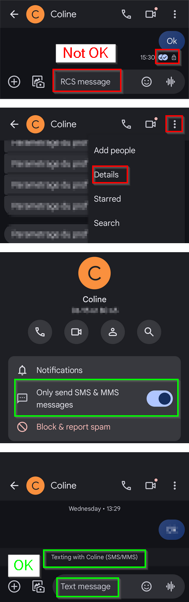

### Fejl ved udførelse af kommandoer

Der er flere mulige grunde til, at kommandoen ikke lykkes:

* Opsætningen af SMS-kommandoer er ikke færdig/korrekt
* Du har sendt en kommando i et forkert format (f.eks. »disconnect pump 45« i stedet for »pump disconnect 45«)
* Du har brugt en forkert eller udløbet kode fra godkendelsesappen (det er som regel godt at vente et par sekunder på en ny kode, hvis den aktuelle snart udløber)
* Kode+PIN var OK, men SMS'en blev forsinket på vej ud eller ind, så **AAPS** beregnede, at koden fra godkendelsesappen var udløbet
* **AAPS**-telefonen er uden for rækkevidde/kontakt med pumpen
* Systemet er allerede i gang med at give en bolus

Almindelige fejl er vist i eksemplerne nedenfor:

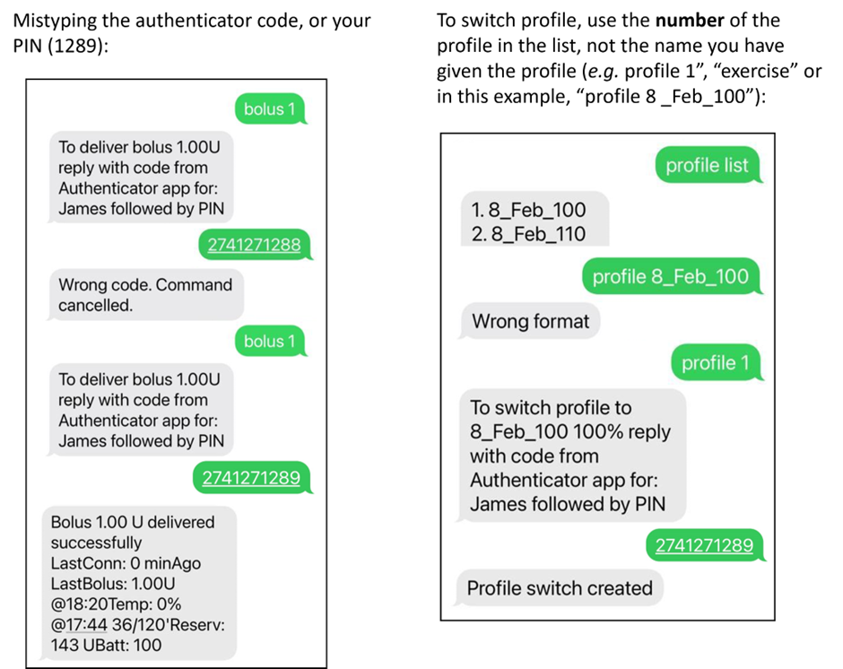

### Hvordan kan jeg stoppe en kommando, når den er godkendt?

Det kan du ikke. Men du kan annullere en bolus, der er sendt via SMS, på selve **AAPS**-telefonen ved bare at annullere den i bolus-popup-vinduet, hvis du er hurtig. Mange SMS-kommandoer (bortset fra bolus og kulhydratmeldinger) kan let fortrydes, eller du kan gøre noget for at mindske uønskede virkninger, hvis der sker en fejl.

Ved fejl med bolus og kulhydratmeldinger kan du stadig gøre noget. Hvis du f.eks. har meldt 20 g kulhydrater, men dit barn kun spiser 10 g, og du (eller en omsorgsperson på stedet) ikke kan slette behandlingen direkte på **AAPS**-telefonen, kan du sætte et højt midlertidigt mål eller vælge en lavere profil for at få **AAPS** til at være mindre aggressiv.

### Flere SMS'er

Hvis du får den samme besked igen og igen (_f.eks._ et profilskift), har du måske ved et uheld lavet en løkke med andre apps. Det kan f.eks. være xDrip. Hvis det er tilfældet, så sørg for, at xDrip (eller en anden app) ikke uploader behandlinger til Nightscout.

Hvis den anden app er installeret på flere telefoner, så sørg for at deaktivere upload på dem alle.

(sms-commands-too-many-messages)=
### Jeg får alt for mange SMS'er fra SMS-kommandoer. Kan jeg få færre, eller kan jeg få dem til at stoppe?

Når du bruger SMS-kommandoer, kan der komme mange automatiske beskeder fra **AAPS**-telefonen til omsorgspersonens telefon. Du får også beskeder, f.eks. »Basalprofilen i pumpen er opdateret«, hvis du har automatiseringer sat op i **AAPS**. Det kan være nyttigt at have fri SMS i abonnementet til din **AAPS**-telefon (og til hver omsorgspersons telefon), hvis der bliver sendt mange SMS'er, og at slå SMS-notifikationer, alarmer eller vibrationer fra på alle telefoner. Det er ikke muligt at bruge SMS-kommandoer uden at få disse opdateringer. Derfor vil du måske hellere bruge en anden måde at kommunikere direkte med dit barn på (hvis barnet er gammelt nok) i stedet for SMS. Almindelige andre kommunikationsapps, som omsorgspersoner til **AAPS** bruger, er WhatsApp, LINE, Telegram og Facebook Messenger.

Det er muligt at slå SMS'en »Basalprofilen i pumpen er opdateret« fra, når profilændringen kom fra Nightscout. For at gøre det skal du oprette en fil, der hedder **præcis** `do_not_send_sms_on_profile_change`, i mappen `extra` i din AAPS-mappe.
