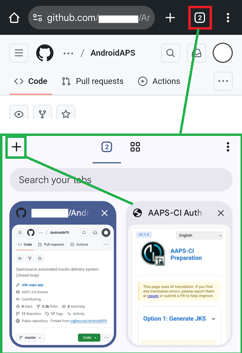

(browser-build)=

# Build i browseren

Byg AAPS med GitHub Actions.

**Den laveste AAPS-version, der understøttes, er 3.3.2.1.**

## Byg selv i stedet for at downloade

**AAPS-appen (en apk-fil) kan ikke downloades på grund af reglerne for medicinsk udstyr. Det er lovligt at bygge appen til eget brug, men du må ikke give en kopi til andre!**

Se [Ofte stillede spørgsmål for loopere](../UsefulLinks/FAQ.md) for detaljer.

(Building-APK-without-a-computer)=

## Vælg, hvordan du vil bygge

Vælg den metode, der passer til den enhed, du bygger fra:

### På en Android-telefon: AAPS Builder (anbefalet)

En opsætningsside viser dig, hvordan du opretter dit eget private build-repository på GitHub. Intet at installere, ingen forberedelsesfil, og du starter selv hvert build. Du downloader appen direkte fra GitHub. Google Drive er valgfrit.

Det virker også fra en browser på en computer.

**→ [Build i browseren med AAPS Builder](BrowserBuildAapsBuilder.md)**

### På en computer eller en iPhone / iPad: fork og forberedelsesfil

Du laver en kopi (fork) af AAPS-kildekoden på GitHub, opretter dit keystore med en forberedelsesfil, og den byggede app bliver gemt i dit Google Drive. Følg de fire trin nedenfor.

```{note}
**Bygger du allerede med en fork?** Bliv ved med at opdatere den som beskrevet i [Opdatering med en browser (fork)](../Maintenance/UpdateBrowserBuild.md), eller skift til AAPS Builder. For at skifte skal du først hente en kopi af dit keystore fra din fork: se [Hvis du kommer fra det tidligere build i browseren](#aaps-builder-from-fork).
```

Du skal bruge flere faner i din browser og skifte mellem dem. Eksempel i Chrome:



```{note}
Du skal skifte mellem faner: start med alle faner lukket, så du ikke farer vild, når du skifter fra en fane til en anden.
```

#### Hvad du skal bruge

- En **Google-konto**, så den byggede app kan gemmes i dit Google Drive.
- En **GitHub-konto** (gratis) – den opretter du i trin 1.
- En **webbrowser**, der kan have flere faner åbne på én gang (nedenfor går vi ud fra Chrome).
- Et lille **hjælpeprogram til at køre forberedelsesfilen**. Hvilket du skal bruge, afhænger af den enhed, du bygger fra – du skal ikke installere noget nu, trin 2 viser dig, hvordan du gør på din enhed:
  - **Computer (Windows / Mac / Linux):** Simple Web Server.
  - **iPhone / iPad:** ingen ekstra app – du bruger den indbyggede app Filer og browseren.

#### Trinnene

Build i browseren er en række valg. Følg disse trin i rækkefølge:

1. **[Opret din GitHub-fork](BrowserBuildFork.md)** – lav din personlige kopi af AAPS-kildekoden.
2. **[Opret dit keystore til signering](BrowserBuildKeystore.md)** – den vigtige beslutning: opret et nyt keystore (Mulighed 1), eller upload dit eksisterende (Mulighed 2), og følg så siden for din enhed.
3. **[Giv adgang til Google Drive](BrowserBuildGoogleDrive.md)** – lad GitHub gemme den byggede app i dit Google Drive.
4. **[Byg APK'en](BrowserBuildAPK.md)** – kør workflowet i GitHub Actions, og vælg din version og variant.

Hvis du får problemer, så se **[Build i browseren: fejlfinding](../GettingHelp/BrowserBuildTroubleshooting.md)**. For valgfrie handlinger med en fork, se [eksport af dit keystore](#ci-keystore-export) eller [cherry-pick af et commit](#github-cherry-pick).

----

**Start med [Trin 1 – Opret din GitHub-fork](BrowserBuildFork.md) →**

```{toctree}
:hidden:

Build i browseren med AAPS Builder <BrowserBuildAapsBuilder.md>
Trin 1: Opret din GitHub-fork <BrowserBuildFork.md>
Trin 2: Opret dit keystore til signering <BrowserBuildKeystore.md>
Trin 3: Giv adgang til Google Drive <BrowserBuildGoogleDrive.md>
Trin 4: Byg APK'en <BrowserBuildAPK.md>
```
