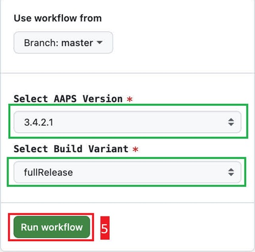
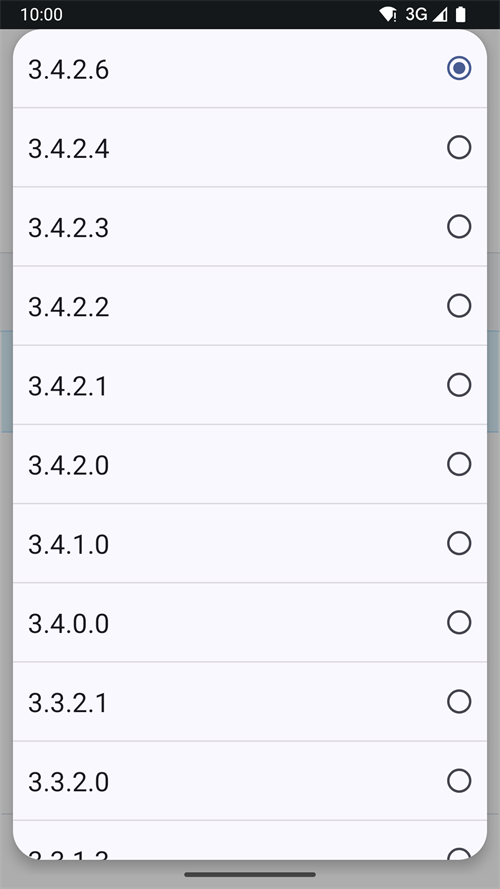
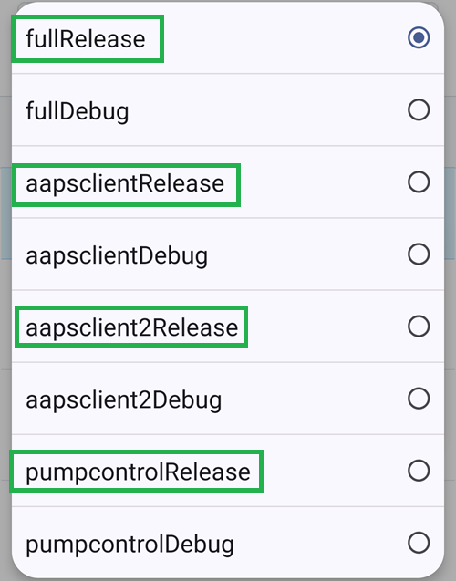

(github-build-apk)=

# Build i browseren – Trin 4: Byg APK'en

```{note}
Dette er **trin 4** i [Build i browseren](BrowserBuild.md). Gennemfør først [Trin 3 – Giv adgang til Google Drive](BrowserBuildGoogleDrive.md).
```

## AAPS-CI GitHub Actions til at bygge AAPS-APK'en
 - Egnet til almindelige brugere.

```{tab-set}

:::{tab-item} Wiki
### Kør workflowet for at bygge den signerede APK

1. Vælg Actions i din GitHub-kopi af AndroidAPS.
2. Fold All Workflows ud.
3. Vælg AAPS-CI


4. Rul ned, og tryk på Run Workflow.


5. Lad **Use workflow from** stå på master-grenen. I **Select AAPS Version** vælger du den **AAPS**-version, du vil bygge (normalt den nyeste). Vælg [varianten](#browserbuild-variant) (fullRelease), og tryk på Run workflow.




6. Du vil se beskeden Workflow run was successfully requested. Opdater siden i din browser, så kan du følge, hvordan buildet skrider frem. Når handlingen er færdig, viser AAPS CI-handlingen et grønt flueben. Du har nu bygget den opdaterede version af AndroidAPS.


### Installer AAPS-APK'en

1. Åbn din Google Drive
2. Gå ind i mappen AAPS, og vælg mappen med den nye version. Der finder du både telefonversionen og Android Wear-versionen.


:::

:::{tab-item} Video
<div align="center" style="max-width: 360px; margin: auto; margin-bottom: 2em;">
  <div style="position: relative; width: 100%; aspect-ratio: 9/16;">
    <iframe
      src="https://geo.dailymotion.com/player/x9rdwms.html?video=x9rdwms&loop=true&mute=true"
      loading="lazy"
      style="position: absolute; top: 0; left: 0; width: 100%; height: 100%;"
      frameborder="0"
      allowfullscreen>
    </iframe>
  </div>
</div>
:::  

```

## Valg af version til build

**Kun AAPS-versioner fra 3.3.2.1 og nyere kan bygges i browseren.**

Tryk på **Select AAPS Version**, og vælg den version, du vil bygge. Den nyeste version står øverst på listen.



(browserbuild-variant)=

## Valg af build-variant

*Bemærk: Både Android-appen og Android Wear-appen bliver bygget automatisk.*

  - Vælg den variant, du har brug for:
    - fullRelease: Til almindelig brug med pumpe og alle funktioner.
    - [aapsclientRelease, aapsclient2Release, aapsclient3Release](#RemoteControl_aapsclient): Til omsorgspersoner (kræver [Nightscout](../SettingUpAaps/Nightscout.md)). `aapsclient3Release` bygger **AAPSClient3**, som findes fra **AAPS** version 4.0 (se [Om AAPSClient, AAPSClient2 og AAPSClient3](#remotecontrol-aapsclient-versions)).
    - pumpcontrolRelease: Til at erstatte din pumpes app/kontrolenhed



Varianter, der ender på »Debug«, betyder, at APK'en bliver bygget i debug-tilstand. Det er nyttigt for udviklere ved fejlfinding.

<!-- If you want to test the items in a pull request has been moved to dev page /AdvancedOptions/DevBranch.md -->

----

Når build er lykkedes, bliver apk-filen gemt i din Google Drive. Fortsæt med [Overførsel og installation af AAPS på din telefon](TransferringAndInstallingAaps.md).

```{note}
Fra september 2026 kan Googles [verifikation af Android-udviklere](#android-developer-verification) blokere installation af APK'en ved tryk på filen, afhængigt af dit land. Gratis løsninger er forklaret på den side.
```

Hvis build fejler, så [find først ud af, hvad der gik galt, i build-loggen](#aaps-ci-read-the-logs), og se derefter [Build i browseren: fejlfinding](../GettingHelp/BrowserBuildTroubleshooting.md). Se [cherry-pick et commit](#github-cherry-pick), hvis du vil have et bestemt commit med i dit build.
