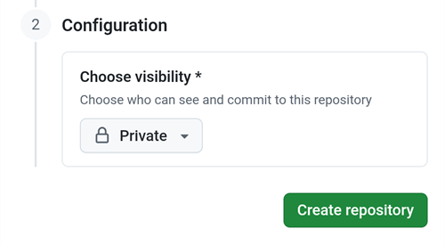
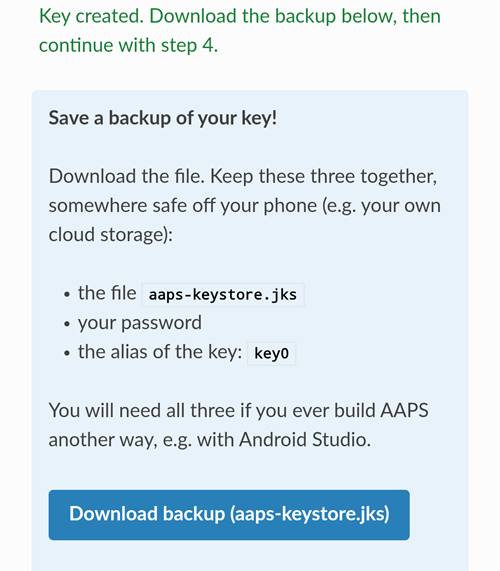

(aaps-builder)=

# Build i browseren med AAPS Builder

```{note}
Dette er den anbefalede måde at bygge AAPS på fra en **Android-telefon**. Det virker også fra en browser på enhver computer. De andre måder at bygge fra en computer eller en iPhone på finder du i oversigten [Build i browseren](BrowserBuild.md).
```

```{contents} In this page
:backlinks: entry
:depth: 2
```

**AAPS Builder** bygger AAPS-appen for dig på GitHub, det gratis websted til kode. Der er intet at installere på din telefon, og ingen forberedelsesfil at åbne.

En opsætningsside fører dig igennem det. Første gang tager det omkring 10 minutter:

1. Opret din egen **private kopi** af AAPS Builder på din GitHub-konto: opsætningssiden åbner GitHub med alt udfyldt, du skal kun bekræfte. Build-workflowet, filen der fortæller GitHub, hvordan AAPS skal bygges, er allerede i den.
2. Opret eller upload din **signeringsnøgle** (keystoret).
3. Giv nøglen til dit repository som en GitHub-**secret**.
4. **Byg** appen. Et build tager 15 til 30 minutter.
5. **Download og installer** appen på din telefon.

Du behøver **ikke** at forke AndroidAPS: AAPS-kildekoden downloades fra det officielle AndroidAPS-repository ved hvert build. Du behøver heller **ikke** Google Drive: du downloader appen direkte fra GitHub.

```{admonition} Where the code comes from
:class: note

Build-workflowet vedligeholdes af AAPS-udviklerne i repository'et [nightscout/aaps-builder](https://github.com/nightscout/aaps-builder), og dit repository er en kopi af det. [Workflowet](https://github.com/nightscout/aaps-builder/blob/main/.github/workflows/build.yml) i din kopi er kort: det kører de [byggetrin](https://github.com/nightscout/aaps-builder/blob/main/.github/workflows/aaps-builder.yml), der ligger i det repository, så forbedringer når frem til dig uden ændringer i dit repository. Du kan læse begge filer. Når den bygger, downloader workflowet kun den officielle AAPS-kildekode og GitHubs egne byggeværktøjer. Dit keystore forlader aldrig din browser og dit private repository.
```

(aaps-builder-before-you-start)=

## Før du starter

Du skal bruge:

- En **GitHub-konto** (gratis). Hvis du ikke har en, så opret den først på [github.com](https://github.com/signup).
- En **webbrowser**: Chrome på din telefon eller en hvilken som helst browser på en computer. Log ind på github.com i den browser, før du starter.
- **GitHub-appen på din telefon?** Du kan beholde den. Nogle knapper på opsætningssiden åbner så appen i stedet for Chrome. Bygning virker i appen, men appen **kan ikke downloade** den færdige AAPS: [trin 5](#aaps-builder-step5) viser, hvordan du skifter til Chrome for at downloade.
- Dit **eksisterende keystore** (`.jks`-fil), dets adgangskode og dets alias, hvis du har bygget AAPS før og vil opdatere uden at geninstallere.

```{warning}
**Dit build-repository skal forblive privat.** Alt, hvad et build laver, kan ses af alle, der kan se repository'et. Opsætningssiden opretter et privat repository for dig. Gør det aldrig offentligt, og lav ikke en **fork** af AAPS Builder i stedet: en fork er altid offentlig.

Et privat repository får 2000 gratis GitHub Actions-minutter om måneden. Det er nok til flere builds.
```

```{warning}
**Ny nøgle eller eksisterende nøgle: dette afgør, om du kan opdatere AAPS.**

- **Du har allerede AAPS på din telefon, bygget med et keystore, som du stadig har**: vælg **Jeg har allerede et keystore** på opsætningssiden, og upload det. Dit næste build opdaterer AAPS direkte. Har du bygget AAPS med det tidligere build i browseren (din egen fork)? Dit keystore ligger i din fork: [få først en kopi af det](#aaps-builder-from-fork).
- **Du bygger AAPS for første gang, eller du har mistet dit keystore eller dets adgangskode**: vælg **Opret en ny nøgle**. En app, der er signeret med en ny nøgle, **kan ikke opdatere** en AAPS, der er signeret med en anden nøgle. Du skal eksportere dine indstillinger, kopiere filen væk fra din telefon, afinstallere den gamle AAPS, installere den nye og derefter importere dine indstillinger: se [Geninstallation af AAPS med et nyt keystore](#reinstall-aaps).

Bliv altid ved med at bruge den samme nøgle bagefter. Når du opretter en ny nøgle, så download den sikkerhedskopi, som siden tilbyder, og gem den sammen med adgangskoden og aliasset (`key0`) et sikkert sted væk fra din telefon.
```

(aaps-builder-from-fork)=

## Hvis du kommer fra det tidligere build i browseren (fork)

Spring dette afsnit over, hvis du aldrig har bygget AAPS med den tidligere metode til build i browseren (din egen kopi, eller fork, af AndroidAPS på GitHub, med forberedelsesfilen og Google Drive).

Dit keystore er gemt som secrets i din fork. GitHub viser aldrig en secret igen, så du kan ikke kopiere den til dit nye repository. Få først en kopi af dit keystore, og brug den derefter i [trin 2](#aaps-builder-step2) med **Jeg har allerede et keystore**.

```{warning}
Vælg ikke **Opret en ny nøgle**. AAPS bygget med en ny nøgle kan ikke opdatere AAPS på din telefon.
```

Hvilket tilfælde gælder for dig?

- **Du brugte mulighed 2** (du uploadede dit eget keystore fra Android Studio), og du har stadig `.jks`-filen, dens adgangskoder og dens alias: du skal ikke gøre noget her. Brug den fil i trin 2.
- **Du brugte mulighed 1** (forberedelsesfilen oprettede din nøgle), eller du har ikke længere din keystore-fil: eksporter den fra din fork som beskrevet nedenfor.

Sådan eksporterer du dit keystore fra din fork:

1. I din fork åbner du **Settings** → **Secrets and variables** → **Actions** og tilføjer en secret med navnet `ZIP_PASSWORD`. Vælg en adgangskode med kun engelske bogstaver og tal. Den beskytter den fil, du nu laver.
2. Åbn fanen **Actions** i din fork, tryk på **CI Keystore Export** og derefter på **Run workflow**. Flere detaljer: [Eksporter dit keystore](#ci-keystore-export).
3. Når kørslen har et grønt flueben, så åbn dit Google Drive: filen `keystore.zip` ligger i mappen **AAPS** → **KeyStore**. Hvis kørslen fejler ved Google Drive-trinnet, er din forks adgang til Google Drive udløbet: se [Google refresh token er udløbet](#aaps-ci-google-token-expired).
4. Download `keystore.zip`, og åbn den med din `ZIP_PASSWORD`: på en computer eller på din telefon med en filhåndteringsapp, der kan åbne adgangskodebeskyttede ZIP-filer. Den indeholder:
   - `keystore.jks`: dit keystore,
   - `keyStoreInfo.txt`: din `KEYSTORE_PASSWORD`, `KEY_PASSWORD` og `ALIAS` (som regel `key0`).
5. Kopier `keystore.jks` til din telefon (eller til Google Drive, så du kan vælge den derfra).

I [trin 2](#aaps-builder-step2) på opsætningssiden:

1. Tryk på **Jeg har allerede et keystore**.
2. I **Keystore-fil** vælger du `keystore.jks`.
3. I **Keystore-adgangskode** skriver du `KEYSTORE_PASSWORD` fra `keyStoreInfo.txt`.
4. I **Nøglealias** vælger eller skriver du `ALIAS` fra `keyStoreInfo.txt`.
5. Hvis `KEY_PASSWORD` er forskellig fra `KEYSTORE_PASSWORD`, så fjern fluebenet ved **Nøgleadgangskoden er den samme som keystore-adgangskoden**, og skriv `KEY_PASSWORD`.

Gem `keystore.zip` og dens `ZIP_PASSWORD` et sikkert sted væk fra din telefon: det er sikkerhedskopien af din nøgle.

Hvis du også vil gemme builds fra AAPS Builder i Google Drive, så udfør [trin 6](#aaps-builder-google-drive): opsætningssiden henter en ny `GDRIVE_OAUTH2` til dig. Du kan beholde din fork, indtil AAPS bygget med AAPS Builder er installeret på din telefon.

## Åbn opsætningssiden

**→ [Åbn opsætningssiden for AAPS Builder](#aaps-builder-setup)**

Opsætningssiden er en del af denne dokumentation, på dit sprog. Hold også denne side åben i en anden fane: afsnittene nedenfor forklarer hvert trin på opsætningssiden mere detaljeret, med skærmbilleder.

Opsætningssiden åbner hver GitHub-side i en ny fane i Chrome. For at komme tilbage til opsætningssiden skal du trykke på faneknappen ved siden af Chromes adresselinje (firkanten med et tal) og vælge opsætningssiden for AAPS Builder.


Opsætningssiden kører helt i din browser: din nøgle og dine adgangskoder sendes aldrig nogen steder hen, undtagen ind i den GitHub-secret, som du selv indsætter dem i. Kun dit GitHub-brugernavn sendes til GitHub for at kontrollere, at det findes. Den husker dit GitHub-brugernavn og navnet på dit repository, så du til enhver tid kan komme tilbage og åbne din side med secrets eller dine builds igen.


(aaps-builder-step1)=

## Trin 1 – Opret dit private build-repository

Dette trin opretter din egen private kopi af AAPS Builder på din GitHub-konto, med build-workflowet allerede i. Kun du kan se det og de apps, det bygger.

1. Sørg for, at du er logget ind på github.com i denne browser.

2. I **Dit GitHub-brugernavn** skriver du dit GitHub-brugernavn, ikke din e-mail. Siden kontrollerer det hos GitHub: **✓ GitHub-bruger fundet** betyder, at det er rigtigt.

3. I **Navn på dit repository** beholder du forslaget `my-aaps`. Hvis du allerede har oprettet dit repository med et andet navn, så skriv præcis det navn.

   ```{note}
   **Har du allerede et AAPS Builder-repository** (lavet med en tidligere version af opsætningssiden)? Opret ikke et nyt: skriv dets præcise navn, spring **Opret mit private repository** over, og opdater dets workflow én gang som forklaret i [Opdatering af AAPS](#aaps-builder-updates). Dine secrets forbliver, som de er. Hvis du alligevel vil have et nyt repository, så vælg et navn, du ikke har endnu, f.eks. `my-aaps-2`, og brug det samme keystore i trin 2.

   Skriv ikke navnet på din fork af AndroidAPS: en fork er offentlig, og den bygger allerede med sit eget workflow **AAPS CI**.
   ```

   

4. Kontroller linjen **Dit repository:** den viser `github.com/<your username>/my-aaps`. Opsætningssiden husker navnet fra dit sidste besøg: kontroller det hver gang, før du bruger dens knapper.

5. Tryk på **Opret mit private repository**.

   

6. GitHub åbner **Create a new repository** i en ny fane. Alt er allerede udfyldt: under **Start with a template** skabelonen `nightscout/aaps-builder` med **Include all branches** slået fra, og under **General** din konto som **Owner** og det navn, du valgte.

   

   Ændr ikke noget.

7. Rul ned: under **Configuration** er **Choose visibility** allerede sat til **Private**. Tryk på den grønne knap **Create repository**.

   

   GitHub viser dit nye repository: det indeholder en mappe `.github` (med build-workflowet) og en fil `README.md`. **Gå tilbage til fanen med opsætningssiden** for trin 2: tryk på faneknappen ved siden af Chromes adresselinje, og vælg opsætningssiden.

   

```{warning}
**Er dit nye repository tomt**, uden filer? Det blev ikke oprettet ud fra skabelonen, og det kan ikke bygge. Slet det (**Settings** → nederst på siden → **Delete this repository**), og tryk så igen på **Opret mit private repository** på opsætningssiden.
```

```{tip}
Siger GitHub **my-aaps already exists in this account**? Du har allerede dit repository: luk GitHub-fanen, og fortsæt på opsætningssiden. Hvis din nøgle allerede er i det, så fortsæt med [trin 4](#aaps-builder-step4). Se [fejlfinding](#aaps-builder-ts-repo-exists).
```

(aaps-builder-step2)=

## Trin 2 – Din signeringsnøgle

Appen skal signeres med din egen nøgle. Vælg en af de to faner. Læs først [advarslen om ny nøgle eller eksisterende nøgle](#aaps-builder-before-you-start).


### Jeg har allerede et keystore

1. Tryk på **Jeg har allerede et keystore**.
2. I **Keystore-fil** vælger du din `.jks`-fil (eller `.keystore`, `.p12`, `.pfx`). På en telefon skal du først kopiere filen til din telefon eller til Google Drive.
3. I **Keystore-adgangskode** skriver du keystore-adgangskoden.
4. I **Nøglealias** vælger du dit alias fra listen, eller du skriver det, hvis der ikke er nogen liste. For keystores lavet med Android Studio er det som regel `key0`.
5. Hvis din nøgleadgangskode er forskellig fra keystore-adgangskoden, så fjern fluebenet ved **Nøgleadgangskoden er den samme som keystore-adgangskoden**, og skriv nøgleadgangskoden.
6. Tryk på **Kontroller og fortsæt**.

Siden kontrollerer adgangskoden og aliasset på din enhed. **Keystore OK! Fortsæt med trin 3.** betyder, at alt er rigtigt. Hvis der står, at adgangskoden bliver kontrolleret, når du bygger, så fortsæt alligevel: buildet fortæller dig, hvis noget er forkert.

### Opret en ny nøgle

1. Tryk på **Opret en ny nøgle**.

2. Vælg en adgangskode, og skriv den to gange. Regler: mindst 8 tegn, kun bogstaverne a–z og A–Z, tallene 0–9 og symboler som `! ? #`. Ingen mellemrum, ingen bogstaver med accent og ikke tegnet `|`.

3. Tryk på **Opret nøgle**. Der går nogle sekunder, før **Nøgle oprettet** vises.

   

4. Tryk på **Download sikkerhedskopi (aaps-keystore.jks)**. Hvis Chrome spørger **Download file again?**, ligger der allerede en ældre sikkerhedskopi med samme navn på din telefon: tryk på **Download again**. Chrome gemmer så den nye nøgle som `aaps-keystore (1).jks`: det er den fil, der hører til denne nøgle. Behold den, og bland den ikke sammen med den ældre.

   Gem disse tre ting samlet et sikkert sted væk fra din telefon (f.eks. dit eget skylager):

   - filen `aaps-keystore.jks`,
   - din adgangskode,
   - nøglens alias: **`key0`**.

   Du skal bruge alle tre, hvis du en dag bygger AAPS på en anden måde, f.eks. med Android Studio. Nøgler, der er oprettet med en tidligere version af opsætningssiden, har aliasset `aaps`.

   

(aaps-builder-step3)=

## Trin 3 – Giv nøglen til dit repository

Trin 3 låses op, når trin 2 er gjort. Din nøgle, dens adgangskoder og dens alias pakkes i én værdi, secret'en `KEYSTORE_SET`.

1. Tryk på **Åbn siden med secrets**.


2. GitHub åbner siden **New secret** i dit repository. På en telefon er den under indstillingsmenuen: rul ned.


3. Skift til fanen med opsætningssiden, og tryk på **Kopier navn**. Skift tilbage til GitHub-fanen, og indsæt det i det lille felt **Name**. Navnet er `KEYSTORE_SET`.

4. Skift til fanen med opsætningssiden, og tryk på **Kopier secret**. Skift tilbage til GitHub-fanen, og indsæt den i det store felt **Secret** (langt tryk på en telefon). Secret'en er en meget lang kode på tusindvis af tegn: opsætningssiden viser de første tegn ved siden af knappen. Indsæt ikke ordet `KEYSTORE_SET` der.

5. Tryk på **Add secret**. `KEYSTORE_SET` vises nu under **Repository secrets**.


Det skal du kun gøre én gang.

```{tip}
Viser GitHub **Page not found** (404)? Kontroller først, at du er logget ind på github.com i denne browser: GitHub viser 404 for private repositories, når du ikke er logget ind. Ellers passer brugernavnet eller navnet på repository'et i trin 1 ikke med dit repository. Kontroller navnet på github.com, ret det i trin 1, og tryk på knappen igen.
```

(aaps-builder-step4)=

## Trin 4 – Byg appen

1. Tryk på **Åbn build-siden** på opsætningssiden. GitHub åbner siden **Build AAPS** i dit repository.

   

   Hvis **GitHub-appen** åbner i stedet: tryk på **RUN WORKFLOW**, kontroller version og variant, og tryk på **RUN WORKFLOW** igen. Appen viser måske stadig **Nothing to see here**: træk listen ned for at opdatere den og se dit build. Fortsæt derefter med trin 4 nedenfor.

2. Hvis GitHub spørger, så tryk på den grønne knap for at aktivere workflows.

   Listen over workflows viser to punkter: brug **Build AAPS**. Ignorer **AAPS Builder**: det indeholder byggetrinene og har ingen knap **Run workflow**.

3. Tryk på **Run workflow**. En lille formular åbner:
   - **Version**: behold `latest` for at bygge den nyeste AAPS-udgivelse, eller skriv et versionsnummer som `4.0.0`.
   - **Variant**: behold `fullRelease` til normal brug med en pumpe. De andre varianter er forklaret i [build-varianter](#browserbuild-variant). `aapsclient3Release` bygger **AAPSClient3**, som findes fra **AAPS** version 4.0 (se [Om AAPSClient, AAPSClient2 og AAPSClient3](#remotecontrol-aapsclient-versions)).
   - Tryk på den grønne knap **Run workflow**.

   

4. Buildet starter og viser **In progress** med to dele: **AAPS / Check** og derefter **AAPS / Build AAPS**.

   

5. Vent 15 til 30 minutter. Et grønt flueben betyder, at buildet er færdigt. Et rødt kryds betyder, at det fejlede: åbn buildet for at læse beskeden, og se så [fejlfinding](#aaps-builder-troubleshooting).

   

   ```{tip}
   **E-mail når et build er færdigt:** GitHub sender kun en e-mail, når et build fejler. Hvis du også vil have en e-mail, når det lykkes: på github.com åbner du dit profilbillede → **Settings** → **Notifications** → **System** → **Actions** og fjerner fluebenet ved **Only notify for failed workflows**.
   ```

Hvis der ikke er nogen knap **Build AAPS** eller **Run workflow**:

- Åbn dit repository, og kontroller, at det har en mappe `.github` med filen `workflows/build.yml`. Hvis repository'et er tomt, blev det ikke oprettet ud fra skabelonen: slet det (**Settings** → nederst på siden → **Delete this repository**), og udfør [trin 1](#aaps-builder-step1) igen med knappen.
- Filen er der, men GitHub viser **This workflow does not exist**: se [fejlfinding](#aaps-builder-ts-workflow-not-found).
- Åbn fanen **Actions**. Hvis der står, at workflows er deaktiveret, så tryk på den grønne knap for at aktivere dem, og tryk derefter på **Build AAPS** i listen.

(aaps-builder-step5)=

## Trin 5 – Installer appen på din telefon

```{warning}
**Før hver opdatering** skal du [eksportere dine indstillinger](#ExportImportSettings-Automating-Settings-Export) i AAPS og kopiere filen **væk fra telefonen** (Google Drive, Dropbox…). Gem også flere ældre eksporter og APK-filerne der, så du altid kan gå tilbage.
```

1. Åbn opsætningssiden i **Chrome** på din telefon. Log ind på github.com, hvis du bliver bedt om det.
2. Tryk på **Åbn mine builds** og derefter på det nyeste build med grønt flueben.

   ```{admonition} The GitHub app opened instead of Chrome?
   :class: note

   GitHub-appen kan ikke downloade builds. I appen åbner du det nyeste build og trykker på **Artifacts ↗**, eller du trykker på deleikonet øverst og vælger **Chrome** (eller **Copy link**, og indsætter så linket i Chromes adresselinje). Buildet åbner i Chrome: fortsæt med næste trin der.

   Sådan undgår du, at GitHub-links åbner i appen: Android **Indstillinger** → **Apps** → **GitHub** → **Åbn som standard** → slå **Åbn understøttede links** fra.
   ```

   

3. Rul ned til build-oversigten, og tryk på linket **Download AAPS**.

   

   ```{tip}
   Rul med fingeren på teksten, ikke på diagrammet over byggetrinene: ellers flytter diagrammet sig i stedet for siden.
   ```

   Du kan også rulle længere ned til **Artifacts** og trykke på download-ikonet ved siden af `aaps-….apk`.

   

4. Når downloaden er færdig, så åbn Chromes menu **⋮** → **Downloads**, tryk på `aaps-….apk`, og vælg **Install**. Hvis du bliver spurgt, så tillad installation af apps fra denne kilde.

   

`aaps-wear-….apk` er appen til smartur. Spring den over, hvis du ikke bruger et.

Appen gemmes på build-siden i **14 dage**. Den vises ikke under **Code** i dit repository. Kopier den til et sikkert sted væk fra din telefon sammen med dine eksporterede indstillinger.

Flere måder at installere appen på finder du under [Overførsel og installation af AAPS på din telefon](TransferringAndInstallingAaps.md).

```{note}
Fra september 2026 kan Googles [verifikation af Android-udviklere](#android-developer-verification) blokere installation af APK'en ved tryk på filen, afhængigt af dit land. Gratis løsninger er forklaret på den side.
```

(aaps-builder-google-drive)=

## Trin 6 (valgfrit) – Gem også appen i Google Drive

Du kan også få hvert build gemt i dit Google Drive, i mappen `AAPS/<version>`. Det er valgfrit: appen er altid tilgængelig på build-siden.

Det kræver én secret mere, `GDRIVE_OAUTH2`. Trin 6 på opsætningssiden henter den fra Google for dig, på en telefon eller en computer. **AAPS** kan så kun se og ændre de filer, den selv opretter i dit Google Drive, intet andet.

1. Tryk på **Forbind Google Drive** på opsætningssiden. Google åbner i en ny fane.

2. Vælg din Google-konto, og giv adgang. Hvis Google siger, at appen ikke er verificeret, så tryk på **Advanced** og derefter på **Go to …**.

   

   

3. Den nye fane viser så en fejl som **This site can't be reached** eller **127.0.0.1 refused to connect**. **Det er forventet:** Googles svar står i adressen på den fane. Tryk på adresselinjen og derefter på kopiikonet ved siden af adressen (på en computer: marker hele adressen, og kopier den). Den starter med `http://127.0.0.1:47913/`.

   

   

4. Gå tilbage til fanen med opsætningssiden inden for få minutter: Googles svar er kun gyldigt i kort tid, og kun én gang. Indsæt adressen i **Indsæt den kopierede adresse her**, og tryk på **Hent GDRIVE_OAUTH2**. Siden viser **GDRIVE_OAUTH2 er klar**.

   

   

5. Tryk på **Åbn siden med secrets**. Tryk på **Kopier navn**, og indsæt det i det lille felt **Name** (navnet er `GDRIVE_OAUTH2`). Tryk på **Kopier secret**, indsæt den i det store felt **Secret**, og tryk på **Add secret**.

   

Fra næste build gemmes APK'erne også i Google Drive.

Har du allerede en `GDRIVE_OAUTH2`-værdi fra forberedelsesfilen fra de andre metoder til build i browseren? Den virker også: tilføj den som secret'en `GDRIVE_OAUTH2`.

Google stopper adgangen, hvis du ikke bygger i 6 måneder, eller hvis du ændrer din Google-adgangskode. Buildet fortæller dig så det: gentag disse trin. Se [Google refresh token er udløbet](#aaps-ci-google-token-expired).

(aaps-builder-updates)=

## Opdatering af AAPS

Dit repository bygger aldrig noget af sig selv: du bestemmer, hvornår der bygges, hvilken version og hvilken variant. Når en ny AAPS-version udgives:

1. [Sikkerhedskopier dine indstillinger](#aaps-builder-step5) som forklaret i trin 5.
2. Byg den nye version som i [trin 4](#aaps-builder-step4). Behold `latest`, eller skriv versionsnummeret.
3. Download og installer den som i [trin 5](#aaps-builder-step5).

**Opdateringer af byggetrinene** når frem til dig af sig selv: ved hvert build kører dit repository de byggetrin, som AAPS-udviklerne har udgivet i nightscout/aaps-builder. Intet ændres i dit repository, og der er ingen automatiske builds.

**Opdateringer af din workflow-fil** er sjældne: kun når formularen **Run workflow** ændres, f.eks. for en ny build-variant, eller én gang, hvis dit repository blev lavet med en tidligere version af opsætningssiden (et tomt repository med en kort workflow-fil) eller ud fra den gamle skabelon. Siden [Opdateringer og ændringer i dokumentationen](../Maintenance/DocumentationUpdate.md) fortæller det. Din secret `KEYSTORE_SET` forbliver, som den er. Åbn **Opdatering af din kopi** i slutningen af trin 1 på opsætningssiden:

1. Tryk på **Åbn det nyeste workflow**. På en computer klikker du på **kopiikonet** (»Copy raw file«) øverst til højre i filen. På en telefon åbner du i stedet **ren tekst-versionen**, holder fingeren på teksten og vælger **Vælg alle** og **Kopiér**.
2. Tryk på **Åbn min workflow-fil**, derefter på menuen **⋯** øverst til højre i filen og **Edit file… In place** (på en computer: klik på blyanten).
3. Erstat hele teksten med det kopierede workflow (langt tryk på en telefon: **Vælg alle**, derefter **Indsæt**).
4. Tryk på **Commit changes…** og derefter på **Commit changes**.

Filens første linje viser dens version.

## Fejlfinding

Gik noget galt? Se [Fejlfinding for AAPS Builder](#aaps-builder-troubleshooting).

```{toctree}
:hidden:

Opsætningsside for AAPS Builder <BrowserBuildAapsBuilderSetup.md>
```
