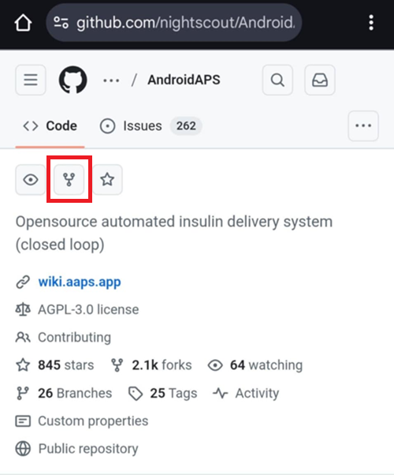
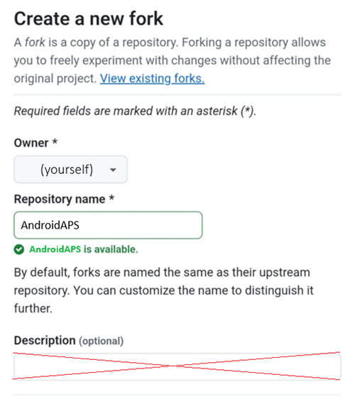
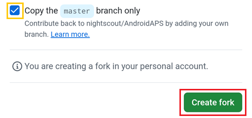
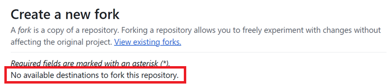
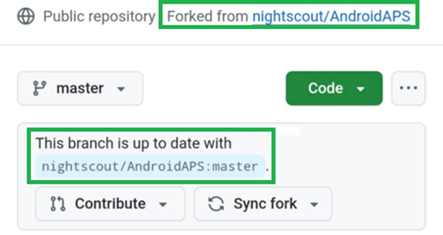

(github-fork)=

# Build i browseren – Trin 1: Opret din GitHub-fork

```{note}
Dette er **trin 1** i [Build i browseren](BrowserBuild.md).
```

Du skal gemme din personlige Android Java Key og dine Google Drive-oplysninger som secrets i GitHub (vi forklarer senere hvordan).

Da det ikke kan gøres i det offentlige repository for AndroidAPS, skal du lave din egen kopi af kildekoden (det kaldes en fork).

## GitHub-konto

Du skal [oprette en GitHub-konto](https://github.com/signup), hvis du ikke har en endnu.  
Du kan tilmelde dig med din e-mail, eller du kan tilmelde dig med Google. Følg trinene til registrering og bekræftelse.

Når du har en konto, så [log ind på GitHub](https://github.com/login).

## Lav en fork af AndroidAPS

Åbn det officielle AndroidAPS-repository via [dette link](https://github.com/nightscout/AndroidAPS).

Tryk på fork-ikonet. Det opretter en kopi i din egen konto.



Rul ned på den næste skærm, og tryk på **Create Fork**.



*Bemærk: Du kan **fravælge** »Copy the master branch only«, hvis du vil bygge udviklerversioner eller dine egne tilpasninger.*



```{note}
Kan du ikke lave en fork, og ser du dette?<br/><br/>
**`No available destinations to fork this repository.`**<br/><br/>
<br/><br/>
Det betyder, at du allerede har en fork af AndroidAPS.<br/>
Sørg for, at den er opdateret, og fortsæt med forberedelsestrinene.
```

```{warning}
**Slet aldrig din fork uden først at have lavet en sikkerhedskopi af dine secrets!**
```

GitHub viser nu din egen kopi af AndroidAPS. Lad denne fane i browseren være åben.



----

**Næste: [Trin 2 – Opret dit keystore til signering](BrowserBuildKeystore.md) →**
