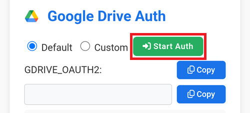
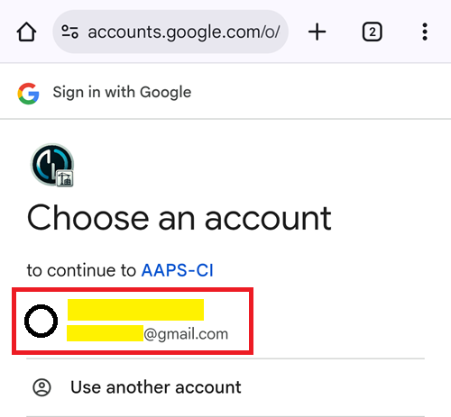
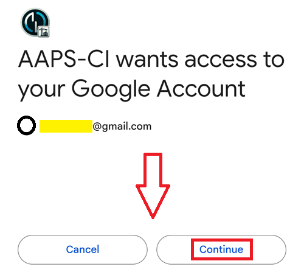
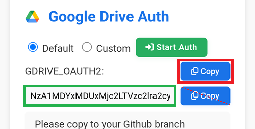
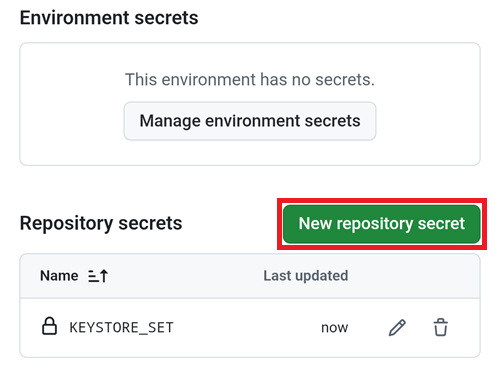
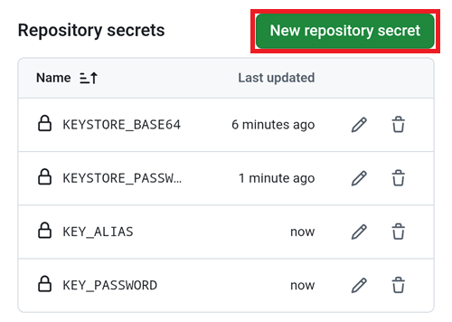
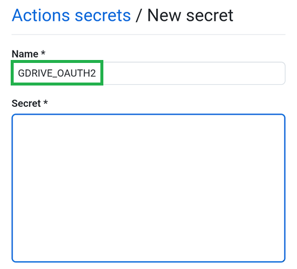
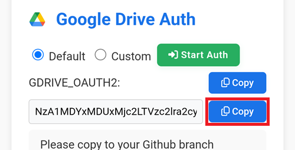
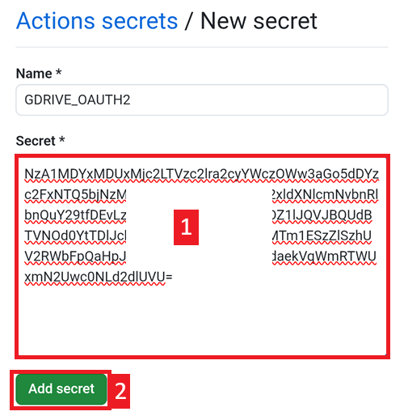
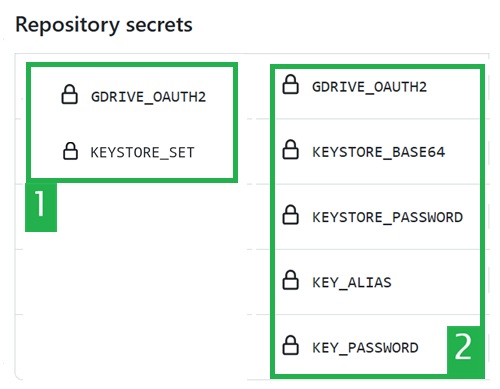

(aaps-ci-google-drive-auth)=

# Build i browseren – Trin 3: Giv adgang til Google Drive

```{note}
Dette er **trin 3** i [Build i browseren](BrowserBuild.md). Gennemfør først [Trin 2 – Opret dit keystore til signering](BrowserBuildKeystore.md).
```

```{warning}
Uanset hvilken af de forrige vejledninger du fulgte (Mulighed 1 eller Mulighed 2), SKAL du give adgang til Google Drive for at kunne bruge build i browseren.
```

Bemærk: Hvis du allerede har fulgt denne del i videoen, kan du nu springe til [Trin 4 – Byg APK'en](BrowserBuildAPK.md).

```{warning}
Hvis Google-godkendelsen ikke starter, eller forberedelsessiden fejler, så luk forberedelsessiden, åbn `aaps-ci-preparation.html` igen på samme måde som i trin 2, og start dette trin forfra. Se [fejlfinding](#aaps-ci-preparation-web).
```

Gå tilbage til fanen med forberedelsessiden.

Rul ned til afsnittet »Google Drive Auth«, og tryk på »Start Auth«.



Vælg din Google-konto.



Rul ned, og giv adgang. Websiden skal bruge den for at hente nøglen til Google Drive-godkendelse.

Tryk på »Continue«.



Feltet `GDRIVE_OAUTH2` bliver udfyldt. Tryk på den øverste knap »Copy«.



Skift tilbage til fanen med GitHub.

Rul ned til »Repository secrets«, og tryk på »New repository secret«.

Hvis du fulgte Mulighed 1, skal du se dette:



Hvis du fulgte Mulighed 2, er der flere nøgler:



Indsæt den tekst, du lige har kopieret, i feltet »Name«. Tryk længe på tekstfeltet for at få vist menuen til at indsætte.



Skift til fanen med forberedelsessiden.

Tryk på den anden knap »Copy«.



Skift tilbage til fanen med GitHub.

1. Indsæt den tekst, du lige har kopieret, i feltet »Secret«. Tryk længe på tekstfeltet for at få vist menuen til at indsætte.

2. Tryk på »Add secret«.



Du skal nu have enten to (mulighed 1) eller fem (mulighed 2) secrets.



Når APK'en er bygget, kan GitHub nu gemme AAPS-apk-filen i din Google Drive.

----

**Næste: [Trin 4 – Byg APK'en](BrowserBuildAPK.md) →**
