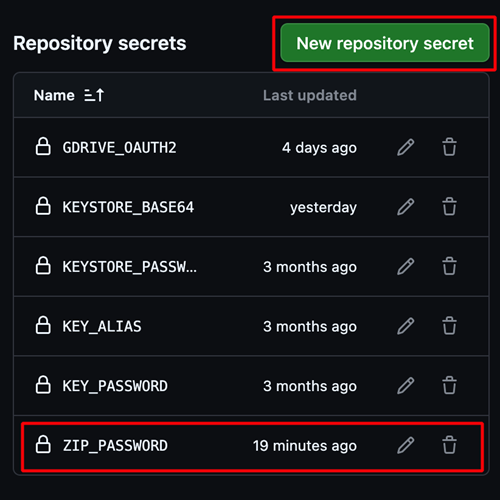
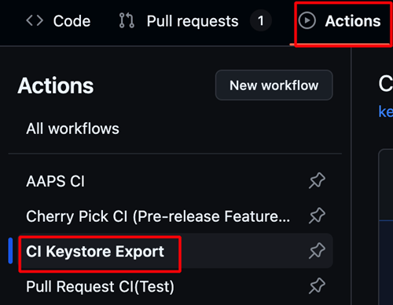
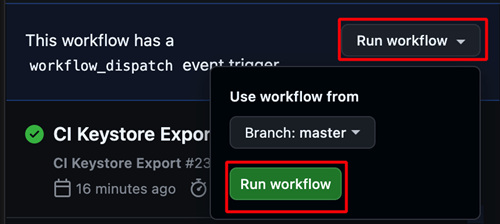

(aaps-ci-preparation)=

# Build i browseren – Trin 2: Opret dit keystore til signering

```{note}
Dette er **Trin 2** af [Build i browseren](BrowserBuild.md). Gennemfør først [Trin 1 – Opret din GitHub-fork](BrowserBuildFork.md).
```

AAPS skal signeres med private nøgler, som er gemt i et **Java KeyStore (JKS)**. Dette er den vigtigste beslutning i hele processen, fordi den afgør, om du senere kan **opgradere** AAPS uden at geninstallere.

```{note}
I de næste trin gemmer du private oplysninger (dit keystore og senere din adgang til Google Drive) i GitHub som **secrets**. En secret er bare en krypteret værdi, som kun dit eget build kan læse – ingen andre kan se den, heller ikke folk, der ser på din fork. Det er det, der sikrer, at dit build forbliver dit.
```

## Vælg, hvordan du vil lave dit keystore

Læs begge muligheder, og vælg den, der passer til din situation.

### Mulighed 1 – Opret et nyt keystore (nye brugere)

Vælg denne, hvis **bare én** af disse ting passer:

- Det er **første gang**, du bygger AAPS.
- Du har ikke et keystore fra et tidligere build med Android Studio (på computer).
- Du har glemt adgangskoden eller aliasset til dit keystore.

```{warning}
Når du bygger AAPS med **Mulighed 1**, oprettes et helt nyt keystore, så **du kan ikke opgradere din nuværende AAPS** direkte. For at skifte til dette nye build skal du eksportere dine indstillinger, afinstallere den gamle AAPS, installere den nye og importere dine indstillinger igen. Følg trinnene i [Geninstallation af AAPS med et nyt keystore](#reinstall-aaps).
```

**→ [Fortsæt med Mulighed 1 – Opret et nyt keystore](BrowserBuildO1.md)**

### Mulighed 2 – Upload dit eksisterende keystore (nuværende / tidligere brugere)

Vælg denne, hvis du **allerede har** det `.jks`-keystore, som du brugte til et tidligere build af AAPS på en computer i Android Studio, **og** du kender dets adgangskode og alias (som regel `key0`).

Så kan din nuværende AAPS stadig opgraderes: fremtidige opdateringer bruger det samme keystore.

**→ [Fortsæt med Mulighed 2 – Upload dit eksisterende keystore](BrowserBuildO2.md)**

----

```{note}
På næste side vælger du din enhed (computer eller iPhone). Hver side for en enhed viser dig derefter, hvordan du downloader og åbner forberedelsesfilen på den rigtige måde for den enhed, og hvordan du opretter dit keystore. Den byggede AAPS-app bliver gemt i dit Google Drive.
```

**Næste trin: vælg [Mulighed 1](BrowserBuildO1.md) eller [Mulighed 2](BrowserBuildO2.md) ovenfor, og følg så siden for din enhed.**

----

(ci-keystore-export)=

## Eksporter dit keystore (valgfrit)

Brug denne metode, hvis du vil eksportere dit gemte keystore.

Dette script eksporterer de keystore-oplysninger, som du tidligere har sat op (med Mulighed 1 eller Mulighed 2), som en ZIP-fil med adgangskode til mappen `/AAPS/KeyStore` i dit Google Drive.

```{warning}
Før du bruger denne eksportmetode, skal du sikre dig, at indstillingerne for dit keystore og Google Drive er færdige.
```

### Trin:

1. **Tilføj en secret med ZIP-adgangskoden:**
   - Gå til **Settings** → **Secrets and variables** → **Actions** i dit repository
   - Klik på **New repository secret**
   - Skriv i feltet **Name**: `ZIP_PASSWORD`
   - Skriv i feltet **Secret** din egen adgangskode til krypteringen af ZIP-filen
   - Brug kun engelske bogstaver og tal i adgangskoden (ingen specialtegn)
   - Klik på **Add secret**

   

2. **Kør eksport-workflowet:**
   - Gå til fanen **Actions** i dit repository
   - Vælg **CI Keystore Export**
   - Klik på **Run workflow**
   - ZIP-filen med det eksporterede keystore bliver gemt i dit Google Drive

   

   

```{toctree}
:hidden:

Mulighed 1 – Opret et nyt keystore <BrowserBuildO1.md>
Mulighed 2 – Upload dit eksisterende keystore <BrowserBuildO2.md>
```
